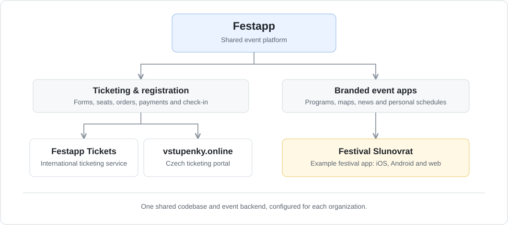
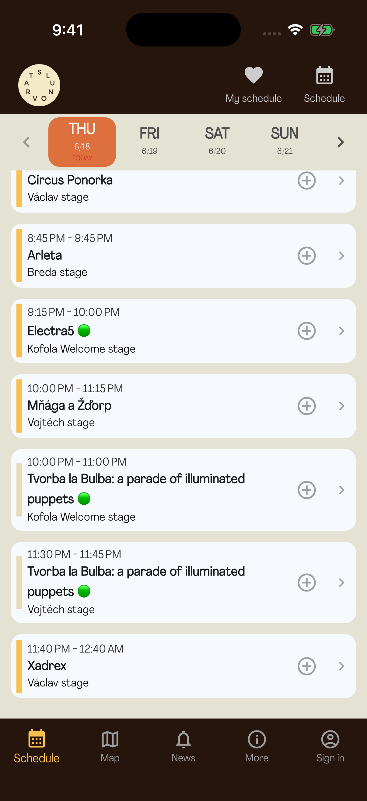
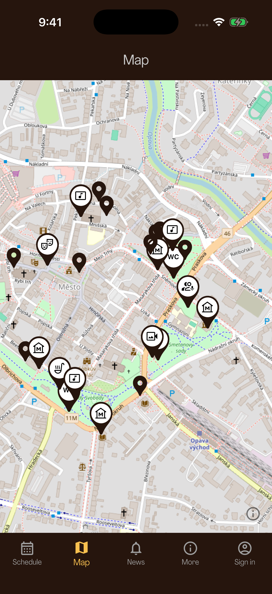
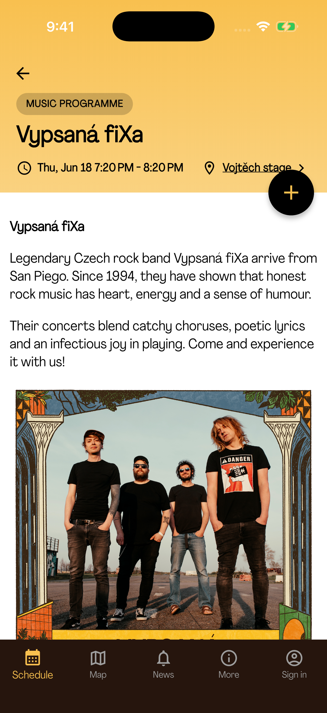
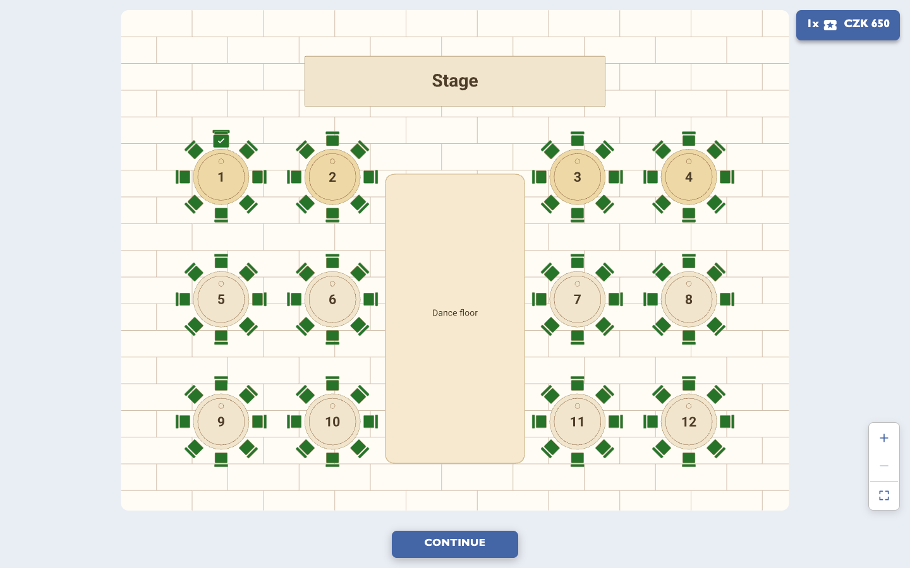
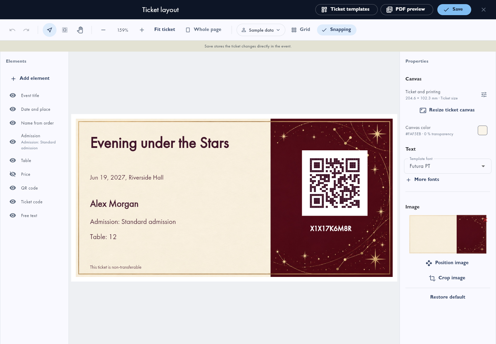
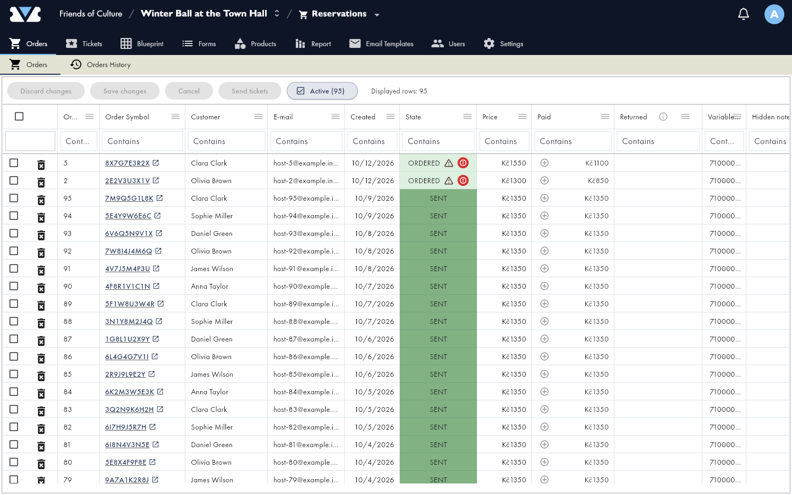

# Festapp

Festapp is an event platform for festivals, conferences and community
events. Attendees browse programs, explore venue maps and save their personal
schedule on iOS, Android and the web. Organizers manage registration, tickets,
reserved seating, payments and admission.

The same platform powers branded festival apps such as **Festival Slunovrat**,
the international **Festapp Tickets** service and the Czech **vstupenky.online**
portal.

[Festapp](https://festapp.net/) ·
[Festapp Tickets](https://tickets.festapp.net/) ·
[vstupenky.online](https://vstupenky.online/) ·
[Developer setup](docs/setup/howto.md) ·
[Contributing](CONTRIBUTING.md)

## One platform, connected products



The products share the same application and event backend. Each organization
configures its branding and features; a festival app and a ticketing portal are
different experiences built on Festapp.

## The event app

Festapp also gives attendees schedules, venue maps, news, workshop sign-ups
and a personal program on Android, iOS and the web. Organizers choose which
features each event needs, including information pages, songbooks and group games.

### Slunovrat 2026: the summer festival

For the summer Slunovrat festival in Opava (June 18-21, 2026), visitors can follow
the program, find venues on the map and explore artist profiles.

<table>
  <tr>
    <th align="center">Festival program</th>
    <th align="center">Venue map</th>
    <th align="center">Artist details</th>
  </tr>
  <tr>
    <td align="center"></td>
    <td align="center"></td>
    <td align="center"></td>
  </tr>
</table>

Previously downloaded event information remains available offline. Sign-in and
ticket purchases need an internet connection. Events can also include offline
venue maps. See the [feature reference](docs/overview/features.md) for more.

## Ticketing for organizers

### Design your venue



Manage seating across the ground floor, boxes and balconies, with a clear view
of the stage and dance floor.

### Design your tickets



Create tickets with your own artwork, event details and seat information.
Each ticket includes a QR code for admission checks.

### Orders and payments



Track orders and payments from the event administration.

- **Ticket sales and registration.** Build public forms with ticket types,
  prices, capacity limits and attendee questions; share a link or embed a form
  on your website.
- **Reserved seating.** Design your venue layout and let buyers select seats
  when purchasing tickets.
- **Orders and payments.** Manage orders, track payments and match bank transfers.
  Online payment options depend on the event's configured provider.
- **Tickets and admission.** Customize PDF tickets, deliver them by email and
  verify QR codes with the browser scanner.
- **Event operations.** Coordinate volunteers, participant groups,
  accommodation and reception, with event-specific branding and permissions.

The same platform powers [vstupenky.online](https://vstupenky.online/), its
regional ticketing and registration portal. Website plugins and connectors
live in the [integration directory](integrations/README.md), together with their
setup instructions and publication status.

## Start here

| I want to... | Read |
|---|---|
| Develop the app locally | [Developer and tenant setup](docs/setup/howto.md) |
| Run an isolated test database | [Local database development](docs/setup/local_development.md) |
| Prepare a backend server | [Server deployment](docs/setup/server_deployment.md) |
| Publish a tenant web release | [Cloudflare deployment](automation/cloudflare/README.md) |
| Configure Cloudflare services | [Cloudflare infrastructure](docs/setup/cloudflare.md) |
| Build or publish mobile apps | [Android](automation/release/android_play_release.md), [iOS](automation/release/ios_howto.md) |
| Change code and run checks | [Contributing](CONTRIBUTING.md) |
| Develop or publish a platform integration | [Integration directory and status](integrations/README.md) |

## How it fits together

Flutter handles the mobile app and web administration. A separate vanilla
JavaScript client handles public forms, checkout and the browser scanner.
PostgreSQL RPCs own business rules and permissions. Deno Edge Functions connect
those commands to email, ticket generation and external services.

Production uses self-hosted Supabase at `https://api.festapp.net`. Cloudflare
Pages hosts the combined web bundle; Workers and R2 provide image and sync
services. Server setup, application configuration and web publication are
separate steps.

| Path | Contents |
|---|---|
| `lib/` | Flutter application and feature modules |
| `packages/festapp_core/` | Portable Dart domain and sync contracts |
| `web_client/` | Public JavaScript client |
| `database/` | Canonical SQL functions, schema sources and tests |
| `supabase/` | Local baseline, forward migrations and Deno functions |
| `workers/` | Cloudflare image, sync and monitoring services |
| `automation/` | Configuration, builds, deployments and backend operations |
| `docs/` | Setup guides, architecture, runbooks and historical records |

Shared code lives on `main`. Production branches carry approved tenant overlays.
`automation/project.conf` supplies public configuration; `apply_config.sh`
generates the corresponding app and platform files. Private credentials stay
outside Git and browser assets. A tenant's activation document identifies its
live backend, organization and generation.

For details, use the [documentation map](docs/README.md),
[architecture context](docs/architecture/ai_context.md) and
[tenant overlay policy](docs/architecture/tenant_overlays.md).

## Local development

Install Git, Node.js, pnpm 11.24.0 and FVM. Use the Flutter version specified by
`FLUTTER_VERSION` in `automation/project.conf`. From the repository root:

```bash
fvm install
fvm flutter pub get
(cd packages/festapp_core && fvm dart pub get)
pnpm --dir web_client install --frozen-lockfile
```

Complete the [configuration and backend setup](docs/setup/howto.md) before
running against event data. Then choose a frontend:

```bash
fvm flutter run -d chrome
# Or, in another terminal:
pnpm --dir web_client run dev
```

For client checks, run `./automation/test_client.sh`. JavaScript checks use
`pnpm --dir web_client test`; SQL tests require the isolated local database.
The wider `test_all.sh` wrapper has environment-dependent skips and warning-only
lanes, so its exit status alone is not an all-suite pass. The exact commands and
limits are in [Contributing](CONTRIBUTING.md#1-testing-workflow).

## Project history

Festapp began with volunteers building an app for
[Absolventský Velehrad](https://absolventskyvelehrad.cz) in 2023.
[CHANGELOG.md](CHANGELOG.md) records development history. Updates are also
shared in the [Czech WhatsApp channel](https://whatsapp.com/channel/0029Vb64lj91CYoUWARKf80R).

JavaScript packages use pnpm 11.24.0 and their own frozen lockfiles. Run
`pnpm install --frozen-lockfile` in the package directory, then use `pnpm run`
or `pnpm exec`. See [Contributing](CONTRIBUTING.md) for the full workflow.
