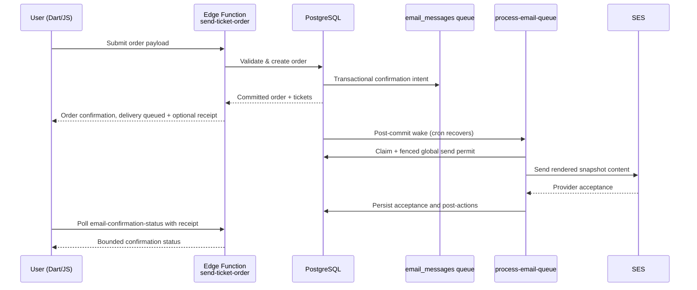
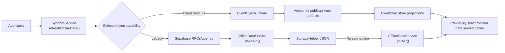

# Critical Data Services

> **Deep-dive into internal services** in `lib/data_services/`. Essential
> reading for understanding permissions, offline sync, and multi-tenancy.

This document complements **[ai_context.md](ai_context.md)** with implementation
details on critical services.

---

## RightsService

**Location**: `lib/data_services/rights_service.dart`

**Role**: Central singleton for permissions and multi-tenant context management.

### Key Responsibilities

1. **Context Management**:
   - Determines "Current Occasion" (`occasionLinkModel`)
   - Determines "Current Unit" (`currentUnit()`)
   - Manages navigation context

2. **Permissions**:
   - User rights checking (`isAdmin()`, `canEditOccasion()`, `canUpdateOrders()`, etc.)
   - RBAC (Role-Based Access Control)
   - Integration with PostgreSQL RLS

3. **State Management**:

   ```dart
   static OccasionLinkModel? occasionLinkModel  // Current occasion context
   static UnitModel? currentUnit()               // Current unit context
   static UserInfoModel? currentUser()           // Logged-in user
   ```

### Lifecycle

- Initialized at app startup (`main.dart`)
- Reset on logout or context change (occasion/unit switch)
- Interacts with `RouterService` for URL-based context

### Usage Patterns

```dart
// Check permissions (uses current occasion context automatically)
if (RightsService.isAdmin()) { ... }
if (RightsService.canEditOccasion()) { ... }

// Get current context
final unit = RightsService.currentUnit();
final occasion = RightsService.occasionLinkModel;
final user = RightsService.currentUser();
```

Check the active unit/occasion before displaying context-sensitive data.
`RightsService` controls UI availability; SQL/RLS and Edge authorization enforce
tenant isolation. A visible/hidden button or populated client context is not
server-side permission proof.

---

## OfflineDataService

**Location**: `lib/data_services/offline_data_service.dart`

**Role**: Offline cache and local storage management.

### Key Features

- Cross-platform key/value storage through `StorageHelper` (JSON)
- Client Sync v1 projections use the dedicated `ClientSyncStore`; do not bypass
  `ClientSyncRuntime` when that capability is selected
- Type-safe generic methods: `saveOffline<T>()`, `getOffline<T>()`, `getAllOffline<T>()`
- Domain-specific helpers: `saveAllEvents()`/`getAllEvents()`, `saveAllInfo()`/`getAllInfo()`, etc.

### Pattern

The legacy refresh explicitly fetches and caches data. With v1 selected,
domain accessors such as `getAllEvents()` read `ClientSyncStore` projections
instead of legacy JSON. The generic JSON storage helpers do not fetch remote
data or select a fallback backend. For the legacy cache:

```dart
// Save remote data to cache
await OfflineDataService.saveAllEvents(events);

// Read from cache when offline
final cached = await OfflineDataService.getAllEvents();
```

---

## SynchroService

**Location**: `lib/data_services/synchro_service.dart`

**Role**: Selects the active synchronization path. Client Sync v1 refreshes
versioned public/private projections; legacy tenants still use direct RPC/table
reads and populate `OfflineDataService`.

### Key Methods

- `refreshOfflineData()` — Refreshes `ClientSyncRuntime` and the offline search
  index when v1 is selected; otherwise fetches user info, events, activities,
  inventory, map data, information, speakers, cleaning status and news into the
  legacy cache
- `getAppConfig(LinkModel)` calls `loadAppConfigWithLegacyFallback`:
  `get_app_config_v219` first, then `get_app_config_v218` / `get_app_config_v2`
  only for the exact PostgREST missing-function error. `useLegacyContract` can
  select the legacy sequence directly. Authorization, network and server errors
  propagate instead of triggering fallback.

### Data Flow

```
SynchroService.refreshOfflineData()
  → ClientSyncRuntime (v1) OR Supabase RPCs/queries (legacy)
  → projection store / OfflineDataService
```

---

## Key Data Flows

**Order Creation Flow**:



**Offline Cache Flow**:



**For complete implementation details**, refer to:

- **Data Services**: `lib/data_services/` source code
- **SQL Functions**: `database/functions/user_permissions/`
- **RLS Policies**: `database/policies/`

---

Offline reads require previously populated stores; these flows do not promise
offline authentication, payments or server-confirmed writes. See the
[Client Sync runbook](../runbooks/client-sync-v1.md) and
[email queue guide](../setup/aws_ses.md) for operational boundaries.

**Last reviewed**: 2026-10-19
