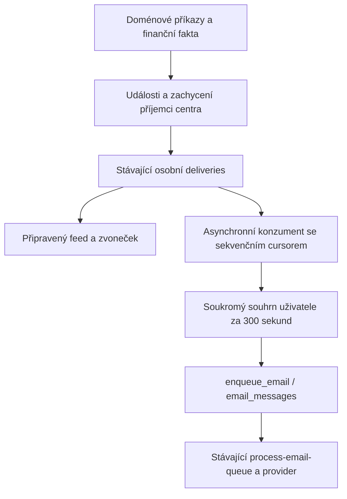

# Administrátorské e-maily ze společného notifikačního centra

Následné závazné upřesnění uživatele: provozní problémy bankovních účtů i platebních bran jsou povinné pro správce konkrétního účtu/připojení, nezávisle na volitelných souhrnech. Bankovní e-mail vyžaduje canonical `bank:<connection>` scope. `provider_problem` používá správce připojení spolku, společný registry operation `notification_connection_health`, doménová počítadla a stav Stripe/Barionu, jednu epizodu/recovery a původní recipient capture/prepared/email pipeline. Nepřidává poller ani sender. Implementační rozšíření a důkazy jsou v [RESULT](admin-notification-delivery-RESULT-2026-11-12.md#následné-zadání-povinné-provozní-problémy). Toto upřesnění má přednost před původními zmínkami o volitelném odběru bankovních problémů.

Datum: 2026-11-12  
Stav: lokálně implementováno a cíleně ověřeno; bez commitu, pushe a produkčního nasazení. Viz [výsledek](admin-notification-delivery-RESULT-2026-11-12.md).  
Ověřování implementace: standard - oprávnění, migrace, souběh a společná fronta.

## Výsledek a rozhodnutý rozsah

Jeden uživatel dostane jeden pětiminutový souhrn přihlášek, objednávek, plateb a problémů napříč vybranými akcemi a organizacemi. E-mail přehledně oddělí organizace a akce. Každá položka vychází ze stejné události a stejného zachyceného příjemce jako existující notifikační centrum. Stav přečtení centra zůstává nezávislý na doručení e-mailu.

První verze má pouze odběr zapnout/vypnout a pevné seskupování po 300 sekundách. Denní režim, nastavitelné intervaly, okamžité výjimky a OneSignal pro administrátory jsou odložené rozšíření. Nejsou potřeba pro vyžádané chování a nebudeme kvůli nim zavádět další časové plány, generační přepočty ani precedence režimů. Stávající push novinek zůstává samostatnou produktovou funkcí.

Nastavení zůstane ve stávajícím panelu centra. Uživatel volí kategorie a zdrojové organizace/akce. Volitelné kategorie vyžadují explicitní přihlášení. Podle následného zadání uživatele jsou bankovní e-maily povinné pouze pro aktuální administrátory konkrétního účtu podle kanonické bankovní write policy; čtenář objednávek ani samotný správce organizace nestačí. Bankovní e-mail nemá uživatelský přepínač a ignoruje globální stop volitelných souhrnů i mute akce. Aktivace tenantu, readiness, oprávnění a společný provider gate zůstávají povinné.

Nezavádět obecný detektor konfliktů. Použít existující emailové a bankovní incidenty a uložené konflikty platebního enginu. Odmítnutá rezervace nebo nezařazený bankovní pohyb samy o sobě nejsou novým incidentem. Nový problém musí mít konkrétního doménového vlastníka a definované recovery.

Plán vychází z pracovních canonical souborů, nikoli ověřené produkce. První průzkum: HEAD `742d614b7`, větev `docs/festapp-tickets-readme-20261107`; workspace obsahoval rozsáhlé nesouvisející změny. Implementátor vyjde z aktuálního main a zachová cizí práci. Původní revize autorizovala dokumenty. Následný execution prompt a uživatelské zadání autorizovaly lokální implementaci a ověření; commit, push a produkční operace zůstávají mimo rozsah.

## Doložené výchozí body

SQL cesty níže jsou relativní k `database/functions/`, Edge cesty k `supabase/functions/`.

| Fakt | Důkaz | Důsledek |
|---|---|---|
| Doména explicitně publikuje událost a zachytí oprávněné příjemce. | `notification_center/core.sql`: `notification_center_publish_internal`, `notification_center_capture_recipients_internal` | Nevytvářet druhý event log ani druhý výběr adresátů. |
| Projektor zapisuje osobní doručení se sekvencí pod zámkem uživatelského stavu. | `project_notification_center`, `notification_center/schema.sql`: `notification_center_user_state`, `notification_center_deliveries` | Sekvence je bezpečný vstup pro asynchronního konzumenta; timestamp ani globální max ID nejsou cursor. |
| Projektor má vlastní limity, souběh a retry; UI používá připravené views. | `core.sql`, `prepared_projection.sql`, `prepared_worker.sql`, `_shared/notificationDispatcher.ts` | Emailová agregace nesmí vstoupit do transakce feedu a blokovat ji. |
| Viditelnost, muting a relevance se mohou změnit. | `notification_center_allowed`, `notification_center_unmuted`, `center_policy.sql`, `subject_visibility.sql` | Znovu ověřit každou položku při přípravě a send permit. |
| Existující preference ukládají pouze umlčení akce. | `notification_center_preferences`, `prepared_views.sql`: `get_notification_center_settings` | Zachovat význam `muted`, přidat pouze emailové odběry. |
| Všechny aplikační e-maily musejí přes jednu frontu. | `emails/email_queue.sql`, `process-email-queue/index.ts` | Jediný provider sender, pause, quota, suppression, retry a unknown protokol. |
| Enqueue i reporting jsou tenantově orientované. | `enqueue_email`, `email_message_dedupe`, `emails/email_reporting.sql`: `get_email_delivery_page/detail` | Souhrn více tenantů musí mít soukromý recipient scope. |
| Běžné zprávy mají příjemcovský limit 20/den a ordinary/auth/commitment klasifikaci. | `abuse/seeds.sql`, `abuse/email.sql`, `abuse/schema.sql`, `begin_email_send` | Prosté použití ordinary třídy by pětiminutový režim zastavilo. Nutná omezená notification třída ve stejné frontě. |
| Bankovní upozornění mají dva vlastníky oznamování a dva health adaptéry. | `notification_center/bank.sql`, `_shared/notificationCenterHealth.ts`; `eshop_bank_sync/bank_sync_health.sql`, `_shared/bankSyncHealth.ts` | Před novým rozesíláním sjednotit source/readiness a odstranit `BANK_SYNC_WARNING` producer. |
| Bankovní doména už eviduje incident UUID a readiness. | `record_bank_sync_health`, `bank_sync_alert_ready`, `eshop.bank_sync_health` | Centrum pouze promítá autoritativní bankovní incident. |
| Přechod objednávky do paid nemusí znamenat přijetí peněz. | `eshop_orders/recalculate_order_payment_status.sql` | Platební událost odvodit z finančních faktů. |
| Existují stabilní identities finančních pohybů. | `eshop_transactions/apply_transaction_pairing.sql`; `eshop_stripe/schema.sql`: `stripe_payment_movements`; `eshop_barion/schema.sql`: `barion_movements`; `payment_providers/effects.sql` | Nevymýšlet další finance nebo identitu platby z webhook/recalc revize. |
| Nové order události již zachytí count a formContext. Prepared apply je používá a sahá do domény jen při legacy absenci; DTO zatím count dotazuje i při existujícím snapshotu. | `notification_center/orders.sql`: `notification_center_order_internal`; `prepared_projection.sql`: `notification_center_prepared_apply`; `shared.sql`: `notification_center_dto` | Sdílet příspěvek události a odstranit zbytečný DTO přepočet, nevytvořit emailovou kopii. |
| Prepared scope se vytváří až otevřením/čtením centra, skupiny závisejí na read receipts; contacts se hydratují živě. | `prepared_views.sql`: INSERT projection scopes, `notification_center_prepared_render/contact`; `prepared_worker.sql` | Mail nesmí vyžadovat otevřené UI ani přebírat počet celé unread skupiny do jiného pětiminutového okna. |

## Vlastnictví a malá rozhraní

Centrum vlastní události, recipient capture, tenantový feed a read receipts. Nový emailový modul vlastní jen odběr, cursor konzumenta, členství souhrnu, deadline a vazbu na queue message. Fronta vlastní kompletní životní cyklus zprávy a provider pokusů. Domény vlastní vznik/recovery incidentu a fakta o penězích. Žádná z těchto odpovědností se neopakuje v rendereru.

Rozhraní modulu:

- Stávající `get_notification_center_settings` doplní vlastní profil a odběry; jedno nové typed save RPC ukládá jen nastavení `auth.uid()` s očekávanou revision.
- Dvě service-only operace téhož modulu: `collect_notification_center_emails(p_limit)` spotřebuje nové deliveries a `enqueue_notification_center_emails(p_limit)` předá splatné souhrny původní queue. Každé HTTP RPC je samostatná transakce/commit; SQL funkce neprovádí skryté mezicommitnutí. Žádné RPC nepřijímá libovolný payload/příjemce/finanční částku z klienta.
- Soukromý SQL owner `notification_center_email_context_internal(dispatch_id, recipient)` vrací aktuálně oprávněný obsah a fingerprint. Použije jej příprava i validace send permit; renderer pouze escapuje a formátuje tento výsledek.
- Odesílání a callbacky používají výhradně stávající queue rozhraní. Interní pomocné funkce nejsou veřejná rozhraní, všechny granty explicitně zavřít.

Nové SECURITY DEFINER funkce mají `search_path=public,extensions`, živé typed permissions, odvozený scope a žádné přímé klientské granty na soukromé tabulky. Nezavádět obecný event bus, transport registry, druhou sadu authorization pravidel ani framework pro hypotetické kanály.

### Sdílení přípravy a výpočtů je povinné

Ochrana proti duplicitním zprávám sama nestačí. Email nesmí zavést druhý průchod doménou, který znovu připraví stejné počty, kontext, stav problému a oprávnění podle vlastní implementace. Před přidáním emailového rendereru provést tento malý refactor existujících vlastníků; není to nová paralelní notification pipeline.

| Co se připravuje | Jediný vlastník / reuse | Co mail nesmí dělat |
|---|---|---|
| Počet vstupenek/osob a form context události | Existující source snapshot `events.data.count/formContext`; společný `notification_center_event_facts_internal(e)` v `shared.sql` pro prepared apply, DTO i email context. | Nový COUNT DISTINCT nad order_product_ticket pro každý mail, recipient nebo validaci. |
| Legacy chybějící facts | Jedna podmíněná fallback větev uvnitř stejného facts helperu, pouze pro staré centrum. Nové emitované kinds mají kompletní potřebné snapshoty. | Druhý legacy lookup v DTO/rendererech nebo historický backfill kvůli emailu. |
| Relevance/storno/recovery/expirace | Vyčlenit společné recipient-independent pravidlo z `center_policy.sql` a `notification_center_prepared_policy`; oba stávající owners i mail je používají. Cached privacy prepared workeru a živé privacy readu zůstanou příslušné adaptéry. | Kopie CASE pro incident status, storno či membership v email_context. |
| Aktuální oprávnění | Existující `notification_center_prepared_allowed_scopes` pro explicitního recipienta + `notification_center_prepared_event_access`/typed authority. Scope vector materializovat jednou na `(organization,recipient)` v rámci SQL snapshotu a použít pro všechny items. | Nová role kombinace v mailu, auth.uid spoofing service role nebo opakovaný výběr všech rolí pro každou položku. |
| Aktuální display kontext a bezpečné odkazy | Použít/extrahovat společné části `notification_center_dto`, `notification_center_prepared_render/contact`; recipient-explicit interní helper, UI wrapper odvodí auth.uid. Mail odebírá jen potřebný minimální kontext, bez zákaznických kontaktních previews. | Zkopírovat DTO SQL do emailového hydrátoru nebo přidat vlastní kontaktový resolver. |
| Peníze a problémová epizoda | Existující finanční/bankovní doménový owner vydá stabilní fact/incident a potřebný immutable notification příspěvek. | Znovu sčítat finanční ledger, párovat platby nebo vyhodnocovat bankovní readiness při sestavování souhrnu. |
| Počty ve výstupu | UI používá své existující read/history skupiny; mail pouze SUM/COUNT již připravených příspěvků skutečně zařazených dedup items v jednom okně. | Převzít celý unread batch count jako pětiminutový count, nebo rekonstruovat všechny objednávky celé akce. |

Facts helper vrací malé hodnotové údaje bez nového cache úložiště a bez kontaktních PII. Přepojit na něj existující prepared apply a DTO, jejich původní count/context větve odstranit. V DTO zejména neponechat dnešní nepodmíněný count dotaz, který se vykoná i tehdy, když následně vyhraje captured count. Odstranit jen duplicity v právě dotčené cestě; nepřepisovat celý serving engine.

Email context je kompozice společných owners a emailového členství, ne nový vlastník business logiky. Zpracování dělat setově: stejné event facts v jednom statementu jednou, aktuální metadata jednou na distinct order/form/occasion a scope vektor jednou na organization/recipient. Žádné N+1 RPC/SQL z rendereru. DTO wrappery nesmějí znovu vyvolat drahý výpočet, který už předal jejich caller. Sdílené interní rozhraní musí umět explicitní recipient; veřejný klient si cizí UUID nevolí.

Existující view_members/summary hodnoty lze využít, jsou-li připravené a odpovídá source revision a rozsah. Nejsou ale podmínkou emailového doručení a nejsou novou autoritou. Nezakládat UI view token, nespouštět celý prepared backfill ani zapisovat read receipts kvůli mailu. Nevytvářet další tabulku s kopiemi prepared facts, nové projector joby nebo vlastní invalidation systém. Source snapshoty, existující revisions a společné helpery postačí.

Nutné opakované bezpečnostní ověření před send permit zůstává; jde o kontrolu aktuálnosti stejného připraveného obsahu. Znovu se kvůli ní nesestavuje doménový count, finanční součet nebo incident. Odlišné časové seskupení mailu a UI je oprávněná prezentační práce, nikoli druhý business výpočet.

## Datový kontrakt

Následující objekty jsou návrh, dosud neexistují.

| Objekt | Obsah a omezení | Vlastník |
|---|---|---|
| `notification_center_email_profiles` | PK `recipient` s FK na existující identitu; globální stop, locale, revision. Jeden řádek slouží i jako per-recipient pracovní zámek. | Osobní nastavení a serializace agregace; bez tenantového vlastníka. |
| `notification_center_email_subscriptions` | Recipient, organization, nullable occasion, validované per-kind on/off overrides a aktivační časy, revision. Jedinečnost `(recipient,organization,occasion)` s NULLS NOT DISTINCT. Occasion musí patřit uložené organizaci. | Jediný emailový odběr na daný scope. Organization řádek je default pro své akce, konkrétní occasion jej přepíše. |
| Stávající `notification_center_user_state` | Přidat `email_scanned_sequence`, default 0 a invariant `0 <= email_scanned_sequence <= last_delivery_sequence`; partial index na dosud nepřečtenou sekvenční práci. | Cursor konzumenta existujících deliveries, bez nové kopie událostí. |
| `notification_center_email_items` | PK `(recipient,delivery_key)`, admission čas/epoch, dispatch ID nebo terminal disposition. `delivery_key` je `event:<event UUID>`, u sdíleného bankovního incidentu `bank:<connection>:incident:<incident UUID>`. | Jediné externí upozornění na daný fakt pro příjemce, i když má několik tenantových projekcí. Žádné kontakty, peněžní součty nebo provider retry. |
| `notification_center_email_item_sources` | PK `(event_id,recipient)`, FK na item téhož příjemce, zachyceného recipienta a konkrétní osobní delivery; source organization, první sequence a activation důkaz. | Pouze normalizovaná vazba existující tenantové události na společný item. Nekopíruje událost ani její payload. |
| `notification_center_email_dispatches` | UUID, recipient, opened_at, due_at, `collecting/queued/omitted`, jedinečný queue message ID. Partial unique index: nejvýše jedna collecting obálka příjemce. | Soukromá obálka souhrnu. `queued` značí pouze předání queue, ne doručení. |

Datum narození, identita účtu ani e-mail se nekopírují do nové identity tabulky. Agregační klíč je canonical recipient UUID. `get_user_delivery_email` již tento UUID přijímá; `user_info.id` odkazuje na `auth.users.id`. Oddělené účty se stejným e-mailem neslučovat. Pokud produkce pro jednoho člověka používá oddělené tenantové identity, společný souhrn vyžaduje již existující ověřenou identity vazbu; její vytvoření není součástí této funkce.

Stávající `notification_center_preferences.muted` zůstane jediným umlčením akce a volitelného externího odběru. Povinný bankovní e-mail pro administrátora účtu se jím nevypíná. Nepřidávat do této tabulky druhou kopii emailových overrides. Efektivní rozhodnutí vlastní jeden SQL resolver: globální stop -> organization/occasion subscription -> muted -> povolený kind -> aktivační hranice -> aktuální oprávnění. Neznámý kind je off. Čtyři kategorie UI jsou `problems/registrations/orders/payments`; mapování konkrétních kind vlastní jeden serverový katalog. Povinný `bank_problem` není editovatelný kind; self-save odmítá jeho true i false. Server dodává `requiredKinds` a UI jej zobrazuje pouze pro čtení. Smíšená volitelná kategorie má třístavový checkbox.

Bankovní událost bez occasion zohlední jen oprávněné zdrojové scope. Emailový příjemce musí mít kanonický scope `bank:<connection>`; `bank-occasion:<occasion>` pro čtenáře objednávek nestačí. Událost se zařadí nejvýše jednou v rámci tenantové projekce. Tentýž doménový bankovní incident promítnutý do více organizací má jediný recipient item i napříč různými souhrny, nejen jednu prezentační položku v jednom HTML. Nový source se připojí k existujícímu itemu; queued/již zpracovaný item se znovu neotevírá. Oprávněné odkazy se hydratují ze source vazeb, všechny event IDs zůstanou dohledatelné. Bankovní adaptér uloží ověřenou doménovou incident identity do události. Klíč neodvozovat z reason, emailu, názvu, timestampu nebo attention revision. Doménová incident identity není druhý event log.

RLS a odebrání přímých grantů jako u centra; přístup výhradně přes úzké RPC. Smazání tenantu odstraní jeho subscriptions/source vazby, nikoli osobní profil, sdílený dedup item nebo obálku s daty jiného tenantu. Item bez živého oprávněného source nemá odesílatelný obsah; jeho dedup klíč zůstane po potřebnou dobu zachován. Smazání účtu odstraní osobní odběr/scheduling, provider audit se řídí existující queue retention. FK nikdy neblokuje smazání business objednávky. Smazaná událost zneplatní svou source vazbu a fingerprint. Queue message reference na recipient/dispatch nesmí vytvořit blokující FK cyklus při smazání účtu; neodeslané zprávy zneplatní jejich owner a auditní UUID zůstanou pouze podle existující queue retention.

### Pojistky proti duplicitám

| Vrstva | Jediná identita / databázová pojistka | Zakázané opakování |
|---|---|---|
| Doménová událost | Stávající UNIQUE `(organization,source_key)`; nové payment keys používají uloženou fact identity. | Nový event kvůli replay webhooku, recalculation nebo rendereru. |
| Zdroj doručení | PK source vazby `(event_id,recipient)` a existující delivery sequence. | Tentýž source z více collect průchodů nebo attention revisions. |
| Externí item | PK `(recipient,delivery_key)`, deterministický klíč z doménové identity. | Tentýž incident ze dvou organizací nebo různých pětiminutových oken. |
| Členství v souhrnu | Jedno nullable dispatch ID itemu; composite FK `(dispatch_id,recipient)` do obálky stejného příjemce. | Zařazení itemu do dvou obálek, přesun queued/terminal itemu do nové obálky. |
| Otevřený souhrn | Partial UNIQUE recipient pro collecting. | Dvě souběžně vytvořená okna pro stejného uživatele. |
| Předaný souhrn | Recipient-scope UNIQUE queue dedupe key a UNIQUE message ID v dispatchi; enqueue/link v jednom commitu. | Dvě queue zprávy pro jeden dispatch po timeoutu nebo crash. |
| Aktivní zpráva | Partial UNIQUE `email_messages(recipient_user)` pouze pro admin digest v `blocked/pending/preparing/sending/retry_wait/unknown`. | Dvě neuzavřené admin zprávy téhož příjemce při souběhu workerů. |
| Provider | Stávající attempt/lease/send permit a unknown reconciliation. | Nový záměr jako náhrada neurčitého výsledku. |

Source vazba i composite FK musí potvrdit stejného recipienta a původní tenant scope; neprovádět jen aplikační kontrolu. Item klíč neobsahuje organization u faktů sdílených napříč tenanty. Nezavádět univerzální fingerprint obsahu, další dedup registry nebo kopii seznamu příjemců. Omezení identity a tyto unikátní indexy jsou součástí canonical schema, nikoli pouze podmínky IF NOT EXISTS v kódu.

## Asynchronní načítání a pětiminutové okno

Do `project_notification_center` nevkládat emailové helpery, profile zámky ani enqueue. Stávající deliveries jsou durable vstup; nehrozí mezera mezi zápisem feedu a emitováním dalšího outboxu, protože žádný druhý emit neexistuje.

Konzument vybere recipient se sekvenční prací přes index, získá profil `FOR UPDATE SKIP LOCKED` a čte jeho scope stavy v pevném pořadí se stejným bounded SKIP LOCKED chováním. Profil vznikne při vlastním save, bankovní migraci nebo zachyceném povinném doručení. Automatický profil má stopped=true a nevytváří volitelné odběry; jeho vznik serializuje sdílený advisory lock, collector používá try-lock. Aktuální kanonický scope rozhodne, zda smí bankovní e-mail skutečně přijmout. Zachytí committed `last_delivery_sequence` pro každý `(organization,recipient)`. V omezeném batchi načte `cursor < sequence <= captured_bound`. Každou událost podle resolveru zařadí nebo vědomě přeskočí a ve stejné transakci posune cursor po poslední zpracovanou sequence. Nezpůsobilá/skrytá/smazaná položka není důvod zablokovat celý scope. Sekvenční mezery nejsou nové události; cursor může přes ně poskočit, avšak nikdy přes skutečný dosud nezpracovaný row v captured bound.

Žádný watermark z `occurred_at`, auto-increment ID, view/read watermarku nebo aktuálního maxima napříč organizacemi. Concurrent delivery se sekvencí nad captured bound patří do dalšího průchodu. Crash rollbackne přidání source vazeb/items i cursor. Source PK potlačí attention revision, item PK navíc druhou tenantovou projekci stejného incidentu. Cursor commit a zařazení items skončí před samostatným enqueue RPC; zdrojové user_state zámky se nikdy nedrží během práce s queue nebo jejími budgets. Omezený počet scopes/rows a rotující cursor ve stávající worker maintenance zajišťují fairness, nejen globální LIMIT od nejnižšího tenant ID.

Schema expanze přidá cursor s defaultem 0. Teprve explicitní první aktivace vybrané organizace pod jejím existujícím activation zámkem nastaví její stávající cursory na current last sequence a uloží `email_collection_started_at` do `notification_center_organizations`. Toto pole je trvalá tenantová aktivační hranice, nikoli druhá fronta. Opakované zapnutí cursor znovu neinicializuje. Neaktivované tenanty nebackfillovat a jejich osobní stavy neměnit. Při zapnutí odběru používat i serverové `enabled_from`; stará událost opožděně promítnutá po aktivaci nesmí spustit historický replay. Nové scope stavy s cursorem 0 se načtou normálně, ale jen skutečně nové a povolené události projdou activation policy. Opt-out nevymaže cursor ani item a opětovné zapnutí je nepřehraje. Worker smí cursor posouvat i při off; není potřeba zpětný scan.

První admission item otevře okno `[opened_at,opened_at+300 sekund)`. Další item v tomto intervalu použije tutéž obálku bez ohledu na organizaci, akci a kind. `due_at` se nepřepisuje. Použít DB clock, nikoli timestamp klienta; původní čas události se uchová pro zobrazení. Opožděná projekce dostane nové admission zařazení, nikoli ztrátu události.

Zjednodušení při opožděném workeru: dokud collecting obálka nebyla uzavřena, může po deadlinu absorbovat další zjištěné items jako jeden catch-up souhrn, ale původní deadline zůstává splatný. Nečeká se dalších 300 sekund. Jakmile worker dostupný souhrn uzavře, nové items otevřou další okno. Nejde o opakovaně prodlužovaný debounce. Při velkém backlogu jeden průchod nejdřív zpracuje omezený recipient batch, další zjištěné položky může přidat do téže collecting obálky; neexistuje merge obálek ani druhá kolekce oken; nevytvářet nekonečnou podmínku „odeslat až po vyprázdnění všech budoucích událostí“.

V normálním provozu nic neodeslat před `due_at`, po něm co nejdříve ve stávající queue. Příslib je pětiminutové seskupování, ne garance provider doručení na sekundu. Prázdné souhrny nevytvářet. Pokud předchozí obálka už má aktivní queue zprávu blocked/pending/preparing/sending/retry/unknown, nevytvářet další queue zprávu téhož příjemce: nový splatný collecting souhrn vyčká a průběžně absorbuje backlog. Po terminal výsledku předchozího záměru lze předat další. Unknown se nevydává za neodesláno a nikdy se nenahrazuje novým záměrem.

Uzavření souhrnu, `enqueue_email` a uložení message ID jsou jeden SQL commit pod recipient lockem. Stabilní dedupe je `notification:<dispatch UUID>`, vstupní payload pouze dispatch ID a template verze. Živé názvy, counts a čas běhu nejsou součástí dedupe hash. Enqueue quota selhání rollbackne pouze tento batch; collecting obálka a durable deliveries zůstanou k pozdějšímu zpracování. Limit lze odložit bounded next-at ve stávající maintenance, bez vlastního provider retry protokolu.

Tím jsou odděleny tři stavy: doménová událost, zařazení do souhrnu, provider doručení. Email items jsou membership journal, nikoli druhá e-mailová fronta. Stav accepted/delivered/bounced se do nich nezrcadlí; čte se z propojené queue.

## Rozšíření jediné e-mailové fronty

### Soukromý recipient scope

Použít jeden konkrétní `message_kind=admin_notification_digest`. Pouze tento druh smí mít `organization=NULL`, povinný `recipient_user`, NULL occasion/unit/order a existující soukromý dispatch stejného příjemce. Rozšířit canonical table kontrakt, enqueue whitelist a TypeScript registry. CHECK musí uzavřít výjimku na tento druh; ostatní kinds dál vyžadují dosavadní tenant scope.

Tenantový unique index zachovat; přidat partial unique `(recipient_user,message_kind,dedupe_key)` pro admin digest a odpovídající přesnou ON CONFLICT/replay větev. Samotné přidání nullable organization nestačí: současný ON CONFLICT přes tenantový index by NULL duplicitám nezabránil. Hash replay pod správným scope musí selhat při jiném vstupu a vrátit stejnou message ID při stejném.

Žádný umělý tenant, první organization coby vlastník souhrnu ani další provider sender. Systémový sender/branding a locale příjemce; tenantové šablony/sender nesmějí měnit společnou zprávu. Neodesílat tenant SES tag s hodnotou `null` nebo seznamem dalších organizací. Engagement tracking disabled.

Celý souhrn, provider pokusy a adresát nejsou dostupné tenant adminovi. `get_email_delivery_page/detail`, exporty a health/incident adaptéry nesmějí obejít recipient scope. Tenantové reporty admin digest úplně vynechají; první verze nepřidává částečný tenantový reporting této soukromé zprávy. Vlastník uvidí ve vlastním panelu poslední stav/selhání přes úzké self RPC, nikoli veřejný payload endpoint. Privilegovaná systémová diagnostika zůstává pod existujícími oprávněními.

### Limity a příprava

V existující `email_messages.admission_class` přidat `notification`. Pouze serverově ověřený admin digest navázaný na skutečný dispatch ji smí získat; nelze ji přijmout z klientského priority/context parametru. Ordinary, auth a commitment pravidla se nemění. Priorita notification je nižší než auth, commitment, potvrzení objednávky a vstupenky.

Konkrétní místa: `abuse/email.sql` (`email_admission_class_v1`, `admit_email_intent_v1`), `abuse/schema.sql`, `abuse/seeds.sql`, `abuse/policy.sql` (`abuse_effective_rules_v1` kontroluje přesný počet pravidel), queue prepare a `begin_email_send`. Notification používá stejné `abuse_charge_v1`, globální payload limit a SES capacity/rate/pause/circuit. Její recipient/global scopes nesmí vytvořit NULL advisory klíč nebo fiktivní organization; `abuse_charge_v1` chybějící scope odmítá jako `abuse_scope_missing`.

Doplnit explicitní notification enqueue/preparation/backlog/send rozpočty přes tentýž abuse backend. Příjemcovský limit dovolí pětiminutový provoz: výchozí send/intent limit 288 za rolling 24 hodin, burst 2 za minutu; privileged hard cap může být vyšší, ale příjemce jej neovládá. Global notification budget je omezený a nekonkuruje rezervovaným auth/commitment třídám. Backlog count/bytes vypočítat pro recipient-scope zprávy, ne dotazem `organization=NULL`. Konkrétní globální limit odvodit před aktivací ze stávající account capacity, uložit do stejné policy a bez úplné policy fail closed. Neměnit tenantové rozpočty kvůli tomuto soukromému systémovému mailu a neúčtovat jeden send každému zdrojovému tenantu.

Příprava načítá obsah přes SQL owner pro dispatch a recipient, mimo mutující read RPC centra. Renderer jen formátuje. Obsah/counters po organizacích, akcích a druzích; částky navíc po měnách, žádný společný účetní součet. Omezit detailní řádky a velikost HTML, nadbytek zobrazit počtem a autorizovaným odkazem. Jedna velká aktivita nezpůsobí další zprávy. Neoznačovat počet event rows jako počet osob.

### Send permit, změny práv a adresy

Při přípravě uložit fingerprint přesných autorizovaných items, aktuálního bezpečného obsahu, emailové subscription revision, locale a doručovací adresy. Při `begin_email_send` znovu použít tentýž context owner. Pokud se obsah změnil, odmítnout starý prepared snapshot a vrátit stejný záměr do přípravy přes existující queue protokol. Neplatné items z A vyřadit, B zachovat; prázdnou obálku zrušit. Ztráta příslušného oprávnění se musí projevit i v předmětu, počtech a odkazech, ne jen v HTML řádku.

Autorizační linearizační bod je finální SQL statement, který rozhodne o send permit nad konzistentním snapshotem live dat. Revokace/opt-out commitnuté před tímto statementem musí být zohledněny. Souběžná změna po jeho snapshotu je až po tomto rozhodnutí a již udělený permit se nedá odvolat. Tím nevyžadujeme zavést nové globální authorization fences do všech role writerů. Recipient settings/dispatch stav serializovat existujícím profile lockem; v queue cestě jej získat před email_capacity/attempt/message zámky, aby enqueue a send neobracely pořadí. Source permissions číst ve stejném finálním SQL snapshotu, nezamykat celý seznam tenantů. Finální context/fingerprint kontrolu a přechod queue message/attempt do sending vykonat v jednom SQL statementu; nestačí dva PL/pgSQL příkazy s různými READ COMMITTED snapshoty. Stávající capacity/admission kroky musí ve stejné transakci rollbacknout nebo explicitně defernout bez spotřebovaného sendu, pokud se finální snapshot neshoduje.

U všech dotčených queue funkcí napsat jednotný lock pořádek a concurrency test: profile -> případný source cursor -> dispatch -> stávající queue locks v jejich původním pořadí. Projektor profil nikdy nezamyká. UI save nesmí při držení profilu volat queue cancel/message mutation; uloží preference a změna se projeví finální validací.

Adresa queue zprávy je po enqueue součást immutable identity/hash. Odebírat ji přes `get_user_delivery_email` při enqueue. Změna adresy před send permit zruší starý záměr s důvodem destination_changed; nevytváří náhradní zprávu a nepřepisuje dedupe hash. Další nové události použijí novou adresu, původní zůstávají ve feedu. Chybějící adresa před enqueue ponechá collecting souhrn čekající, v nastavení zobrazí důvod; nepokoušet se periodicky generovat nové zprávy.

`notification_center_email_internal` musí admin digest rozpoznat před tenantovým advisory lockem a nevytvářet další email_problem. Recipient-scope selhání je viditelné v soukromém stavu a systémových metrikách. Pro ostatní zprávy se běžný incident flow nemění. Nezavádět upozornění na selhání upozornění.

## Doménové zdroje: přihlášky, platby a problémy

Přihlášky čerpat z existujících `occasion_joined`, `waitlist_registered` a relevantních order/form událostí podle skutečného významu. Katalog každé události přidělí jednu kategorii pro odběr; stejný event se nepřijme dvakrát přes registrations a orders. Skrytý účastník zůstane pod současnými visibility pravidly. Summary používá stejné count authority jako centrum a jasně odlišuje osoby, vstupenky, objednávky a změny.

`order_payment_received` vznikne při skutečném doloženém příjmu přiřazeném objednávce. Banka/hotovost: explicitní `apply_transaction_pairing` po pozitivní transakci. Provider: uložený pohyb kind payment po ověřené observation, přes owner `apply_provider_payment_effects_internal`; použít existující provider registry rozšířené o úzké získání notification fact identities, bez nového switch v generickém enginu.

Identita banky je existující transakce, identita provideru jeho connection/provider movement/kind. Source key obsahuje namespace, fact identity a objednávku. Opakovaný callback, recalculation nebo odpojení a připojení ke stejné objednávce nevytváří nový příjem. Skutečný doplatek má vlastní movement. Přepárování zneplatní starý event pro budoucí doručení a nový označí jako přiřazení již přijaté platby. Reprice, free order, ruční paid, autorizace karty a refund nejsou přijetí peněz.

Rozšířit vlastníky center klasifikace včetně obou overload `notification_center_order_activity_internal`, scope/prepared projekce, DTO, presenteru, lokalizace a existujícího order detail routing. Nový source musí fungovat i bez aktivovaného e-mailu; žádný email-only event typ schovaný před centrem.

`payment_problem` promítá uložené action_required/conflict z existujícího payment enginu a recovery stejného owneru. Pokud je dnes konflikt jen lokální proměnná, doplnit stabilní epizodu do autoritativní payment domény; transport jej sám nedopočítává. Bank a email mají existující incident identity. Běžná změna reason/attention_revision nevede k druhému upozornění na tutéž epizodu. Neodeslaný opravený incident odpadne; opakované připomínání není součást první verze.

## Bankovní cutover bez duplicit

1. Jediná bankovní source/readiness authority je `eshop.bank_sync_health`, `record_bank_sync_health`, `bank_sync_alert_ready`. `_shared/bankSyncHealth.ts` zůstane jediným pozorovatelem pro tuto funkci a pokrývá API i email mode. Neměnit definice výpadku ani zavádět druhý timeout v centru.
2. Interní adaptér publikuje `bank:<connection>:incident:<incident UUID>` v každé dotčené organizaci a stejné recovery. Bezpečné reason mapování je zde, ne ve dvou pollerech. Callers dohledat scoped přes `record_bank_sync_pull/health`, suspend/disconnect a alias změny; explicitně připojit doménový helper ve všech těchto hranicích.
3. Příjemce zachytí centrum podle stávajících oprávnění, včetně dual-role bank-admin pravidla a oprávněných order readers dotčené akce. Povinné e-maily dostávají pouze administrátoři účtu podle stejného bankového scope. Migrace nezakládá bankovní subscriptions ani nezapíná volitelné kategorie; původní adresáti zůstávají zahrnuti pro historické dedup tombstones, nikoli jako oprávnění k novému sendu. Rozdíl proti starému volnějšímu mailing seznamu zaznamenat počtem, ne exportem osobních údajů.
4. Existující aktivní center události mapovat na doménové incident ID jednorázově; zachovat přečtení a baseline. Nejednoznačný mapping nepárovat podle textu/časové podobnosti: starou projekci bezpečně uzavřít jako baseline a začít od dalšího doménově potvrzeného incidentu. Historický incident se kvůli cutover neposílá.
5. Odstranit producer `enqueue_bank_sync_health_alerts` a jeho volání z monitoru. Odstranit `_shared/notificationCenterHealth.ts`, claim/complete RPC, tabulku `notification_center_bank_health` a druhé fetch volání v maintain entrypointu. Zachovat obecnou údržbu centra, bankovní fakta a autoritativní monitor.
6. Před aktivací nového bankovního email odběru vypořádat staré `BANK_SYNC_WARNING` pending/preparing/retry/unknown/sending. Nezahájené zprávy zrušit jako baseline; accepted a unknown identity adoptovat jako již řešené, ne automaticky přeodeslat novým druhem. In-flight lease a unknown řešit původní queue reconciliation s audit důkazem. Nezaměnit unknown za potvrzené doručení.
7. Legacy renderer/validátor dočasně existuje jen pro identifikované neuzavřené legacy zprávy, bez produceru. Kontrakce je odstraní po nulovém legacy gate; do té doby se celý cutover neoznačí za dokončený. Accepted historické zprávy si ponechají audit a připravený obsah.

## Retention, výkonnost a obnova

Databáze už maže staré center deliveries/events po 90 dnech (`notification_center/maintenance.sql`). Email konzument nesmí kvůli své chybě tuto doménovou retention zastavit. Běžná aktivita připouští catch-up nejvýše 24 hodin od původní události; starší aktivitu po dlouhém výpadku vědomě přeskočí s metrikou a posune cursor. Stále aktivní, dosud neoznámené incidenty tento věkový limit nemají: rozhoduje aktuální relevance původního owneru a odběr aktivní před jejich vznikem. Již oznámený nebo vyřešený incident se znovu neposílá. Feed a původní audit zůstávají svými pravidly. Žádná historická záplava po obnovení měsíce vypnutého workeru.

Items se nepurgí, dokud jejich doménový incident zůstává aktivní nebo související queue záměr neuzavřený/unknown, ani když se odstranily všechny aktuální tenantové source vazby. Jinak lze uzavřený membership journal po 90 dnech odstranit společně s relevantním center history, nikoli však vymazat queue audit. Pozdější přidání dalšího tenantu ke stále stejnému incidentu nesmí po vyčištění source vazeb znovu upozornit. Prázdné collecting obálky se vyčistí, queued obálka s retained message zůstane dohledatelná. Smazání source mění fingerprint a invaliduje jen jeho příspěvek k obsahu.

Rozšířit existující `process-notification-center` o dvě oddělená collect/enqueue RPC volání; každé má svůj omezený commit. Selhání fáze má vlastní metriky a neukončí feed/view fáze. `wake_notification_center` testuje přes index sekvenční práci pouze v aktivovaných organizacích a pro existující emailové profily, spolu s nejbližšími splatnými collecting obálkami; žádné nové nezávislé polling cron pro e-maily a žádné HTTP každou sekundu naprázdno. Budoucí deadline drží DB a stávající safety scheduler. Omezený drain oddělí processed feed a email counters; práce čekající na 300 sekund není důvod k okamžitému re-wake loopu.

Metriky bez payloadu: oldest unscanned delivery, cursor lag, oldest due collecting, active queue count, deferred/no-address/expired catch-up, queue message ID a retry/unknown stav podle původního owneru. Idle výsledek neznamená, že neexistují odložené nebo unknown zprávy.

## Implementační vlny a jejich výstup

### 1. Recipient scope a jednotná queue admission

**Změny:** canonical email schema, `emails/email_queue.sql`, `emails/email_reporting.sql`, `abuse/email.sql`, `abuse/schema.sql`, `abuse/seeds.sql`, `abuse/policy.sql`, `_shared/emailRegistry.ts`, `_shared/emailSender.ts`. Uzavřené granty, nullable scope pouze pro digest, správný dedupe/replay, notification třída a její limity. Přidat minimální dispatch schema nutné pro validaci, bez aktivního produceru.

**Migrace:** expand přes nový forward assembler/manifest podle aktuální baseline; nepřepisovat staré publikované migrace. Ordinary/auth/commitment kontrakty zůstanou stejné.

**Ověření a exit:** SQL testy nové scope CHECK/replay a abuse klasifikace, fail closed policy, více než 20 notification send permits při zachování ordinary limitu, tenant report leak negatives, existence jediného senderu. Nový druh bezpečně projde starou frontou, ale zatím jej nikdo automaticky nevytváří.

### 2. Odběr, asynchronní konzument a agregace

**Změny:** nejdřív refactor sdílených facts/context/relevance owners v `shared.sql`, `center_policy.sql`, `prepared_projection.sql` a `prepared_views.sql` podle reuse tabulky. Přepojit současné UI/DTO callers a smazat jejich nahrazené větve. Pak nové canonical `notification_center/email_delivery_schema.sql`, `email_preferences.sql`, `email_delivery.sql`, `email_context.sql`; cursor sloupce/index ve stávajícím user_state; profil, jediná subscriptions tabulka, dedup items s normalizovanými source vazbami a obálky. Kontext kompozice, renderer, finální snapshot/fingerprint validace a recursion guard. Změnit stávající dispatcher/wake, nikoli transakci delivery projektoru.

**Migrace:** cursor baseline bez replay, odběry off. Žádné duplikované preference ve staré mute tabulce. Data expanze před novým workerem.

**Ověření a exit:** cursor crash/replay, gaps/concurrent delivery, chyba enqueue po úspěšném collect commitu, stejné event revision, společné okno různých tenantů, neměnný deadline, queue timeout, backpressure, no-address a privacy/opt-out změna mezi přípravou a permit. Nové události existujících druhů odcházejí přes jeden souhrn a jednu queue bez vlivu na feed.

### 3. Doménové zdroje a bankovní sjednocení

**Změny:** platební publish ve stávajících pairing/provider effect owners; konkrétní movement identities přes existující registry; center klasifikace a uložené payment incident epizody. Bankovní doménový adaptér, identity mapping, monitor a maintain caller cutover. Aktualizovat runtime installer a source/grant inventory.

**Migrace:** bankovní producer zastavit koordinovaně, zachovat potřebné legacy read/render pro původní queue drain. Existing bank-only subscriptions migrovat bez zapnutí nových kategorií a bez historické kampaně.

**Ověření a exit:** reprice/free/refund není nový příjem; částečná platba/doplatek a reassign jsou správné; rollback nevypublikuje phantom; API/email bank health/recovery/suspend a dvě organizace sdílející účet mají jednu incident authority. Žádný nový `BANK_SYNC_WARNING` a žádný druhý health fetch.

### 4. Stávající panel, detail a provozní kontrakce

**Změny:** `notification_center_controller.dart`, `notification_center_panel.dart`, `notification_center_strings.dart`, presenter a stávající lokalizace. Jeden panel pro globální stop, scope odběry, kategorie a vlastní stav doručování. Popis „Jednou za 5 minut souhrn napříč vybranými akcemi a organizacemi“. Nedostupné kategorie nenabízet. Žádný časový plán ani denní režim.

**Navigace:** reuse root routing a `notification_center_bell.dart`/`notification_detail_target.dart` podle `docs/architecture/tab_deep_links.md`. Každý item odkazuje do svého tenant kontextu s přihlášením a novou autorizací; žádný přístupový token v URL. Neplatný/smazaný objekt zobrazí bezpečný stav. Předmět je obecný, detaily v oddílech těla, minimum osobních dat a žádné vstupenkové přílohy.

**Kontrakce:** po splnění legacy queue gate odstranit starý bankovní renderer, validátor, RPC granty, poller a nepotřebné notified_at pole. Aktualizovat README centra/queue a runbook diagnostiky cursor -> dispatch -> message -> attempt.

**Ověření a exit:** targeted controller/widget cases, migration upgrade s historickými pending/unknown rows a negativní test absence retired producer/poller/RPC. Bankovní historický audit se nepoškodí a canonical sources nemohou obnovit druhý oznamovací kanál.

## Povinné scénáře přejímky

1. Tři akce, dvě organizace a desítky přihlášek/objednávek/plateb pro stejného recipient: jeden dispatch/message po 300 sekundách, nic dříve. Dva recipienti mají dvě oddělené zprávy; shodný mailbox nespojuje různé identity.
2. Nepřetržitá aktivita neposouvá due_at. Souběžný konzument/close na hranici neztratí item a neotevře dvě collecting obálky. Opožděný průchod vytvoří catch-up bez dalšího čekání.
3. Chyba email konzumenta nevrátí zpět už commitnutý feed. Cursor/PK journal po crash před/po enqueue nedovolí ztrátu nebo dvojí membership/send. Přečtení/purge feedu nezpůsobí nový odběr historie.
4. Výpadek provideru: nejvýše jedna aktivní queue zpráva příjemce plus collecting catch-up; accepted/unknown se nepřepošle jako nová zpráva. SES pause/quota/suppression i notification limity zůstávají funkční.
5. Revokace/opt-out/smazání organizace A před finálním permit snapshotem vyřadí A ze všech částí e-mailu a zachová B. Připravený starý fingerprint se znovu nepoužije. Destinace změněná po enqueue zruší původní záměr bez náhradního sendu.
6. Tenant admin A, jiný uživatel a anon nedostanou recipient obálku přes žádný email report/detail/export/incident. `organization=NULL` u order/custom/ostatních kinds zůstane odmítnut. Příjemce dostane pouze svůj stav přes self RPC.
7. Problém změněný na jiný reason a stejná bankovní epizoda ve dvou tenantových projekcích nezvýší počet zpráv/položek falešně. Druhá projekce přijatá až po odeslání prvního souhrnu nepřidá nový item/send; nová skutečná epizoda po recovery se odešle. Změna odběru, odebrání/přidání tenantu ani odstranění původního source dedup neobejdou. Selhání digestu nevytvoří další externí upozornění.
8. Platební doplatek má vlastní skutečný fact; replay/refund/reprice nezaloží další příjem. Počty osob/objednávek/událostí ani částky různých měn se nezamění.
9. Legacy bankovní drain, auth/ordinary/commitment a existující center read/seen/history mají nezměněné doložené chování. Běžná aktivita starší 24 hodin je vědomě vyřazena s metrikou; stále aktivní neoznámený incident se zachová podle své původní relevance.
10. Přímé negativní SQL případy skutečně poruší každý unique/composite FK z tabulky pojistek a ověří odmítnutí. Concurrency scénář dvou workerů ověří stejné pojistky přes veřejné/service rozhraní, včetně crash po commitnutí queue před přijetím HTTP odpovědi. Neověřovat jen počet řádků z jednoho happy path běhu.
11. Reuse test s více eventy stejné objednávky a více recipienty: UI a email vrátí stejné captured facts/relevance, běžná email příprava ani finální validace neobsahuje nový ticket COUNT nebo ledger recalc. Pomocí scoped EXPLAIN/call evidence v disposable DB ověřit setový lookup distinct zdrojů a žádné per-item RPC; nevytvářet nový benchmark framework. Když centrum nebylo nikdy otevřené a projection scope neexistuje, email funguje bez UI backfillu a bez přidání nové prepared tabulky.

## Deletion ledger a záměrně zachované hranice

| Artefakt | Akce a dokončovací důkaz |
|---|---|
| `enqueue_bank_sync_health_alerts` a monitor caller | Odstranit; žádné spustitelné nové enqueue `BANK_SYNC_WARNING`. |
| `bankSyncWarningEmail.ts`, renderer a intent-validity větev | Odstranit po nulovém legacy pending/in-flight/unknown gate. Historical accepted audit/prepared obsah zachovat. |
| `_shared/notificationCenterHealth.ts`, claim/complete RPC, `notification_center_bank_health` | Odstranit caller, granty i tabulku forward migrací bez CASCADE; negativní test absence. |
| Bankovní druhé source-state počítání epizod | Nahradit odkazem na doménový incident UUID; recovery/reopen test. |
| `eshop.bank_sync_health.notified_at` | Odstranit po uzavření všech callers; stav externího doručení vlastní propojená queue. |
| Stávající `notification_center_preferences.muted` | Zachovat jako jediný mute owner, žádná emailová kopie tohoto stavu. |
| Původní count/context větve v `notification_center_dto` a `notification_center_prepared_apply` | Přepojit na jediný facts helper, nahrazené SQL odstranit; captured facts nesmějí vyvolat legacy count. |
| Duplicitní recipient-independent relevance v `center_policy.sql` a `notification_center_prepared_policy` | Jediný společný owner se dvěma stávajícími privacy adaptéry; email nepřidává třetí kopii. |
| Nové emailové DTO, role/count/finance resolvery a připravené cache | Nevytvářet. Email context skládá existující sdílené owners, email ledger ukládá pouze členství/dedupe. |
| `email_messages`, attempts/events, provider sender | Zachovat jako jediný transport a audit. Notification je třída ve stejné frontě. |
| `log_notifications`/`notify` pro novinky | Zachovat jako produktovou funkci, admin digest sem nepublikuje. |
| Dřívější návrh daily/generation/overflow/extra preferences a feed hooku | Neimplementovat; nejsou existující runtime artefakty k migraci. |

## Ověřování, rollout a rizika

Při revizi plánu neběží testy ani build. Implementace používá standard targeted checks a stávající suites:

- `node web_client/scripts/run_db_tests.js database/tests/notification_center/` a přesné nové email/abuse/payment/bank testy; concurrency přes existující registrované runner seams.
- Deno změněné dispatcher/renderer/health testy přes `deno test --frozen --lock=supabase/functions/deno.lock` s nezbytnými permissions; fake transport bez skutečných zákaznických zpráv.
- Jediný Flutter slot na workstation, `fvm flutter test --concurrency=1` s dotčenými notification/presenter případy a cílené `fvm dart analyze <soubor>`.
- Nový forward assembler `--check`, canonical-source/ACL registry parity, migration upgrade ze současné baseline s historickými queue a center daty. Staré migrační bytes nepřepisovat.
- Před později autorizovanou source publikací dotčené canonical lanes `automation/test_ci.sh` dle aktuálního `automation/ci/checks.json`; zásah do queue/admission/payment nelze pokrýt jen notification unit testem.

Případná browser kontrola jen disposable lokální backend podle `festapp-local-e2e`, izolovaně, ztlumeně a light mode; delegovat dle AGENTS.md. Dokumentační revize browser nepotřebuje.

Budoucí produkční rollout musí mít explicitně vybranou tenant aktivaci. Cross-tenant obálka smí zahrnout pouze aktuálně aktivované zdroje; globální schema/worker změna sama neaktivuje další tenanty ani jejich odběry. Pořadí: expand schema a kompatibilní readers -> queue/admission/renderer -> konzument s odběry off -> doménové source změny a koordinovaný bankovní cutover -> UI -> aktivace vybraných scope -> legacy kontrakce po queue gate. Nasazení shared Functions neautorizuje propagaci do dalších prod větví. Přesné GitHub baseMainSha gates z AGENTS/CONTRIBUTING zůstávají povinné.

Functions změny přes `restart-production-functions.py`, globální queue pause/drain a health probe, bez partial docker compose recreation. Žádný okamžik se dvěma bankovními producents. Rollback vypne recipient delivery processing/aktivaci a zneplatní neodeslané záměry řízeně přes queue; feed a audit zůstanou. Neobnovuje starý `BANK_SYNC_WARNING` fallback a nemaže unknown důkazy.

Materiální rizika: produkční identity napříč tenanty nejsou runtime ověřené; shared recipient scope vyžaduje skutečný queue/report/admission cutover; bankovní readiness a recipient policy se musí migrovat vědomě. Globální notification budget před aktivací určí ověřená SES capacity. Jednou udělený send permit nelze odvolat. Exactly-once u externího provideru se neslibuje, chráníme idempotentní vytvoření záměru a existující unknown protokol. Implementátor aktualizuje plán podle konkrétního nového důkazu, nepřidá fallback místo vyřešení problému.

Hotovo znamená všechny přejímací scénáře a deletion ledger, jedinou událost/recipient authority, jedinou queue, jeden souhrn recipienta, nezávislý feed a zachovaný soukromý multi-tenant scope. Lokální implementace a případné neprovedené produkční kroky musí být v handoffu oddělené.

## Zpřesnění doložená lokální implementací

- Chybějící formulář má u běžných order událostí kanonický prázdný kontext.
  Platební fakta a platební incidenty nemají příspěvek osob/vstupenek: count a
  formContext jsou u nich NULL a společný facts owner nespouští legacy lookup.
  Captured nula u ostatních událostí zůstává skutečnou nulou.
- Kompletní bankovní kontrakce je chráněna transakčním drain gate ve forward
  migraci. Neuzavřené legacy zprávy blokují celou migraci; nejprve je musí
  vyřešit původní worker/reconciliation. Následný enqueue owner výslovně odmítá
  BANK_SYNC_WARNING. Historické accepted/unknown důkazy se nemažou ani neoznačují
  automaticky za doručené.
- Výchozí pracovní strom zůstal na HEAD 742d614b7 a stávající větvi kvůli
  rozsáhlé cizí rozpracované práci. Nebyla provedena změna větve ani publikace.
  Aktuální kanonické definice pracovního stromu byly ověřeny databázovou source
  parity. Před případnou pozdější publikací platí aktualizace vůči main a všechny
  původní CI/release gates.
