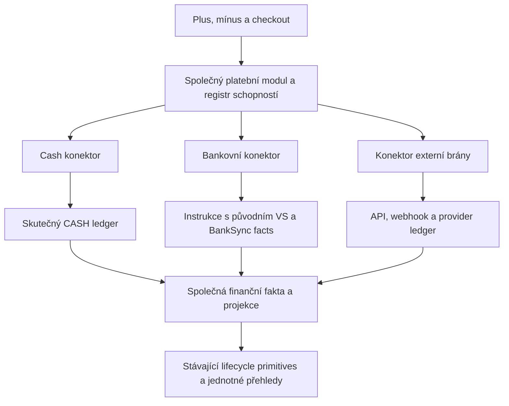

# Sjednocené platby a vrácení peněz: jeden registr a kontrakt konektorů

Datum: 2026-11-10
Stav: Plán sjednocení příjmu a vrácení peněz, bez implementace
Ověřování implementace: standard - finance, oprávnění, souběh, externí operace

## Závazné zadání a rozhodnutí

Vedle pluska bude stejně velké mínusko a obdobný kompaktní dialog „Vrátit peníze“. Neonline objednávka nabídne hotovost a bankovní převod. Bankovní větev zobrazí QR pro platbu zákazníkovi; skutečný výdej potvrdí BankSync. Cizí měny a externí platební brány musí být podporované podle svého konkrétního konektoru. Stripe je pouze jedna současná implementace, nikoli doménová kategorie.

**Bankovní vratka používá přesně stejný uložený variabilní symbol jako původní objednávka. Nevydávat nový VS, refund symbol, RF, specifický symbol ani párovací token ve zprávě.** Interní UUID příkazu či požadavku slouží pouze evidenci a idempotenci a nepřenáší se jako nová platební reference. U EUR se použije již existující původní reference v podporovaném formátu, nikoli nově vydaná reference pro refund.

Jednoznačnost se prokáže před vydáním QR přes vlastnictví původní reference v namespace konkrétního fyzického účtu. Částka, podobnost jména, čas ani první nalezený řádek nesmějí určovat objednávku. Ruční výběr objednávky není výchozí průchod připraveného QR.

Architektonická kontrola mění původní hotovostní návrh v těchto bodech:

- Oddělit požadavek od skutečného výdeje. QR jen připravuje instrukci a rezervaci; částku potvrzeně vrácenou mění až bankovní fakt. Hotovost vzniká a potvrzuje se jedním SQL commandem. Provider má vlastní fázi přijetí a potvrzení.
- Nepřepisovat raw bankovní typ transakce na return. BankSync už ukládá záporné pohyby; refund je jejich klasifikace a vazba na původní objednávku.
- Zachovat jeden finanční owner a jeden lifecycle. Nové požadavky nejsou druhý ledger. Banka, cash i provider se zobrazují společně, ale provedení a finanční fakta mají své skutečné owners.
- Jednoznačnost nepřidávat novou referencí. Využít existující canonical registr původních VS a fyzických účtů. Původní symbol se nemění ani pro opakovanou částečnou vratku.
- Externí bránu nepřevádět na cash/bank. Vrácení se provádí proti původní platbě přes její registrovaný konektor a ověřené facts. Sdílená vrstva nezná značku brány; nezapíše zároveň zápornou bankovní transakci.

Závazné doplnění uživatele: sjednotit architekturu plateb a vracení, včetně banky, hotovosti a bran. Samostatná refund fasáda nad trvale rozdílnými registry není cílový stav. Tento dokument nahrazuje předchozí cash-only i následný oddělený refund návrh na stejné cestě. Samotná plánovací úloha nemění aplikaci, databázi ani produkci.

## Potvrzená evidence a mezery současné architektury

Zdroj: pracovní strom na větvi `docs/festapp-tickets-readme-20261107`, HEAD `742d614b7`, s dalšími rozpracovanými úlohami. Jde o source evidence, nikoli ověření nasazené produkce.

| Fakt | Zdroj | Důsledek |
|---|---|---|
| Plus v Zaplaceno: ikona 18, horizontální padding 4, sloupec 150. Oba vstupy sdílejí cash flow. | `lib/components/eshop/eshop_columns.dart`; `views/cash_payment_flow.dart`, `add_cash_payment_dialog.dart`, `transactions_dialog.dart` | Sdílet dialog a ovládání; ověřit prostor pro obě ikony a delší částku. |
| Cash UI i RPC podporují signed korekce; cash writer zapisuje manual. | `database/functions/eshop_transactions/insert_manual_transaction*.sql`; `lib/components/eshop/db_orders.dart` | Historická záporná oprava není automaticky refund. |
| BankSync ověřuje směr, signed amount a movement identity; outgoing uloží jako stored_outgoing, incoming matcher volá jen pro příjem. | `database/functions/eshop_bank_sync/ingest_bank_sync_transaction.sql` | Přidat outgoing refund reconciliation, nikoli další import. |
| Registr má UNIQUE(namespace_id,variable_symbol), fyzický účet/aliasy a original_payment_info_id; historické identity se uchovávají. Aktivace prověřuje historické konflikty. | `database/functions/eshop_payment_references/{schema,identity,operations,manual}.sql` | Opřít jednoznačnost o stávající vlastnictví reference a readiness gate. |
| Legacy incoming matcher může vrátit ambiguous. | `database/functions/eshop_transactions/match_bank_transaction.sql` | Pouhé zkopírování matcheru nedává garanci pro nový refund průchod. |
| Cash role a bank role jsou rozdílné. Bank write je account admin + manager skutečně připojené jednotky. | `get_transactions_for_order.sql`; `user_permissions/{bank_operations,feature_operations}.sql` | Typed refund capabilities podle skutečného účtu, ne obecné canUpdateOrders. |
| Totals rozlišuje return podle transaction_type; část lifecycle/projections používá samotné gross paid. | `eshop_transactions/payment_totals.sql`; `eshop_orders/recalculate_order_payment_status.sql`; `eshop_waitlist/order_overview.sql` | Společná klasifikace a rozhodování o úhradě podle net. |
| Raw transactions má NUMERIC(12,2), transaction_type varchar bez enum CHECK. | `database/tables/tables.sql`, eshop.transactions | Nevyžadovat domnělou enum migraci; respektovat současnou peněžní přesnost. |
| QR má sdílené SPD/EPC encoders, veřejný widget však obsahuje texty pro placení objednávky. | `_shared/paymentPresentation.ts`, `qrCodePayment.ts`; `payment_qr_card.dart` | Sdílet encoding a nízkou prezentaci, nikoli veřejný payment obsah opačného směru. |
| Provider connector umí refund observation; současný interface nemá refund creation. | `_shared/payments/contracts.ts`, `connectors/stripe.ts`, `_shared/stripe/provider.ts` | Refund dispatch přes Stripe je explicitní doplnění, není již hotový. |
| Report používá denně záporné znaménko, celkově returned; deposits pracují s gross paid. | `database/functions/eshop/get_report_ws.sql` | Zahrnout graf, text a export do stejné klasifikace. |
| Hard delete odpojí pohyby a smaže payment_info/historii. | `eshop_orders/{delete_order,get_order_deletion_context_v1,delete_order_client_sync_v1}.sql` | Refund ochrana musí být v preflight před externím mazáním, nejen FK chyba na konci. |
| Obecná historická bank_account_requests existuje, nalezené aktuální call sites jsou údržba/mazání/RLS. | `database/tables/tables.sql`; scoped search v database/functions, lib a supabase/functions | Není to potvrzený funkční refund owner. Prověřit direct-table grants/klienty a nezanechat paralelní writer. |

## Současný stav versus cílové sjednocení

Ověřeno přímo v kódu: SQL registr eshop.payment_providers obsahuje bank, cash i externí brány. Bank/cash mají handler=NULL, externí brány konkrétní handler/source_field. TypeScript PaymentRegistry v `_shared/payments/runtime.ts` a Dart PaymentConnectorRegistry v `packages/festapp_core/lib/src/payments/registry.dart` nyní obsahují jen brány. TypeScript PaymentConnector vyžaduje online checkout operace a PaymentDependencies vyžaduje i části, které bank/cash nepotřebují.

To je současná mezera, kterou tento plán uzavírá. Cílem není ponechat banku navždy vedle konektorové architektury a překrýt rozdíl novým refund modulem. Rozšíří se existující platební architektura na všechny metody a oba směry peněz.

### Jeden vlastník registrace, implementace podle schopností

- Canonical identita, registrace a povolené schopnosti platební metody zůstávají v současném SQL payment_providers ownerovi. Bank/cash získají skutečné builtin handlery stejného dispatch kontraktu; odstraní se pravidlo, že právě bank/cash musí mít handler=NULL. Bankovní instrukce, cash ledger a gateway API budou konkrétní implementace pod stejným registrovaným rozhraním.
- Stávající TypeScript a Dart/JS registry se rozšíří o bank/cash ve svém příslušném runtime. Nejde o další konkurenční registry: SQL zůstává autorita instalace/povolení, lokální allowlist obsahuje konkrétní implementace a ověřuje shodu identity/schopností. Kontrakt testy prokážou, že server nenabízí neregistrovaný adaptér a klient nepředstírá serverem nepovolenou schopnost.
- Současný monolitický PaymentConnector/PaymentDependencies rozdělit na základ identity a volitelné, typované skupiny schopností pro příjem, vrácení, správu připojení a ověřování. Online checkout údaje jsou povinné pouze uvnitř skutečné hosted-checkout schopnosti. Banka ani cash nedostanou falešnou URL, PaymentIntent, live/test hodnotu nebo prázdnou úspěšnou implementaci jen kvůli původnímu interface.
- Sdílená orchestrace vybírá operaci podle capability registrovaného konektoru, nikdy podle if(method == bank) či if(provider == stripe). Nepodporovaná operace má konkrétní typed unavailable výsledek. Banka nemá automatický převodní API call: její skutečná schopnost vrátí platební instrukci a očekává ověřený bankovní pohyb. To je plnohodnotná implementace kontraktu, nikoli druhý engine.
- Stejná základní registrace a infrastruktura slouží příjmu i vrácení. Oba směry sdílejí scope/autorizační owners, přesné peníze, původní platební identitu, idempotenci, claims/recovery, normalizovaná fakta a finanční projekce. Jednotlivé operace mají vlastní typovaný vstup a potřebnou stavovou posloupnost; není nutný jeden obří RPC ani univerzální workflow framework.

### Malé společné rozhraní platebního modulu

Kanonická orchestrace bude rozšířením existujících `database/functions/payment_providers/` a `_shared/payments/`, nikoli druhým veřejným modulem eshop_refunds vedle plateb. Konkrétní SQL soubory operations.sql, refunds.sql a builtin bank/cash adaptéry přidat do stávajícího ownera. Finance zůstávají v dnešním payment_totals a ledgerech, ne v nové kopii.

- `payment_method_context_internal(order_id)` sestaví schopnosti příjmu i vrácení, přesné gross/refunded/net/pending/available a dopady. Refund část může být privátním helperem, ale UI pravidla se nezdvojují. Použijí jej stávající autorizované readers objednávky a transakcí.
- Admin command `command_payment_operation(input_data jsonb,p_command_id uuid)` přijme typované operace record_payment, prepare_refund, cancel_pending a correct_record. Konkrétní způsob provedení vybere registrovaný konektor podle uložené platební identity a capability. U neonline objednávky lze podle schválených pravidel zvolit cash/bank výdej; online refund zůstává u původního konektoru. Scope, autorizace včetně replay, receipts, sync a finanční následky vlastní společná orchestrace. Příchozí checkout entrypointy zůstávají podle svého skutečného transportu, ale používají stejný registry/owners místo paralelních větví.
- `refund_requests` zůstávají konkrétními daty záměru vrácení uvnitř platebního modulu: interní id, order/payment binding, způsob, přesná částka/měna, původní reference, source/recipient snapshoty, autor/datum/poznámka, revize/hash a provozní stav. Není to nový ledger ani nezávislý refund engine. Cash request vznikne a potvrdí se atomicky.
- `refund_settlements` klasifikují skutečný cash/bank transaction_id a volitelně odkazují na request. Transaction_id je unikátní, částka/měna/payment se čtou z ledgeru. Provider facts zůstávají ve svém ledgeru, vazbu na request vlastní konkrétní adaptér. Jednotný movement projection tyto facts skládá bez dvojího započtení a bez kopírování finančních zůstatků.
- Další krok má jednotný typovaný výsledek, například recorded, show_bank_instructions, open_checkout nebo processing. Způsob ověření je součást capability: local_commit, bank_event či verified_provider_observation. UI neodvozuje úspěch ze značky konektoru nebo zavření okna.
- Potvrzené částky se odvozují z platných ledger facts, bez druhého confirmed čítače. Příprava/dispatch není finanční potvrzení. Audit používá dnešní history/pairing owners bez dvou order-state snapshotů. Použité a stornované vstupenky, deposit i provider admission mají zachované doménové invarianty; konektory nesmějí přímo zapisovat order/ticket/email stavy.
- RLS, odebrané direct client writes, explicitní FK, security-definer pravidla a typed policies platí všude. Všechny funkce jsou v public, žádné business triggery. Společná autorizační orchestrace deleguje skutečně rozdílná oprávnění cash/bank/provider typed predicate ownerům, nevytváří jeden příliš široký allow bit.

### Převod všech volajících a odstranění nahrazených cest

Převést incoming i outgoing na společné capability rozhraní: checkout/configuration/availability, cash přidání přes plus, bankovní párování, připravování QR, provider refund a všechny nové minus vstupy. Existující transporty a ledger fakta zůstávají; nahradí se jejich vedlejší business dispatch, duplicitní capability výpočty a výchozí předpoklad, že PaymentConnector znamená pouze online bránu.

Vydaná RPC, odkazy a webhook protokoly smějí zůstat jen jako tenké adaptéry s konkrétním externím konzumentem. Například insert_manual_transaction deleguje do stejného payment-operation ownera se zachováním významu starých signed korekcí a receipt identity. Neudržovat uvnitř starého RPC druhý výpočet oprávnění, limitů a finančních následků. Interní call sites převést a staré interní fasády odstranit. U každého veřejného compatibility adaptéru uvést konzumenta a podmínku budoucího odstranění; issued public links ani bankovní reference nelámat.

Obecná historical bank_account_requests se nepřebírá podle názvu. Prověřit živé direct-table writers/grants. Případného refund producera převést na stejný canonical payment operation a uzavřít bypass. Nesouvisející historická data zůstanou ohraničeným artefaktem mimo nový kontrakt, bez spekulativní hromadné migrace.

## Jednoznačná bankovní vazba s původním VS

1. VS přijde z uložené objednávky, fyzický source účet a aliasy z canonical owners. Před QR SQL prokáže unikátní původní vlastnictví reference pro dané payment_info v namespace tohoto účtu. Stejně pracuje s již uloženou EUR RF. Nevydává další referenci.
2. Prokazatelné enrollment/import/ochrana budoucích writerů jsou bank readiness gate. Source potvrzuje existenci registru, nikoli jeho produkční aktivaci. Legacy kontrola „právě teď je jeden řádek“ nezaručuje souběh ani budoucí neznovupoužití. Nevydat nepodložené QR; případnou historickou kolizi řešit před zpřístupněním bez změny symbolů, nikoli standardním výběrem objednávky uživatelem.
3. Automatické přiřazení outgoing používá původní fyzický source účet a vlastníka původní reference. Částka a měna jsou finanční kontrola, ne order identifikátor. Příjemcův účet kontroluje shodu s instrukcí, nevybírá order podle podobnosti.
4. Standardní source je původní přijímající účet pořadatele či ověřený alias. Arbitrární jiný účet se nenabízí. Cash objednávce lze bank refund nabídnout pouze tehdy, když již má původní referenci s doloženým vlastnictvím pro tento source; jinak se nová nevytváří.
5. Opakované částečné vratky stále patří stejné objednávce a používají stejný VS. Nejvýše jeden nevyřízený bank request na payment_info usnadní vypořádání záměru; request pořadí nikdy nevybírá objednávku.
6. Skutečný debit se vykáže ve skutečné výši. Odlišná částka je odchylka známé objednávky, nikoli hledání jiné podle částky. Další reálný debit či výdej nad plán se nezamlčí ani neořízne na plánovanou částku.
7. Bankou odstraněná nebo člověkem změněná reference je chybějící/porušená instrukce, ne normální nejednoznačnost modelu. Pohyb zůstane v bankovní evidenci; konkrétní oprávněná oprava může využít skutečnou evidenci, bez automatického odhadu. Výchozí vydaný QR se správnými údaji má automatické jednoznačné přiřazení.

Příjemcův účet lze nabídnout z původního příchozího pohybu, ale ten nedokazuje právní vlastnictví zákazníkem. Více původních příjemcových účtů vyžaduje výběr destinace, nikoli výběr objednávky. Ručně zadaný účet je validovaný a zřetelně označený. Po vydání QR se immutable instrukce nepřepisuje; změna příjemce vyžaduje bezpečně vyřešit původní požadavek a auditovat novou instrukci se stejnou původní referencí.

## Finanční invarianty, rezervace a opravy

Příjem 1000 Kč a připravený bank refund 300: přijato 1000, vráceno 0, čistě uhrazeno 1000, čeká 300, pro nový refund dostupných 700. Po skutečném debitu -300: přijato 1000, vráceno 300, net 700, čeká 0. Cash provede rovnou druhý stav.

- Cash vytvoří nový záporný řádek na CASH účtu jednotky/měny s created_by, datem výdeje, serverovým časem a poznámkou. Původní příjem se nemaže, i když byl bankovní. Lokální cash může mít typ return, ale původ se ověřuje také přes CASH účet a ingest_source=manual.
- Vydání bankovního QR nevytvoří žádnou transakci. Po importu se klasifikuje původní debit s původní immutable bank identity, částkou, měnou, účtem a raw typem. Žádný druhý import ani syntetický bankovní řádek.
- payment_info.paid zůstává gross, returned jsou skutečné potvrzené vratky. Jednotná klasifikace je union historických return a platných nových refund settlements, deduplikovaná transaction_id. Refund nesmí zároveň snížit gross a ještě se odečíst v returned.
- Historické záporné manual korekce zůstávají opravami příjmu. Žádný hromadný odhadovaný backfill na refund. Stejnou klasifikaci používají report totals, denní graf i timeline.
- Available pro nový požadavek = max(net - provider holds - nevyřízené refund rezervace,0), bez dvojího odečtení, pokud provider pending již drží částku. paid_externally bez attributable movement limit nezvyšuje. Currency/identity nesrovnalost blokuje nový výdej.
- Limity nové přípravy i cash výdeje kontrolovat pod order/payment zámkem. Dvě záložky ani kombinace cash/bank/provider nesmějí rezervovat stejné peníze. Korekce či odpojení příjmu podkopávající vydanou rezervaci se předem odmítnou.
- Reálný již provedený bank/provider výdej se neodmítá kvůli starému limitu, stornu requestu nebo překročení plánu. Uložit pravdivý fakt, označit odchylku a zastavit nové výdeje do vyřešení. Net se nesmí clampovat na nulu a ukrýt skutečný přečerpaný výdej.
- Chybný cash refund záznam se opravuje explicitně s důvodem a auditem. Původní řádek zůstane dohledatelný, jeho void/korekce se ve finanční projekci započte jednou. Nový cash refund nelze obecně smazat přes delete_manual_transaction_ws. Bankovní debit se nikdy nevoiduje jako chybný cash zápis; chybné přiřazení řeší auditovaný pairing/classification se zámky obou scopeů.
- Povolené nononline finance stavy s payment_info a doloženými penězi: created, ordered, paid, sent, storno, expired. Waiting/preparing nejsou refund capability. Po storno/expired aktualizovat pouze finance/audit/sync, nic neobnovovat a nevytvářet upomínky. Aktivní order po potvrzené vratce používá stávající net/deposit lifecycle, zachovává used/storno vstupenky. Provider admission dál vlastní provider effects a partial-refund rozhodnutí.

## Souběh, opakování a životnost QR

Zachovat atomic bank inbox/identity/ledger/receipt. Refund reconciliation musí být idempotentní pro nový outgoing i již uložený dosud neklasifikovaný debit. Příprava umí najít relevantní dříve uložený výdej a nesmí proti již proběhlému refundu vydat nový QR. Žádný nový import/polling worker.

Současný pairing zamyká existing movement před capacity/order/payment; ingest navíc drží connection. Cílové settlement pořadí je connection, drží-li ji ingest -> existing movement -> canonical capacity/form/order -> payment -> request. Příprava drží capacity/order -> payment -> request a potom nesmí sahat po existing movement/connection zámku v opačném pořadí. Nalezený debit vypořádat přes ownera ve správném pořadí a revizi znovu ověřit před vydáním QR. Implementace musí prokázat celý zámkový graf proti cash writeru, stornu, repricing a provider effects, nikoli jen dva nové RPC.

Stabilní command UUID a payload včetně původního data přežijí nejistý výsledek. Replay po nové autorizaci nepřidá rezervaci, výdej ani historii. Stejné UUID s jiným payloadem se odmítne. Provider idempotency key je interní provozní identita, nikoli další bankovní reference.

QR po vydání nelze odvolat v cizí bankovní aplikaci. Zavření dialogu request neruší. Uvolnění rezervace při zrušení vyžaduje výslovné potvrzení, že převod nebyl zadán; při nejistotě zůstane čekající. Timeout není důkaz nezaplacení. Pozdní debit se stále promítne původní objednávce. Opakovanému externímu zaplacení téhož QR systém nedokáže zabránit; dva skutečné výdeje musí evidovat jako dva pohyby, ale jeden webhook/movement nikdy neimportovat dvakrát.

## Matice měn a poskytovatelů

| Cesta | Původní identita | Provedení | Finanční potvrzení |
|---|---|---|---|
| Cash | Order, měna, CASH účet jednotky | Fyzický výdej, kladný vstup -> záporný ledger | Atomický autorizovaný SQL command |
| Bank CZK | Stejný VS + původní fyzický source účet | SPD QR: ACC zákazníka, AM kladné, CC CZK, X-VS původní | Skutečný záporný BankSync movement |
| Bank EUR | Již uložená původní RF odvozená od původního VS | EPC SCT s příjemcem/IBAN, EUR a touž původní RF | Ověřený outgoing se stejnou původní referencí |
| Další bankovní měna | Původní uložená reference | Konkrétní podporovaný codec, jinak pravdivé ruční instrukce bez falešného SPD/EPC | Jen skutečně podporovaný import, žádná fingovaná automatická capability |
| Externí platební brána | Původní provider/account/mode a jeho uložená payment identity | Vrácení přes konkrétní registrovaný konektor se skutečnou refund schopností | Konektorem ověřené facts a společný provider effects owner |

Měnu nelze měnit ani potichu převádět kurzem. Stored money zůstává exact decimal/minor units, display je lokalizovaný. Současný neonline ledger i provider totals mají dvoumístné omezení; capabilities smějí hlásit pouze skutečně podporované měny a exponenty. Nová FX účetní kniha není součást tohoto plánu.

Dnešní BankSync ingest přijímá CZK/EUR/USD a ověřený API movement aktuálně váže na FIO; cash má CZK/EUR/PLN/USD/GBP. Nejde o zaměnitelné množiny. Dostupnost se odvozuje od měny, source účtu, synchronizace a connectoru, nikoli seznamu všech měn ve formuláři.

Zobecnit současné encoders pouze pro konkrétní reuse bankovních instrukcí. Refund nesmí poslat neupravené payment_info do presentPayment s účtem pořadatele, protože by QR mířil opačně. Payload používá validated recipient, kladnou částku a původní immutable reference. Sdílet SPD/EPC encoding, kontrolu IBAN, měn, limitů a přesné převody; neudělat druhý QR formatter ve Flutteru.

Oficiální SPD specifikace popisuje ACC/AM/CC/X-VS a interoperabilitu tuzemské měny CZK. EUR používá vlastní EPC SCT formát. QR předává instrukci, nikoli potvrzení převodu. Zdroje: [QR Platba](https://qr-platba.cz/pro-vyvojare/specifikace-formatu/), [EPC guidelines](https://www.europeanpaymentscouncil.eu/document-library/guidance-documents/quick-response-code-guidelines-enable-data-capture-initiation?documents_id=607).

### Refund schopnost společného konektoru: banka, cash a externí adaptéry

V cílovém sjednoceném payment connector registry/contracts zavést o explicitní opt-in refund schopnost pro všechny metody. Cash ji vykoná lokálně, bankovní adaptér připraví instrukci a přijme bankovní fact, externí adaptér použije protokol brány. Rozhraní společné vrstvy zná pouze uložený provider key, canonical payment binding, částku/měnu a interní id operace. Konkrétní konektor ukryje provider objekty, SDK, URL, autentizaci, idempotency chování i způsob ověření výsledku. Nepřidávat druhý registry jen pro refundy.

Kontrakt refund schopnosti musí pokrýt:

- capabilities: možnost částečného/plného vrácení, skutečně podporované měny a částky, důvod nedostupnosti a podporované recovery; žádné předpoklady podle značky;
- requestRefund: podle registrované schopnosti atomicky zaznamenat cash, připravit bankovní instrukci, nebo provést/dohledat externí operaci na původním payment bindingu; vždy se stabilní provozní identitou;
- recoverRefund: po nejistém výsledku vrátit nalezenou operaci, prokázanou nepřítomnost, nebo unresolved, nikdy automaticky předstírat neúspěch;
- observeRefund: převést local commit, ověřený bankovní pohyb nebo autoritativní provider observation na normalizovaná fakta; transport i ověřování původu zůstávají v adaptéru;
- normalizovaný výsledek: pending, action_required, succeeded, failed, cancelled nebo unknown, s přesnou částkou/měnou, stabilní identitou původního pohybu a odděleným údajem o nejistotě samotného dispatch. Provider-specific detaily nesmějí řídit if větve ve společném UI.

Výběr konektoru a povolených výdejních metod vychází z uložené platební identity a serverové capability policy. Uživatel nemění externí bránu původní platby; bank/cash varianta u neonline objednávky zachovává pravidla výše. UI zobrazí akci „Vrátit přes {název brány}“ z descriptoru, pokud server vrátí konkrétní capability. Přidání další brány nesmí vyžadovat úpravu refund controlleru, finančních výpočtů ani podmínek značky v dialogu.

Konkrétní adaptéry doplní tento kontrakt v již existujícím connector/store slotu. Stripe je jeden adaptér; jeho PaymentIntent/charge a Stripe-specific recovery zůstávají uvnitř jeho implementace. Barion je další existující connector s vlastním protokolem a zůstává sandbox-only. Connector bez ověřené write schopnosti ji nehlásí; existence obecného interface nezapíná podporu ani produkční aktivaci.

Externí implementace prepare_refund uloží durable intent v SQL; shared command se nejmenuje podle konkrétní brány. Cash a banka používají tutéž orchestration vstupní vrstvu bez vzdáleného API callu. Generická privilegovaná Edge orchestrace po commit claimne lease a provede connector call; recovery doplnit do současného payment-reconcile/runtime. UI nikdy nezíská secret ani nevolá provider SDK. Přijetí requestu není potvrzený výdej. Pending/requires_action/failed/cancelled/uncertain a confirmed succeeded se rozlišují. Existující observation funguje také pro refund vytvořený mimo Festapp, bez místního requestu.

Stripe používá původní PaymentIntent/charge, account a live/test mode, částku v podporovaných minor units a stabilní interní idempotency key. Po nejistém výsledku ověřit původní operaci; po skončení provider retence klíčů nesmí retry slepě vytvořit další refund. Efekty jdou přes apply_provider_payment_effects_internal, partial admission přes decide_stripe_partial_refund_client_sync_v1. Nejde o obecný nononline cash lifecycle a nevzniká druhá bank/cash transakce.

Oficiální Stripe kontrakt připouští částečné refundy proti původní platbě, omezuje zbývající částku a může zůstat pending. Idempotency retence není neomezená. Zdroje: [Create a refund](https://docs.stripe.com/api/refunds/create), [refund lifecycle](https://docs.stripe.com/refunds), [idempotency](https://docs.stripe.com/api/idempotent_requests).

## UI/UX - zapracovaná kontrola Astra Medium

- Tabulka `[+] [-] částka`, stejné ikony 18, padding, focus, hit target a vizuální váha. Tooltip mínuska „Vrátit peníze“. Je-li třeba zvětšit plochu, u obou. Částku neořezávat. Detail má stejně vysokou akci vedle přidání platby, na mobilu Wrap.
- Jeden společný AppAlertDialog ve stávajících rozměrech a stylu. Nononline Hotově / Bankovním převodem; online akce „Vrátit přes {název brány}“ z registrovaného descriptoru a serverové capability, bez cash/bank obcházení a bez hardcoded značek.
- Kladná částka, původní měna, „Lze vrátit“, čekající rezervace a případný dopad na net/deposit. Nepředvyplňovat automaticky celý limit. Nové plus UI také jen kladné, signed legacy RPC zůstává korekcí.
- Hotově: datum a poznámka jako dnes, tlačítko „Zaznamenat vrácení hotovosti“. Žádný bank setup nebo příchozí pairing uvnitř cash refundu.
- Bankou: příjemce/účet, source účet pořadatele, částka/měna a původní VS/reference. „Účet z původní bankovní platby“ s vazbou na pohyb; nepoužít zavádějící „ověřený účet zákazníka“. Ruční účet označit a validovat, víc původních účtů znamená výběr destinace.
- CTA „Připravit QR převod“, potom QR a kopírovatelné údaje. Stav „Čeká na bankovní pohyb“, text „QR je připraven. Převod zatím nebyl potvrzen bankou.“ Ukázat poslední skutečnou synchronizaci. Upozornit věcnou instrukcí vybrat v bankovní aplikaci zobrazený source účet; QR jej nevynucuje.
- Reopen ukáže stejný pending request, nevyrábí další QR operaci. Žádné „Označit jako zaplacené“. Zavření neruší request, zrušení vysvětlí dopad na rezervaci a to, že nezastaví bankovní příkaz.
- Ukládání blokuje double submit a dismiss, chyba zachová draft; nejistý výsledek nabídne ověření stejného commandu. Po confirmed výsledku autoritativní readback a Client Sync aktualizují grid/detail.
- Grid Zaplaceno = čistá potvrzená úhrada. Detail Přijato / Vráceno / Čistě uhrazeno a odděleně Čeká na vrácení. Příprava nevydává úspěch „Peníze vráceny“. Historie rozlišuje cash, bank, provider a opravu, signed amount, datum pohybu/evidence a autora, je-li znám.
- Dopad pod cenu/zálohu vysvětlí serverový náhled před skutečným cash výdejem nebo přípravou bank/provider requestu. Storno/expired nenabízí doplacení a neobnoví vstupenky. UI používá samostatné serverové capabilities, nikoli dnešní obecné _canEdit/canUpdateOrders cash podmínky.

## Mapa dotčených míst a skutečných owners

| Oblast | Konkrétní seams a požadovaná změna |
|---|---|
| Platební registr/commands | Rozšíření existujících payment_providers a _shared/payments pro oba směry; bank/cash handlery a capability kontrakt; context do existujících readerů. Samostatné eshop_refunds není cílový veřejný owner. |
| Cash writer/legacy | eshop_transactions/insert_manual_transaction*.sql, DbOrders.insertManualTransaction. Jeden privátní cash writer, legacy signed korekce se stejnými receipts, nové rezervace neobejitelné. |
| Bank ingest/reference | eshop_bank_sync/ingest_bank_sync_transaction.sql, identity/aliases, existing_facts_match; eshop_payment_references/schema/identity/operations/allocation. Outgoing reconcile přes původního vlastníka, incoming beze změny účelu. |
| Pairing/corrections | apply_transaction_pairing.sql, add_transaction_to_payment_info_ws.sql, remove_transaction_from_payment_info_ws.sql, delete_manual_transaction_ws.sql, get_transactions_for_order_all_available.sql. Žádná obecná cesta nepřipojí debit jako obyčejnou negative correction bez refund classification; actual source práva. |
| Finance/lifecycle | payment_totals.sql; eshop_orders/recalculate_order_payment_status.sql, update_order_and_tickets_to_paid.sql, mark_order_and_tickets_paid_internal_v1.sql. Net místo gross pro úhradovou způsobilost, jeden lifecycle. |
| Read projections | eshop_waitlist/order_overview.sql včetně timeline; eshop_orders/get_orders.sql, get_order_admin_detail.sql, operator_orders.sql. Gross pole nepřejmenovat na net potichu, přidat explicitní net/pending a správné due/overpaid. |
| Flutter UI/modely | lib/components/eshop/db_eshop.dart, db_orders.dart, eshop_columns.dart, order_grid_filters.dart; models/order_model.dart, payment_info_model.dart, order_payment_actions.dart, transaction_model.dart; views/cash_payment_flow.dart, add_cash_payment_dialog.dart, transactions_dialog.dart, order_payment_summary.dart, search_transactions_dialog.dart, order_customer_payment_details.dart. Samostatná refund capability i po stornu a pro provider. |
| Public web | web_client/src/components/forms/order_overview.js a payment_details.js, jejich skutečné adaptéry. Jen potvrzená fakta a net due, interní source/recipient PII a secrets mimo public bundle. |
| QR/měny | _shared/paymentPresentation.ts/test, současné validátory. Případný reuse pouze nízké QR/copy prezentace z payment_qr_card.dart, bez public textů pro příjem platby. |
| Email/reminders | emails/queue_payment_reminders.sql, email_queue.sql včetně deposit gate, update_order_and_tickets_to_paid.sql a skutečné renderer paid čtenáře. Úhradová rozhodnutí podle net, příprava nic neposílá, zachovat jedinou email queue. |
| Report/graf/export | eshop/get_report_ws.sql, Flutter report_tab/formatter a owning tests. Jedna klasifikace denních i celkových příjmů/vratek a deposit výpočtů. |
| Provider | _shared/payments/contracts/runtime a registry, connectors/stripe.ts a StripeProvider, payment-reconcile; payment_providers/registry, financial_facts, effects; eshop_stripe/refund_decisions.sql; Dart provider registry. Jedna provider ingestion/effects cesta. |
| Delete/privacy/source lifecycle | eshop_orders/get_order_deletion_context_v1.sql, delete_order_client_sync_v1.sql, delete_order.sql; others/delete_occasion.sql; account_deletion contract; bank account unlink/delete. Refund historie/rezervace blokuje hard delete už před externí operací, FK RESTRICT jako backstop, nullable actor po privacy výmazu podle stávající politiky. Pending source/identity nesmějí zmizet odpojením. |

Mapa není pokyn přepsat každý soubor. Při implementaci jeden scoped call-site audit rozhodne konkrétní náhrady a test seams. Textový výskyt paid sám není důvod nahradit jej net: hrubý příjem se stále potřebuje zobrazovat.

## Implementační vlny a důkaz dokončení

### 1. Sjednocený registr a kontrakt pro příjem i vrácení

Nejprve rozšířit existující registr a connector/store interfaces na typované schopnosti všech metod, zaregistrovat bank/cash a převést jejich příchozí context/configuration/availability a command dispatch na stejný kontrakt. Online checkout dependencies přesunout pod online capability, bez fake bank API. Doplnit requests/settlements, typed policies, společný context/operation facade a ochrany delete/privacy/source včetně preflight. Prověřit canonical enrollment původních referencí cílového tenantu, skutečnou capability matrix a historické direct-table writers. Připravit novou dopřednou migraci s explicitním ordered manifestem, upravit canonical source/parity registraci; neměnit zmrazené provider migrace. Stávající cash/bank/provider assemblery při regeneraci nesmějí obnovit starší definice owners.

Validace: isolated SQL schema/ACL/context testy; nezměněný původní VS, vlastnictví reference a aliasy, žádný nový allocator, cizí účet nepřístupný, hard-delete odmítnutý před externí operací. Hotovo: příjem i vrácení používají stejnou registraci a typované capability; bank/cash se řeší adaptéry stejného rozhraní. QR nelze vydat bez prokázaného jednoznačného scope; unique transaction settlement brání dvojímu započtení.

### 2. Klasifikace, finance a cash

Jeden classification owner pro totals/timeline/report; cash adaptér při prepare_refund atomicky vytvoří request, záporný CASH movement, settlement, audit, totals a sync. Plus record_payment se vede týmž payment-operation ownerem, s jiným typovaným účelem. Nový command sdílí dnešního cash writera. Net eligibility/projekce/deposit/email/reminder čtenáři podle mapy. Explicitní auditovaná oprava nového cash refundu, bez obecného delete bypassu. Signed historical korekce zůstávají korekcemi a nemění původní receipts.

Validace: příjem 1000/refund -300 -> gross 1000/returned 300/net 700; full/partial/přeplatek/deposit; desetinná přesnost; historická korekce; storno/expired/used tickets; oprava a rollback při chybě. Hotovo: finance i lifecycle souhlasí ve všech relevantních projekcích.

### 3. Bank QR, původní reference a skutečný výdej

Bankovní adaptér prepare_refund, rezervace/cancel, immutable instrukce s původním VS nebo původní EUR RF. SPD/EPC reuse, jeden otevřený bank request, reopen bez nového intentu. Outgoing reconciler v dnešním BankSync; raw fakta/dedup/incoming zachovat. Request/ingest závod i dříve uložený relevantní debit nesmějí vytvořit další výplatu. Historické odchozí pohyby nereklasifikovat hromadně jen podle záporného znaménka.

Validace: ověřený envelope -> původní ledger -> refund -> net; přesně původní VS v QR i routingu; dvě postupné částečné vratky stejného VS; EUR RF; source alias; nesprávná měna/source/ref; webhook replay; pozdní debit po cancel; dva skutečné debity oba viditelné; odlišná částka stále na téže objednávce. Hotovo: správně zaplacený QR se automaticky projeví na původní objednávce bez další reference a běžného ručního párování.

### 4. Externí adaptéry pod sjednoceným platebním kontraktem

Doplnit externí implementace refund schopnosti do společného kontraktu zavedeného ve vlně 1 a jeho durable claim/lease/recovery; nevytvářet další veřejný refund engine. Doplnit konkrétní adaptéry přes stejný interface; první ověřit na aktuálně používaném konektoru, bez hardcoded větví jeho značky ve společné vrstvě. Současná provider ingestion/effects zůstává finanční autoritou, bez shadow bank řádku. Connector bez write capability neukazuje falešné provedení; sandbox-only konektory neaktivovat pro produkci. Obecná podpora není hotová pouhým supportsRefund polem.

Validace: společné connector/SQL contract tests spustitelné pro každý adaptér; fixture druhého odlišného konektoru prokáže stejný UI/command/reconcile průchod bez zásahu do shared vrstvy, nikoli novou bránu implementovanou jen kvůli testu. Konkrétní použitý adaptér ověřit test-mode partial/full, account/mode/currency, pending/action_required/failed/succeeded, timeout po dispatch, webhook před odpovědí, duplicate delivery, refund bez místního requestu, recovery po provider retenci bez druhého výdeje a admission rozhodnutí. Hotovo: jedna provider movement identity má jeden finanční efekt a přidání konektoru nevyžaduje shared if(provider == Stripe). Sjednocení všech registrovaných metod a obou směrů je povinná podmínka dokončení. Neověřená refund write schopnost konkrétního adaptéru zůstává pravdivě nedostupná a v předání neprovedená; to neopravňuje ponechat pro něj druhý registry, orchestration engine nebo sdílené podmínky podle značky.

### 5. Společné UI a prezentace

Jeden controller/form s režimy/capabilities, stejné mínusko v obou vstupech, správné net/pending modely, web a report. Lokalizace přes dnešní string owners ve všech podporovaných jazycích. Odstranit signed entry z nového plus UI, ponechat jen ohraničené legacy adaptéry a historické popisky.

Validace: owning Flutter suite pro dialog/model/summary, retained draft a command, původní VS, bank pending/confirmed, EUR/provider, storno; desktop delší částka, mobilní detail, keyboard/focus. Browser izolovaný, ztlumený, světlý, delegovaný podle AGENTS.md. Hotovo: příprava se nevydává za skutečné vrácení a uživatel nemusí znát znaménka či interní ids.

### 6. Souběh, kontrakce bypassů a readiness

Dvěma DB spojeními prověřit prepare/prepare, cash/bank, settle/cancel, ingest/request, correction/reservation, delete/refund a source disconnect. Dokončit převod všech incoming/outgoing callers, runtime registrací, SQL handlerů a klientských descriptorů. Jednou projít hotové writers/readers z mapy a uzavřít bypassy. Odstranit nahrazené builtin-vs-online business dispatch větve, interní cash/refund fasády a testy uzamykající staré rozdělení; pro externí kompatibilní transporty evidovat konkrétní konzumenty a removal podmínky. Aktualizovat eshop README, payment-providers architekturu a source/migration manifests podle finálního kontraktu.

Validace: targeted SQL/Flutter/Deno/web a affected canonical CI mirror lanes před publikací. Hotovo doloží současně reachability všech vstupů na společný owner, absenci nahrazených interních cest a chování kontraktu pro bank/cash i alespoň dva odlišné externí adaptéry. Žádný debit jako neklasifikovaná obyčejná korekce přes veřejné RPC, žádný reader neodečítá peníze vydáním QR, žádný hard-delete nevymaže pending vazbu.

## Zachování a odstranění cest

| Cesta | Finální stav | Důkaz |
|---|---|---|
| Registr bank/cash bez handleru a oddělený online-only connector význam | Jeden canonical registry s konkrétními bank/cash/gateway adaptéry a typovanými schopnostmi | Shodné capability contract tests a registrace všech metod |
| Příchozí plus a checkout s vlastními method business větvemi | Stejný payment context/registry/operation owners jako refund | Call-site reachability mapa pro oba směry |
| Samostatný command_order_refund/order_refund_context veřejný owner | Nevznikne; refund je operace společného platebního modulu | Žádná nová paralelní registrace ani facade v runtime |
| Sdílené if(bank)/if(stripe) pro provedení a úspěch | Capability dispatch a typovaný výsledek | Přidání adaptéru bez editace dialogu/finance/orchestrace |
| Negative entry v novém plus UI | Explicitní mínus a kladné zadání | Widget test směru |
| Historical signed manual RPC | Původní význam/receipts, jeden writer, rezervace neobejitelné | Regrese a ACL/caller audit |
| Obecné připojení outgoing jako negative correction | Refund classification se source oprávněním | Negativní test veřejných pairing RPC |
| Raw bank type přepis na return | Zakázaný, settlement klasifikace | Ingest fact parity/replay |
| Nový refund VS/RF/token | Neexistuje, pouze původní reference | QR/protocol test, žádný refund allocator |
| Sign-only denní refund vs type-only totals | Jedna movement classification | Stejná fixture v reportu, grafu a timeline |
| Obecné smazání nového cash refundu | Explicitní auditovaná oprava | Původní řádek dohledatelný, projekce správně |
| Hard delete s refund historií | Preflight doménově blokovaný | Žádný externí delete side effect |
| Historical bank_account_requests | Ohraničená stará tabulka nebo převedený objevený writer, nikdy paralelní pravda | Producer/grant audit |
| Provider ledger a admission | Zachované owners, dispatch je doplní | Jedna movement identity = jeden efekt |

## Ověřování, provozní důkazy a nasazení

Plánování nespouští testy, browser ani produkční čtení. Implementace ověřuje standardní targeted checks podle CONTRIBUTING. SQL naváže na cash_command_guards/cash_history_access, bank_sync_ingest/atomicity, payment_pairing_contract, payment_lifecycle, order-delete a report suites; nové souběhy používají dvě DB spojení. QR/provider využijí paymentPresentation/connector/provider tests a effects SQL. Stripe end-to-end jen test mode, žádný skutečný refund z produkce.

Flutter owning entrypointy musí skutečně importovat rozšířené cases. Použít cílené fvm dart analyze a fvm flutter test --concurrency=1, nejprve ověřit volný jediný Flutter slot. SQL přes node web_client/scripts/run_db_tests.js jen proti izolované lokální DB; JS pnpm 11.24.0/frozen lockfile. Před source publication povinné affected automation/test_ci.sh lanes, před produkcí všechny předepsané release gates.

Nasazení: schema/ACL a sjednocený capability registry -> převod incoming i outgoing owners/adaptérů -> kompatibilní klasifikace/totals/všichni finanční čtenáři -> reconciliation/provider support -> UI -> kontrakce nahrazených interních cest. Schéma/registry/data nejprve rozšířit kompatibilně, nevypnout používaný handler dříve než jsou převedení jeho volající. Produkční rollout neponechává druhou business implementaci jako fallback. Nevydávat QR před ověřením enrollment/history ownership vybraného scope. Případný potřebný import/aktivace má vlastní náhled a oprávnění, nemění původní VS a nezahrnuje automaticky jiné tenanty. Staré UI může ukazovat gross: aktivovat funkci až s kompatibilní verzí dotčených klientů, ne předstírat, že staré zobrazení je vždy správné.

Rollback může skrýt nové UI nebo zastavit nové requesty, ale nesmaže settlements, nevrátí staré finance výpočty a dál přijímá skutečné pohyby proti vydaným QR. Pending operace a původní reference musejí zůstat dohledatelné. Commit/push, produkční migrace/deploy, registry aktivace, reálné převody a refundy nejsou touto plánovací úlohou autorizované.

Nepotvrzené provozní důkazy: aktivace/import reference registry cílového tenantu, skutečné předání EUR RF používanou bankou a provider refund write permissions/test účty. Jsou to konkrétní readiness gates, nikoli záminka změnit reference nebo přenést normální párování na uživatele. Nelze předstírat garanci bez aktivních ownerů.

Hotovo: banka, hotovost a externí brány jsou konkrétní adaptéry jednoho registru/kontraktu pro příjem i vrácení a nahrazené interní cesty jsou odstraněné; stejné mínusko v tabulce/detailu; cash tvoří nový záporný auditovaný výdej; bank QR používá původní VS a skutečný debit se automaticky promítne původní objednávce; měny mají správný původní formát; externí brány používají společný kontrakt konektoru, vlastní ověřené facts a svůj ledger, přímý dispatch konkrétních adaptérů je ověřený, pokud je součástí rolloutu. Gross/refund/net/pending souhlasí v relevantních přehledech, rezervace brání novým duplicitním požadavkům, storno se neobnoví a nevznikne nová platební reference ani paralelní finance engine. Neprovedené varianty či produkční kroky se při předání pojmenují přesně.
