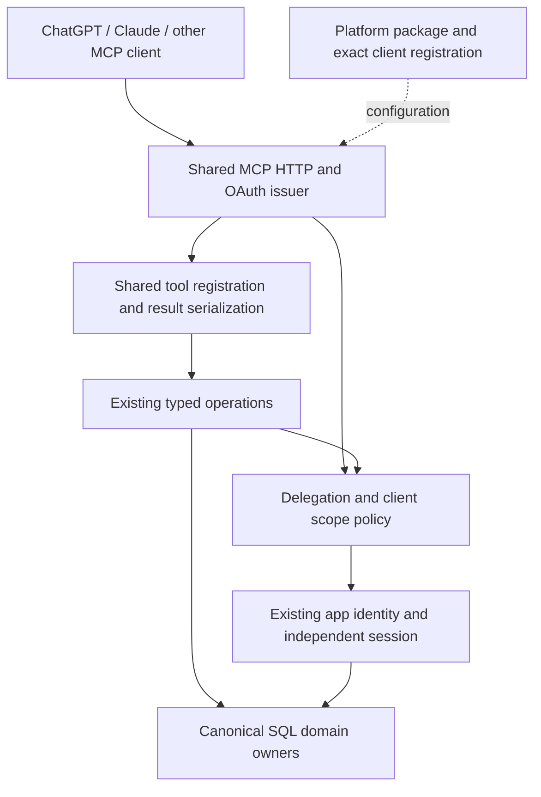

# Festapp in ChatGPT: authenticated read pilot

Date: 2026-10-26; architecture hardening: 2026-10-27
Status: Local read contract, real Auth/Edge/SQL and cutover adapters tested; regional production cutover and ChatGPT acceptance pending
Verification: standard (OAuth, permissions, public contracts and production)

## Execution clarification - 2026-10-27

The user authorized operating a new browser tab in their existing ChatGPT account.
The regional product must be identifiable as `vstupenky.online`, with an explanation
of its relationship to Festapp that is absent for global Festapp Tickets users.
Two independent branded connections with shared implementation are the intended
presentation. Public listing eligibility and URL migration were investigated in
[branding and URLs](chatgpt-mcp-branding-and-urls-2026-10-27.md). The current pilot
currently uses its existing URL and registered client; the approved regional address is `https://mcp.vstupenky.online/mcp`. DNS and a
global client remain unprovisioned. Separate final public addresses are required
before connecting/testing ChatGPT on this pilot; the global domain must first be verified.
Changing a published origin is not a routine config edit.

Current `main` at execution was `00c1da5ce` (includes the MCP image contract fix).
Implementation uses isolated branch `feat/chatgpt-mcp-pilot-20261027`; the original
checkout and its three unsaved planning documents were preserved. The current main
protection requires one independent approving review. No admin bypass is authorized.
See the [execution record](../operations/chatgpt-mcp-pilot-2026-10-26.md) for the
actual test, deployment and acceptance state rather than the unchecked historical
exit criteria below.

## Outcome and scope

An organizer connects Festapp in ChatGPT, signs in on the existing first-party
tenant, explicitly selects occasions, and receives accurate sales summaries and
bounded order answers. Reconnection, refresh and issuer-side disconnection work.
The connection cannot create occasions, change orders, record payments or send
tickets. Success means a real ChatGPT conversation, not merely a healthy URL.

This is an integration of the existing MCP, not completion of the administration
roadmap. Target only the existing ticketing tenant, vstupenky.online. Other
tenants, Claude, new commerce/checkout flows, custom chat UI, generalized client
registration and write capabilities are outside this implementation.

Architectural portability to Claude and other MCP clients is in scope. Their
production registrations, accounts and directory publication are not. Standard
MCP clients must exercise the same operation and authorization contracts.

The current user request is to prepare this plan. No implementation, deployment,
publication, purchase, commit or push is performed by this planning task.
Subsequent implementation should execute waves 0-4; wave 5 prepares public
submission without making directory approval a prerequisite for pilot success.

## Fixed point and working tree

Original HEAD: `1ed734f747044ab8989b5b565f39cdb8f5a807e1`.
Hardening HEAD: `9b1e856f7cc8dfd1507a0c696db97e5e3c4f0a04` (admin MCP stage 4).
Observed branch at hardening: `work/mcp-pilot-note-20261026`.
The workspace advanced during investigation, including additional shared MCP
operations. Do not mistake those operations for this pilot's scope. Preserve
unrelated changes. At implementation,
inspect the current diff and use a separate clean worktree based on authoritative
main if necessary; do not base the integration on the notification feature branch
or sweep its files into a release. Reconcile relevant MCP changes already on main
before editing. Shared code belongs to main; only one selected tenant is in scope.

## Current-state evidence

| Fact | Owner/evidence | Consequence |
| --- | --- | --- |
| Public HTTPS is already active | Earlier checks in `docs/operations/chatgpt-mcp-pilot-2026-10-26.md`: health/discovery 200, unauthenticated MCP POST 401 | Missing-DNS text in the historical remote-auth record is not a current blocker; authenticated operation remains unproved |
| OAuth has a maintained implementation | `tools/festapp/src/remote/server.mjs:createRemoteApp`, `config.mjs:parseRemoteConfig`; oidc-provider, static public clients, PKCE, exact audience, opaque tokens, rotating refresh | Extend this owner; do not build a second OAuth server |
| Current registered clients are public and static | Config schema exposes client ID/name/type/redirects; provider registration is disabled and token auth is `none` | Start with registered `festapp-chatgpt`; CIMD/DCR are not required by the supported provided-client route |
| Tokens are short-lived and grants are bounded | Server TTL: access 300 seconds, grant/refresh seven days; encrypted remote storage | Test refresh across access expiry and deliberate reconsent after grant expiry |
| Ordinary-user and delegation checks compose | `remote/delegation.mjs:DelegatedOwner.current`, `authorized`, `delegatedContext`; `packages/festapp_contracts/mcp-permissions.mjs` | Both consent and token must authorize the operation, then live SQL rights apply |
| Read-order functionality already exists | `operations/orders.mjs:orderDescriptors`, `invokeOrderOperation`; `database/functions/eshop_orders/operator_orders.sql` | Use existing report/list/detail readers rather than exposing SQL or duplicating calculations |
| SQL owns scope and order semantics | `check_operator_order_scope_internal_v1`, `get_operator_order_report_v1`, `get_operator_orders_v1` | Bind organization/organizer/occasion in the canonical transaction; do not calculate valid sales totals from a fetched order page |
| Tools are dynamically filtered per grant | `operations/catalog.mjs:Operations.catalog`, `remote/delegation.mjs` | A read grant must advertise only its available read tools; force-call denial must also hold |
| Tool authentication metadata is currently only `_meta.securitySchemes` | `src/mcp/server.mjs:createServer` | Inspect actual serialized tools/list with SDK 2.3.1 and align the top-level auth declaration with current ChatGPT docs |
| Tool auth errors already have a partial linking hook | `createServer` returns `mcp/www_authenticate` for authentication/MFA codes; `DelegatedOwner.authChallenge` lacks error/description parameters | Improve the existing hook, distinguishing expired identity from legitimate scope denial |
| Descriptors lack tool titles at registration | `createServer` passes description/schemas/annotations, not title | Add useful titles to the selected read surface without renaming callable tools |
| Order data includes broader backend action eligibility | `operator_order_snapshot_internal_v1` returns `allowedActions` from SQL | Project delegated capabilities accurately; a read grant must not imply it can perform backend-eligible writes |
| First-party consent and management exist | `web_client/src/components/mcp/mcp_connection_page.js`, account connections page; `supabase/functions/mcp-session-exchange/{handler,management}.ts`; `remote/tenant-bridge.mjs` | Reuse app login, independent MCP-owned session and existing revoke boundary |
| Tests cover many protocol/permission cases | `tools/festapp/test/remote.test.mjs`, `orders-postgres.test.mjs`, component tests | Extend these seams; fixture tests do not prove ChatGPT behavior |
| A local consent runner is task-bound | `tools/festapp/test/local/consent.e2e.mjs` contains absolute historical fixture paths | Do not run it as a generic test or depend on those workstation paths |
| Initial scope discovery currently asks only for the base read scope | `remote/server.mjs:challenge`; resource metadata advertises the whole platform scope list | A standard client can connect successfully without gaining order reads; fix discovery/profile alignment rather than assuming a UI will request extra scopes |
| Registered clients have no scope ceiling in the current config schema | `remote/config.mjs`; all clients are initialized with the same global provider scope set | A package requesting read scopes alone is not a server-enforced pilot policy |
| Each authorized operation refreshes the downstream session and verifies live identity | `auth/session.mjs:SessionOwner.authorized`, `identity`; locked refresh-token rotation | Count these costs before optimizing; never cache permissions to improve a benchmark |
| Transport compatibility already exists | `remote.test.mjs` exercises modern 2026-07-28 and legacy SDK HTTP clients | Extend the existing matrix; do not implement another transport for Claude |
| Deployment is an independent sidecar | `Dockerfile.remote`, `remote-compose.yml`, `Caddyfile.remote` | No Flutter rebuild or unrelated Supabase restart for MCP-only changes |

Representative path: ChatGPT -> resource/issuer discovery -> registered-client
authorization code + S256 -> tenant app login -> session-exchange broker ->
explicit resource/permission consent -> encrypted delegation and separate backend
session -> MCP bearer validation -> shared operation -> canonical SQL with live
actor rights -> validated structured result -> ChatGPT answer.

## Target contract

### Ownership and reusable seams

Keep the existing modules; deepen their interfaces where a caller currently has
to reconstruct policy. Do not create a connector framework or move code merely
to create layers. Responsibilities and allowed dependencies are:

| Module | Interface responsibility | Must not know |
| --- | --- | --- |
| Canonical SQL | Business rules, live actor rights, aggregate reads/transactions | ChatGPT, Claude, MCP client names |
| Existing operation modules | Typed inputs/results; scoped domain invocation | Host UI, host prompts, OAuth callback URLs |
| Permission contract | Scope dependencies and operation requirements | SDK classes, HTTP response objects, platform names |
| Delegation/issuer | Client policy, token/grant/session lifecycle and live authorization | How a model phrases an answer |
| Shared MCP serializer | Tools, schemas, annotations, content and auth error translation | New domain decisions or a second permission model |
| Platform configuration/package | Client identity, exact redirects, optional presentation metadata and distribution | SQL, prices, order eligibility, custom business implementations |

The existing CLI and remote MCP already prove that operation reuse is real.
OpenAI-specific optional metadata may be emitted as an extension by the shared
serializer and ignored by other clients. Do not select security or business
behavior from User-Agent, clientInfo, a vendor string or an untrusted header.
No platform adapter class or plugin registry is needed just to hold constants.

### One operation policy, reused everywhere

Extend `packages/festapp_contracts/mcp-permissions.mjs` with a small pure lookup
for the complete required scopes of a known operation, including base reads and
occasion creation. Keep current scope dependency definitions authoritative.
Unknown operations fail closed; do not interpret an empty lookup as permission.
The issuer, delegation checks, tools/list auth metadata and effective capability
projection use this lookup. Domain effects/schemas remain in existing operation
descriptors; SQL remains the authority for business rights.
Apply the lookup to hosted delegated operations, not local-only CLI commands
that do not participate in remote OAuth. No artificial OAuth grant for CLI.

Use this intersection consistently:

`registered-client ceiling ∩ token scopes ∩ persisted consent ∩ live domain rights`.

Discovery advertises supported capabilities, not a grant of them. Operation
visibility narrows the catalog but does not replace call-time enforcement.
Do not duplicate operation-to-scope or backend-action mappings in a ChatGPT file.

### Registration and least-privilege bootstrap

Cut over the regional issuer/resource to `https://mcp.vstupenky.online/mcp`
through wave 2b **before** any further ChatGPT setup/acceptance. Preserve the
existing authorization implementation; do not introduce another OAuth owner. Keep the provided
public client `festapp-chatgpt`, token endpoint authentication `none`, and exact
verified ChatGPT callback. Do not enable DCR or CIMD just to get past setup.
If the account UI cannot configure provided clients, use the documented plugin
package configuration route. If that also cannot establish a personal pilot,
record the exact incompatibility and revise this wave before widening registration.

Make the pilot's registered-client policy read-only at the issuer, not merely in
the package. Add an optional explicit `allowedScopes` ceiling to existing client
configuration, validating known scopes and dependency completeness. Configure
`festapp-chatgpt` with only base read and order read domain scopes; allow the
provider's required identity/session scopes separately. Reject excessive requested
scopes before consent and intersect the ceiling again on token use and refresh.
An old wider grant must not retain writes after this ceiling is narrowed.
Other existing clients with omitted ceilings retain their current behavior;
never retrofit a broad global read-only limit onto native clients. New external
client setup instructions require an explicit ceiling.

The shared `/mcp` endpoint cannot infer a registered client before OAuth. Keep
its unauthenticated challenge minimal (base read). The ChatGPT provided-client
package/configuration explicitly requests base plus order read and is the
reproducible setup path. A bare-URL connection receiving only base read remains
a valid limited connection, not a sales pilot success. Do not fix that by
advertising all write scopes, choosing scopes from User-Agent, creating per-vendor
MCP endpoints or silently adding unrequested scopes at consent. If the actual
ChatGPT setup surface cannot request the required scopes, settle that with a
minimal private package/configuration in wave 0, not only during public packaging.

The base read scope is an existing external contract and retains its
historical name; renaming it is not necessary for this pilot.

Expected tools for this grant:

| Tool | Role |
| --- | --- |
| `festapp_access_inspect` | Discover consented, currently accessible occasions |
| `festapp_context_inspect` | Resolve context and effective capabilities |
| `festapp_ticket_layouts_inspect` | Existing base-scope read, retained rather than silently broken |
| `festapp_orders_report` | Canonical sales/ticket/payment totals, preserving currencies |
| `festapp_orders_list` | Search/filter/keyset pagination, maximum 50 orders |
| `festapp_orders_inspect` | One scoped order detail |

The three base reads are already coupled by READ_OPERATIONS. Do not add an
alternative endpoint solely to hide ticket-layout reading. If the measured live
catalog differs, determine whether the cause is absent scope, backend readiness
or deployed revision; do not fall back to less authorized data access.

Target invariants:

1. SQL is the domain authority; Node is the typed protocol/delegation adapter.
2. Token AND stored grant AND current actor rights authorize every private call.
3. Selected occasions do not imply future-event or whole-organizer consent.
4. Read-only pilot grants expose no writes, and direct attempted write calls fail.
5. No supplied actor ID, service-role credential, raw SQL or copied app JWT can
   bypass the delegated operation boundary.
6. Revocation discards in-flight private results and denies refresh/subsequent reads.
7. Auth-expiry signals trigger usable relinking. Foreign resources remain access
   denials, not automatic requests for broader permissions.
8. Customer fields, notes and form answers are untrusted data, never instructions.
   Evidence/logs exclude passwords, tokens, authorization URLs and buyer PII.
9. Results preserve decimal strings, currency, actual order states and page limits.
   Empty results are empty; a partial page is never described as the full event.
10. Existing native Codex clients, grants and tenant login remain compatible.
11. A registered client cannot acquire capabilities beyond its configured ceiling,
    including through old grants or refresh. A second client cannot use its token.
12. Protocol-standard errors work without OpenAI metadata; optional extensions
    cannot change authorization decisions or domain result meanings.

### Error and lifecycle contract

Distinguish these outcomes at one shared translation seam; use existing error
codes where they already carry the needed meaning, adding a code only where
the present FORBIDDEN loses a necessary distinction:

| Cause | Protocol behavior | Reuse/UX rule |
| --- | --- | --- |
| Missing, expired or revoked MCP identity | HTTP 401 and resource metadata challenge | No private data; reconnect using standard OAuth |
| Valid identity, operation scope missing | Explicit insufficient-scope signal only if that operation is allowed by client policy | Full required scope set in one challenge; no repeated single-scope prompts |
| Client ceiling excludes action, foreign occasion or removed domain right | Access denial, no scope escalation | Never suggest broader consent as a cure for absent business rights |
| Backend identity/MFA cannot continue during a call | Safe authentication error and matching linking extension where supported | Revoke unusable delegation; MFA fails closed, not an automatic successful retry |
| Upstream timeout or throttling | Bounded retryable error; preserve request correlation | Respect backoff; no unlimited retry or repeated login loop |

For insufficient scope before operation execution, the HTTP and tool-level
representations must reflect the actual negotiated protocol/SDK behavior.
Test the wire response; do not throw an auth error as a misleading generic 200
success. Never leak the reason a foreign resource exists. Keep grant keys/session
binding, token refresh, revocation and single-process storage with their current
owners; no second token cache or distributed store for this pilot.

### Efficiency contract

Implementation: waves 0-1 are one coherent local change; run one targeted batch
after that change. Reuse current tests for covered cases and extend only missing
behavior. A changed auth/metadata file does not justify rebuilding Flutter,
rewriting SQL, walking every administration screen or surveying every tenant.
Do not run the broad operator suite and then rerun its included test files.

Runtime: default to access discovery once per conversational task when the event
is unknown, then direct report/list/detail calls. No mandatory sequence of context,
list, inspect and report for every question. Sales totals use the report, not
exhaustive page traversal. Keep list page default 25/max 50 and details explicit.
Preserve numeric-string money, currencies and pagination semantics. Do not add
summary-per-product tools or a generic executor to save tool descriptions.

Create one small deterministic evidence fixture with an allowed and denied actor,
multiple occasions, unpaid/paid/empty results and at least 51 orders to exercise
the page boundary. Capture tools/list size, each selected result's serialized
UTF-8 bytes, calls and backend requests per task, plus warmed wall time with
sample count/runtime details. Separate fixture timing from live ChatGPT latency.
Measure actual tokenizer counts only if an appropriate local tokenizer is
available; bytes are not token counts. No paid model call is needed for this.

`createServer` currently repeats full JSON in text content and structuredContent.
Inspect actual client consumption before changing that contract. Keep one
canonical validated DTO; reduce duplication only if modern and legacy consumers
both retain their required data. Do not truncate a declared result, invent a
second vendor-specific DTO, omit fields required by schema or break clients that
parse the text JSON. Improvements need measured before/after evidence, not a
claim that every client spends twice the tokens.

Likewise, profile activation, backend session refresh, identity/MFA and live
rights are currently checked during authorized calls. Count their latency and
request cost first. Optimize redundant immutable/schema work only when measured;
do not cache private results, revocation or permissions, weaken identity checks,
or replace canonical SQL to meet an arbitrary speed target. Bound auth endpoints
comfortably below the strictest supported client's documented timeout. A larger
session-lifecycle optimization is a separately justified follow-up if it is not
needed to pass the first real ChatGPT task.

## Decisions, assumptions and external dependencies

**Decisions:** reuse the remote server and first-party consent; begin read-only;
use provided-client OAuth; keep UI optional; perform no model API call from
Festapp for this integration. Adding a plugin skill is useful only after the
tool-only pilot demonstrates that reusable workflow instructions are needed.

**Platform portability matrix (documented requirements, not live acceptance):**

| Client | Shared contract | Deliberately platform-specific setup |
| --- | --- | --- |
| ChatGPT | HTTPS MCP, PKCE, resource discovery, delegated operations | Provided public client/scopes, actual callback, optional linking metadata and plugin package |
| Claude hosted | Same MCP/OAuth and operations | Register separately; documented hosted callback is `https://claude.ai/api/mcp/auth_callback`; settle supported public/configured-client vs confidential/CIMD route before activation |
| Claude Code | Same domain/permission owner | Native client registration and current documented loopback rules; do not broaden existing Codex redirect policy in advance |
| Other MCP clients | Standard discovery, challenges, schemas and results | Own exact client registration and scope ceiling; no vendor identity inferred from clientInfo |

Claude's documented initial scope choice honors the HTTP challenge, and its
discovery/token endpoint timeout is 10 seconds (refresh 30 seconds). These are
future compatibility constraints, not evidence of an accepted Claude connection.
Keep optional OpenAI extensions dispensable. CIMD can become a separate bounded
issuer enhancement when an actual client requires it; no DCR/CIMD work now.

**Assumptions to resolve in wave 0:** the intended ChatGPT account can create a
custom MCP connection; its actual redirect matches or can be explicitly registered;
the live image contains order readers and their canonical SQL prerequisites; the
chosen operator can use the existing independent session-issuance flow.

**External dependencies:** operator account login/consent and ChatGPT connection
configuration cannot be inferred from public probes. The operator performs these
in their own account, or explicitly authorizes a new browser tab. Automated QA
uses an isolated background session. Do not take over an existing browser window.
Existing MFA limitations must fail closed; never disable MFA to satisfy a demo.

No missing answer prevents local contract implementation. Do not request
credentials in chat. Do not buy plans or paid services to resolve account access.

## Implementation waves

Execution order amended by the user: finish reviewed source and safe local checks,
perform wave 2b as part of the protected wave-3 release, verify the regional URL,
then resume wave 0's account setup and wave 4. Do not accept another connection on
the old hostname merely to complete an earlier checklist.

### Wave 0 - pin the real connection requirements

Goal: settle account and live-version facts before changing authentication.

Changes: record a sanitized connection manifest in the pilot evidence: account
surface/workspace availability, actual callback, provided client mode, requested
scopes, deployed source/image digest, tenant activation identity and available
backend read owners. Read current deployment records first. Inspect production
only through `festapp-backend-access` if protected runtime access is needed.
Verify tenant activation before any database/user data read. Capture only
non-secret selected fields; never dump private runtime config.

Build the minimum private connection package/configuration now if needed to
express provided client + explicit order-read scope. Public listing assets/legal
materials remain wave 5. Inventory registered-client capabilities and compare
documented ChatGPT and Claude setup requirements without registering a live
Claude client. Both platforms can reuse OAuth, but their registration paths
and hosted/native callback rules differ. No blanket promise of zero future auth
work: a Claude public directory listing may need a confidential client or CIMD.

Validation: public metadata + existing release evidence; operator checks the
actual management page. An unavailable account does not block local waves 1-2.
Exit: configuration is reproducible, and live/source drift is explicitly known.
No migration, registration change or production mutation is part of this wave.

### Wave 1 - make the existing MCP contract work cleanly in ChatGPT

Changes:

- `packages/festapp_contracts/mcp-permissions.mjs`: introduce the single known-
  operation scope lookup described above; reuse it in delegation, auth metadata
  and capability filtering. Reject missing mappings without widening the catalog.
- `remote/config.mjs`, `remote/server.mjs`, `remote/delegation.mjs`: implement
  and enforce optional per-client allowedScopes; configure the pilot ceiling,
  preserving existing clients and all already-narrow consent constraints.

- `tools/festapp/src/mcp/server.mjs`: publish per-tool auth information in the
  supported SDK wire format, not merely an assumed JavaScript option. Keep any
  required `_meta` mirror generated from the same schemes. Use SDK serialization
  tests to decide whether a supported lower-level registration boundary is needed;
  never patch node_modules or pin a second SDK for this integration.
- Add titles for selected descriptors and preserve stable callable names/schemas.
- `remote/delegation.mjs` / `remote/server.mjs`: enrich existing linking challenges
  with accurate error and description when appropriate. Preserve HTTP 401 at the
  transport boundary and tool-result metadata for authentication lost during a
  call. Do not classify every FORBIDDEN as an expired login.
- `operations/orders.mjs`: inspect backend action names and intersect the returned
  `allowedActions` with delegated capabilities. Read-only connections return no
  executable write actions. Keep ordinary CLI behavior and canonical SQL unchanged.
  `database/functions/eshop_orders/order_actions.sql` uses action labels such as
  `view`, `note`, `cancel`, `send` and `paid`, not MCP operation IDs. Map the
  existing action vocabulary once at the operation adapter, retain valid read
  actions, and deny unknown write labels; do not intersect unequal strings or
  replace the SQL state/eligibility calculation.
- Keep platform constants and packaging in `integrations/chatgpt/`; protocol and
  error helpers stay in the shared MCP/remote modules. Add no vendor conditionals
  to SQL, operation handlers or permission contracts. Use an existing small helper
  or private pure function where it removes repeated policy, not a new framework.
- Improve selected descriptions only where necessary to select an occasion,
  distinguish tickets from orders, preserve currencies, understand cursor pages
  and treat customer text as data. Do not put authorization solely in descriptions.

Migration/deletion: no SQL migration expected. Replace metadata-only auth
declarations with one generated supported contract; do not maintain two sources.
If a missing backend function is discovered, identify the existing migration and
its production dependencies rather than inventing a new reader.

Failure/compatibility: expiry/revocation during a call must leak no result; permission
denial must not widen consent; native/local tools retain their existing semantics.
Exit: SDK tools/list and calls expose the expected metadata, schemas, exact read
catalog and denial behavior for synthetic grants.

### Wave 2 - prove the path with repeatable local evidence

Changes: extend existing test seams, with additional fixtures only where they
exercise missing behavior. Use a reusable disposable fixture for actual
Auth/broker/SQL integration; do not reuse historical absolute-path runners or
production data. If the existing runner is adapted, parameterize its paths and
retain disposable identity, paused mail and cron guards.

Required cases: exact read tools/list; top-level auth serialization and metadata
mirror agreement; bad callback/PKCE/audience; access-token refresh; refresh replay;
grant expiry; permission and resource narrowing; read-only direct write denial;
two actors; live role removal; in-flight revoke; restart with preserved encrypted
state; orders pagination/filtering/totals; hostile customer note cannot cause a
write or exfiltration. Existing tests may satisfy cases without duplication.

Validation: run the targeted commands in the verification table once after the
coherent change. Exercise real local PostgreSQL for relevant readers with zero
skips. Change consent UI only if evidence requires it, then run its component and
isolated browser checks. Exit: dated sanitized fixture evidence distinguishes
real local Auth/SQL from mocked protocol cases. No public ChatGPT claim yet.

Reuse this fixture for the two-client portability assertions and byte/call
baseline in the verification strategy; do not build independent test harnesses.

### Wave 2b - regional endpoint cutover (added by user decision 2026-10-27)

Before any further ChatGPT connection setup or acceptance, make
`https://mcp.vstupenky.online/mcp` the canonical
regional resource for the connector named `vstupenky.online`. Keep the current
`https://mcp.festapp.net/mcp` unchanged until this coordinated cutover is ready.
The global `Festapp Tickets` connection has its own final address under a verified
global domain. Do not provision a guessed global domain or a second production
client in this regional pilot.

This is a required delivery phase, not a suggestion to revisit naming later.
Use the [brand/URL decision](chatgpt-mcp-branding-and-urls-2026-10-27.md) for evidence
and exact migration concerns. Work remaining in this phase:

- Verify selected-zone ownership, DNS/TLS, routing and challenge-path ownership;
  expose only reviewed regional MCP/OAuth/discovery paths through the proxy.
- Choose and implement exact regional resource/issuer URLs through the existing
  owners. The current config derives resource from issuer and rejects another
  Host; a DNS alias alone cannot pass. Keep static `festapp-chatgpt`, read ceilings
  and exact verified callback; no DCR, broad grant or generic client router.
- Reconcile all URL-pinned first-party boundaries (the exchange now returns its
  registry-owned issuer and the web client checks continuation against it): consent continuation validation,
  tenant broker config, session-exchange allowlist, management route and app CSP.
  Do not leave two independent authority paths or broadly allow arbitrary origins.
- Inventory affected connections without PII. Issuer storage is pinned to
  `digest([issuer, profile.binding])`; changing issuer against the existing state
  must fail. Prepare protected backup and an explicit fresh-state/reconsent
  transition rather than editing stored bindings or translating old audiences.
  Retain issuer keys and scope ceilings; do not reset first-party app sessions.
- Prepare native/Codex reconnection instructions if issuer/resource changes.
  Preserve the supported client registrations and verify them at the new target;
  do not promise that credentials bound to the old issuer/resource remain valid.
- Update private setup/package URL, refresh ChatGPT metadata and execute wave 4
  on the final regional address. Validate old-resource and wrong-client rejection,
  refresh, in-flight revocation, both protocol eras and controlled rollback.
- Keep the old route only for the explicitly staged transition/rollback window;
  retire it as a regional authority after the new connection is accepted. Do not
  repurpose an old regional grant as global Festapp access.

Normal protected main review, scoped backend/hosting release rules and cheaper
subagent deployment delegation still apply. This phase permits no other tenant
release, new global registration or public directory submission. The exact
production mutation is performed only through those existing release gates.

### Wave 3 - release only the required sidecar changes

Goal: production runs the validated contract at a pinned revision.

Before publishing source, inspect current branch protection, fetch authoritative
main, reconcile new commits, and run affected checks. Historical documentation
records required PR approval; do not assume a bypass or impose an obsolete rule.
Follow current protection and normal main/tenant ancestry. Freeze source SHA.

Delegate routine build/deploy/probes to `gpt-6-luna`, low effort, `fork_turns=none`,
per standing repository instructions. Give it exact source SHA, image digest,
selected tenant, changed files, commands and gates; engineering failures return
to the primary agent. Build/deploy the independent remote image using existing
Dockerfile/Compose. Preserve issuer/storage/cookie/signing keys, clients and
encrypted state. No Flutter build or other tenant release for a sidecar-only fix.

Any tenant web change or missing existing SQL prerequisite is a separate scoped
release action, with its own applicable release/backend skill and authorization.
Do not bundle a broad authorization migration into this pilot silently.

Validation: packaged health, metadata, unauthenticated POST challenge, immutable
image/source match and measured resource/error behavior. Refresh ChatGPT metadata
after rollout. Exit: the source revision tested locally is proven to be serving.
Do not deploy from the dirty notification branch.

### Wave 4 - real ChatGPT acceptance

Connect with the exact registered client/callback and only read permissions.
Select individual occasions first. The operator completes first-party login and
consent. Inspect discovered tools, refresh metadata and start a new conversation.

| Scenario | Observable acceptance |
| --- | --- |
| P1: Which of my occasions can you access? | Only currently authorized and consented occasions; no fabricated IDs |
| P2: Summarize sales for a selected occasion | Canonical report, correct tickets vs orders, amounts/currencies preserved |
| P3: Show unpaid orders for that occasion | Correct stored state mapping, bounded page, accurate indication of more pages |
| P4: Find an order by known sample symbol | Scoped search result, no QR/auth secrets, no unnecessary customer fields in answer |
| P5: Explain that order's status | Correct detail and useful explanation, no proposed executable write permission |
| N1: Read an unconsented occasion | Denial; no foreign details and no silent broader consent |
| N2: Cancel an order or send its tickets | No advertised write and no mutation, payment, queue or mail effect |
| N3: Read after issuer-side disconnect | Denial even if the old token has not yet expired |

Also test a follow-up across normal access-token expiry, empty results, ambiguous
occasion selection and synthetic hostile notes. Never log tokens while debugging.
Use synthetic reviewer data for repeatable scenarios; do not mutate real records
to demonstrate denial. Record request IDs, tool names, outcome and revision,
not buyer data. If synthetic live setup requires writes, provision it through
an explicitly scoped fixture/setup action before testing.

Exit: evidence at the final regional MCP URL for real ChatGPT login, tool discovery, useful answers, refresh
and revocation. If account access is unavailable, local implementation may be
reported complete but the pilot must remain explicitly unaccepted.

### Wave 5 - prepare public distribution

After wave 4, create a portable package at `integrations/chatgpt/` with one root
`plugin.json`, `mcp.json`, real owned assets and a README. Validate its current
schema; declare provided client, `none` token auth and exact read scopes. Include
no secret/header token. Add skills only if their value was established in pilot.

Prepare verified publisher, product/support/privacy/terms URLs, dedicated populated
demo account, five positive/three negative executed cases and accessible walkthrough.
Do not put reviewer credentials in the package; use the secure portal field.
Keep issuer/host changes for the real domain challenge separate and preserve any
existing token at the challenge path. No dummy URLs or invented attestations.

Exit: reviewable package and honest readiness record. Upload/submission/publication
occur only within the then-authorized scope; directory approval is external and
does not block acceptance of the private pilot.

## Verification strategy

Planning executes no tests. During implementation use pnpm 11.24.0, pinned
dependencies and the existing package lock; Node 24 is the hosted runtime.

| Change/risk | Targeted check |
| --- | --- |
| OAuth, grant narrowing, tool serialization | `pnpm --dir tools/festapp exec node --test --test-concurrency=1 test/remote.test.mjs` with added SDK wire assertions |
| Shared MCP/CLI serialization changed | Include `test/stdio.test.mjs` and `test/readiness.test.mjs` in the same single-concurrency Node batch as remote tests; expand to the full operator suite only for broader affected behavior or unresolved regression evidence |
| Canonical order reads | `FESTAPP_MCP_TEST_DATABASE_URL` privately set to marked disposable target; `pnpm --dir tools/festapp exec node --test --test-concurrency=1 test/orders-postgres.test.mjs` |
| Consent/management UI changed | `pnpm --dir web_client exec node --test tests/components/mcp_connection_page.test.js tests/components/account_connections_page.test.js` plus background agent-browser flow if needed |
| Edge broker changed | Use the repository's current Deno/Edge test command for the affected handler/config/management test files; determine it from existing tooling, not a new runner |
| Real account behavior | Wave 4 transcript outcomes and redacted request IDs tied to source/image revision |

If a broad package run already includes the targeted files, do not repeat them.
Default combined Node batch: `pnpm --dir tools/festapp exec node --test
--test-concurrency=1 test/remote.test.mjs test/stdio.test.mjs
test/readiness.test.mjs test/orders-postgres.test.mjs`, with the marked disposable
DB configured privately. Skip counts must be explicit; required auth/order cases
must not be skipped. Add UI/Edge checks only if those owners changed.
Avoid Flutter work unless native UI changes are necessary; then obey the global
single-task limit and `--concurrency=1` for tests. No paid API Playground run is
needed for this MCP pilot. No claim of refresh compatibility from fixture tests
alone substitutes for the actual ChatGPT follow-up check.

For portability add a second synthetic registered OAuth client with a different
callback and scope ceiling to the existing fixture. Run the same discovery,
authorization, read and revocation assertions for both client IDs on the same
server, and prove cross-client token/grant separation. Exercise modern HTTP and
the existing legacy HTTP/stdio matrix through shared operation contracts. This
proves reusable protocol behavior, not an actual Claude account connection.
Include a client that ignores optional OpenAI metadata and relies on HTTP auth.

Required additional assertions: an explicitly read-only client cannot request,
refresh or execute write scopes, even with an older wider grant; base-only bare-
URL setup is distinguished from the order-read pilot; unknown operation scope
mapping fails closed; optional metadata does not affect enforcement. Reuse the
efficiency fixture for call/byte baselines, rather than a second benchmark suite.

## Consolidation and rollback

| Artifact | Action and proof |
| --- | --- |
| Existing stdio MCP and native Codex registration | Retain as distinct supported clients; targeted tests prove no regression |
| Historical base scope name | Retain intentionally as external OAuth contract; no alias or parallel scope |
| `_meta` auth declaration | Keep only if supported compatibility metadata, generated from the same per-tool schemes; serialized values must agree |
| Old setup claims and DNS blocker | Update current README and pilot guide after acceptance; mark historical evidence superseded, do not erase historical outcomes |
| Task-specific local fixture runner | Do not make it the pilot's required path; parameterize only if reused |
| Extra OAuth server, generic SQL tool, anonymous private data route | Do not introduce; scoped declaration/caller searches and protocol tests prove absence |

Rollback restores the previous immutable sidecar with its unchanged keys/state
if compatible. If auth/identity fails, disable only MCP routing/service and revoke
affected connections; do not reset app login, alter business data or restore a
legacy backend. A package uninstall alone is not issuer-side revocation. Any
persisted storage format change needs a separate compatibility and restore
decision before rollout; no storage format change is expected.

The new optional client ceiling is an actual config change: back up its protected
file and verify restart compatibility. The previous image may reject that field.
Never remove a read-only ceiling and reactivate wider old grants merely to make
rollback start; use a compatible image or disable/revoke the pilot client before
restoring a previous config. Scope policy must not broaden during rollback.

## Completion and residual risk

Current execution evidence is in the
[pilot record](../operations/chatgpt-mcp-pilot-2026-10-26.md#regional-deployment-and-live-account-evidence---2026-10-27).
The regional cutover is deployed. Real ChatGPT consent, six read tools, selected
occasion report/list/detail/search, out-of-consent denial, continuity across
normal token expiry and immediate issuer-side revocation have passed. Live
hostile-note and ambiguous-selection cases remain outstanding; do not label
the entire wave accepted from the core connection checks alone.

- [x] Existing remote MCP is the only hosted operation/auth owner.
- [x] Pilot grant has the exact read catalog and effective read-only capabilities.
- [x] Local protocol, permission and real disposable owner checks pass.
- [x] Validated source/image revision is identified for the live endpoint.
- [x] Actual ChatGPT connection, useful read results, continuity across expiry
      and revocation pass (opaque refresh exchange was not logged).
- [x] Current connection documentation matches observed setup; historical evidence
      is clearly bounded, not presented as current failure or success.
- [x] One operation-scope lookup and client ceiling drive issuance, invocation,
      refresh, discovery and effective capabilities; local CLI is unchanged.
- [x] Two registered test clients pass shared protocol/lifecycle assertions without
      relying on vendor metadata; no real Claude support is claimed without its test.
- [x] Byte/call/timing evidence exists for the small fixture; no duplicate test
      harness or speculative connector framework was introduced.
- [x] Public package readiness is recorded separately from pilot acceptance.

Main residual risks: account/UI availability; actual registered-client callback;
live backend/source drift; existing MFA/session issuance limitations; SDK wire
compatibility; and policy/review changes before public submission. Resolve them
at their named wave, never through broader credentials or guessed fallbacks.

Indicative effort after architectural hardening: local policy/metadata work and
fixtures 3-5 engineering days; rollout and real ChatGPT acceptance 1-2 days with
account access. Public materials add about
2-4 days. These estimates exclude approval queues and substantial pre-existing
backend/auth defects discovered by the pilot.

## Official documentation checked 2026-10-26; portability checked 2026-10-27

- [Authentication](https://developers.openai.com/plugins/build/auth): per-tool
  OAuth declarations, S256, callbacks, expiry and linking challenges.
- [Connection testing](https://developers.openai.com/plugins/deploy/connect-chatgpt):
  test installed experience and refresh cached metadata after server changes.
- [Packaging](https://developers.openai.com/plugins/build/plugins): portable
  package and MCP authentication configuration.
- [Submission](https://developers.openai.com/plugins/deploy/submission): provided
  clients, verification, review evidence and publication workflow.
- [MCP authorization](https://modelcontextprotocol.io/specification/2026-07-28/basic/authorization):
  protocol-level discovery, client registration and operation-specific scope challenges.
- [Claude connector authentication](https://claude.com/docs/connectors/building/authentication):
  registration differences, HTTP sign-in, scope selection and endpoint timeouts.
