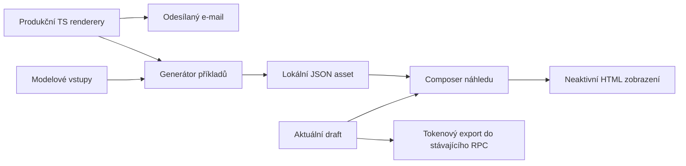

# E-mailové šablony: proměnné přes @ a názorné bloky

Datum: 2026-10-18, zpřesněno 2026-10-19
Stav: Implementováno lokálně 2026-10-19; viz [výsledky a limity ověření](email-template-mentions-implementation-2026-10-19.md)
Ověřování implementace: standard (zásah do sdíleného editoru a serializace)
UX návrh: [specifikace Astra medium](email-template-mentions-ux-2026-10-18.md)
Zdrojové ověření editoru: [nativní tagovací pluginy a konkrétní zapojení](email-template-mentions-editor-evidence-2026-10-18.md)

Zpřesnění po hlubším průzkumu: nainstalovaný Super Editor již obsahuje podporu mentions/tagů. Implementace má použít jeho veřejné pluginy, placeholdery a příklady; předchozí předpoklad o chybějícím základu byl chybný. Vlastní práce se soustředí na doménové vložení, HTML serializaci a napojení nabídek.

## Oprava předpokladů na kanonickém main (2026-10-19)

Implementační checkout vznikl z main `9638008fe`, odděleně od původního rozpracovaného checkoutu. Tento main již vyřadil samostatnou šablonu `ORDER_OVERVIEW`: viz `lib/components/email_templates/README.md` a registr v `email_template_model.dart`. Šablonu neobnovovat. Jeho `orderEmailOverview.ts` již sdílí modré tlačítko pro objednávkové i waitlist e-maily a vkládá odkaz do `ORDER_OVERVIEW_LINK_SLOT` uvnitř karty přehledu, před podpis. Původní níže uvedená očekávání plain-link varianty a `orderOverviewEmail.ts` platila pro jinou zdrojovou revizi; na tomto main je nahrazuje zachování současných dvou variant modrého tlačítka a slot-aware finalizace. Pure extrakce se proto týká dnešního `orderEmailOverview.ts` a `waitlistEmailRenderer.ts`.

Nynější SQL vlastní také waitlist tónové texty v `database/functions/eshop_waitlist/email_render_context.sql`. Generátor čte jejich existující literály a při změně tvaru zdroje selže; nepřidává SQL ani druhou vlastní překladovou sadu. Standardní TypeScript batch používá existující `orderEmailOverview_test.ts`; historický `orderOverviewEmail_test.ts` neexistuje.

## Výsledek a rozsah

Autor vloží proměnnou napsáním `@` nebo přes dostupné proměnné v úvodu editoru. V nabídce uvidí lidský název a příklad hodnoty. Tělo e-mailu ukazuje textové proměnné jako rozpoznatelné prvky a složené hodnoty jako názorné, nedělitelné bloky ze skutečného HTML e-mailových rendererů. Přehled obsahuje realistické položky, ceny a součet; odkazy a tlačítka mají podobu dodávanou konkrétním e-mailem a jsou v náhledu neaktivní. Ukázkový náhled zobrazí aktuální rozepsaný předmět i tělo s dosazenými příklady. Nenápadné doporučení nabídne nahrazení doslovně napsaného názvu aktuální akce proměnnou. Psaní e-mailové adresy nabídku ani krátce neotevře.

Součástí je předmět, tělo, inline i rozbalený editor, úvodní nápověda a všechny typy šablon, které mají deklarované proměnné. Návrh interakcí a vzhledu patří Astře s medium reasoning; stejné zadání modelu platí pro následnou implementaci UI.

Mimo rozsah: nový jazyk šablon, migrace uloženého obsahu, změny dědičnosti, oprávnění, doručování, fronty a platební logiky; AI služba pro analýzu textu; přesný náhled všech e-mailových klientů; odesílání testovacích e-mailů; produkční operace.

## Doložený současný stav

| Zjištění | Místo | Důsledek |
|---|---|---|
| Předmět je obyčejný `TextFormField`, tělo `EditableHtmlField`; úvod vypisuje `{{code}}`. | `lib/components/email_templates/views/email_templates_settings_page.dart`: `_buildSubsDefinition`, `_buildHtmlParent` | Doplnit oba vstupy a úvodní nápovědu. |
| Definice mají pouze `code`, `description`, `defaultValue`; existuje seznam pro každý kód šablony. | `lib/components/email_templates/email_template_model.dart`: `EmailTemplateSub`, `substitutionDefinitions` | Rozšířit metadata, zachovat identifikátory i existující seznamy dostupnosti. |
| `ORDER_OVERVIEW` je v registru, ale chybí v `getUsageDetails`; výchozí větev vrací prázdné `subs`. | Tentýž model | Nabídka musí číst registr podle kódu, nikoli odvozovat dostupnost z popisku použití. |
| `RichHtmlEditorController` používá Super Editor; reakce kromě stylů odstraňuje a tagovací plugin nepřipojuje. | `lib/components/html/rich_html_editor_controller.dart`: `_load`; lokální `super_editor` 0.3.0-dev.52 | Zapojit nativní plugin až po odstranění ostatních reakcí. |
| Dev.52 veřejně exportuje `StableTagPlugin`, `ActionTagsPlugin`, `PatternTagPlugin` a inline placeholdery. Tagovací zdroje a demo jsou shodné s ověřeným upstream SHA `d75f2d89cf6d5072e81dac4b17817867423eb381`. | `super_editor.dart`; `src/default_editor/text_tokenizing/`; oficiální `feature_stable_tags.dart` | Žádný upgrade/fork ani další mentions balíček. Použít action composition a atomický placeholder s vlastním kódem. |
| Editor uchovává HTML obálky a upravitelné listové uzly, včetně tabulek a odkazů. | `html_editor_document.dart`: `HtmlEditorDocument`, `_readInline`, `_writeInline`, `encode` | Tokenizace musí respektovat strukturu a zachovat původní HTML při otevření bez úprav. |
| Existuje jeden doménový vnořený widget serializovaný jako editorový `div`. | `lib/components/html/html_embedded_block.dart`: `HtmlEmbeddedBlock` | Lze převzít vzor widgetu, nelze tento persistovaný div použít přímo místo substituce. |
| `renderEmail` dosazuje `{{code}}` do předmětu i HTML a potom přidává wrapper. | `supabase/functions/_shared/emailDelivery.ts`: `substitute`, `renderEmail` | Zachovat transportní formát a kódy. `@` je interakce pro autora. |
| Potvrzení objednávky má platební instrukce v `balanceReasoning`, přehled v `fullOrder`; `paymentDetails` je v registru upomínky. | `supabase/functions/send-email/getTicketOrderConfirmationTemplate.ts`; `email_template_model.dart`; `_shared/orderOverview.ts` | Nestačí vytvořit vizuální blok pouze pro název `paymentDetails`. |
| Část proměnných obsahuje HTML, část je URL a část prostý text; existují camelCase i snake_case kódy. | Registr; `_shared/waitlistEmailRenderer.ts`; `_shared/orderOverviewEmail.ts` | Potřebná je klasifikace a omezení podle cílového pole, nikoli přejmenování kódů. |
| Waitlist preview RPC vrací vyřešenou šablonu/wrapper, nevytváří nabídku ani token. | `database/functions/eshop_waitlist/email_preview.sql` | Není to obecný renderer rozepsaného e-mailu; nový plán jej nepotřebuje rozšiřovat. |
| Editor vstupenky má scénáře a ukázková data. | `lib/components/ticket_layout/views/ticket_layout_editor.dart`: `scenario`, `previewData`, `preview` | Převzít princip ilustrativního obsahu a scénářů; nepropojovat datové modely vstupenek a e-mailu. |
| `generateFullOrder` vytváří skutečnou HTML kartu s produkty po vstupenkách a součtem; neobsahuje tlačítko přehledu. | `_shared/orderOverview.ts` | Generovat vzorové HTML stejnou funkcí; nepřikreslovat do něj neexistující části. |
| `order_overview_button` je v `ORDER_OVERVIEW` prostý odkaz, ve waitlist e-mailech stylované modré tlačítko. Waitlist renderer chybějící odkaz na přehled doplňuje po renderu. | `_shared/orderOverviewEmail.ts`; `_shared/waitlistEmailRenderer.ts` | Klíč příkladu zahrnuje producenta/šablonu. Zachovat obě skutečné podoby a podmíněné doplnění bez duplikace. |
| `HtmlView` automaticky linkifikuje, mění barvy odkazů a zapíná navigaci, zoom obrázků i video. | `lib/components/html/html_view.dart` | Náhled e-mailu potřebuje malý neinteraktivní renderer nad již používaným `HtmlWidget`, bez aplikačních úprav obsahu. |

Tok dnes: vyřešená zděděná šablona -> dialog -> koordinátor HTML draftu a médií -> `DbEmailTemplates.updateEmailTemplate` -> stávající RPC. Při odesílání producent sestaví substituce -> `renderEmail` -> wrapper -> šifrovaný snapshot a kanonická fronta. Změna zůstává před uložením na klientovi.

Průzkum proběhl nad rozpracovaným checkoutem `feat/occasion-setup-wizard-20261007`, nikoli čistým main. Při implementaci použít izolovaný checkout kanonického main a přenést jen aktuálně relevantní změny. Cizí rozpracované změny neslučovat ani nevracet. Zde vznikají pouze plánovací dokumenty; testy ani buildy se kvůli plánu nespouštěly.

## Kanonický kontrakt a vlastnictví

1. Databáze a odesílání nadále přijímají předmět/HTML s `{{code}}`. Nevzniká druhá větev interpretující `@code`. Prostý `@` je obyčejný text, pokud autor nic nevybere.
2. Dostupnost a druh proměnné vlastní jeden registr e-mailových definic. Z něj čtou nápověda, nabídka, počítání použití, doporučení i ukázkový náhled. `getUsageDetails` přestává být druhým zdrojem seznamů.
3. Čistá pravidla skenování, cílových polí, relevance a doporučení patří do `packages/festapp_core/lib/src/email_templates/`; lokalizované popisky do Flutter adaptéru u `email_template_model.dart`. HTML příklady generuje build-time nástroj ze skutečných TS rendererů a ukládá do verzovaného lokálního assetu. Sdílený HTML editor nedostane závislost na e-mailovém modelu. Metadata vystavit přes malý volitelný kontrakt editoru; bez něj zůstává jeho chování stejné.
4. Metadata rozlišují `text`, `url`, `richInline`, `richBlock`, cílová pole a doporučenou opakovatelnost. HTML fragmenty nejsou dovoleny nově vkládat do předmětu; URL lze použít jako text i jako cíl odkazu. Opakovatelnost je doporučení pořadí, nikoli zákaz uložit existující obsah.
5. Každý vybraný token nese stabilní kód v nativním objektovém placeholderu `AttributedText`, nikoli jen lokalizovaný název. Atomické úpravy, mazání a undo pracují s celým tokenem. Samostatné rich fragmenty mohou být blokovými uzly. Serializace vrací výhradně původní `{{code}}`, nikdy příklad, štítek, editorový div nebo objektový znak.
6. Otevření existující šablony rozpozná známé tokeny v textu i odkazech. Token v `href` zůstává atributem odkazu, nikoli viditelným blokem. Neznámé kódy nebo poškozené zápisy se zachovají a označí jako nerozpoznané; bez důkazu se nemažou ani nepřepisují. Známá HTML proměnná již přítomná v předmětu se zachová s upozorněním, nová nabídka ji nenabízí.
7. Pomocné dekorace a ukázkové bloky patří pouze do modelu editoru a zobrazení. Nemění HTML profil, sanitizer ani pravidla pro důvěryhodné URL. Nesmí vytvářet nový uložený formát `data-*` atributů.
8. Změna vzniklá doporučením je explicitní, vratná a vztahuje se na konkrétní výskyt v aktuální revizi draftu. Před použitím znovu ověřit rozsah i shodu. Detektor nečte HTML atributy, skryté styly, URL, existující tokeny ani ukázkové hodnoty.
9. Ukázková data neobsahují skutečné zákazníky, platné přístupové tokeny ani funkční platební QR. Náhled neukládá, neodesílá, nic nerezervuje a neotevírá živé akční odkazy.
10. `fullOrder`, platební údaje, změny a akční odkazy mají jediného vlastníka HTML podoby v produkčních TS rendererech. Flutter jejich layout znovu neimplementuje. Generované příklady jsou odvozené artefakty, nikdy ručně upravované zdroje.

### Pořadí, doporučení a náhled

Přesná prezentace se řídí přiloženou UX specifikací. Základ rozhodnutí: filtr oprávněných proměnných pro typ šablony a pole, pak relevance hledání, skupina dosud nepoužitých nebo běžně opakovaných, pak již vložené složené bloky. Zachovat stabilní pořadí a nic neschovávat jen proto, že už bylo použito. Použití sledovat v celém aktuálním draftu, ale pro pořadí počítat výskyty v aktivním poli: název akce použitý v předmětu má zůstat doporučený v těle. Text v dosazeném příkladu se nepočítá. Opakovaný blok lze vložit explicitně.

První verze doporučení je lokální a deterministická: úplný doslovný název právě vybrané akce (`occasionTitle` nebo `occasion_title` podle šablony). Normalizovat velikost písmen a mezery, požadovat celý název na hranicích slov. Nejde o porozumění libovolné větě. Krátké, obecné a nejednoznačné hodnoty doporučení nevyvolávají. Pro unit/organization šablonu bez konkrétní akce detekci jejího názvu vypnout. Pouhé otevření šablony nevyvolává doporučení nad historickým textem; pouhé zobrazení doporučení nikdy neoznačí draft jako změněný.

Náhled používá resolver generovaných příkladů nad aktuálním draftem. Text a URL se escapují podle kontextu; jen deklarované rich hodnoty mohou tvořit HTML fragment. Skenovat tokeny jednou a nenahrazovat rekurzivně uvnitř dosazených příkladů. Zachovat přípustné umístění fragmentu v HTML, zejména uvnitř tabulek. Příklady `fullOrder`, `paymentDetails`, `balanceReasoning`, `changeOverview` a tlačítek jsou výstupem stejných funkcí jako při odesílání, nikoli ruční ilustrací jejich vzhledu.

Výsledek označit jako náhled obsahu e-mailu s ukázkovými daty. Scénáře pro objednávkové šablony: k úhradě, záloha, uhrazeno, nulová cena; nabídnout pouze relevantní. Do prvního rozsahu nepatří skládání zděděných bannerů/wrapperů: tento stav není součástí `EmailTemplatesResponse`. Stejné HTML garantuje stejný zdroj obsahu a stylů; rozdíly vykreslování mezi Flutterem, Outlookem a dalšími klienty ověřit vizuálně a neslibovat pixelovou shodu.

### Zavináč: přesný aktivační kontrakt

- Spouštěč je samostatný nový `@` na začátku pole/odstavce, po whitespace nebo po explicitně povolené otevírací interpunkci `(`, `[`, `{`. Pouhý regex word-boundary nestačí: plus, tečka a pomlčka jsou běžné součásti adresy.
- Před zobrazením nabídky ověřit textový prefix před triggerem. `jana@`, `jana.novakova@`, `jana+akce@`, `jana+@`, `jana-novakova@`, `jana_1@`, `"jana"@` a následně dopisovaná doména nezaloží UI composition. Platí i pro již existující adresu, paste a editaci uprostřed.
- Zakázat aktivaci v rozpoznané adrese/URL, `mailto:`, cíli odkazu, kódu, jiném tokenu a během IME composition. Kontrolovat kontext před triggerem i již existující text za ním, aby vložení `@` do adresy v prostředku nebliklo nabídkou.
- Při změně kontextu na adresu dotaz okamžitě ukončit, text zachovat. Nepřípustný stav pluginu zrušit před publikováním nabídky a před vykreslením dalšího frame. Aktivační guard, filtrování výsledků a finální vložení používají stejná čistá pravidla.
- Akce „Vložit údaj“ je explicitní cesta bez triggeru, ale musí respektovat cílové pole a zákaz vložení doprostřed existující adresy/URL. Uživatel může vložit proměnnou na jinou pozici; adresa zůstane beze změny.

### Věrné náhledy s jedním zdrojem HTML

**Vlastnictví:** produkční TS funkce vlastní HTML a styl, testovací data vlastní pouze modelový vstup, generátor vlastní odvozený asset, Flutter pouze dosazuje a vykresluje. Žádný runtime JS engine, nové preview API, síťové volání ani druhý Flutter layout objednávky.

| Obsah | Kanonický renderer / zdroj | Příklad |
|---|---|---|
| `fullOrder` | `_shared/orderOverview.ts: generateFullOrder` | Jana Nováková, `jana.novakova@example.invalid`, dvě vstupenky s produkty 450 Kč a 350 Kč, celkem 800 Kč; skutečné seskupení a sloupce rendereru. |
| `paymentDetails` | `_shared/translations/payment-details.helpers.ts: generatePaymentDetails` | Stejná dlužná částka, ukázkový účet/reference a poznámka; zachované skutečné řádky a styl. |
| `balanceReasoning` | `_shared/translations/translations.cs.ts` / `.en.ts`, příslušná funkce dle scénáře producenta | K úhradě 800 Kč, záloha 300 Kč + doplatek 500 Kč, uhrazeno nebo nulová cena; žádná kopie výpočtu v Dartu. |
| `changeOverview` | `_shared/changeOverview.ts: generateChangeOverview` | Kanonický modelový `OrderChangeSummary`, např. změna 700 Kč -> 800 Kč, soulad s aktuálním přehledem. |
| Přehled / nabídka / správa čekání | Úzký nový pure helper `_shared/emailActionLink.ts`, vyčleněný z existujících producentů | Zachovat dnešní varianty prostého odkazu a modrého tlačítka včetně escapování a atributů. |

Generátor `automation/generate_email_preview_examples.ts` používá tyto pure funkce s deterministickými vstupy z `automation/fixtures/email_preview/`. Výstup `assets/email_templates/preview_examples.json` se explicitně přidá do `pubspec.yaml`. Záznam má `templateCode`, `scenario`, skutečný jazyk e-mailu, tón, skalární hodnoty, HTML fragmenty a případná data povinných odkazů. Manifest obsahuje digest zdrojových rendererů a vstupních dat, nikoli čas generování. Stejná data používá inline blok i celý náhled, včetně skrytých optional hodnot.

Jednoznačné vlastnictví a závislosti:



Přesné příkazy nového nástroje:

```bash
deno run --frozen --lock=supabase/functions/deno.lock --allow-read --allow-write=assets/email_templates automation/generate_email_preview_examples.ts
deno run --frozen --lock=supabase/functions/deno.lock --allow-read automation/generate_email_preview_examples.ts --check
```

Nezaměňovat jazyk rozhraní s jazykem odesílaného e-mailu. Renderery objednávek podporují cs/en a některé současné waitlist odkazy jsou pevně česky; fixture musí odpovídat skutečné větvi producenta. Neslibovat šest jazyků obsahu jen proto, že je lokalizovaný editor. Tón a scénáře zobrazit jen tam, kde mění danou šablonu. Generovat explicitní malou matici podporovaných kombinací, nikoli všechny kartézské součiny.

**Skládání čekacího seznamu:** dnes se chybějící tlačítko přehledu připojí až po renderu. Oddělit tento pure krok do úzkého `emailContentCompletion.ts`: vstupem je HTML a seznam požadovaných odkazů `{url, html}` určený producentem. Funkce zachová stávající kontrolu odpovídajícího `href` a vložení před `</body>` nebo na konec. Generátor uloží stejné požadavky jako data scénáře. Dart composer interpretuje pouze tento malý kontrakt doplnění, bez znalosti waitlist stavů, tokenů či oprávnění. Jeho výsledek musí souhlasit s TS finalizerem na společných fixtures: odkaz přítomen, chybí, není dostupný, celé HTML vs fragment. Nevytvářet obecný jazyk renderovacích pravidel. Původní rozhodnutí, kdy odkaz existuje, zůstává v producentovi; layout tlačítka má stále jediného TS vlastníka.

**Zobrazení:** Astra medium vytvoří `EmailPreviewHtml` nad již používaným `HtmlWidget`, s věrnými inline styly a neutrální e-mailovou základnou. Nepoužívat `HtmlView` s jeho linkifikací, aplikačními barvami, `RouterService`, zoomem a videem. Tlačítko zůstává vizuálně stejné, nikoli zesvětlené jako disabled button; interakce a focus se vypnou na prezentační vrstvě, čitelná sémantika obsahu zůstává. Blokace platí pro pointer, klávesnici, sémantickou aktivaci, `mailto:` a obrázky. Náhled není klikací ani při testu s jinak platným odkazem. Ukázkové odkazy směřují na `.invalid`; tato adresa sama o sobě není náhradou blokace interakcí.

Modelové bloky nemají vzdálené obrázky ani živé QR. V celém draftu se již vložené obrázky zobrazují přes stávající autorizovaný/staged bytes resolver; náhled nevyvolává upload ani nové sledovací požadavky. Nezískatelný obrázek má stabilní náhradní místo. Úvodní text a editovací chrome jsou mimo HTML příklad, do odesílaného exportu nevstupují.

**Rychlost:** asset načíst jednou za editorovou session; fragmenty cachovat podle template/scenario/locale/tone/code, nikoli přepočítávat při každém stisku. Počty proměnných aktualizovat z dotčených uzlů; celý náhled sestavit při otevření nebo krátce po změně, která ho skutečně ovlivňuje. Rozpracovaná nabídka `@` má čistě lokální synchronní data. Selhání assetu nesmí ztratit draft; ukázat chybu náhledu a možnost znovu načíst, nikoli falešnou náhradní podobu.

## Implementační vlny

### 1. Registr a pravidla bez změny ukládání

- Rozšířit `EmailTemplateSub` a vyčlenit čistá pravidla do core. Pro každý existující kód určit typ, cíle, pořadí a opakovatelnost podle producenta; zachovat všechny kódy.
- Oddělit lokalizované popisky od pravidel a nedržet nová přeložená pole ve staticky inicializovaných hodnotách. Náhled a nabídka mají reagovat na jazyk aplikace.
- Sjednotit přístup přes kód šablony; odstranit ručně duplikované seznamy `subs` v `getUsageDetails`, doplnit použití `ORDER_OVERVIEW`.
- Přidat čisté kontraktní testy pro nabídku dle pole, stabilní pořadí, duplicity, oba styly kódů, skenování a ochranu obyčejných e-mailových adres.
- Vyčlenit jen pure renderování action linků a post-render doplnění do výše pojmenovaných helperů; stávající producenti je zavolají se stejnými daty. Ověřit nezměněný výstup včetně escapování, stylu a deduplikace. Nepřesouvat načítání dat, capability generování, queue ani payment branching.
- Přidat generátor, explicitní scénáře a lokální asset. Generátor importuje jen pure renderery, nikoli `send-email` entrypointy, `emailDelivery.ts` s env přístupem ani queue klient. V režimu `--check` pouze porovná deterministický výsledek s assetem a selže při driftu. Do běžné CI registrace přidat jediný tento check; nespouštět generování při každém otevření editoru ani při každém rebuild UI.
- Výstup: jediný registr poskytuje konzistentní dostupnost všem spotřebitelům. Žádná DB migrace.

### 2. Tokeny v HTML dokumentu a rozhraní editoru

- Přečíst zdrojový rozbor editoru. Zavést volitelný doménově neutrální provider a session adaptér vlastněný controllerem. Po filtrování výchozích reakcí v `_load` připojit logickou část `ActionTagsPlugin(tagRule: TagRule(trigger: '@', ...))`; stav nabídky číst z `composingActionTag`. Nepoužívat ruční attach zároveň s předáním téhož stock pluginu do `SuperEditor.plugins`. Reset/dispose musí odpojit původní editor, listenery a notifier právě jednou; session je společná pro inline/fullscreen.
- Import v `HtmlEditorDocument` převede známé textové výskyty na `TemplateTokenPlaceholder(code)` v `AttributedText.placeholders` ještě před zachycením baseline. `_readInline`/`_writeInline` musí zachovat attribution obálky a hranice tabulek; při exportu placeholder rozšířit na původní token bez mutace živého dokumentu.
- Pro skalární proměnné použít `stylesheet.inlineWidgetBuilders` a veřejné `InsertInlinePlaceholderAtCaretRequest`/command. Lokalizovaný název se řeší ve widgetu, objekt drží pouze stabilní identitu. Samostatné rich proměnné reprezentovat vlastním block node + component builderem; rich token ve smíšeném odstavci ponechat jako inline placeholder s ukázkou. Nekopírovat `StableTagPlugin`: jeho automatické potvrzení a vazba textu na `tagValue` se neshodují s cílovým kontraktem.
- Přidat `InsertTemplateTokenRequest`/command: přijme kód, očekávaný rozsah a revizi, znovu ověří shodu a dostupnost, smaže rozpracovaný `@dotaz`, nastaví výběr a vloží placeholder/blok v jedné undo transakci. Nepoužít `SubmitComposingActionTagRequest`, protože dev.52 má v jeho příkazu natvrdo pravidlo pro `/`. Stejný příkaz využije tlačítko a přijetí doporučení s explicitním rozsahem.
- Astra medium implementuje menu podle oficiálních `feature_action_tags.dart`, `feature_stable_tags.dart` a `popover_list.dart`, s doménovým filtrem e-mailových adres/URL a ochranou IME composition. Vlastní obsluha kláves zachytí Escape v obou fázích jen při otevřené nabídce; nesmí spustit existující `_cancelShortcut` dříve, ani plošně blokovat zavření. Konfiguraci protáhnout přes `EditableHtmlField` a `RichHtmlEditorDialog` do stejného controlleru. Nezapínat plošně odstraněné reakce.
- Serializaci a clipboard pokrýt společným tokenovým exportem. Obecné `toPlainText` vrací pro objekt U+FFFC; přesměrovat všechny copy/cut cesty včetně `controller.operations.copy/cut` ve floating toolbaru i klávesových/mobile akcí. Externí text obsahuje `{{code}}`, HTML schránka žádné interní značky; paste opět tokenizuje známé kódy.
- První cílený důkaz adaptéru: import/export textového placeholderu, bloku, smíšeného odstavce a `href` uvnitř tabulky; vložení přes `@`, jeden undo, obyčejný nepřijatý `@text`, Escape a kopírování. Nativní atomická reprezentace je ověřená ve zdrojích upstream; zde se ověřuje její integrace s HTML Festapp.
- Výstup: editace, smazání, undo/redo, kopírování a fullscreen zachovávají kódy i okolní HTML; otevření bez změny nevyvolá dirty stav. Neexistuje vlastní paralelní parser rozpracovaných tagů ani fork knihovny.

### 3. Předmět, nápověda a nabídky

- Astra medium upraví `email_templates_settings_page.dart`: úvod učí `@`, dostupné položky používají společný registr a vkládají do zvoleného pole. Předmět použije stejný Super Editor engine omezený na jediný prostý odstavec bez toolbaru; sdílí composition plugin, placeholdery, historii a clipboard. Zabránit novým odstavcům přes Enter, IME i paste; nepřenášet do předmětu HTML styly. Přístupný label, chybová hláška a required validace zůstávají jako u současného formulářového pole. `SuperTextField` sice inline widgety umí, ale nemá stejný plugin/history kontrakt; nevytvářet druhou implementaci tagování jen kvůli předmětu.
- Stav předmětu řídit controllerem, nikoli až `onSaved`; náhled musí vidět právě napsanou hodnotu. Zahrnout jej do stávající ochrany draftu pro Cancel, Escape, zavření i navigaci. Nelze ztratit změněný předmět při nezměněném HTML.
- Zachovat `HtmlSaveCoordinator`, přípravu médií, reset dědičnosti a existující RPC. Při chybě uložení zachovat rozepsaná data; Apply uvnitř editoru je stále jen změna nadřazeného draftu.
- Aktualizovat `email_templates_strings.dart` a katalogy `cs/en/sk/de/pl/uk`, pouze dotčené řetězce. Odstranit instruktáž s dvojitými složenými závorkami z běžného UI.
- Výstup: oba vstupy fungují myší, dotykem a klávesnicí, běžná adresa `jana@example.cz` nabídku nespustí, Escape nejprve zavře nabídku a nezahodí dialog.

### 4. Ukázky bloků a doporučení

- Přidat doménový resolver generovaných modelových hodnot u `lib/components/email_templates/`; nepoužívat dnešní texty `Order details here`, `Payment details table` ani neplatné datum `30. 2. 2026` jako finální příklady. Resolver vrací existující HTML fragment podle klíče; neskládá vlastní tabulku nebo tlačítko.
- Astra medium implementuje `EmailPreviewHtml`, inline náhledy bloků a náhled předmětu/těla podle UX specifikace a kontraktu výše. Data jsou společná pro blok i ukázku celého draftu, aby se nerozcházely částky a objednávky. Přehled a tlačítko mohou být vedle sebe jen tam, kde to skutečný obsah/producent skládá. Neprovádět další roundtrip ukázkového HTML přes ukládací controller.
- Doplnit malý composer pro dosazení a deklarované povinné odkazy, se sdílenými TS/Dart vstupními a očekávanými fixtures. Zakázat všechny akční cesty náhledu a otestovat je; samotný callback vracející false není blokace, protože renderer může spustit fallback navigation.
- Napojit deterministické doporučení na změny draftu s debounce a ověřením revize; ignorovat IME composition a zamezit přesouvání výběru při každém stisku. Přijetí je jedna undo operace, zamítnutí se respektuje pro daný výskyt během sezení.
- Výstup: napsání konkrétního názvu akce nabízí použitelnou náhradu, preview mění pouze zobrazení, žádné vedlejší síťové/platební efekty.

### 5. Cílené ověření a dokončení

Ověření batche provést po ucelených změnách, ne po každém souboru:

- Core: `(cd packages/festapp_core && fvm dart test test/email_templates)`.
- Příklady: `deno run --frozen --lock=supabase/functions/deno.lock --allow-read automation/generate_email_preview_examples.ts --check`. Generování používá tentýž příkaz bez `--check` a navíc `--allow-write=assets/email_templates` před cestou skriptu. Bez env/network oprávnění; potřebné importy jsou lokální. Při implementaci zapsat přesný generovací příkaz do README, nevyžadovat ruční úpravy JSON.
- TS: jeden cílený batch testů nových pure helperů + existujících `orderOverviewEmail_test.ts`, `waitlistEmailRenderer_test.ts`, `send-email/deposit_templates_test.ts` a `test_changeOverview.ts`, jen pokud se dotčený renderer mění. Nové testy patří pod `supabase/functions/_shared/*_test.ts`, aby je již existující runner objevil. Potvrdit bezezměnové přesunutí současných HTML fragmentů a post-render doplnění; nespouštět SQL ani celé Edge Functions kvůli této extrakci.
- Flutter: existující `email_templates_cases.dart`, `html_editor_document_cases.dart`, `rich_html_editor_lifecycle_cases.dart` a nové relevantní cases spustit v jednom cíleném volání `fvm flutter test --concurrency=2 <dotčené cases>`. Registraci nových suites provést podle `CONTRIBUTING.md` a `test/sessions/README.md`; nespouštět celou klientskou sadu bez důvodu.
- `fvm dart analyze <změněné Dart soubory>`: cíleně sdílené rozhraní a jeho volající.
- Kontraktní HTML fixtures: token v odstavci, napříč formátováním, rich token ve smíšeném textu, `href="{{resetLink}}"`, token v buňce tabulky, neznámý kód, kopírování/paste, žádná změna při pouhém otevření. V exportu nesmí být nový interní markup ani modelové hodnoty. Metadata dostupnosti porovnat se skutečnými klíči příslušných producentů, bez rozšiřování API na neexistující proměnné.
- Widget scénáře: pořadí a filtr nabídky, opakovaný blok, změna jazyka, přijmout/odmítnout doporučení a jeden undo, nepřijatý `@text` zůstane textem, Escape key-down/key-up bez zavření rodiče při otevřené nabídce a s běžným zavřením při nabídce zavřené, Enter/IME/paste bez nového odstavce v předmětu, přepnutí inline/fullscreen a reset bez dvojí registrace pluginu, neuložený předmět, selhání save, načtení zděděné šablony.
- Jedna izolovaná headless UX kontrola přes `agent-browser` dle repository pravidel: 320 px a desktop, klávesnice, 200% zoom, dlouhé lokalizované popisky, složené bloky a návrat z fullscreen. Pro skutečnou navigaci vyžadující backend použít `festapp-local-e2e`; nikdy kvůli kontrole nevytvářet produkční objednávky. Konkrétní UI realizaci kontroluje a upravuje Astra medium.
- V téže UX kontrole porovnat skutečné HTML příkladů s vykreslením editoru: skupiny vstupenek, řádky/ceny/součet, platební karta, plain-link varianta a modré waitlist tlačítko. Vygenerovaná referenční HTML stránka musí fungovat z `file://`. Pokud Flutter renderer některý důležitý styl nepodporuje, opravit úzkou prezentační adaptaci nebo omezení zaznamenat; nepřekreslit celý blok druhým layoutem.
- Widgetové testy navíc prokážou nulovou navigaci/focus/launch při pointer, Enter a semantics aktivaci na tlačítku; typing/paste adres včetně `jana+@` neotevře nabídku ani na jeden frame. Náhled otevřeného draftu a tokenový save export obsahují zcela oddělená data.

Výstup: cílené testy a analýza projdou, příklady jsou aktuální vůči kanonickým rendererům, vizuální chování je zkontrolované a export je kompatibilní. Ověření TS se týká pouze čisté prezentační extrakce; SQL migrace ani produkční build nejsou pro plánování nebo lokální implementaci potřeba.

## Odstranění a zachování původních cest

| Artefakt | Konečný stav | Důkaz |
|---|---|---|
| `_buildSubsDefinition` jako statický technický výpis | Nahradit přístupnou nabídkou s názvy a ukázkami. | V hlavičce není návod psát `{{...}}`. |
| Duplikované `subs` v `getUsageDetails` | Odstranit; dostupnost číst z registru. | `ORDER_OVERVIEW` má dostupné položky i přes svůj zvláštní popis použití. |
| Slovní zástupné `defaultValue` složených bloků | Nahradit resolverem generovaného assetu; odstranit nepoužívané hodnoty. | Náhled obsahuje skutečné produkční HTML, žádné `Payment details table` ani ruční kopie layoutu. |
| Inline markup tlačítek a doplnění odkazu v producentech | Přesunout do úzkých pure helperů, všechny stávající volající převést. | Stejný send výstup, jeden HTML vlastník a freshness check. |
| `{{code}}` ve storage, odkazech a `{{content}}` wrapperu | Záměrně zachovat jako jedinou transportní hranici. | Roundtrip fixtures a export po úpravě. |
| Existující `HtmlEmbeddedBlock` pro ostatní domény | Zachovat; nesmí být paralelní e-mailový ukládací formát. | Sdílené HTML testy a export bez interních značek. |

## Předpoklady, rizika a nasazení

- Předpoklad: požadavek na `@` se týká práce autora; doporučené zachování `{{code}}` interně není migrace syntaxe. Pokud má být `@` i uložený formát, změnit plán před implementací: šlo by o samostatnou migraci všech producentů, uložených šablon a URL kontextů.
- Příklady jsou skutečné HTML vytvořené produkčními funkcemi v dané zdrojové revizi. Freshness check brání zastarání v repozitáři. Shoda s aktuálně nasazeným serverem závisí na sladěném vydání; tento plán neprovádí živé ověření ani nasazení. Pixelové odlišnosti e-mailových klientů a chybějící tenant wrapper jsou jasně omezený rozsah, nikoli důvod použít přibližné vlastní karty.
- Nativní tagovací a atomické placeholder API již existuje v přesně používané verzi. Zbývající rizika jsou doménový export HTML/clipboardu, historie vložení a klávesový/lifecycle adaptér. Vlna 2 je konkrétně ověřuje; nejsou důvodem psát tagovací jádro od nuly ani preventivně upgradovat závislosti.
- Nenápadné doporučení nezachytí parafráze ani spolehlivě všechny skloňované názvy. Zachovat konzervativní shodu a nepřidávat placenou AI nebo nepředvídatelné automatické nahrazování.
- Pro napsání plánu není blokátor. Publikování, commit/push a nasazení nejsou tímto zadáním autorizované. Případný web release později pouze pro výslovně vybraného tenanta, se standardními repository branami a delegací rutinního nasazení.
- Bez DB migrace mohou stávající klienti číst stejné uložené šablony. Případné vrácení klientské změny nesmí vyžadovat přepis dat ani obnovovat alternativní syntaxi.

## Rychlá exekuce bez opakovaného průzkumu

1. **Jeden integrační vlastník připraví datový kontrakt:** registr, dvě úzké pure extrakce, generátor a sdílené fixture příklady. Zafixovat provider pro editor a resolver pro ukázky. U každé nové abstrakce musí být konkrétní caller; nevytvářet obecný templating framework.
2. **Astra medium vlastní souvislý UI řez:** tokeny/HTML adaptér, společný engine předmětu a těla, nabídka, inertní HTML bloky, náhled a doporučení. Předat jí přesné artefakty a hotové fixture API; nedělit společné controller/codec soubory mezi současně editující agenty.
3. **Dvě smysluplné brány:** nejprve malý důkaz serializace + transakce `@` + clipboard, potom jeden závěrečný batch core/Flutter/TS/freshness/analyze a jedna UX kontrola. Žádné opakování již úspěšných checků bez nových změn, žádné produkční buildy během implementace.
4. **Dokončení:** odstranit staré výpisy a falešné příklady, aktualizovat README s jediným generovacím příkazem, předat výsledky a případné konkrétní limity HTML vykreslení. Publikaci/nasazení řešit až samostatně pro určeného tenanta.

Toto pořadí dává nejdříve stabilní kontrakt a poté jeden ucelený UI průchod; nevyžaduje další architektonický průzkum. Krátké zadání pro implementaci je v přiloženém EXECUTION-PROMPT dokumentu.

## Hotovo znamená

- `@` funguje v předmětu i těle včetně fullscreen; nápověda používá stejný slovník a nabídku.
- Jedna definice dostupnosti a metadat obsluhuje všechny typy šablon, včetně `ORDER_OVERVIEW`.
- Použité hodnoty zůstávají dostupné a pořadí bere ohled na relevanci i opakování.
- Bloky vykreslují skutečné HTML ze stejných rendererů jako e-mail, včetně odpovídajících tlačítek/odkazů; náhled používá rozepsaný draft a konzistentní modelová data. Žádná jeho akce není aktivní, žádný vizuální prvek není přidán jen pro hezčí preview.
- Psaní i vložení úplných/rozpracovaných e-mailových adres nevyvolá nabídku `@`, včetně plus adres a úprav uprostřed textu.
- Generátor je deterministický, asset odpovídá producentům a společné composition fixtures dokazují doplnění odkazu právě jednou.
- Doporučení je explicitní, odmítnutelné a vratné; běžné adresy a URL nejsou rušeny.
- Save/export obsahuje jen původní tokeny a zachované HTML. Žádné ukázkové údaje ani editorová metadata se nedostanou do odesílaného obsahu.
- Ochrana draftu, dědičnost a bezpečné zacházení s médii zůstávají funkční a cílená validace je doložená.
