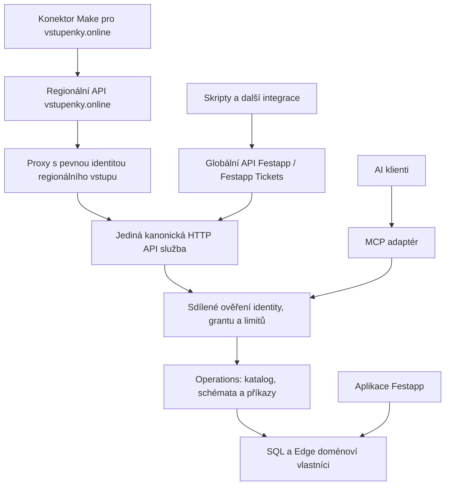

# Jedno API Festapp pro integrace, společné operace s MCP

Datum: 2026-11-13  
Stav: Návrh k realizaci, bez implementace a nasazení  
Ověřování realizace: standard - veřejný kontrakt, autentizace a autorizace

Revize: Prohloubení návrhu podle zdrojů ověřených 2026-11-13. Nová rozhodnutí
nahrazují původní společnou API/MCP audience a vlastní formát HTTP chyb.
Společný doménový základ a přesun Make na obecné API zůstávají cílem.
Další upřesnění uživatele: dvě veřejné API adresy pro Festapp / Festapp Tickets
a vstupenky.online vedou do jedné kanonické služby, bez kopie implementace.
Další revize: ověřené postupy z Mendelio Voice, povinná generovaná reference
a rozšíření existujícího MCP procesu bez dalšího API kontejneru.

## Implementační aktualizace 2026-11-13

Lokální implementace byla zahájena bez publikace a bez produkčních změn.
Průzkum aktuálního `origin/main` nad `09cdd991f` vyvrátil původní předpoklad
single-profile runtime: globální MCP binding již má `contexts`, `contextConfig`
a `connectionContext`. Tyto canonical owning soubory byly převzaty do pracovní
větve místo vytvoření druhého bindingu. Nesouvisející upstream změny operací
nebyly převzaty. Původní sdílená větev nad `742d614b7` zůstala zachována. Finální review checkout
`/Users/miakh/source/festapp-unified-api-review-20261113` stojí nad aktuálně
porovnaným `origin/main` `8aa7379d3`; zachovává novější MCP capability search,
inventory operace, opravu OAuth CSP i runtime licence/notices.

Pinned provider 9.12.2 řeší resource v refresh handleru **až po spotřebování a
rotaci refresh tokenu** (`lib/actions/grants/refresh_token.js`, consume před
resolveResource). API target se proto validuje už v `rotateRefreshToken` před
spotřebováním. Skutečné HTTP testy ověřují, že odmítnutí chybějící/cizí audience
neodstaví validní rodinu, zatímco replay spotřebovaného tokenu ji revokuje.

Původní kapacitní test skutečného provideru prokázal jeden uchovaný consumed
row na exchange, což nevychází pro dlouhé souhlasy. Implementace proto následně
zavedla verzovanou transakční migraci `refresh-replay-v1`: přesná spotřebovaná
opaque credentials se ukládají do 256 šifrovaných komprimovaných bucketů ve
stejném store. Živá evidence se nevyhazuje; overflow odmítne consume atomicky.
Limity jsou 128 KiB komprimovaně / 2 MiB dekódovaně na bucket, 20 000 main rows,
16 nově přijímaných souběžných připojení a 12 refresh rotací za minutu/grant.
Výchozích sedm dní a 30denní idle limit zůstávají; 30/90/365 dní vyžaduje
explicitní klientskou politiku. Offline rekey přepisuje a ověřuje celou DB v
jedné transakci, při chybě zůstává původní klíč. Viz finální receipt a recovery.

Souběžný canonical SQL owner order summaries již vrací bezpečná finanční pole
`payment.net` a `payment.pending`; striktní runtime DTO je neznalo. DTO nyní
přijímá tato explicitní volitelná pole téhož vlastníka, bez PII a bez finančního
přepočtu v klientu. Skutečný SQL summary test i product HTTP/replay test prošly
na označené lokální fixture `festapp-global-mcp-20261113`, bez externích sendů.

Nová API cesta, sdílený runner, build-time kontrakt/Redoc a generátor Make jsou
lokální. Ostatní mutation rodiny mají explicitní readiness blokaci; samotný
existující descriptor není důkaz uzavření jejich HTTP proof/recovery podmínek.
Read-only Make SDK průzkum potvrdil starou definici, existující připojení a dva
známé scénáře (sanitizovaný receipt v evidence adresáři). Přechod není proveden.
Starý adaptér je registrován pouze pro
legacy-make klienty, používá společný runner a má sunset 2026-12-13. Odstranění
blokuje ověření skutečných konzumentů, nikoli vývoj nového API. Deletion ledger
zůstává otevřený. Vlna S nadále nemá schválený principal/SQL ADR a není aktivní.

Finální lokální receipt, testy a přesné otevřené body jsou v
`festapp-unified-api-RESULT-2026-11-13.md`. Kontrakt má osm build projekcí
(fasáda x data profil x proof profil); DPoP security je OAuth AND proof.
Finální srovnání používá stejné vzorky 100 MCP probes a 100 dalších operací
pro obě varianty, dále exporty, 32prvkové preview a refresh. Nárůst warmed-idle
RSS 17,34375 MiB uživatel pro tento kandidát výslovně přijal jako výjimku z
návrhových 16 MiB; limity kontejneru/CPU/heap se nezvyšují. Make cutover
zůstává provozním krokem vyžadujícím samostatnou autorizaci.

## Výsledek a hlavní rozhodnutí

Festapp získá dokumentované HTTP JSON API pro čtení i řízení podporovaných
funkcí. MCP a API budou adaptéry nad stejnou interní vrstvou `Operations`.
Konektor Make.com bude běžným klientem tohoto API, stejně jako budoucí skript,
integrační služba nebo konektor jiné platformy. Jeho moduly, výběrová pole a
stránkování zůstanou v konektoru; server nebude mít zvláštní Make API.

MCP nemusí interně volat API po HTTP. Společné jsou provádění operací,
validace, oprávnění a doménoví vlastníci. Aplikace nadále používá své stávající
kanonické SQL/Edge příkazy; tento projekt ji nepřepisuje na HTTP API.

**Umístění a procesy:** API je další HTTP adaptér ve stávajícím kanonickém
MCP/integration runtime `tools/festapp`, nikoli nová samostatná služba nebo
kontejner vedle něj. Oba veřejné API hosty směřují na jeho loopback listener.
Stávající oddělení regionálního a globálního MCP podle jejich release plánu
se tím automaticky neruší; kvůli API se nepřidává další trvale běžící proces.
Globální runtime může být současně zaváděn jinou autorizovanou prací, proto
implementace nejprve ověří aktuální stav a rozšíří jeho canonical ownera.

## Rozsah

- Obecný API adaptér v `tools/festapp`, sdílené hosted provádění s MCP,
  generovaná OpenAPI dokumentace, řízené čtení i zápis a stahování artefaktů.
- Dvě veřejné API fasády: globální Festapp / Festapp Tickets a regionální
  vstupenky.online. Jedno provádění, jeden kontrakt a jedna kanonická služba.
- Migrace existujícího Make konektoru na obecné API a odstranění serverové
  větve `/make/v1` po bezpečném přechodu skutečných konzumentů.
- Výslovná politika každého klienta: povolené transporty, operace, scopes a
  datový profil. Make si zachová omezený read-only `order-summary` profil.
- Postupné zpřístupnění existujících operací. Úplnost znamená evidované pokrytí
  katalogu; ne tvrzení, že API již umí každou obrazovku Festapp.

Mimo rozsah: přepis Flutter/web klienta, nové platební mechanismy, obecný SQL/RPC
executor, webhookové předplatné, SDK v několika jazycích, samoobslužný vývojářský
portál. Návrh níže zahrnuje i cílový model samostatných integračních identit;
jejich implementace je oddělená navazující vlna s vlastní SQL autorizací.
První vydání API používá osobní delegovaný OAuth. Nesmí se prezentovat jako
neomezeně běžící firemní integrace nezávislá na zaměstnanci.

## Co je ověřeno v aktuálním kódu

Průzkum vychází z pracovního stromu nad `742d614b7`, větev
`docs/festapp-tickets-readme-20261107`. Strom obsahuje rozsáhlou souběžnou práci.
Nejde o důkaz stavu produkce ani o čistý release základ. Před realizací porovnat
dotčené soubory s aktuálním main a zachovat cizí rozpracované změny.

| Fakt | Zdroj | Důsledek |
| --- | --- | --- |
| Katalog již obsahuje vstupy, výstupy a dispatch operací. | `tools/festapp/src/operations/catalog.mjs`: `Operations.catalog`, `invoke`, `readArtifact` | Nevytvářet druhý seznam obchodních handlerů pro HTTP. |
| MCP registruje tools přímo z katalogu a volá `operations.invoke`. | `tools/festapp/src/mcp/server.mjs`: `createServer` | Zachovat stejný princip pro API. |
| HTTP API již existuje pro pět čtecích operací Make. | `src/remote/server.mjs`: `/make/v1/operations/:operation`; `make-contract.mjs`, `make-transport.mjs` | Generalizovat existující hranici, nepřidat třetí souběžnou implementaci. Cesty `src/` v tabulce jsou relativní k `tools/festapp/`. |
| OpenAPI se již skládá ze Zod schémat katalogu. | `src/remote/make-transport.mjs`: `makeDocumentation` | Rozšířit generování, nepsat vstupní a výstupní DTO ručně. |
| Delegace ověřuje aktivní grant, klienta, audience, profil a aktuální oprávnění. | `src/remote/delegation.mjs`: `DelegatedOwner.current`, `authorizeOperation`, `authorized` | API musí používat tutéž delegaci, včetně kontroly před vrácením soukromých dat. |
| Scopes a jejich závislosti jsou společným kontraktem. | `packages/festapp_contracts/mcp-permissions.mjs`: `scopesForOperation` | Názvy souboru ani existujících OAuth scopes nejsou důvodem ke druhému API seznamu. |
| Výstupy závisí na datovém profilu klienta. | `Operations.catalog`, `operations/public-orders.mjs`, `DelegatedOwner.orderSummaryOnly` | API nesmí proměnit summary klienta v plnou administraci. |
| Make generátor je svázaný se serverovými Make konstantami a cestami. | `integrations/make/scripts/build.mjs`, `src/connection.json`, `API.md` | Převést konektor na verzovaný veřejný API kontrakt; odstranit závislost na serverových internals. |
| Existují verze agregátů, receipty a recovery pro nejistý výsledek. | `operations/products.mjs`, `seat-orders.mjs`, `layout-save.mjs`, `errors.mjs`: `commandEdgeResponse` | HTTP nesmí přidat druhý idempotency mechanismus ani měnit příkaz při retry. |
| Privátní exporty a náhledy se znovu autorizují při čtení. | `Operations.readArtifact`, `operations/reporting.mjs`, `mcp/server.mjs` | Pouhá URL nebo znalost ID souboru nestačí ke stažení. |
| Provider vydává opaque access tokeny s TTL 300 s, rotuje refresh a omezuje životnost grantem. | `remote/server.mjs`: provider config; `packages/festapp_contracts/mcp-connection.mjs` | JWT není nutný předpoklad moderního API. Souhlas má pevný konec a 30denní idle limit. |
| Resource je natvrdo odvozen jako `issuer + '/mcp'`; všechny klienty registruje jako public s auth metodou `none`. | `remote/config.mjs`: `parseRemoteConfig`; `remote/server.mjs`: `clients` | Pro oddělené API resource a confidential klienty nestačí přidat route. |
| Šifrovaný SQLite store má hashované identifikátory, AES-GCM payloady, 20 000 záznamů a single-process lock. | `remote/storage.mjs`: `openRemoteStorage`, `putUntil`, `adapter.consume` | Kapacitu a uchování replay evidence je nutné změřit před dlouhými granty. |
| Replay refresh tokenu a zachování aktivního grantu po restartu již mají test. | `test/remote.test.mjs`: `refresh replay revokes its connection...` | Navázat na existující ochrany, doplnit souběh, ztracenou odpověď a obnovu starší zálohy. |
| Instalovaný provider 9.12.2 má DPoP a PAR ve výchozím stavu zapnuté. Hosted handler přijímá pouze `Bearer` a přímo hledá `AccessToken`. | `node_modules/oidc-provider/lib/helpers/defaults.js`; `remote/server.mjs`: operation route | Podpora knihovny neprokazuje správné ověření proof na resource serveru. Nutný test downgrade a explicitní profil funkcí. `node_modules` je důkaz verze, nikoli soubor k úpravě. |
| Delegované SQL používá skutečné `auth.uid()` a ordinary-user práva. | `database/functions/user_permissions/delegated_operations.sql`; `auth/session.mjs`: `authorized` | `client_credentials` nelze bezpečně přidat pouze přepnutím provider feature. |
| Současný compose předepisuje 384 MiB/container, 0,5 CPU, 64 PID a image spouští Node s heap limitem 192 MiB. | `tools/festapp/remote-compose.yml`, `Dockerfile.remote` | Jsou to konfigurované limity, nikoli změřená spotřeba. API má použít stejný proces a prokázat rezervu v těchto mezích. |

Současný řetězec Make je HTTP route -> OAuth token -> `DelegatedOwner` ->
`Operations.invoke` -> doménový SQL/Edge vlastník -> validovaný výsledek.
Hlavní chybějící část je obecný veřejný kontrakt a odstranění vazby HTTP
transportu na jednoho konkrétního klienta.

## Co přebíráme ze skutečného Mendelio Voice API

Proveden read-only průzkum `/Users/miakh/source/roman_seznamka` nad
`9149730b1` a `/Users/miakh/source/mendelionet-sdk` nad `22f15c9`.
Jde o aktuálně čtené zdroje, ne o potvrzení živého nasazení nebo výsledku
jejich testů. Historický plán
`docs/plans/mendelio-voice-openapi-contract-completion-plan-2026-07-19.md`
v Mendelio repozitáři sloužil jako kontext; závěry níže ověřuje skutečný kód.
Prvních šest cest v tabulce je relativních k Mendelio repozitáři.

| Ověřený postup Mendelia | Konkrétní zdroj | Rozhodnutí pro Festapp |
| --- | --- | --- |
| Runtime schémata napájejí OpenAPI i validaci veřejných odpovědí. | `apps/voice/src/lib/publicApiSchemas.ts`, `openapi.ts`; `src/fetch/routes/v1/audio/speechJobs.ts` | Použít skutečná schémata `Operations`, ne další ručně psané docs DTO. Ověřovat i úspěšný výstup. |
| Reference má stabilní operationId, úplné response media/statusy, hlavičky a konkrétní příklady. | `apps/voice/src/lib/openapi.ts` | „Successful response“ bez přesného schématu nestačí. RFC 9457 se týká i limitů, parseru a autorizace. |
| Test srovnává dokumentované operace se skutečnými route handlers a ověřuje statusy/media/headers. | `apps/voice/src/__tests__/openapi.vitest.ts` | Přidat obousměrnou parity gate: chybějící dokumentace i zdokumentovaná neexistující operace blokují vydání. U generic command route kontrolovat také operationId, ne jen URL. |
| Specifikace má lint a baseline kompatibility. | `apps/voice/scripts/check-openapi.mts`, `check-openapi-compatibility.mts`, `redocly.yaml` | Převzít lint a release baseline; rozšířit diff o směrovou kompatibilitu typů, required polí, enumů a security, nespoléhat jen na přítomnost názvů. |
| Veřejná reference čte OpenAPI a používá centrální identitu/brand origin. | `packages/voice-ui/src/DeveloperReferenceScreen.tsx`, `apps/mendelio-voice/src/runtime/voiceRuntime.web.ts` | Reference i raw JSON pro obě značky vznikají ze stejného kontraktu a endpoint registry. Pro Festapp navíc plně zobrazit payloady a workflow, ne jen seznam cest. |
| Aplikační commandy a transport mají pojmenované vlastníky; veřejný adaptér neodhaluje providera/internal queue. | `apps/voice/src/lib/v1/api.ts`, `src/lib/speech/composition.ts`, `src/__tests__/audio-api-arch-guard.vitest.ts` | Sdílet operation module; HTTP/MCP nesmějí kopírovat business logiku ani publikovat interní RPC/service credentials. |
| SDK má samostatný public contract smoke a thin MCP adapter nad SDK nebo doménovým portem. | SDK repo: `packages/voice/scripts/contract-smoke.mjs`, `packages/voice-mcp/src/core.ts`, `sdkOperations.ts` | Test veřejného artefaktu z pohledu konzumenta; lokální SDK klient může volat HTTP, serverový MCP dál používá stejný operation module in-process. |

Nekopírovat Mendelio API keys, Voice billing/queues, generování nového
idempotency UUID v convenience metodě ani ručně udržované route inventories
jako druhý festappový source of truth. Festapp potřebuje vlastní OAuth
delegaci, commandId/recovery a SQL práva. U Mendelio smoke skriptu existuje
package script, ale samotná existence není důkaz, že jej jejich aktuální CI
vždy spouští; Festapp novou gate výslovně zapojí do owning CI lane.

Architektonické posouzení používá skill `codebase-design`: úzké interface
jednoho hlubokého operation module skrývá autentizaci, scope/tenant binding,
readiness, řízení souběhu a volání doménových vlastníků. HTTP a MCP jsou
skutečné adapters na společném seam. Žádná síťová mezivrstva ani obecný
plugin framework nevznikají jen pro budoucí hypotetické použití.

## Standardy a jejich použití

Následující verze byly ověřeny z primárních zdrojů 2026-11-13. Před realizací
ověřit případná errata a podporu připnutých knihoven. Doporučení Festapp v dalších
sekcích jsou architektonická rozhodnutí, ne doslovné požadavky všech standardů.

| Zdroj a stav | Rozhodnutí pro Festapp |
| --- | --- |
| [RFC 9700, OAuth Security BCP](https://www.rfc-editor.org/rfc/rfc9700.html), publikováno | Povinný bezpečnostní základ: code + PKCE, přesné callbacky, zákaz implicit/password grantů, omezené tokeny a ochrana refresh replay. |
| [OAuth 2.1, draft 17](https://datatracker.ietf.org/doc/draft-ietf-oauth-v2-1/), aktualizován 2026-10-30, stále Internet-Draft | Použít jeho směr a kompatibilitu MCP, neslibovat soulad s neexistujícím finálním RFC. |
| [MCP Authorization 2026-07-28](https://modelcontextprotocol.io/specification/2026-07-28/basic/authorization) | Připnout protokol, discovery, resource a issuer kontroly; zachovat kompatibilitu skutečných klientů. |
| [RFC 8707](https://www.rfc-editor.org/rfc/rfc8707.html) a [RFC 9728](https://www.rfc-editor.org/rfc/rfc9728.html), publikované | Explicitní resource při vydání tokenu, vlastní metadata API/MCP a odmítnutí záměny audience. |
| [RFC 9207](https://www.rfc-editor.org/rfc/rfc9207.html), publikováno | Svázat OAuth flow s očekávaným issuerem a ověřovat `iss`, včetně regionálního/globálního mix-up scénáře. |
| [RFC 9449, DPoP](https://www.rfc-editor.org/rfc/rfc9449.html), publikováno | Proof-of-possession pro řízené klienty; ověřování na token endpointu i u API/MCP, bez bearer downgrade. |
| [RFC 9126, PAR](https://www.rfc-editor.org/rfc/rfc9126.html), publikováno | PAR pro řízené a citlivé klienty; běžný code flow s PKCE pro ověřené externí klienty, kteří PAR neumí. |
| [RFC 7523](https://www.rfc-editor.org/rfc/rfc7523.html), publikováno | Asymetrická autentizace confidential klientů pomocí `private_key_jwt`; odlišit ji od DPoP. |
| [RFC 7009](https://www.rfc-editor.org/rfc/rfc7009.html), [RFC 7662](https://www.rfc-editor.org/rfc/rfc7662.html), publikované | Standardní revokace; introspekce až při skutečném oddělení resource serveru. |
| [RFC 9470](https://www.rfc-editor.org/rfc/rfc9470.html), publikováno | Pro citlivé operace explicitní požadavek na sílu/čerstvost přihlášení; bez důvěryhodného důkazu operaci nezpřístupnit. |
| [FAPI 2.0 Security Profile](https://openid.net/specs/fapi-security-profile-2_0-final.html), Final z 2025-02-22 | Referenční profil pro citlivá API. Festapp nebude tvrdit FAPI compliance/certifikaci na základě pouhého zapnutí DPoP/PAR. |
| [OpenAPI 3.2.1](https://spec.openapis.org/oas/v3.2.1.html), vydáno 2026-09-10 | Cílový popis veřejného API; případný kompatibilní export 3.1.2 generovat ze stejného kontraktu, pokud jej potřebuje ověřený nástroj. |
| [RFC 9457, Problem Details](https://www.rfc-editor.org/rfc/rfc9457.html), publikováno | Standardní HTTP chyby; MCP zachová vlastní protokolovou reprezentaci. |
| [Idempotency-Key draft 08](https://datatracker.ietf.org/doc/draft-ietf-httpapi-idempotency-key-header/), stále Internet-Draft | Nepředstírat hotové RFC; ponechat existující doménový `commandId` bez druhého receipt systému. |
| [RFC 9745, Deprecation](https://www.rfc-editor.org/rfc/rfc9745.html) a [RFC 8594, Sunset](https://www.rfc-editor.org/rfc/rfc8594.html) | Oznámení přechodu existujících HTTP klientů; Sunset je publikované Informational RFC, nikoli záruka migrace uživatelů. |

Nejnovější standard není pokyn zapnout všechny granty, distribuovat služby nebo
vyměnit opaque token za JWT. Rozšiřovat jen schopnosti s jasným použitím,
ověřenou podporou obou stran a provozním vlastníkem.

## Cílový kontrakt

### Transport a adresa

- Navržená cesta: `POST /integrations/v1/operations/{operationId}`, tělo je přímo vstup
  katalogové operace. Například `products.list` přijímá `occasionId`, `limit`,
  případně `after`. Obě operace discovery přijímají `{}`.
- `GET /integrations/v1/openapi.json` zveřejní generovaný kontrakt bez uživatelských dat.
  Podporované datové profily musí mít jednoznačné samostatné komponenty nebo
  dokumentové varianty; nikdy nevydávat full DTO za summary DTO.
- `POST /integrations/v1/artifacts/read` přijme striktní `{uri}` pro existující
  `festapp-export://` nebo `festapp-preview://` identifikátor a po opětovné
  autorizaci vrátí binární obsah s přesným MIME typem a `Cache-Control: no-store`.
  Žádné fetchování libovolných URL, veřejný bearer odkaz ani nový renderer.
- Úspěšné API operations vracejí stávající `ok`, `operation`, `data`, `meta`.
  HTTP neúspěch je `application/problem+json` podle RFC 9457: stabilní `type`,
  `title`, skutečný HTTP `status` a rozšíření `code`, `requestId`, `retryable`,
  případně bezpečné `operation`, `commandId`, `outcome`. Interní operation
  error se pouze mapuje; MCP jej nadále formátuje podle svého protokolu.
  `X-Request-Id` odpovídá `meta.requestId` nebo `requestId` problému.
  Před ověřením kontextu nevracet vymyšlený tenant/actor. OAuth endpointy si
  zachovají standardní OAuth chybový formát, nikoli Problem Details.
- Verze `/v1` patří veřejnému HTTP kontraktu. Identifikátory operací, přesné
  peněžní hodnoty, DTO, stránkování a konflikty mají stejného vlastníka pro MCP.
  Žádná nekompatibilní změna publikovaného vstupu/výstupu pod stejnou verzí.
- Zachovat explicitní command API. REST aliasy typu `/orders/...` by nyní
  přidaly druhou mapu týchž operací bez přínosu pro tento rozsah.

Public base není odvozen z OAuth issueru. Konkrétní doporučené veřejné adresy
a jejich proxy mapování určuje následující sekce. Globální host, login/consent
a výběr tenantů koordinovat s
[globálním MCP plánem](festapp-global-mcp-endpoint-plan-2026-11-13.md).
Lokální implementace může vznikat před jeho nasazením; veřejná dostupnost
obou API vstupů potřebuje dokončenou kanonickou identity/ingress službu.

### Dva veřejné vstupy, jedna kanonická služba

| Fasáda | Doporučený veřejný base | OAuth resource | Kontext |
| --- | --- | --- | --- |
| Festapp / Festapp Tickets | `https://api.festapp.net/integrations/v1` | `https://api.festapp.net/integrations` | Discovery podporovaných profilů a explicitní výběr jednoho ověřeného kontextu do grantu. |
| vstupenky.online | `https://api.vstupenky.online/integrations/v1` | `https://api.vstupenky.online/integrations` | Pevný regionální profil/organizace, dále zúžený klientem, souhlasem a živými právy. |

Adresy jsou návrh k ověření DNS/TLS a existujícího routingu, nikoli ověřené
živé API. `api.festapp.net` již vlastní Supabase Auth/REST/Functions: přidat
jen přesný nový prefix `/integrations/v1`, bez změny `/auth/v1`, `/rest/v1`,
`/functions/v1` nebo jiných existujících cest. Pokud by prefix či regionální
host skutečně kolidoval, implementátor upraví tabulku na ověřený volný base
před vydáním tokenů. Nemění se tím dvouvstupová architektura ani izolace.
Relativní operation cesty zůstávají `/operations/{operationId}`; prefix
`/integrations/v1` používá i kanonický listener. Nezavádět další veřejný
alias ani odlišný interní prefix bez konkrétní provozní potřeby.

Obě adresy proxyují do téhož kanonického integračního runtime. Regionální
fasáda nemá vlastní business handlery, databázi, receipt store, token exchange
ani sync kopii konfigurace. Verze kontraktu a releasovaný kód jsou stejné;
liší se serverem řízená endpoint policy a prezentace značky. Regionální scope
ceiling může být užší, což generátor pravdivě promítne do dokumentace.
Festapp Tickets je produkt globálního vstupu, nevzniká třetí duplicitní API.

Veřejný globální base je kanonická adresa, ale proxyování regionálního
požadavku nesmí udělat z něj globální požadavek. Nepoužívat HTTP 301/302/307/308,
neměnit audience a nedoplňovat serverový supertoken. Bezpečný ingress předá
regionální požadavek přímo stejnému privátnímu listeneru s důvěryhodnou pevnou
identitou regionální fasády. Přímé volání globálního vstupu se stejným
regionálním tokenem je nadále odmítnuto kvůli jiné audience.

Vytvořit endpoint registry vlastněný serverem: `endpointId`, `publicBase`,
`resource`, `issuer`, `brand`, `profilePolicy`, `allowedClients` a transportní
limity. Regionální položka má pevný ověřený profil; globální umožní jen
registrované profily a při consentu připne jeden. Grant uloží endpoint/resource
i konkrétní profile binding, aby host sám nebyl jediným bezpečnostním opatřením.
Žádný přepínač profilu z request body, query nebo volné klientské hlavičky.

Proxy odstraní klientské forwarded/endpoint hlavičky a přidá vlastní,
kanonický privátní listener přijímá jen z důvěryhodného ingressu. Na stejné
stanici použít stávající loopback/trusted proxy ochranu; mezi stroji vyžadovat
ověřený privátní kanál, například mTLS. Pokud nelze původ požadavku prokázat,
regionální i globální request se odmítne. Nezavádět veřejně podvrhnutelný
`X-Tenant` nebo „original host“ bypass.

DPoP se ověřuje proti původní veřejné URL fasády včetně veřejného prefixu,
nikoli privátní backend URL nebo případné přepsané cestě. Proxy proof
nemění ani znovu nepodepisuje. Stejná veřejná identita platí pro metadata,
absolutní odkazy, případné Location a API příklady. Globální i regionální
OpenAPI jsou generované projekce téhož kontraktu se správným `servers` a
resource. Nevracet regionálnímu klientovi privátní nebo nesprávné globální URL.

Pro nové API granty zvolit jeden kanonický authorization server společný s
novým globálním MCP runtime. Preferovaný issuer globálního MCP plánu je
`https://mcp.festapp.net`; skutečný origin a first-party login/consent musí
uzavřít jeho auth vlna. Resource registry poskytne oba API audiences tomuto
issueru, consent se značkou a pevnou scope politikou vybraného vstupu.
Regionální API smí mít stejný AS issuer jako globální API; tím se neruší
oddělení jeho audience ani tenantu.

Dosavadní regionální MCP issuer `https://mcp.vstupenky.online` se v rámci
API migrace neruší. Jeho staré Make/MCP granty zůstávají na jejich dosavadní
hranici; přechod Make na regionální API vytvoří nové připojení u kanonického
AS s regionální API audience. Existující tokeny, state ani klíče se nekopírují.
Pokud tým později požaduje samostatný regionální issuer i pro nové API, je to
vědomá změna tohoto rozhodnutí a potřeba ověřené multi-issuer introspekce a
backend session resolveru; nevznikne jako vedlejší efekt proxy.

### Identity a oprávnění

**Rozhodnutí po prohloubení:** Jeden kanonický authorization server vydává
tokeny pro oddělené protected resources. Globální MCP resource zůstane
`issuer + '/mcp'`; globální a regionální API mají vlastní stabilní resource
z tabulky fasád, bez verze `/v1` v audience.
Host může být stejný; audience není určena pouze hostname. Pro nové API není
důvod zdědit historický alias Make. Toto je přísnější produktové rozhodnutí
podporované RFC 8707, nikoli tvrzení, že společná audience je vždy zakázaná.

Route předá runneru serverem určenou očekávanou audience. Token musí přesně
odpovídat resource, klientovi a grantovému bindingu. Vydávat jeden access token
pro jeden resource, bez seznamu API+MCP audiences. Auth code, consent, refresh
family i nově vytvořená session mají neměnnou vazbu na resource a profil.
Refresh nesmí změnit resource nebo scopes rozšířit. Smíšené resource indikátory
odmítnout; opakovaný totožný indikátor zpracovat konzistentně se stávajícími
MCP klienty. U nových API klientů požadovat explicitní `resource` při auth/token
flow. Výjimku stávajícího MCP defaultu držet pouze na staré hranici.

`/.well-known/oauth-protected-resource/integrations` na každém API originu a
odpovídající MCP dokument popisují správný resource a issuer.
`WWW-Authenticate` vede na metadata skutečně
odmítnuté služby. `offline_access` patří do AS discovery/consent, ne mezi
doménové požadavky resource. Nikdy nepřeposílat API/MCP bearer do Supabase,
platební brány nebo externího URL. Backendová GoTrue session zůstává zvláštní,
serverem chráněnou identitou se samostatnou rotací a expirací.

Make přejde na API s novým explicitním consentem a API audience. Starý token
se tiše nepřeznačí ani nezačne platit na nové route. Původní Make grant může
dočasně obsloužit jen starou `/make/v1` během přesně omezeného přechodu.
Dosavadní globální/regionální MCP issuer hranice zůstávají oddělené od nových
API grantů; tokeny nepřebírat ani tehdy, když mají stejného člověka a podobné
scopes. Dvě nové API fasády sdílejí kanonický issuer, ale mají různou audience.

Rozšířit striktní konfiguraci klientů v `remote/config.mjs` o explicitní
povolené transporty. Stávající MCP klienti nepřejdou automaticky na API.
Make po migraci dostane HTTP API a svůj dosavadní scope/datový strop.
Nepřenášet tokeny mezi klienty. Zachovat PKCE, přesné callbacky, rotaci refresh
tokenů, pevný konec souhlasu, revokaci a klientský scope ceiling.

Efektivní oprávnění je průnik podporované operace, transportu klienta, jeho
scope ceiling a datového profilu, scopes tokenu, souhlasu a živých SQL práv.
Organizace se váže z ověřeného profilu/grantu. ID zdroje se ověřuje proti
uloženému stavu. Vstupní `organizationId` ani wildcard nesmí přepnout tenant.
Změna oprávnění nebo revokace se kontroluje i při replay receiptu a čtení
artefaktu. Nezavádět API klíče s pravomocí service role.

### Typy klientů, tokeny a souhlas

| Klient | První vydání a cílové chování |
| --- | --- |
| Make a další externí delegovaný klient | Code + PKCE S256; pouze ověřená registrace a schopnosti. Make zůstane public podle ověřeného stávajícího flow, read-only a summary; samotný provoz v cloudu není důkaz confidential autentizace. |
| Nativní CLI / lokální skript s uživatelem | Public client, code + PKCE, přesný loopback callback; žádný distribuovaný client secret. DPoP pro klienta pod naší kontrolou po implementaci proof podpory. |
| Serverová aplikace pod kontrolou provozovatele | Confidential client, code + PKCE a preferovaně `private_key_jwt`; klíč je v chráněném úložišti. PAR a DPoP podle deklarovaného profilu. |
| Webová aplikace s backendem | Tokeny drží backend/BFF, prohlížeč má zabezpečenou session cookie a CSRF ochranu. Nevytvářet nový model dlouhodobých tokenů v localStorage. Přímé cizí SPA není implicitně podporováno CORS wildcardem. |
| Samostatná integrační identita organizace | Navazující vlna S níže: `client_credentials` a asymetrická autentizace, žádný osobní refresh token ani napodobení zaměstnance. Do té doby nezpřístupněno. |

Oddělit čtyři různé věci: autentizace člověka, autentizace klienta, důkaz
držení tokenového klíče a doménové oprávnění. `client_id` není tajemství;
`private_key_jwt` samo nebrání replay ukradeného access tokenu a DPoP samo
neuděluje právo na operaci. ID token slouží klientovi pro přihlášení a API
jej nikdy nepřijímá jako access token.

**Access token:** zachovat náhodný opaque formát a výchozí TTL 300 s.
Zkrácení TTL nenahrazuje revokaci. V jednom procesu ověřit token přímo providerem
a aktuálním grantem; neprovádět HTTP introspekci na sebe. Při budoucím oddělení
resource serveru použít autentizovanou RFC 7662 introspekci. Pozitivní cache
vyžaduje explicitní revocation SLA; při nedostupné autoritě odmítnout požadavek.
Nedistribuovat JWT jen kvůli úspoře jednoho lookupu. Pokud se někdy zvolí JWT,
vznikne samostatný profil validace issuer/audience/typ/alg/keys a revokace.

**Refresh token:** ponechat rotaci s detekcí reuse a revokací rodiny pro
public Bearer profil. Token i family jsou svázané s klientem, resource,
profilem, schválenými scopes a pevným koncem souhlasu. Nový access token
nepřežije tento konec. Výchozí souhlas zůstává 7 dní; 30/90/365 dní jen jako
výslovná volba podle klientské politiky, ne automatický nárok na každý write
scope. Zachovat 30denní idle limit. Jde o nastavení Festapp, ne univerzální RFC
hodnoty. Rizikový profil může tyto limity zkrátit.

Klient musí refresh provádět jedním procesem pro dané připojení a nový refresh
token uložit atomicky před dalším použitím. Dva souběžné refreshe mohou v přísné
reuse politice zrušit připojení; server to nesmí řešit nekontrolovaným grace
oknem. Ztracenou tokenovou odpověď neopakovat naslepo se starým tokenem.
Dokumentovat opětovné připojení; případné budoucí recovery okno vyžaduje přesný
bezpečnostní návrh. Testovat i selhání zápisu po rotaci backendového refresh
tokenu, protože delegace obsahuje dvě nezávislé tokenové rodiny.

**Registrace a souhlas:** první vydání má řízené předregistrace. Stropy
operací/scopes/resource, granty, datový profil, auth metoda a proof profil jsou
explicitní, nové API nemá implicitní plný přístup při chybějícím seznamu.
Zvýšení stropu nesmí zpětně rozšířit staré granty. Zúžení musí okamžitě omezit
nové požadavky a refresh. Změna klientova callbacku nebo klíče má audit a
ověřené vlastnictví. Souhlas jasně ukáže aplikaci, organizaci, akce/pořadatele,
data, zápisy, budoucí akce zahrnuté unit grantem a konec přístupu.

MCP 2026-07-28 doporučuje Client ID Metadata Documents a připouští
předregistraci. Zde je zvolená předregistrace kvůli explicitnímu scope/datovému
stropu a kontrole publisherů. CIMD není povinnou součástí prvního API vydání.
Případné otevření vyžaduje ochranu SSRF/DNS rebinding, velikosti a stáří
metadat, redirect trust, schválení klienta a abuse limity; client metadata URL
nesmí být automatické obchodní oprávnění. DCR nezapínat jako obejití tohoto
rozhodnutí. Viz [bezpečnost MCP](https://modelcontextprotocol.io/docs/2026-07-28/tutorials/security/security_best_practices).

### DPoP, PAR a citlivé operace

Zavést dva výslovné profily: interoperabilní Bearer pro ověřené externí
klienty a řízený profil s DPoP pro naše podporované klienty. Citlivé API
operace, zejména změny bankovního nastavení, refundace a destruktivní lifecycle,
nemají být automaticky dostupné klientovi jen proto, že je operace v katalogu.
Jejich readiness obsahuje proof profil a případný čerstvý step-up důkaz.
Make dostává pouze čtení. Výjimka z požadovaného profilu musí být konkrétní
klientská politika s doloženým rizikem, ne tichý fallback za běhu.

DPoP ověřuje povolený algoritmus/podpis, vazbu tokenu na klíč, `htm`, `htu`,
`iat`, `jti`, `ath` a případný nonce. `htu` se skládá z důvěryhodného veřejného
originu a route, ne podvržených proxy hlaviček. Replay cache je omezená a
nesmí zahazovat ještě platnou ochranu, aby uvolnila místo. DPoP token v
`Authorization: Bearer` se odmítne, stejně jako proof pro jinou cestu/metodu
nebo jiné `cnf` key. Každý retry má nový proof, ale stejný commandId/payload.
DPoP nepodepisuje tělo příkazu; nenahrazuje doménový confirmation hash.
Tyto podmínky vycházejí z RFC 9449, nikoli z ověření dnešní implementace.

Důležitý průzkumný nález: provider již může DPoP nabízet výchozím nastavením,
ale hosted resource handler obsahuje jen Bearer lookup. To je potenciální
downgrade mezera, ne prokázaný exploit. Nejdříve přidat negativní integrační
test: získat DPoP-bound token a zkusit jej bez proof použít jako Bearer. Do
end-to-end podpory DPoP explicitně zakázat jeho vydávání/advertising pro
nepřipravený profil. Neměnit knihovnu v node_modules. Totéž posoudit pro PAR:
metadata a konfigurace musí odpovídat skutečně podporovaným klientům a cestám.

PAR používat pro řízené citlivé klienty; předané request_uri je jednorázové,
krátkodobé a vázané na klienta. Nevyžadovat PAR plošně bez ověření Make a MCP
klientů. FAPI 2.0 má vlastní soubor požadavků včetně odlišných doporučení pro
refresh rotaci v sender-constrained profilu; kombinace několika vybraných
mechanismů neopravňuje ke tvrzení FAPI shody.

Step-up vychází z RFC 9470. Důkaz `acr`/`auth_time` se přenáší z důvěryhodného
ověřeného loginu a váže na grant; údaj z API těla není důkaz MFA. Pokud dnešní
GoTrue/tenant bridge nedokáže potřebnou sílu/čerstvost prokázat, takto chráněná
operace zůstane v API blokovaná. Čerstvé přihlášení, preview příkazu a lidské
schválení konkrétní částky jsou tři odlišné podmínky.

### Odvolání přístupu, rozpracované příkazy a úložiště

Revokace připojení zablokuje jeho další token exchange, nové operace i nové
čtení artefaktů; odstraní backend binding a zavře všechny access/refresh
tokeny příslušné rodiny. Správa připojení ukáže resource, scopes/datový profil,
rozsah, expiraci a poslední použití bez zobrazení tokenu. Jde o rozšíření
existující správy připojení, nikoli nový souběžný portál. Akce logout uživatele,
logout konkrétní integrace, změna hesla/MFA, odebrání členství a kompromitace
klienta mají explicitní odlišnou revokační politiku. Samotné zavření browseru
automaticky neruší offline souhlas. Odebrání členství musí zavřít odpovídající
doménový přístup i s dosud platným access tokenem.

Nelze slíbit, že revokace zpětně zruší transakci. Dnešní kontrola grantu před
a po operaci žije v SQLite, zatímco business commit v PostgreSQL. Pro první
vydání platí přesná hranice: nově přijímané operace po dokončené revokaci jsou
odmítnuty, již přijatý zápis může dokončit commit; soukromý read se při
revokaci před vrácením zahodí. Po commitu se nesmí vracet tvrzení „nic se
nestalo“. Interní výsledek zůstane dohledatelný přes původní příkaz a oprávněný
admin. Test musí uměle vložit revokaci mezi přijetí, SQL commit a HTTP odpověď.
Pokud produkt vyžaduje, aby revokace vyhrála i proti takto rozpracovanému
citlivému zápisu, jeho API readiness blokuje samostatný návrh transakčního
grant fence v kanonickém SQL. Kontrola v JavaScriptu tuto záruku nedokazuje.

Politika opakování musí rozlišovat requestId, commandId, receipt a úspěch
vedlejšího efektu. Timeout znamená možný commit; nový token nebo nový grant
nesmí sám vytvořit novou objednávku. Email se nadále řadí do jediné queue a
finanční efekty mají dosavadního vlastníka. Při nové session nemusí být starý
receipt dostupný pod stejným klientským bindingem: ve vlně 3 ověřit skutečné
SQL klíče a zdokumentovat bezpečnou kontrolu výsledku oprávněným adminem;
nepřeklenout to automatickým novým commandId.

SQLite a klíče zůstávají zpočátku single-process. Oddělit signing keys, storage
encryption key, broker secret a cookie keys, protože mají různé dopady rotace.
Rotace musí určit `kid`, překryv veřejných ověřovacích klíčů, dokončení
probíhajících flow, re-encryption dat a atomický přechod. Při podezření na
kompromitaci nejprve revokovat odpovídající granty a tokeny; výměna signing key
sama nezneplatní opaque access tokeny. Nové lokální přihlašovací/recovery
údaje uchovat dle AGENTS v Keychain, na serveru v chráněném secret managementu;
mode-0600 pracovní export není jediná záloha credentialu. Žádné secret values
v dokumentaci, logu, image nebo veřejném JWKS.

Starší záloha authorization DB může oživit již revokovaný grant či spotřebovaný
refresh token. Recovery runbook proto musí před otevřením provozu při rollbacku
stavu invalidovat obnovené delegace/tokeny a vynutit reconsent; alternativní
zachování grantů vyžaduje doloženou monotónní revocation evidenci mimo vracenou
zálohu. Obnova stavu není totéž jako restart stejné aktuální DB. Testovat obě.

Před rozšířením ověřit kapacitu 20 000 záznamů: každý refresh může zachovávat
spotřebovaný token pro reuse detekci až do jeho expirace. Teoretický klient
obnovující každých pět minut vytvoří 288 refresh výměn denně; nejde o měřený
objem současného store. Změřit skutečný růst připnutého provideru a maximální
grant; pokud nevyhoví, zvolit podporovanou bounded reprezentaci family/replay
evidence nebo připravit řízenou migraci auth store. Neodstraňovat dosud platné
reuse doklady a nezvedat limit bez kapacitního rozpočtu. Totéž platí pro
globální token queue 8 a souběh 2/grant, 16 celkem. Převod transportu nesmí
zdvojit quota. Zavést alerty bez tokenů na plnost, replay, odmítnuté exchange,
latenci auth/DB a počet aktivních připojení.

### Provádění, chyby a spolehlivost

Vytvořit úzký hosted runner pro oba adaptéry: ověření tokenu, vytvoření
`DelegatedOwner`, transportní politiku, limity, readiness, sdílené artefakty,
audit a uvolnění slotů v `finally`. MCP si ponechá svůj protokolový formát,
HTTP svůj status a JSON. Doménové podmínky zůstanou v `Operations` a SQL/Edge.

API použije jeden úplný, explicitní převod existujících chyb: 401 autentizace,
403 scope/přístup, 404 nerozlišitelné neexistující/nepřístupné zdroje,
409 konflikt verze/příkazu nebo nutnost nového preview, 410 expirovaný příkaz
bez možnosti replay, 422 neplatný vstup či odmítnutá doménová změna, 429 limit,
503 nedostupná schopnost/dočasný backend a 504 timeout. Zbývající porušení
upstream kontraktu je 502. Před implementací projít konkrétní `OperationError`
kódy v `operations/` a `errors.mjs`, zapsat konečnou tabulku do kontraktu a
testovat ji; žádné odhadování významu pomocí podřetězců názvu chyby.
Neznámá operace je 404, nepovolená známá operace zůstává 403 bez úniku dat.
Step-up challenge pro nedostatečnou sílu autentizace je samostatná RFC 9470
401 odpověď `insufficient_user_authentication` s odpovídající výzvou, nikoli
automatická revokace jinak platného grantu. Odlišit ji od skutečně neplatné
backend session/MFA chyby dnešní `DelegatedOwner.authorized` cesty.
Chyby parseru, velikosti těla a nepovolené metody musí mít stejný bezpečný
formát. Hodnotu `Retry-After` převzít z limiteru, ne nahrazovat pevným číslem.

Pro chybný JSON použít 400, příliš velký request 413, nepodporovaný media type
415 a nepovolenou metodu 405 s `Allow`; odlišit je od doménové validace 422.
Chybová odpověď nesmí odhalovat zákaznická data ani podrobnosti SQL. Interní
`retryable: true` není blanket pokyn k opakování zápisu s novým UUID. HTTP
problém rozlišuje jistě odmítnutý příkaz, známý commit/pending a neznámý výsledek.
Revokace po přijetí může z bezpečnostních důvodů skrýt detaily; ani tehdy
klient nesmí vyvodit, že se příkaz neprovedl.

Každý zápis musí mít v matici readiness určenou skutečnou cestu: vstup,
autorizaci, rozsah, případné preview/potvrzení, verzi agregátu, commandId,
receipt/recovery, vedlejší efekty a výstup. API nesmí automaticky doplňovat
potvrzení, číst novou verzi k překonání konfliktu nebo generovat nové UUID
po timeoutu. U již idempotentního příkazu opakovat stejný payload a UUID;
odlišný payload pod stejným UUID musí odmítnout existující vlastník. Pokud
takovou záruku daná operace nemá, její omezení výslovně uvést a zakázat
automatické retry. Není důvod vytvářet druhou tabulku API receiptů.

AI pokyny k získání souhlasu nejsou vynutitelné bezpečnostní pravidlo API.
Co doména vyžaduje technicky, zůstane v command schématu a transakčním ověření.
Kde jde pouze o pokyn lidskému operátorovi, dokumentovat ho jako odpovědnost
klienta a neslibovat serverem ověřené lidské schválení. Automatizace dostává
výslovný grant k operacím, nikoli plošné obejití preview nebo finančních pravidel.

Zachovat jednotné IP/grant/souběžné limity pro API i MCP. Přepnutí transportu
nesmí násobit kvótu. Audit ukládá identitu připojení, klienta, transport,
operaci, request/command identifikátory a výsledek; ne tokeny, zákaznické odpovědi
ani těla požadavků. Provoz zůstane single-process podle současného storage a
session lock kontraktu; horizontální škálování potřebuje vlastní návrh.

### Veřejný kontrakt, nákladné operace a provozní hranice

Katalog operací není sám o sobě stabilní vývojářský produkt. Generovaný kontrakt
musí mít verzi, source digest, changelog a deterministický test breaking změn
včetně povinných polí, enumů, limitů a datových profilů. Make připne konkrétní
API kontrakt bez importu serverové implementace. Ověřit průchod OpenAPI 3.2.1
na skutečném generátoru a konzumentovi; export 3.1.2 je případná formátová
projekce téhož zdroje, ne další API implementace. Nepoužívat vzorky zákaznických
dat jako zdroj typů. Definovat kompatibilitu přidávání polí: runtime strict
validace a generované klienty nesmějí dělat z každého přidaného pole tichý break.

Každá operace má popsané přesné peněžní typy, bezpečný rozsah číselných ID,
null/omitted význam, časové pásmo a stránkování. Ponechat současné DTO a decimal
string tam, kde jej doménový owner garantuje; nepřevádět peníze na float jen
kvůli Make. Keyset stránkování není konzistentní snapshot. Export „všech dat“
musí tento rozdíl výslovně řešit; nepřidávat nekonečné neomezené listy. Sada
všech scopes také není bezpečný výchozí požadavek klienta. Stávající historický
base scope `festapp:ticket-layouts:read` nepřejmenovávat kosmeticky; pro nové
API klienty výslovně omezit operation allowlist tak, aby minimální discovery
automaticky neudělilo artwork ani jiné dodatečné operace.

Veřejně nabízený vstup musí být proveditelný v limitech celého řetězce.
Současný proxy/Express limit 48 KB porovnat s katalogovými limity blueprintů,
importů a obrázků. Limitovat bajty, vnoření i rozsah dávky, ne jen délku polí.
Pokud se některá rodina nevejde, navrhnout konkrétní bezpečný bounded kontrakt
nebo ji dočasně označit jako blokovanou. Média se nahrávají existujícím
kanonickým image Workerem, API přijímá ověřené vlastněné reference; nenabízet
nový Supabase Storage nebo libovolné vzdálené URL fetchování.

Nákladné preview, export, import a scan mají vedle request count vlastní
rozpočet položek/bajtů/souběhu. Chránit organizaci a klienta, aby založení
dalšího grantu neobešlo nákladové limity. Limiter musí mít kapacitní limit i
způsob odmítnutí; backend dotazy mají timeout a bounded projekce. Každý API
zápis, který může účtovat externí poplatek, musí zachovat existující produktovou
autorizaci a cenové omezení, ne pouze OAuth scope.

Nepřidávat univerzální async job systém. Použít existující command/pending/resume
stav a ownera. `202 Accepted` použít pouze tehdy, když existuje uložený stav a
dokumentovaný autorizovaný způsob zjištění výsledku; žádné fire-and-forget
sliby. Přenos HTTP klienta může skončit, zatímco uložená práce běží dál.
Artifact cache má dnes TTL 15 minut, nejvýše 8 položek/16 MiB a restart ji
ztratí. Dokud není samostatně navržen trvalý export, tyto meze uvést v API.
Chybějící artefakt lze znovu vyrobit čtecí operací, nikoli opakováním zápisu.

CORS povoluje jen výslovné podporované browser originy, methods a headers;
server-to-server Make jej nepotřebuje. Doplnit preflight pro Authorization a
DPoP tam, kde jej podporovaný klient používá. Cookies nesmí autentizovat
obecné operations API; consent/connection management mají vlastní CSRF
ochranu. Discovery může být veřejné s CORS bez credentials. Auth metadata,
keys a callbacky se neodvozují z nedůvěryhodných vstupů; žádný wildcard redirect.

Rozlišit provozní log a trvalý důkaz doménového commitu. Audit příkazu se opírá
o existující receipt; stderr událost sama nedokazuje, zda SQL commit nastal.
Zabezpečený audit má korelaci actor/principal, client, grant/resource, tenant,
commandId/receipt a requestId, omezený přístup a určenou retenci. Zapisovat
poslední použití připojení pro správu, bez tajných tokenů a bez celých payloadů.
Stanovit měřené limity a alarmy pro dostupnost, latenci, 429 a zpoždění
doménového fulfillmentu. Případné [W3C `traceparent`](https://www.w3.org/TR/trace-context/)
validovat jako nedůvěryhodný
vstup; nesmí suplovat actor/grant identitu ani obsahovat PII.

### Interface společného operation module

Zvolený seam je mezi důvěryhodným hosted vykonáním a transportní reprezentací.
HTTP adaptér vlastní HTTP method/path/status/media a RFC 9457 projekci; MCP
adaptér vlastní SDK registraci, tools/resources a MCP výsledky. Oba mají jeden
způsob získání autorizovaného vykonání z téhož runtime. SQL/Edge zůstávají
doménovým implementation ownerem, který ověřuje atomická obchodní pravidla.

Runner nabídne jedno malé interface pro tři existující záměry: zjistit aktuální
schopnosti připojení, vyvolat registrovanou operaci a přečíst autorizovaný
artefakt. Vstupem jsou serverem vybraný endpoint, raw credential/proof,
korelační ID a diskriminovaný záměr s neověřenými argumenty. Výstupem je
ověřený operation výsledek nebo typované odmítnutí s případnou auth výzvou.
Nepřijímá zvenčí „již autorizovaného“ actora, tenant ani libovolný RPC název
a nevrací transportu provider token, backend refresh nebo SQL klienta.
`DelegatedOwner`, příprava `Operations` a slot cleanup jsou uvnitř.

Veřejný katalog pro dokumentaci je čistá read-only projekce descriptorů a
endpoint/client policy, ne druhý execution runner. Sdílená metadata doplnit
k existujícím descriptorům nebo jejich existujícímu ownerovi, aby se
method/scopes/operationId/status mapping neautorizovaly na dvou místech.
Katalogové importy při generování dokumentace nesmějí číst klíče, vytvářet
session, volat síť nebo načítat renderer fontů/PDF. Nevytrhávat kvůli tomu
celý projekt do nového frameworku.

Ve stejné implementaci se sdílí issuer/provider instance, přístup k auth store,
limiter, bounded artifact cache a immutable descriptors. Naproti tomu
`DelegatedOwner`, aktuální actor/grant, mutable `operationId` a kontext
`Operations` zůstávají request-scoped. Globálně cachovaný `Operations` s prvním
uživatelem je nepřípustný. API nesmí mít jiné admission limity nebo druhou
token queue. PDF/canvas zůstává načtený až při potřebné operaci; běžný API read
nesmí přidat native renderer jako startup dependency.

Testy prochází stejným interface jako oba adapters: neověřují pořadí privátních
helperů, ale scope isolation, skutečnou odpověď, receipt/side effect a uvolnění
slotů při selhání. Zachovat potřebné transportní testy, nesnažit se každou
doménovou kombinaci znovu otestovat v každém transportu.

### Povinná automatická dokumentace jako vydávaný artefakt

Automatická dokumentace není pouze JSON endpoint. První veřejná verze musí
současně vydat raw OpenAPI, čitelnou prohledávatelnou referenci, onboarding a
ověřené příklady. Obsah pochází ze skutečných runtime schémat a metadata mají
jediného ownera. Ruční narativ může vysvětlovat workflow, ale nesmí přepisovat
typy, limity, scopes nebo seznam dostupných operací.

| Výstup pod každým publicBase | Obsah a invariant |
| --- | --- |
| `/openapi.json` | Aktuální schválený kontrakt s public `servers`, operationId, security/scopes, všemi request/response media, statusy, hlavičkami a příklady. |
| `/docs/` | Statická HTML reference s navigací podle domény, hledáním, podrobnými schématy a přepínačem skutečně podporovaných datových profilů. Vizuálně správná značka fasády. |
| `/contracts/{projectionDigest}/openapi.json` | Immutable snapshot vydaného kontraktu; příslušný digest rozlišuje fasádu/profil. Základní schema digest je společný pro stejné tvary. |
| Release manifest v build artefaktu | Source SHA, kanonický API major, verze kontraktového releasu, generátor/tool verze, endpoint/profile, schema/projection digests a reference na HTML/assets. Bez tajemství. |

`publicBase` je z tabulky fasád, tedy například
`https://api.vstupenky.online/integrations/v1/docs/`. Nevzniká další docs server,
zvláštní Next aplikace ani vyhledávací služba. Statické výstupy doručí
existující reverse proxy/file server nebo stejný Node listener, pokud je to
nejmenší změna současného release ownera; žádné generování při requestu.
`info.version` se odvodí z jediného existujícího release/package version ownera
a build manifest přidá source SHA. API major `/v1` není verze knihovny OpenAPI
ani nutnost bumpnout všechny Flutter tenanty.

Zvolené nástroje: build-time Redocly CLI pro lint a statický Redoc HTML výstup,
s přesně připnutou ověřenou verzí v devDependencies `tools/festapp` a pnpm locku.
Oficiální [build-docs](https://redocly.com/docs/cli/commands/build-docs) podporuje
OpenAPI 3.2 a vložení runtime bundle. Nastavit telemetry off, odstranit externí
asset/CDN požadavky včetně vzdáleného loga/fontů a vytvořit výstup fungující
přímo z `file://`. Neslibovat offline výstup jen na základě `--inlineBundle`;
ověřit skutečné asset reference a CSP. Nástroj není produkční Node dependency
a build image jej po generování nesmí potřebovat k obsluze API.

Reference je zpočátku čtecí: hledání, typy, příklady a kopírování příkazů,
bez ukládání credentials nebo spouštění produkčních příkazů z docs stránky.
Protože všechny commandy používají POST, „povolit jen GET/zakázat POST“ není
dostatečné rozlišení čtení a mutací. Případná budoucí autorizovaná konzole
musí respektovat descriptor `domainReadOnly` a skutečný proof/consent profil,
ne vytvářet další autorizační systém. Dokumentace nevyžaduje takovou konzoli,
aby byla úplná. Žádné skutečné tokeny, grant IDs ani zákaznické odpovědi ve
veřejných příkladech a žádný externí online schema validator.

Onboarding obsahuje: získání registrace klienta, code/PKCE login, výběr
regionálního/globálního vstupu a kontextu, minimální scopes, discovery akcí,
stránkované čtení, preview/potvrzení zápisu, commandId a timeout recovery,
token refresh/revoke a stažení artefaktu. Příklady shell/JavaScript/Python
vycházejí ze stejných syntetických request/response fixtures; není tím
autorizováno vydání tří SDK. Schema sample a kódový snippet mají oddělenou
validaci: skutečnost, že JSON odpovídá schématu, ještě nedokazuje správné
OAuth/retry workflow. Vysvětlit nedokumentovatelné Zod refinements a podmínky
preview, které nelze vyčíst z pouhé JSON Schema.

Security projekce musí být přesná: více objektů v OpenAPI `security` znamená
alternativy OR, nikoli souběžně povinné důkazy. U DPoP-only profilu nesmí
generátor omylem popsat OAuth samotné jako dostatečnou alternativu. Proof
header a požadavek na správný token typ popsat spolu s konkrétními scopes;
co OpenAPI security scheme neumí vyjádřit, uvést jako závazný profil a
negativní test. Podobně scopes neznamenají přístup do všech akcí organizace
bez consent/RBAC. Viz [Security Requirement Object](https://spec.openapis.org/oas/v3.2.1.html#security-requirement-object).

Generování je deterministické a běží z čistého checkoutu bez přihlašovacích
údajů a bez živého backendu. Jedna pipeline provede katalog -> OpenAPI
projekce -> lint -> validaci příkladů a parity -> kompatibilitu -> HTML ->
manifest. Docs a API se nasazují jako jeden verzovaný release; public raw
spec i HTML zobrazují stejný projectionDigest. Aktuální alias má revalidation
cache politiku a ETag, digestované snapshots/assets immutable public cache.
To platí pouze pro veřejnou dokumentaci; privátní API data zůstávají no-store.
Rollback vrací koherentní API + docs pár, ne pouze starý kontejner s novou
referencí.

Povinné gates, inspirované Mendeliem a rozšířené pro Festapp:

1. Obousměrná shoda skutečně registrovaných HTTP operationId, scopes a
   profile-aware request/response DTO s veřejným kontraktem; chybějící či
   neexistující operace je chyba. Readiness blokované rodiny nejsou falešné
   fungující endpointy v referenci.
2. Úplnost reálných statusů, media types a hlaviček: včetně 400/401/403/404,
   verzovacího konfliktu/recovery, 413/415, 429 s Retry-After, timeoutu a
   přepnutí na binary artifact. Změna parseru nesmí uniknout OpenAPI.
3. Request/response příklady se validují proti stejným schématům jako runtime;
   doplnit pozitivní i negativní public adapter test, aby generátor a test
   nesdílely tutéž chybnou představu o routě.
4. Baseline posledního vydaného kontraktu je neměnná release evidence.
   Diff rozlišuje request versus response required/type/enum kompatibilitu,
   rozsahy, defaulty, nullable/omitted, media a security. Baseline se nesmí
   při nekompatibilní změně jen přepsat. Změna vyžaduje explicitní kontraktový
   postup/deprecaci nebo nový major.
5. Spotřebitelský smoke načte raw spec z build artefaktu a při rollout gate
   z obou veřejných hostů: verze/digest/servers/resource/schema musí odpovídat
   přesnému releasu. Samotný soubor v repozitáři není důkaz vydání dokumentace.
6. Renderovaná reference musí mít dostupné sekce, funkční interní odkazy a
   příklady; není jen seznamem cest. Kontrolu provést jednou cíleně v izolované
   muted/light browser session dle AGENTS, delegovaně Terra, při implementaci.
   Tato plánovací revize prohlížeč neotevírá a nespouští dokumentační server.

### Paměťový a provozní rozpočet rozšíření MCP

API neznamená další platformu ani proces: rozšíří `remote/server.mjs` a stávající
immutable image. API a MCP sdílejí stejné instance provideru, auth store,
artefaktů a limiteru; pouze request-scoped stav roste s povoleným souběhem.
Generátory OpenAPI, linter a HTML renderer běží při buildu a do produkčního
heapu se nenačítají. Veřejné schéma se neskládá znovu na každý request ani
neuchovává jako samostatná kopie pro každého uživatele. Cache konfigurací je
omezená počtem registrovaných endpointů/profilů, ne počtem tokenů.

Nezvyšovat výchozí compose limit 384 MiB, heap 192 MiB nebo CPU 0,5 jako
vedlejší efekt implementace. Nezavádět kvůli API Redis, další DB, nové auth
replicas, docs/search daemon nebo druhý session/artifact store. Přidání
HTTP adaptérů má malý očekávaný idle overhead, ale bez benchmarku se žádná
konkrétní paměťová úspora ani nárůst netvrdí. Native PDF/canvas, Buffery,
SQLite a sockety se musí počítat vedle V8 heapu.

Při realizaci porovnat baseline MCP image a kandidáta na stejném disposable
datasetu, s týmiž limity a celkovým počtem operací. Baseline ani kandidát nesmí
být paralelní kopie produkce s jejím provozem. Měřit container memory peak
(včetně native), process RSS/heap/external/arrayBuffers, event-loop delay,
MCP p95 a chybovost. Scénáře: idle po zahřátí; stejné čtení pouze MCP versus
smíšené API/MCP; token refresh; bounded export; jedno nejnáročnější podporované
preview; grant/API limit exhaustion a odpojení klienta. Zátěž je omezená
existujícím admission budgetem, ne libovolný load generator proti produkci.

Navržené akceptační rozpočty: nejvýše +16 MiB warmed-idle RSS proti baseline,
container peak nejvýše 300 MiB v deklarovaném provozním profilu, žádný OOM
a žádný neomezený růst po dokončení/expiraci requestů a cache. Počítat s
opakovanými intervaly GC, ne vyžadovat okamžitý návrat RSS po jediném requestu.
MCP p95 latence při stejné celkové zátěži nesmí bez vysvětlení narůst o více
než 10 % proti baseline. Jsou to projektové návrhové rozpočty, nikoli již změřené hodnoty
nebo průmyslový standard. Pokud baseline sama nevyhoví, vykázat skutečné
hodnoty a upravit souběh/workload budget; neprohlásit API za ověřené zvýšením
limitu. Skutečně potřebné navýšení infrastruktury je samostatná doložená změna.

### Volba veřejného stylu API

První vydání ponechá konkrétní typované command operace pod
`POST /integrations/v1/operations/{operationId}`. Každé skutečně podporované
ID má v OpenAPI vlastní operaci a přesné DTO, nikoli `input: any`. Samotný
server může mít jediný generický route handler. Jeho inventura proto musí
srovnávat povolené operationId s katalogem, ne počet route souborů.

Posouzené alternativy: resource-first REST je vhodný pro samostatné čtecí
zdroje, ale současný Festapp katalog obsahuje transaction/preview/resume
commandy, které nelze poctivě zredukovat na CRUD. Jeho zavedení nyní by
vyžadovalo druhou veřejnou naming/mapping smlouvu a migraci klientů.
GraphQL nepřináší pro tento rozsah výhodu proti již omezeným projekcím a
zvyšuje složitost query-cost a field-level autorizace. Ani jedna alternativa
není technicky zakázaná; není však součástí prvního smluvně úplného API.
Budoucí resource interface musí prokázat konkrétní přínos a nadále používat
stejný operation module. „Moderní“ zde znamená přesný a ověřený kontrakt,
nikoli přidání dalšího protokolu. Čtecí POST zůstává obchodně read-only,
což odráží descriptor, dokumentace i retry politika, nikoli jen HTTP metoda.

## Postup realizace

### 0. Uzavřít auth profil a důkazy před veřejným API

**Změny:** Ve `remote/config.mjs`, `server.mjs`, `delegation.mjs` a
`connection-choice.mjs` přesně navrhnout registry globálního MCP a obou API
resources, neměnný grant binding,
public/confidential client metadata a explicitní seznam funkcí provideru.
Výchozí granty/API klientské politiky selhávají uzavřeně. Doplnit rozhodnutí
o DPoP/PAR profilu, důvěryhodném step-up důkazu a podmínkách citlivých rodin.
Zkontrolovat soulad s globálním MCP plánem. Pokud je pro nejbližší bezpečný
API slice nutná aktualizace provideru, nejprve doložit konkrétní důvod a
kompatibilitu; „nejnovější“ není důvod neomezeného dependency upgradu.

**Migrace:** Připravit verzovaný upgrade konfigurace a auth store: starý
`config.resource` a staré granty se interpretují výhradně jako MCP/stávající
Make alias. Nový API grant již ukládá resource a proof profil. Staré granty
nikdy nedostanou automaticky API audience nebo širší scope. Dvojí resource je
změna auth datového kontraktu, i když nepotřebuje business SQL migraci.
Nesmazat ani nezměnit regionální klíče kvůli novému globálnímu originu.

**Validace:** Pinned provider test DPoP token -> Bearer bez proof, API/MCP
resource substitution při auth/code exchange/refresh/request, ID token místo
access tokenu, vadné/mixované indikátory, code replay, `iss` mix-up, neznámý
client a chybějící API allowlist. Změřit růst token store a refresh queue při
simulované dlouhé session. Prověřit restart aktuální DB versus restore starší
DB po revokaci; zdokumentovat rotaci klíčů a recovery postup.
**Hotovo:** Konkrétní negativní testy dokazují izolaci audience/proof a metadata
neslibují nepodporovaný profil; existuje kapacitní rozpočet a bezpečný restore.

### 0I. Dvě fasády a důvěryhodný ingress do kanonické služby

**Změny:** Přidat explicitní endpoint registry s globálním a regionálním
publicBase/resource/issuer/profilePolicy. Rozšířit dnešní single-issuer
`req.headers.host === config.issuer.host` kontrolu tak, aby validovala přesnou
API fasádu a důvěryhodný ingress, nikoli libovolný Host. Consent a token flow
obslouží společný kanonický AS podle resource registry; regionální grant
nemůže zvolit globální profil. Profil do runtime a `DelegatedOwner` musí
přicházet z grantu, nikoli ze serverového singletonu nebo argumentu operace.
Tato změna se sdílí s profile bindingem globálního MCP plánu.

Proxy konfiguraci připravit v repository-owned runtime místě podle současného
canonical Caddy/ingress ownera z `automation/hetzner-supabase/runtime/`.
Nezakládat nový neřízený produkční soubor vedle něj. Nejprve ověřit přesný
aktuální site block a nový prefix; nepřepisovat upstream Supabase routing.
Global a regional API prefix mapují na jediný kanonický private listener.
Připravit DNS/TLS změny a trusted-header mapování jako reviewovatelný config,
bez provedení produkčních změn. Existující regionální MCP service se tím
nepřesouvá ani neresetuje.

**Migrace:** API endpoint registry je nový; stará MCP konfigurace se přesně
mapuje na její dosavadní hranici. Nový AS klient Make zachová známé clientId
a callback, ale dostane pouze regionální API resource a summary read strop.
Žádný import starých přístupových tokenů mezi issuer stores. Jsou-li potřeba
nové broker allowed-origin/profile záznamy v `mcp-session-exchange`, navrhnout
je explicitně spolu s auth vlnou; neodstranit ověření původu.

**Validace:** Testy stejných dat přes dva různé oprávněné granty, ne token
replay mezi fasádami. Podvržený Host/Forwarded/endpointId, přímý private-port
request bez trusted proxy, regionální token na globálním base i obráceně,
regionální grant s globálním profilem a global consent bez explicitního výběru
musí selhat. DPoP `htu` testovat pro původní veřejný prefix po proxy přepisu.
Oba discovery dokumenty a OpenAPI mají správné veřejné odkazy, audience a
značku. Jeden backendový mutation receipt, jeden rate-limit rozpočet a jeden
source/image artefakt pro obě API fasády. Izolovaný proxy test ověří, že
stávající Supabase Auth/REST/Functions route není zasažena.
**Hotovo:** Dvě veřejné adresy jsou lokálně ověřené fasády jedné služby s
nepodvrhnutelnou regionální politikou; žádná druhá implementace ani redirect.

### 1. Uzavřít veřejný kontrakt a pokrytí

**Změny:** V `tools/festapp` přidat verzovaný generovaný API artefakt a API
dokumentaci. Z existujícího katalogu a klientské politiky vygenerovat vstupy,
výstupy, scopes, datové profily a metadata read/write/idempotency. Připravit
matici všech operací s klasifikací supported nebo konkrétním důvodem blokace;
readiness zahrnuje proof/step-up, limity těla, retry i recovery a nesmí znamenat
jen přítomnost descriptoru. Oddělit statický kontrakt
od schopností konkrétního připojení vracených `context.inspect`.

Konkrétní noví owning pomocníci v `tools/festapp/scripts/`:
`generate-api-reference.mjs` pro OpenAPI/manifest projekci,
`check-api-compatibility.mjs` pro směrový diff proti vydané baseline a
`build-api-docs.mjs` pro statickou referenci. Návrhové package scripts
`api:generate`, `api:check`, `api:compatibility`, `api:docs` musí při realizaci
opravdu vzniknout; v této fázi je nelze vydávat za existující příkazy.
Sdílet schéma projekci s `scripts/generate-reference.mjs`, jehož MCP help
kontrakt zůstává aktivní; neopisovat katalog do nového manifestu.

`api:check` zahrne Redocly lint, determinismus, obousměrnou parity a příklady.
`api:compatibility` čte explicitně uloženou poslední vydanou baseline
`contracts/api-v1/release-baseline.json`; první veřejné vydání vytvoří
schválenou počáteční baseline s source/digest evidencí. Chybějící baseline
u pozdějšího vydání je chyba, ne automatické přijetí aktuálního souboru.
`api:docs` sestaví reference pro oba endpointy a podporované profily.
Build/deploy pipeline musí balit HTML, OpenAPI i manifest do stejného
releasu; image může použít build stage, ale runtime zachová production-only
dependencies a nepotřebuje Redocly nebo další renderovací Node proces.

**Migrace:** Bez SQL a bez změny živých klientů. Scopes ponechat beze změny.
**Validace:** Test generátoru nad stejnou operací v operator a summary profilu,
shoda množiny operací s katalogem, drift/breaking check a skutečná kompatibilita
OpenAPI 3.2.1 se zvoleným konzumentem. Ověřit, že JSON Schema
neztrácí runtime refinements; nevyslovitelné podmínky zůstávají runtime
validované a jsou popsány v API dokumentaci.
**Hotovo:** Každá operace má stav a ověřitelné podmínky zpřístupnění; dokument
neprezentuje blokované zápisy jako fungující endpointy. Oba veřejné vstupy mají
v build artefaktu raw spec, úplnou statickou referenci a onboarding z téže
projekce; bez nich není vlna hotová. Přidat testy `test/api-contract.test.mjs`
a `test/api-docs.test.mjs` pro veřejnou shodu, příklady a artefakty, nikoli
testy privátních helperů nebo českého narativního textu.

### 2. Sdílený hosted runner a obecné čtecí API

**Změny:** Extrahovat společné provádění z `remote/server.mjs` do malého modulu
vedle něj. Přidat API adaptér a obecné generování OpenAPI. Doplnit politiku
transportů v `remote/config.mjs`, její validaci, discovery, limity a bezpečné
chyby RFC 9457 i pro `/integrations/v1`. Použít `DelegatedOwner` a `Operations` bez kopie
dispatch logiky, očekávaný resource určit serverem z route. Zpracovat metadata,
CORS/preflight a proxy proof validaci. Aktivovat pouze schválené čtecí operace
pro API klienty; API bearer nesmí aktivovat MCP route a naopak.

**Migrace:** Stávající MCP/Make klientská konfigurace se převede deterministicky
na explicitní politiku bez rozšíření práv. `/make/v1` dočasně volá tentýž
runner; nedostává nové operace ani nové zákazníky. Nepřidávat druhý limiter.
U staré route lze po omezenou dobu ponechat starý regionální runtime, protože
právě on vlastní původní issuer/session store. Stále používá tentýž verzovaný
runner a doménové vlastníky; nové regionální API již provozuje jediná
kanonická služba z vlny 0I. Nesmí vzniknout trvalá druhá regionální API služba.
**Selhání:** Sloty se uvolní i při parsování chyby upstreamu a odpojení klienta;
odpojení klienta není důkaz zrušené transakce. Ztráta readiness se projeví
uzavřením schopnosti, nikoli privilegovaným fallbackem.
**Validace:** Doplnit HTTP testy dvou klientů/profilů, nesprávné audience,
nedostatečného scope, odvolané role/grantu, cizího tenantu, přestěhované akce,
špatného JSON, limitů a smíšeného API/MCP souběhu. Stejné čtení přes MCP a API
má stejný doménový výsledek po vyloučení requestId/času.
Navíc refresh race/reuse, atomické klientské uložení nového tokenu, ztracená
odpověď, zúžení ceiling, konec consent/idle deadline a skutečný DPoP replay.
**Hotovo:** Běžný HTTP klient přečte podporovaná data po OAuth, Make nadále
funguje se summary a žádný transport nemůže rozšířit souhlas.

### 3. Zápisy a artefakty přes stejné vlastníky

**Změny:** Nejdříve uzavřít skutečný průchod `products.list` -> `products.save`
se stejnou verzí, commandId a receipt jako MCP/UI. Pak zpřístupňovat zbývající
rodiny z matice: konfiguraci/formuláře/program, objednávky, místa a lifecycle,
finance a další podporované operace. Každá rodina musí splnit readiness a své
existující preview/confirm/recovery podmínky i auth profil z vlny 0. U citlivých
operací ověřit důkaz step-up nebo je neaktivovat. Přidat autorizovaný artifact
adaptér nad `Operations.readArtifact`, včetně reautorizace a TTL.

**Migrace:** Obchodní SQL se nemění jen kvůli novému transportu. Nalezenou
chybějící idempotenci, chybný receipt nebo authorization mezeru opravit u
kanonického vlastníka pro všechny volající. Potřebnou novou forward migraci
uvést jako samostatnou změnu; neupravovat historické migrace.
**Validace:** Disposable PostgreSQL pro zápis/replay, změněný payload pod stejným
UUID, konflikt verze, timeout po commitu, pending/resume a odebrání práv před
replay. Citlivý seat/order scénář musí zachovat preview fingerprint a odmítnout
zastaralé potvrzení. Artefakt odmítne jiný účet/připojení, expirovaný záznam a
odvolaný grant. Ověřit stejné SQL efekty a počet email/payment intentů, ne pouze
shodu JSON odpovědí. Externí odesílání a platby v testech zůstanou vypnuté.
Povinný revocation-race test po přijetí i po commitu musí prokázat pravdivý
výsledek a bezpečnou dohledatelnost. Testovat i obnovu připojení po timeoutu,
aby změna session bindingu nevedla k duplicitnímu obchodnímu příkazu.
**Hotovo:** Každá rodina je podporovaná se skutečnými důkazy nebo explicitně
blokovaná s konkrétní mezerou. Nelze označit celý katalog za připravený, pokud
zůstávají plánované rodiny bez uzavřených podmínek.

### 4. Make jako běžný klient a odstranění zvláštní cesty

**Změny:** `integrations/make/scripts/build.mjs` bude číst publikovaný verzovaný
API kontrakt se summary profilem místo importování `Operations` a
`remote/make-contract.mjs`. Konektor si vlastní názvy modulů, formuláře,
defaultTotal/maxPages/limity běhu a transformaci polí pro Make. Server vlastní
obecnou maximální velikost stránky, keyset, oprávnění a úplnost odpovědi.
Převést `src/connection.json`, generované API/module/RPC soubory, příklady a
`API.md` na `/integrations/v1`, API resource a Problem Details. Zachovat clientId,
callback, scopes a datový profil; změnu audience provést novým consentem.
Generovaný konektor použije veřejný regionální base z registry
fasád (`/integrations/v1`). Změna issueru
vyžaduje nové připojení a reconsent podle vlny 0I.

Make-specifické hlavičky `x-festapp-make-page` a `x-festapp-make-total-limit`
odstranit ze serveru a generátoru. Limit celkového běhu a odmítnutí tichého
useknutí výsledků patří do konektoru. Obecnou kontrolu keysetu/příslušnosti
vrácené objednávky přesunout do společného API/operation vlastníka pro všechny
klienty. Nezmírnit kontrolu summary DTO ani zavést fallback na full RPC.

**Pořadí:** Nejprve server podporující nové API granty a ponechávající staré
Make granty pouze na staré route, potom ověřený generátor a konektor s novým
OAuth připojením. Přesun audience vyžaduje reconsent, nikoli znovupoužití
původního tokenu. Před odstraněním staré route zjistit z reálného
stavu distribuce a sanitizované telemetrie, zda existují instalovaní klienti
nebo staré připnuté verze scénářů. Pokud žádní nejsou, odstranit ji ve stejném
rolloutu. Pokud jsou, zaznamenat vlastníka, datum ukončení a způsob přechodu;
po omezenou dobu je povolen pouze tenký adaptér na stejný runner. Bez nových
funkcí, dalších konzumentů nebo druhého provádění. Redirect POST s bearer tokenem
není migrační mechanismus. Neznámý stav konzumentů blokuje odstranění, ne vývoj.
Při skutečných konzumentech publikovat `Deprecation`, `Sunset` a odkaz na
migrační instrukce. Aktivovat nové připojení před revokací nahrazovaného;
selhání nového flow nesmí předčasně vyřadit funkční staré připojení. Po sunset
starý endpoint nesmí nadále provádět operace; případný pevný 410 tombstone
patří do proxy bez token handlingu a nesmí zůstat alternativním API.

**Validace:** `make-connector.test.mjs` ověří generování z API kontraktu a
absenci serverových importů; `make-transport.test.mjs` se rozdělí na obecné API
testy a potřebné konektorové testy. Read/report/list/detail přes API musí
odpovídat dosavadnímu summary kontraktu. Ověřit prázdné výsledky, stránkování,
limit běhu, 401/403/429 a zákaz write operací pro Make. Reálný Make scénář jen
při samostatně autorizované publikaci s dodržením nákladových omezení.
**Hotovo:** Make volá stejné obecné API jako ostatní integrace; zvláštní
serverová cesta i dočasná kompatibilita jsou odstraněné. Dokud přechod skutečných
konzumentů není ověřený, tato vlna se nevykazuje jako dokončená.

### 5. Uzavření kontraktu a provozní uvedení

**Změny:** Doplnit reference v `tools/festapp/README.md`, API příklady OAuth,
read, write, konfliktu, retry stejného příkazu a artifact read. Zahrnout generátor,
nové soubory a testy do existujících canonical CI lanes a input selection;
ověřit `automation/ci/checks.json` a owning workflow tak, aby API testy skutečně
běžely, ne pouze existovaly. Projít deletion ledger a odstranit dočasné větve.

**Validace:** Cílené Node/DB testy a generátor podle strategie níže, před source
publication dotčené `automation/test_ci.sh` lanes. Před produkcí přesný release
gate podle AGENTS/CONTRIBUTING. Zvolený rollout tenant/origin nesmí rozšířit
rozsah na další produkční větve.
**Hotovo lokálně:** Zdroj, kontrakt, testy a dokumentace souhlasí; žádné
Make-specifické serverové API nezůstává. **Hotovo produkčně:** Pouze po zvlášť
autorizovaném nasazení a readbacku OAuth, čtení, bezpečného syntetického zápisu,
revokace a Make scénáře; zdokumentované SHA/image a přesné scope nasazení.
Před produkčním otevřením navíc prokázat rotaci/restore authorization stavu,
token storage kapacitu, limity a správu připojení s resource/expirací. Samotný
happy-path curl request není release důkaz této architektury.
Povinnou součástí gate je také porovnání paměti a MCP latence podle uvedeného
rozpočtu. Benchmark harness uloží image/source SHA, prostředí, limity,
dataset, stejný celkový workload, délku běhu a peak/idle/p95 čísla bez tajemství.
Nezvyšovat compose memory/heap/CPU jen proto, aby kandidát prošel.
Public docs/schema smoke musí ověřit shodný release manifest jako API;
nepublikovat jen zvlášť sestavený Swagger/Redoc mimo kanonický release.
Veřejný readback ověří oba API vstupy, jejich správnou značku/discovery,
regionální omezení, negativní záměnu tokenů a shodný canonical source/image.
Dva API ingressy samy o sobě neautorizují build/deploy dvou tenantových Flutter
aplikací; backend/proxy scope evidovat odděleně od tenantových web releasů.

### S. Navazující integrační identity organizací

Tato vlna je navržená a odděleně vyčíslitelná součást cílové architektury;
neblokuje vydání delegovaného API a není v něm skrytě částečně aktivní.
Před její implementací uzavřít konkrétní požadavek na autonomní firemní provoz.

**Cíl:** Integrace přežije odchod svého původního správce. Patří organizaci,
má nejméně jednoho odpovědného správce, explicitní unit/occasion scope,
datový profil, expiraci/review přístupu, audit a okamžité disable.
Její subject je skutečný service principal, ne osobní účet zakladatele.

**Změny a authority:** Před grantem `client_credentials` vytvořit kanonický
principal/membership model navázaný na stávající typované authorization
predikáty. Provést inventuru relevantních `auth.uid()`/`user_info` požadavků
v SQL, Edge a receipts. Jeden společný principal resolver musí rozlišit člověka
a stroj, zachovat tenant a live rights a nepoužít service_role jako doménovou
identitu. Způsob předání a ověření service identity do Supabase je samostatný
povinný ADR s konkrétními SQL/Edge entrypointy, migracemi a ACL. Bez tohoto ADR
nelze považovat zapnutý provider grant za funkční service API.

Stroj se autentizuje asymetrickým klíčem (`private_key_jwt`, krátké assertions,
kontrola audience/exp/jti a replay). Klíče jsou explicitně registrované nebo
na ověřeném spravovaném JWKS; nezískávat je z libovolného `jku` v JWT.
Preferovat i DPoP pro ochranu vydaného access tokenu. Žádný refresh token:
po expiraci si klient vyžádá nový krátký token, ale každý exchange znovu
ověří aktivní principal/registraci/policy. `client_credentials` je standardní
flow [RFC 6749](https://www.rfc-editor.org/rfc/rfc6749.html); produktová práva
a lidské schvalování za něj standard neurčuje.

**Migrace:** Expandovat schéma principal a permissions před čtenáři, zavést
explicitní service auth boundary, pak aktivovat jedinou úzkou čtecí integraci.
Přesné tabulky a forward SQL určí ADR proti aktuálním typed predicates, bez
duplicitního role enginu a bez aplikačních triggerů. Migrace není součástí
první delegované verze API. Finanční/destruktivní operace nejsou strojově
povolené automaticky; pokud potřebují člověka, řeší skutečný schvalovací intent
v doméně s odděleným žadatelem a schvalovatelem, ne `approved: true` z klienta.

**Validace a hotovo:** Reálné disposable DB testy service-versus-human práv,
cizí organizace, odebrání membership, vypnutí principala, rotace/revokace
klíče, replay assertion/proof, audit správného actora a absence personálního
refresh tokenu. Odchod zakladatele zachová jen výslovně organizací spravované
právo stroje; disable stroje ihned uzavře nové operace. Teprve potom přidat
podporu automatizací bez člověka do veřejné dokumentace.

Standardní [Token Exchange RFC 8693](https://www.rfc-editor.org/rfc/rfc8693.html)
je případná budoucí hranice pro oddělené služby, nikoli potřeba současného
in-process runneru. Nikdy nenahrazovat delegaci prostým přeposláním Supabase
tokenu; token exchange se nezapíná bez konkrétního trust a actor modelu.

## Deletion ledger

| Artefakt | Konečný stav | Důkaz |
| --- | --- | --- |
| `/make/v1` a `/make/v1/operations/:operation` | Odstranit po ověřeném přechodu klientů. | Žádná aktivní registrace route/proxy ani volání z konektoru; kontraktní test. |
| `remote/make-transport.mjs` | Obecné části přesunout do API adaptéru, Make pagination do konektoru; soubor odstranit. | API/MCP/Make testy a scoped `rg`. |
| `remote/make-contract.mjs` | Obecné limity do API kontraktu, UI/run limity do konektoru, client policy do konfigurace; soubor odstranit. | Generátor nemá import serverových internals. |
| `make` větvení v `remote/server.mjs` | Nahradit deklarativní transportní/client policy a runnerem. | Žádné `token.clientId === MAKE_CLIENT_ID` pro business dispatch. |
| Make page/total hlavičky | Odstranit ze serveru i konektoru. | Stránkovací test a absence producentů/čtenářů. |
| API dokumentace a generované Make moduly odkazující na `/make/v1` | Regenerovat/přepsat aktuální reference. | Drift check; historické plány a receipty ponechat jako historii. |
| `mcp-permissions.mjs`, MCP scopes, Make OAuth klient | Zachovat existující veřejné identity a sdílenou politiku. | Regresní test scopes/callbacku; žádný kosmetický rename vyžadující nové souhlasy. |
| Doménové SQL/Edge příkazy a receipt store | Zachovat jako jedinou autoritu, doplnit jen doložené společné opravy. | Parita efektů MCP/API/UI a absence API receipt enginu. |
| Sdílená API/MCP audience navržená v první revizi | Pro nové API granty nepoužít; pouze starý Make alias po dobu migrace. | MCP token odmítnut na obou API fasádách; Make reconsent má regionální API resource. |
| API resource odvozovaný jen z issueru nebo interního hostu | Nahradit explicitní registry veřejných fasád. | Regionální/global audience a DPoP htu odpovídají veřejné adrese po proxy. |
| Regionální kopie API služby, business handlerů nebo konfigurace | Nezavádět; regionální API je pouze ingress/policy do kanonické služby. | Jediný canonical backend release a absence regionálního business dispatch. |
| Další API Node proces/kontejner nebo docs/search server | Nezavádět; API routy ve stejném MCP procesu a hotové statické docs. | Compose/runtime inventory a měření celkového container memory, nejen V8 heapu. |
| Ruční OpenAPI YAML/docs DTO a generování schémat při HTTP requestu | Nevytvářet; build-time projekce existujících runtime ownerů. | Deterministická pipeline, shoda public artefaktů a absence generátoru v runtime request path. |
| API failure envelope převzatá přímo z MCP/Make | Na novém API použít jedinou RFC 9457 projekci. | Chyby parseru, auth, limitu i domény mají správný HTTP formát; OAuth/MCP beze změny protokolů. |
| Implicitní provider defaults pro nepodporované DPoP/PAR profily | Nahradit explicitní ověřenou konfigurací. | Metadata a negativní proof testy odpovídají dostupným schopnostem. |

## Ověřování realizace

V `tools/festapp` používat pnpm 11.24.0 a `pnpm exec node --test
--test-concurrency=1` s konkrétními soubory. Rozšířit existující
`test/remote.test.mjs`, `test/make-transport.test.mjs`,
`test/make-connector.test.mjs`, `test/rate-limit.test.mjs`,
`test/products-postgres.test.mjs` a `test/make-orders-postgres.test.mjs`;
API-specific kontrakt může mít vlastní `test/api-transport.test.mjs`.
Přidat a explicitně zapojit `test/api-contract.test.mjs`,
`test/api-docs.test.mjs` a nové `api:*` scripts z vlny 1 do canonical CI.
Nové devDependencies připnout přes pnpm 11.24.0 a neměnit produkční závislosti
jen kvůli generování dokumentace. Memory benchmark z vlny 5 je cílený release
důkaz dopadu, ne drahý opakovaný benchmark po každé drobné editaci.
Auth/profile/proxy coverage doplnit podle vln 0 a 0I; zahrnout dotčené
`test/connection-choice.test.mjs`, `test/remote-image.test.mjs` a
`test/runtime-smoke.py`. Správu připojení doplnit v jejích současných owning
remote testech. Před spuštěním potvrdit aktuální požadavky runtime harnessu;
nepoužívat produkční prostředí jako testovací fixture.
DB testy spouštět jen s ověřenou disposable fixture podle současných harnessů,
bez skipped testů vydávaných za úspěch. Přesný výběr doplnit podle změněných
rodin, nikoli automaticky spouštět všechny Flutter testy kvůli HTTP adaptéru.

Plánování samo nevyžaduje spuštění těchto testů. Tento dokument vychází ze
zdrojového průzkumu; dřívější receipts neprokazují dnešní produkční stav.

Povinná akceptační matice nové architektury:

| Hranice | Důkaz před veřejným otevřením |
| --- | --- |
| Dvě API fasády -> jedna služba | Oba přes proxy do stejného releasu; správné veřejné odkazy a DPoP htu, podvržené endpoint hlavičky odmítnuty. |
| Regionální omezení | Cizí profil, organizace i global-token substitution odmítnuty i při shodném člověku/clientId. |
| Token lifecycle | Rotace, reuse, souběh, ztracená odpověď, pevný/idle deadline, změna scope ceiling a revokace; žádný bearer downgrade DPoP. |
| Přístup versus commit | Odebrání role/grantu před requestem i po přijetí/commitu; žádná duplicita ani falešné tvrzení o neprovedení. |
| Obnova a kapacita | Restart stejných dat versus restore starší zálohy, rotace různých klíčů, dlouhá session a bounded replay evidence. |
| Smlouva API | OpenAPI, profile-aware schémata, payload limity, Problem Details, enum/field compatibility, drift a breaking-change gate. |
| Automatická dokumentace | Úplná statická reference + raw spec + příklady pro obě fasády, stejné digests jako API, generování bez credentials a runtime backendu. |
| RAM a sdílený runtime | Žádný další API/docs proces, důkaz idle/peak/external memory a MCP p95 ve stávajících limitech. |
| Make přechod | Nové připojení k regionálnímu API, summary DTO, stránkování bez tichého useknutí, starý grant jen na staré route do sunset. |
| Zachování domény | Stejný SQL owner, účetní fakta, receipty, queue intent a oprávnění jako MCP/UI; žádný nový payment/email engine. |

## Nasazení, rollback a otevřené předpoklady

- Tento úkol autorizuje pouze návrh. Implementace, commit/push, migrace,
  nasazení a publikace konektoru vyžadují další zadání.
- Při rollout zadání určit jeden tenant/origin, přesná main/tenant SHA a
  stav závislostí globálního MCP plánu. Deploy provést dle aktuálních release
  pravidel a delegovat dle AGENTS.md. Nespouštět GitHub Deploy jako náhradu
  lokálního build/direct deploy postupu webu, pokud se web skutečně mění.
- Rollback uzavře nové API transporty a vrátí poslední kompatibilní image.
  Nevytváří druhý business engine a nepovolí dříve odvolané granty. Po odstranění
  `/make/v1` se nesmí slepě vrátit starý konektor; při nezbytném recovery musí
  stále používat kanonický obecný API runner. Kompatibilitu token/config/store
  ověřit před výměnou image; zachovat existující protected storage a keys.
- Předpoklad A1: cílové integrace mohou využívat osobní delegovaný OAuth.
  Důsledek: první delegované vydání vyžaduje reconsent po konci přístupu.
  Samostatné organizační identity mají navrženou vlnu S; její auth/SQL ADR
  a implementace nejsou automaticky hotové vydáním HTTP adaptéru.
- Předpoklad A2: seznam klientů a distribuovaných verzí Make lze zjistit.
  Vlastník realizace musí ověřit skutečnou distribuci před vlnou 4; evidence
  v repozitáři sama neprokazuje absenci uživatelů.
- Předpoklad A3: souběžná práce na globálním endpointu může změnit profilový
  binding. Před první auth změnou porovnat oba plány a implementovat jeden
  společný binding, bez wildcard organizací nebo druhé consent cesty.
- Předpoklad A4: navržené API prefixy a regionální hostname lze bezpečně
  použít. Ověřit je před rolloutem; veřejné URL se nesmí měnit až po vydání
  grantů bez nové resource/consent migrace.
- Předpoklad A5: produkt akceptuje dokončení již přijatého zápisu při souběžné
  revokaci podle popsané admission hranice. Potřebu silnějšího transakčního
  fence uzavřít před aktivací dotčené citlivé rodiny, ne tvrdit neověřenou
  atomickou revokaci přes SQLite a PostgreSQL.

Konkrétní dosud neprokázané provozní body: globální first-party login/consent
origin, dostupnost obou navržených API adres, skutečný stav instalovaných Make
konzumentů, DPoP ověření na dnešním resource handleru a kapacita dlouhých
refresh families. Jejich uzavření má vlastníka a důkaz ve vlnách 0/0I/4/5.
Nejde o důvod přidat fallback nebo deklarovat produkční připravenost bez testu.

Dokončení první delegované verze znamená dva veřejné API vstupy do jediné
kanonické služby, dokumentované obecné API se stejnými doménovými efekty jako
MCP, oddělené audiences, zachované scope/datové hranice, ověřené retry/recovery,
token lifecycle, restore/kapacitu a Make převedený
na běžného API klienta. Součástí dokončení je automaticky generovaná úplná
reference a raw OpenAPI ze stejného releasu a ověřený paměťový dopad ve
stávajícím MCP procesu. Samotná další route vedle trvale ponechaného zvláštního
Make API tento plán nesplňuje. Samostatné service identities lze vykázat jako
hotové až po vlně S; tuto závislost nesmí marketing ani implementace skrýt.
