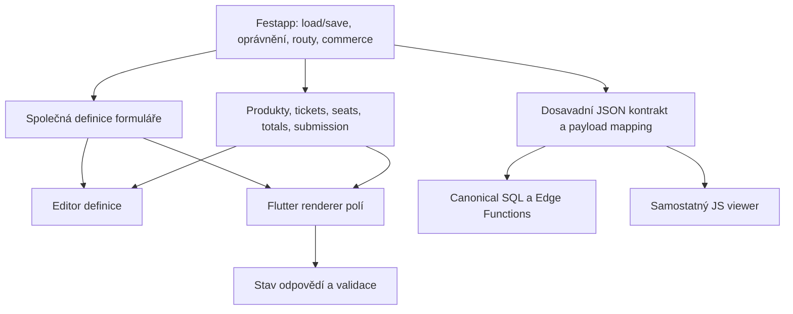

# Společný formulářový modul: posouzení editoru a vieweru

Datum: 2026-10-07. Status: posouzena proveditelnost; doporučen první interní refaktor, vyčlenění balíčku je podmíněné. Verification: standard při implementaci, protože se dotýká objednávkového UI a existujících kontraktů. Zadání této analýzy neautorizuje implementaci ani publikaci.

## Rozhodnutí

Samostatný `form_editor` není vhodná první hranice. Editor, náhled a vyplňování potřebují společné definice polí, pravidla a interpretaci hodnot. Technicky lze vytvořit lokální Flutter balíček pro tuto společnou část, ale dnešní kód není připravený na pouhé přesunutí adresáře.

Doporučení: nejprve uvnitř aplikace vymezit společný formulářový modul a na reprezentativním formuláři prokázat jeho rozhraní. Teprve potom rozhodnout o lokálním `form_engine`. Pokud by rozhraní muselo kopírovat téměř celý checkout nebo se rozpadlo do callbacku pro každou drobnou akci, ponechat modul uvnitř Festappu. To je platný výsledek, nikoli nedokončená extrakce.

Cílem je lokalizovat pravidla formuláře a umožnit samostatné ověřování. Zrychlení celé testovací sady není touto analýzou prokázané. Balíček nebude čistý Dart: viewer používá Flutter a `flutter_form_builder`.

## Výchozí bod a rozsah

- Primární důkazy pocházejí z publikovaného main `f6c62ad3fabbdd74303de1aed44967aca1a20b0f`, čteného v čistém release worktree `/private/tmp/festapp-live-release-20261007`. Jeho formulářový kód odpovídá main; tenant generation mění konfiguraci, nikoli tento modul.
- Dřívější balíčky HTML/grid/ticket jsou rozpracované v `/Users/miakh/source/festapp-editor-draft-plan`. Tam se liší i importy formulářů. Není to totožný stav jako nyní vydaný main. Implementace musí nejprve vybrat autoritativní commit; nesmí naslepo přebírat celé dirty worktree.
- Posuzujeme Flutter definice, editor, náhledy a vyplňování, jejich aplikační adaptéry a interoperabilitu s veřejným JS viewerem.
- Neměníme SQL schéma, názvy RPC, obchodní pravidla, platby, veřejné routování, zákaznické chování ani způsob nasazení. Nepřepisujeme JS viewer do Flutteru.

## Doložený současný stav

| Fakt | Důkaz | Dopad na návrh |
|---|---|---|
| Model pole není nezávislá definice | `lib/components/forms/models/form_field_model.dart`: `FormFieldModel extends ITrinaRowModel`, `toTrinaRow`, `ProductTypeModel`, `Tb`, `FormHelper` | Přesun modelu by přitáhl grid, commerce a widget helper; nejprve oddělit role |
| Form aggregate míchá definici a provozní informace | `models/form_model.dart`: `relatedFields`, `bankAccount`, `secret`, `stats`, `deletedFieldIds`, `deletedProductIds`, `toEditedJson` | Balíček nemá převzít celý `FormModel` |
| Editor vstupuje přes obchodní bundle | `db_forms.dart`: `FormEditBundle`, `getFormForEdit`, napojení product types/products/bank accounts; `widgets_editor/form_fields_generator.dart` | Obchodní obohacení musí mít vlastníka v aplikaci |
| Existují dva opravdové kontexty editoru | `views/form_editor_content.dart`: běžný konstruktor a `.prototype`; `components/occasion/prototype/occasion_setup_demo.dart` | Rozhraní musí fungovat pro uložený formulář i lokální návrh bez backendu |
| Editor už používá rozdílné interní náhledy | `widgets_editor/form_fields_generator.dart`: `_buildAnswerWidget`; `test/components/forms/form_editor_answer_preview_test.dart` | Pasivní ukázka odpovědi není interaktivní formulář; nesmí začít přijímat input |
| Plný náhled v editoru otevírá uloženou routu | `views/form_editor_content.dart`: `previewFormFab`, `/form/<link>?preview=true` | Dnešní plný náhled není automaticky náhled neuloženého draftu |
| Preview parametr je část dostupnosti, ne sandbox | `views/form_page.dart`: `showPreview` kontroluje `RightsService.isEditorOrderView`; `_sendOrder` má skutečné odeslání | Nelze tvrdit, že aktuální preview nikdy rezervuje/odesílá; refaktor nesmí potichu změnit jeho význam |
| Runtime holder je spojený s widgety a commerce | `models/holder_models/form_holder.dart`: `FormHolderController`, global key, secret, blueprint, callbacky; `fromFormFieldModel` filtruje spot/product podle seat selection | Nelze bez náhrady jednoduše přesunout `FormHolder` |
| Renderer obsahuje síťový zápis | `widgets_view/form_field_builders.dart`: `buildTicketField/removeTicket` volá `DbOrders.selectSpot` | Zobrazovací modul musí ztratit přímý DB přístup; uvolnění místa zůstane aplikační operací |
| UI totals nejsou nezávislý kalkulátor | `form_session.dart`: `recalculateTotals` čte Flutter klíče, produkty, sedadla a globální `DepositFeature` | Checkout totals a cenové autority nemigrovat do obecného formulářového jádra |
| Definice polí mají další konzumenty | `views/form_responses_content.dart`, `models/form_response_model.dart`, `components/eshop/eshop_columns.dart`, occasion prototype | Nestačí přepojit editor a jednu stránku; zahrnout response grid a vytváření akce |
| Veřejný web má samostatný viewer | `web_client/src/components/forms/form_page.js`, `form_renderer.js`, `form_session.js`, `form_data_reader.js`; `automation/cloudflare_build.sh`: `/form/` míří do web klienta | Dart balíček nesjednotí JS implementaci; musí se zachovat společný JSON kontrakt |
| Preview v JS má jinou implementaci oprávnění | `form_page.js`: `canPreview = true` s placeholder komentářem | Existující nesoulad evidovat zvlášť; UI preview není bezpečnostní autorita a extrakce ho sama neopravuje |
| Uložení je transakční a serverové | `DbForms.updateForm` -> `FormCommands.save/update_form`; `database/functions/eshop_forms/update_form.sql`: explicitní deletion IDs a row locks | Nepřepisovat deletion checks, permission checks ani atomické ukládání do package |

Pozor na starší README: uvádí `create_form_ws` jako registraci/submission. Čtený `DbForms` jej používá pro založení definice formuláře; `FormPage._sendOrder` používá `send-ticket-order`. `supabase/functions/send-ticket-order/index.ts` vybírá canonical order RPC. Plán vychází z kódu, nikoli z této formulace README.

## Tři různé náhledy a jejich stav

1. **Náhled odpovědi uvnitř editoru:** ukazuje typ/default/options, ale vstup do odpovědi je zakázaný. Editovatelné jsou vlastnosti definice.
2. **Plný náhled formuláře přes odkaz:** dnes načítá uložený bundle. Parametr preview mění zobrazení dostupnosti; jde o běžnou runtime stránku, nikoli zaručeně izolovanou simulaci.
3. **Rekapitulace objednávky:** čte aktuální odpovědi, vybrané produkty a rezervovaná místa. Patří do checkout toku, nikoli editorového draftu.

Nový společný renderer může mít explicitní pasivní režim a běžný režim vyplňování. Lokální simulační adaptér použít pro testy a důkaz rozhraní; nepřesměrovat na něj veřejnou preview routu. Zavedení náhledu neuložených změn by bylo samostatnou funkční změnou.

## Alternativy

| Varianta | Výhoda | Cena / omezení | Rozhodnutí |
|---|---|---|---|
| Přesunout pouze editor | Malý počáteční zásah | Zachová závislost na Festapp modelech, holderu a commerce; renderer se rozdělí | Zamítnout |
| Přesunout celé forms + checkout | Málo aplikačních portů | Balíček obsahuje oprávnění, produkty, platby, SQL klienta, routy; zůstává Festapp-specific a těžký | Zamítnout pro současný cíl |
| Vyčlenit pouze schema/codec do čistého Dart | Dobře testovatelná data | Neřeší největší UI vazby a může vytvořit druhý shadow model | Možný mezikrok uvnitř aplikace, nikoli předem slíbený další balíček |
| Společný formulářový modul, commerce přes konkrétní adaptér | Editor a viewer sdílejí význam polí; testy nemusí znát checkout | Vyžaduje skutečný refaktor dat a side effects; JS zůstává oddělený | Doporučený směr, balíček až po důkazu |

## Navržené vlastnictví

**Společný modul vlastní:** pořadí a identitu polí, základní vlastnosti, běžné typy a jejich options/defaults, obecná pravidla definice, editorové operace a běžné vstupy, validaci odpovědí, vzhled vstupů při dodaném tématu. Sdílená interpretace neznamená stejnou widget implementaci editorového nastavení a odpovědi.

**Festapp vlastní:** získání a obohacení bundles, authoring/saving rights, route a dostupnost celého formuláře, secrets a expiraci rezervací, výběr/odebrání místa, product availability, ceny/currency/deposit display, max-ticket obchodní omezení, order preview/send/result, banky a výstup response gridu. Server zůstává autoritou pro přijetí změny, mazání a objednávku.

**HTML:** společný modul potřebuje vykreslit obsah a upravit popis, ne znát Supabase/media ownership. Použít existující přijaté HTML rozhraní, pokud je na zvoleném base dostupné; jinak nejdřív malý interní adaptér ke stávajícímu HTML. Nevynucovat publikaci dalších rozpracovaných balíčků jako skrytou podmínku.

### Rozhraní pro ověření, ne hotový veřejný kontrakt

- Designer dostane jednu společnou definici + editorové capabilities a pracuje s vlastním draftem; vrací změny definice. Nevolá `DbForms` a nezahajuje order session.
- Renderer dostane tutéž definici, samostatný stav odpovědí a resolved presentation; běžná pole ovládá celý modul, ne host callback pro každý znak.
- Produkty a ticket/spot field family se připojí jedním konkrétním commerce adaptérem pro editor i runtime. Ten vlastní obchodní stav a převody těchto hodnot do stávajícího payloadu; používá společné běžné field rendering uvnitř ticketu. Typy jeho parametrů nesmí prosakovat přes `ProductModel`, `BlueprintSeat`, Supabase ani grid do obecného modulu.
- Definice může nést zachované domain metadata a reference, ale žádné secret/bank/runtime objects. Přesná reprezentace ticket containeru je implementační gate: nejprve prokázat na nested ticket + ordinary fields + product + seat. Nezavádět univerzální plugin framework pro hypotetické typy.
- Form-level persistence/response payload mapping zůstává v aplikaci. Převádí společný model na dosavadní wire tvar, nikoli na nové SQL API. Běžné hodnoty musí mít jedinou interpretaci, commerce hodnoty jediného aplikačního vlastníka.

## Invarianty a obtížná místa

1. **Jediná definice pole:** editor a renderer nekopírují vlastní schema třídy; grid má row adapter. `FormModel` může nadále být aplikační aggregate, ale jeho `relatedFields` odkazují na společnou definici.
2. **Oddělené stavy:** definition draft, runtime answers a checkout session se navzájem nemutují. Renderování/default getters nevytvářejí dirty edit. Baseline editoru zahrnuje nested changes a staged deletions.
3. **Stejný wire význam:** field IDs zůstávají identitou pro uložené odpovědi. Odpovědi jsou dnes `fields: [{"<id>": value}]`, nested tickets mají vlastní `fields`; některé alternate reads používají type keys. Zachovat všechny skutečné konzumenty a přesnou reprezentaci product/spot/date/id-document hodnot, null i prázdných hodnot.
4. **Lokální identita:** současný viewer konstruuje holders přes `ffm.id!`, zatímco draft může mít null ID. Nepředstírat DB ID pomocí libovolných záporných čísel. Použít stabilní lokální key uvnitř draftu/session s explicitním mapováním uložených ID; neodesílat lokální keys jako server IDs. Zachovat dosavadní lokální prototype tok.
5. **Type switch:** dnes změna typu může vymazat `data`/options; select-one/select-many přepnutí je výjimka. Zachovat toto konkrétní chování, default hodnoty, required email/ticket a hidden seat/product filtering. Nesmí vzniknout obecné pravidlo odvozené z intuice.
6. **Explicitní mazání:** zachovat `deleted_field_ids` a `deleted_product_ids`, ticket-child cascade a serverové `can_delete`/reason. Omitted fields nikdy neznamenají automatické mazání; stale server rejection zachová draft.
7. **Rezervace:** renderer sám nevolá síť; commerce adaptér zachová pořadí server release -> změna UI, secret scope, cancel/confirm a původní error handling. Lokální cancel snapshot není důkaz uvolnění serverového zámku.
8. **Save/HTML:** uložit HTML přes dosavadního koordinátora, potom canonical form command, baseline přijmout až po úspěchu. Failed save ani discard nesmějí opustit retained admin tab nebo ztratit nesaved draft.
9. **Schema preservation:** při oddělování modelů musí zůstat známá i dosud neinterpretovaná metadata a neznámé type strings. Nesmí dojít k nepozorovanému dropu polí při round-trip. Nové unsupported UI chování není součást refaktoru.
10. **JS interoperabilita:** sdílené JSON fixtures mohou dokazovat shodné outputs/interpretaci obou runtimeů. Sdílení fixtures není sdílení implementace a neodstraňuje potřebu JS tests.

## Rozhodovací gate před balíčkem

Interní prototyp musí zvládnout: editaci běžného pole a options/defaults; pasivní náhled; runtime vyplnění s validací; ticket s běžnými subfields a product/seat adaptérem; produktové mazání odmítnuté serverem přes host save; lokální occasion prototype. Balíček neakceptovat jen proto, že se kompiluje.

Přijmout extrakci pouze pokud:

- obecná implementace nepotřebuje imports z `package:fstapp`, přímé RPC ani grid;
- stejnou definici používá designer a renderer, bez přechodové druhé reprezentace běžných polí;
- host nevlastní většinu widget behavior skrze množství drobných callbacků;
- backend commerce adaptér a lokální testovací adaptér projdou stejnými relevantními scénáři;
- kontraktové fixtures mají shodný výsledek před/po refaktoru v Dart i JS;
- samostatné ověření modulu je prakticky užitečné a root runner ho opravdu pokrývá;
- celý povinný testovací běh nevykazuje doloženou regresi po započtení nového package pub/test overheadu.

Bez výsledku těchto bodů je doporučení **interní modul, nikoli další balíček**. Ani přijatý balíček není automaticky kandidát k veřejné publikaci.

## Implementační vlny pro později autorizovanou práci

### 1. Zafixovat behavior a zdroj

Vybrat clean base/worktree a zaznamenat SHA. Odlišit již přijaté package práce od nepublikovaných. Připravit společné wire fixtures z dnešních tvarů pro ordinary fields, defaults/options, nested ticket, seat/product a deletion. Doplnit pouze chybějící tests skutečných scénářů; nepřepisovat známé passing testy na mock interních funkcí.

Validace: targeted forms Flutter tests a `node --test` relevantních existujících `web_client/tests/forms/*` plus nové fixtures. Exit: lze porovnat význam editor save a runtime answers bez live backendu. Existující veřejné preview chování je pojmenované a není zaměněné za sandbox.

### 2. Rozdělit modely a vedlejší účinky uvnitř aplikace

Z `FormFieldModel` oddělit `ITrinaRowModel`/Trina mapping do aplikačního row adapteru a přepojit `FormResponsesContent`, `FormResponseModel` a `eshop_columns`. Vymezit společnou field definition z `FormModel` a zrušit model -> `FormHelper` widget import. `DbForms.getFormForEdit` dál dodává commerce data přes host context, nikoli product objects uvnitř obecného modelu.

Z `FormHelper` oddělit schema constants, value interpretation a presentation. Z `FormFieldBuilders.buildTicketField` odstranit přímé `selectSpot`, ale zachovat operaci v commerce owneru. `FormSession` ponechat host checkout ownerem; renderer dostane pouze potřebnou informaci a state connection.

Validace: forms/default/deletion/mobile-layout tests, response-grid a occasion prototype integration; existující order command tests při změně call sites. SQL se nemění. Exit: běžné definitions/rendering nemají commerce/grid/network dependency a nejsou dvakrát implementované.

### 3. Prokázat společné rozhraní editoru a rendereru

Přepojit `FormFieldsGenerator`, běžné field editors, `FormPage` vnitřní rendering a holder creation na jednu definici. Host `FormEditorContent` dál vlastní load/save/discard a HTML lifecycle; host `FormPage` dál vlastní availability/rights/checkout/routing. Implementovat konkrétní commerce připojení obou kontextů včetně ticket subfields. Nastavení bank/plateb, design a order results nadále patří hostu; přepojit jejich čtení změněného modelu.

Validace: gate výše; ověřit failure při odebrání rezervace, cancel/confirm bez ztráty odpovědí, failed save zachová draft, hidden spot toggle nenabídne duplicitní seat product, retained tab Save/Discard. Nepřidávat nové veřejné preview chování. Exit: explicitní accept/reject rozhodnutí pro package s konkrétní velikostí rozhraní a výsledky.

### 4. Podmíněný úplný přesun do lokálního `form_engine`

Jen po přijetí gate přesunout společnou implementaci a její behavior tests do jednoho Flutter balíčku; host adapters zůstávají ve Festappu. Zapojit dependency, package tests a changed-test routing do tehdy autoritativního runneru. Výchozí full command musí povinně ověřit/reuse tento package přes stejnou cache politiku jako ostatní packages; nevynechat ho při cache miss či neznámé dependency.

Odstranit původní přesunuté files/imports/duplicate tests a dočasné konverze. Nezavádět forwarding soubory. Exit: všechny callers používají jediného vlastníka, package tests plus aplikační integrační tests projdou, balíček nemá Festapp imports.

Při zamítnutí gate skončit po vlně 3 se stabilním interním modulem; aktualizovat tento plán s důvodem. Nevracet užitečné zúžení závislostí ani cizí rozpracované změny.

## Ledger odstranění a vědomého zachování

| Artefakt | Výsledná akce a důkaz |
|---|---|
| `FormFieldModel` jako grid row i form definition | Jediná definice + host row adapter; starý inheritance/import chain odstraněn, caller testy projdou |
| `FormHelper` jako owner constants + UI + payload + commerce | Rozdělit podle vlastníků, přesunuté funkce nemají starou kopii; host zachová wire mapping |
| Přímý `DbOrders.selectSpot` uvnitř runtime field widgetu | Přesun do commerce owneru; scoped import/symbol search a failure/cancel tests |
| Původní widget/test soubory po případné package extrakci | Vymazat, přepojit všechny imports a runner entrypoints; žádné forwarding aliasy |
| `FormModel`, `FormEditBundle`, `DbForms`, `FormCommands` | Zachovat aplikační aggregate/persistence s přepojenou společnou definicí |
| `FormSession`, reservation/order pages, response grid, settings/design | Zachovat jako aplikační commerce/presentation integrations; nemigrovat celý modul mechanicky |
| JS renderer/session a SQL/Edge Functions | Zachovat explicitně; žádný nový backend nebo paralelní business owner |
| Stávající preview route | Zachovat dosavadní produktové chování; případný security fix nebo draft-preview funkce je samostatná práce |

## Ověření a měření

V této analýze nebyly spuštěny testy ani benchmarky; nezměnil se aplikační kód. Fakta jsou z cíleného čtení reprezentativních producer/consumer toků, backend kontraktu a existujících tests.

Při implementaci používat `fvm flutter test test/components/forms` nebo skutečné grouped entrypoints vybraného base; package ověření `fvm flutter test` v package directory. Pro JS používat existující `npm test` nebo konkrétní `node --test tests/forms/<skutečný soubor>.test.js` v `web_client`. Při pouhém přesunu bez SQL změn neopakovat produkční SQL operace. SQL deletion/order testy jsou autoritativní kontrakt, změna jejich významu vyžaduje zastavení tohoto refaktoru a nové zadání.

Před tvrzením o rychlosti porovnat stejný base obsah, workers, cache policy a workload před/po. Zvlášť vykázat root test runtime, všechny package tests a pub/setup overhead. Náhodný cache hit/miss nesmí být vydáván za efekt extrakce. Pokud je výsledek v běžné variabilitě, označit performance přínos za neurčitý.

## Předpoklady, rizika a definice dokončení

- Současným cílem je vnitřní modularita/testování, nikoli formulářová knihovna pro jiné produkty. Pokud se změní na veřejnou knihovnu, je nutné znovu rozhodnout podporované field families a compatibility policy.
- Přesnou velikost commerce rozhraní bez interního refaktoru nelze poctivě potvrdit. Vlny 2-3 jsou její ověření, nikoli předem schválený plugin framework.
- Další významné náklady: zachování nested mutable draft identity; prototypy bez persisted IDs; HTML async save; price/seat UI parity; response grid; dva jazyky runtime. Nejsou vyřešeny stěhováním souborů.
- Nesoulad JS preview capability a starší README jsou evidované adjacent problémy, nikoli oprávnění k rozšíření refaktoru.
- Dokončení znamená buď prokázaný interní modul se zdůvodněným odmítnutím package, nebo gate-přijatý úplný lokální package cutover se zapojeným runnerem, behavior parity a odstraněnými starými kopiemi.
- Commit/push, veřejná package publikace, backend změny a další live release vyžadují samostatné zadání. Předchozí autorizace live vydání se na tuto novou práci nepřenáší.
