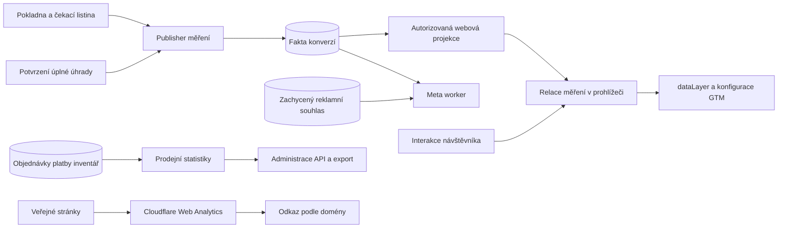

# Měření a statistiky Festappu

Autoritativní plán pro měření formulářů, veřejnou návštěvnost, prodejní statistiky a jejich použití v administraci a integracích. Připraveno 21. 11. 2026. Ověření v režimu standard. Při schváleném nasazení platí všechny repozitářové release brány.

## 1. Výsledek

- Pokladna, čekací listina a platební moduly publikují obchodní momenty pro měření jednou interní metodou. Znalost GTM, GA4, Google Ads a Meta zůstává v odběratelských adaptérech.
- Správce nastavuje měření na jednom předvídatelném místě a vidí stav konkrétního kanálu, formuláře, webu a souhlasu. Konfigurace ukáže, kdo může chybějící předpoklad vyřešit.
- Stejně pojmenovaná statistika v přehledu akce, správě formulářů, exportu a API používá stejnou definici a zdroj. Pokud se liší období nebo populace, rozhraní ji označí přesněji.
- Prodejní součty zahrnují všechny oprávněné prodeje. Marketingové konverze vypovídají o měřeném provozu a doručených signálech. U návštěvnosti je vidět omezení zdroje a pokrytí.

### Rozsah

Zahrnuje nastavení a souhlas formulářů, klientské interakce, serverové konverze, doručení a diagnostiku, Cloudflare návštěvnost veřejných stránek, kapacitu a finanční i provozní souhrny prodeje, jejich zobrazení ve Festappu a odpovídající API a exporty. Rozhraní má zpřehlednit existující obrazovky a jejich odkazy. Pro zdrojové systémy mimo tento rozsah platí architektonické pravidlo v oddílu 2. Nové zdroje kampaní, import dat z reklamních účtů a libovolné sestavování reportů vyžadují vlastní produktové zadání.

### Výchozí stav

Pracovní strom `festapp-capi-self-service` začal na `c626275b3` s lokální samoobsluhou Meta CAPI. Na začátku realizace byl autoritativní `origin/main` na `73de4a5cd`. Implementační větev byla posunuta na `c02f27658`. Čtyři původní mezilehlé commity se z rozpracovaných souborů překrývaly v generované MCP referenci, která byla přegenerována z obou vstupů. Migrace `20261121020000_self_service_meta_capi.sql` navazuje na dosud lokální samoobsluhu. Soukromá oprava výdeje vstupenek zůstává v samostatném worktree.

## 2. Mapa zdrojů a pravidla odpovědnosti

| Otázka | Aktuální zdroj a uživatelé | Cílový vlastník |
| --- | --- | --- |
| Kolik návštěv a zobrazení měly veřejné stránky? | `web_client/public/public-web-analytics.js`, `automation/cloudflare/web-analytics-sites.json`, sestavení v `automation/cloudflare_build.sh`, odkazy v administraci organizace popsané v `docs/operations/public-web-analytics.md` | Cloudflare, s přesným filtrem hostname nebo vybranými site tags. Festapp poskytuje popsaný odkaz na zdroj. |
| Kdo může měřit formulář a jak se přenáší souhlas? | `form_measurement_decision.sql`, `form_measurement_policy.sql`, `form_measurement_runtime.sql`, aktuální website consent binding a revize | Databázové rozhodnutí. Autorizační vstupy vlastní konfiguraci organizace a pořadatele, veřejný runtime dostává omezenou projekci. |
| Co návštěvník udělal v prohlížeči? | `FormDataLayer.emit`, `FormMeasurementSession.record`, protokol v `form_measurement_contract.js`, samostatný a embedded transport | Jediný vstup klientského měření v dokumentu. Události jsou dočasné a závislé na aktuálním souhlasu, dokumentu a původu. |
| Jaká obchodní konverze nastala? | `record_form_conversion_internal` a `record_form_paid_conversion_internal` zapisují `analytics.conversion_facts` | Jeden serverový publisher a stávající fakta s neměnným ID. |
| Kam se měla konverze doručit a co se stalo? | Webové projekce v `form_datalayer.sql`, Meta fronta `analytics.meta_purchase_deliveries`, `meta_purchase_worker.sql`, `process-meta-purchases` | Deklarace odběru podle druhu události, webový adaptér a Meta adaptér. Každý dodržuje svůj způsob doručení a ukazuje odpovídající stav. |
| Kolik evidujeme objednávek, vstupenek, lidí, volných míst a přijatých peněz? | `get_report_ws` pro akci, `get_form_capacity_snapshot_internal` pro kapacitu, duplicitní počty v `get_forms_by_link`, `get_all_viewable_forms_for_copying` a `legacy_occasion_catalogs.sql` | Oprávněný SQL report nad objednávkami, platebními pohyby a inventářem. Přehledové čtečky používají sdílené dávkové výpočty. |
| Kolik bylo odeslaných e-mailů, jak funguje infrastruktura a co se účtuje partnerovi? | `email_reporting.sql`, `automation/hetzner-supabase/monitoring`, `docs/architecture/service-fees.md` a `integrations/wix/reporting` | Samostatní provozní a účetní vlastníci. Do přehledu patří odkazy podle role a označený původ výsledků. Případné sdílení se dělá přes autorizované projekce daného vlastníka. |

Jednotný princip platí napříč těmito zdroji. Každé číslo má zdroj, rozsah, definici populace, časovou osu, oprávnění a údaj o čerstvosti. Publikované konverzní události slouží doručování. Autoritativní obchodní údaje zůstávají v transakčních tabulkách. Provozní, účetní a návštěvní zdroje mají odlišné retenční a přístupové podmínky. Rozšíření jejich sběru patří do rozhodnutí vlastníka konkrétního zdroje.

## 3. Cílová architektura

### Serverový publisher

- Privátní `publish_form_measurement_event_internal(p_event text, p_order bigint) → uuid | NULL` přijímá uzavřené události `checkout_finalized`, `waitlist_registered`, `waitlist_offer_accepted` a `order_fully_paid`. Rozsah pořadatele, obsah, měnu, částku a aktuální způsobilost odvozuje ze záznamů serveru. Volající vlastní transakci, autorizační kontext a okamžik publikování.
- Publisher jako jediný zapisuje `conversion_facts`. Zachová `purchase`, `free_registration`, `waitlist` a `order_fully_paid`, unikátní `(order, kind)` a stávající formát faktů. Typy `register` a `accept` zachovají současný anonymní kontext a dosavadní vyloučení z CAPI. Dokončená objednávka uchová původní časování nákupu a příznak CAPI.
- Odběr je definován v kódu. Webová projekce odebírá příslušné nákupy, úplné úhrady a leady. Meta CAPI odebírá úplnou úhradu a vyžaduje uložený souhlas v existující doručovací frontě. Jedna statická mapa druhů faktů slouží oběma adaptérům. Pravidla o souhlasu, termínu doručení, tokenu, identitě objednávky a revizi konektoru vlastní konkrétní adaptér. Pro přidání kanálu se doplní jeho odběr, adaptér a ověření selhání.
- Autorizovaný checkout zachytí souhlas a údaje pro párování ve stávající Meta frontě. Obecný fakt nenese surový e-mail, telefon, token, IP, objednávkovou capability ani data souhlasu. Meta worker obsluhuje síť až po potvrzení transakce. Opakovaný pokus používá stejnou identitu události.
- Když selže nepovinný zápis měření při checkoutu, obchodní operace a potvrzení zůstanou dostupné. U způsobilé úplné úhrady se finanční účinek a fakt potvrdí společně; selhání faktu umožní opakovat zpracování platby. Replay potvrzení čte stávající fakt a nedoplňuje chybějící události zpětně. Dva souběžné vstupy vytvoří nejvýše jeden fakt a odběratel má nejvýše jednu identitu doručení.
- Mapování `purchase` a `meta_purchase` zachová stávající deduplikaci browser/Meta, časové okno a pravidlo, že běžná webová analytika čeká pouze na své podmínky. Autorizace příjemce, snapshot objednávky a meze zdrojů se kontrolují v každé projekci. Kompatibilita payloadů protokolu 3 a bezplatných, čekacích i zaplacených konverzí je součástí hotového výsledku.

### Katalog statistik

Katalog vznikl porovnáním instalovaných čteček na `73de4a5cd`. Následující rodiny popisují pravidla. Za tabulkou je vazba na konkrétní data a spotřebitele.

| Rodina | Definice k zachování nebo zpřesnění | Povinná dimenze |
| --- | --- | --- |
| Objednávky a vstupenky | Rozlišit vzniklé, platné, stornované, čekající a zaplacené. Hromadný tisk na sklad a okamžik následného prodeje mají vlastní pravidla. Stav `paid` může u objednávky se zálohou vyjadřovat uhrazenou zálohu. | Akce či formulář, stav, okamžik objednání nebo prodeje. |
| Lidé a kapacita | Oddělit počet osob, vstupenek, sedadel a ploch. Rozlišit rezervovanou, obsazenou a veřejně dostupnou kapacitu podle stávajícího vlastníka. Historická řada dostupnosti vyžaduje vlastní data. | Formulář, zdroj kapacity, čas pořízení snímku. |
| Peníze | Objednaná cena, skutečně přijaté platby, vrácené částky a čisté příjmy používají existující platební výpočty. Dny objednávek a platby jsou vlastní osy. Částky jsou po měnách; případná prezentační konverze ukáže použitý kurz a datum. | Měna, účetní událost, datum, časové pásmo. |
| Konverze a doručení | Vzniklý fakt, měřený nákup a doručená Meta událost jsou různé stavy. Fronta umí zobrazit čekající, odeslané, neplatné, odvolané, prošlé a trvale neúspěšné události. | Kanál, forma aktivace, období, původ události. |
| Návštěvnost | Návštěvy, zobrazení a weby, ze kterých návštěvníci přicházejí, vycházejí z pokrytí veřejných tras v Cloudflare. Součty jsou dle dostupného rozsahu externího zdroje. | Doména či přesná sada site tags, časové období. |

| Identifikátor / pole | Zdroj, rozsah a interpretace |
| --- | --- |
| `catalog.orders.total/storno/paid_or_sent/ordered/used` | Stav objednávky v okamžiku čtení. Dávkový `get_order_catalog_counts_internal` dostává rozsah od autorizované čtečky. Formulář používá vztah `orders.form` v téže akci. Katalog počítá i čekací a skladové objednávky. Stav `paid` může zahrnout zálohu. `get_all_forms.response_count` je kompatibilní jméno pro celkový počet objednávek, nikoli osob. |
| `report.orders/tickets/valid` | `get_report_ws` pro jednu autorizovanou akci v organizaci čtenáře. Celkový prodej vylučuje skladové objednávky. Platný podvýběr vylučuje storna a čekací objednávky. Vstupenka se počítá jednou podle ID. Skladová vstupenka vstupuje do historie prodeje dnem následného prodeje. |
| `report.money_by_currency/timeline` | Objednaná cena v měně objednávky. Přijatá a vrácená částka mají vlastní platební pohyby a čistý příjem se vykazuje odděleně. Objednávky a platby mají vlastní den. Objednávky a online úhrady používají `Europe/Prague`, historický výpis banky používá datum pohybu podle databázové relace. Zachován výstup varování i starší textové pole. |
| `report.spots/form_capacity`, formové `capacity` | Snímek sedadel/ploch a samostatný snímek kapacity formuláře. Kapacita používá jedinečné způsobilé vstupenky a pravidla rezervací a čekací listiny. Tyto snímky se nemění na historickou řadu. |
| `form.conversion_fact`, `meta.delivery` | Fakt uchovává ID a čas publikace. Webová projekce používá uložené časování nákupu a aktuální způsobilost. Fronta Meta přidává vlastní stav a revizi souhlasu. Počítadla v nastavení pokrývají posledních 30 dní podle času dokončení, jinak zachycení souhlasu. |
| `web.visits/page_views` | Cloudflare Web Analytics, přesný host u samostatného odkazu nebo přesná sada site tags pro sdružený přehled. Období ovládá dashboard. Pokrytí zahrnuje veřejné katalogy, pořadatele a vyřešené formuláře, s vyloučením přihlášených relací, embedů a neveřejných tras. [Rozsah a evidence](../operations/public-web-analytics.md) |

Flutter `ReportTab` volá `get_report_ws` přímo. API, Make a MCP `orders.report` jej volají přes `get_operator_order_report_v1`; `reports.export` serializuje totéž API. Formové seznamy používají katalogový počet všech objednávek. `get_form_usage_rows_internal` navíc pro existující ochranu při mazání zkoumá historické reference i u již obsazené relační vazby. Detailní filtrování starého seznamu rezervací v `get_reservations(text,text)` zůstává kvůli starším nainstalovaným klientům; jeho odstranění vyžaduje ověřený konec spotřeby starého RPC nebo schválenou změnu kontraktu.

Každé porovnání webu s prodejem musí použít shodný rozsah, čas a známé pokrytí. Když návštěvnost neumíme svázat s formulářem a souhlasem konzistentně, rozhraní ukáže metriky samostatně. Chybějící data se zobrazí jako nedostupná, nula znamená ověřený nulový výsledek. Klientské výpočty se omezí na formátování a vizualizaci.

## 4. Implementační vlny a měřitelné výstupy

### Vlna 0. Inventura a způsobilost změny

- Aktualizuj výchozí revizi. Jedním průchodem projdi zápisy do `conversion_facts`, klientské emitery, workery a plánované úlohy, SQL souhrny, API a exporty. Zapiš pro každý živý vstup jeho autorizační a transakční hranici a spotřebitele. Dohledání používej i v registrovaných RPC, CLI a MCP schématech, generovaných kontraktech a plánovaných jobech.
- Zachyť porovnávací fixture s placeným, částečně zaplaceným, refundovaným, stornovaným, čekajícím, bezplatným a následně prodaným skladovým lístkem, smíšenými měnami a platbou v odlišném dni. Zachyť i data vzniklá před zavedením současných vazeb.
- Zaznamenej výchozí SQL latenci a počet dotazů na fixture pořadatele s více akcemi a formuláři. Použij existující `database/tests/performance/unit_dashboard_test.sql` a `docs/plans/evidence/occasion-report-benchmark.sql`. Výstupem je rozhodnutí, které rozdíly čísel jsou záměrné a které jsou duplicita nebo chyba. U již nasazené nekompatibilní závislosti doplň do plánu konkrétní dočasný adaptér a ověřitelnou podmínku jeho odstranění.

### Vlna 1. Publisher a odběratelé konverzí

- Přesuň zápis pod jeden privátní vstup v `database/functions/eshop_forms/`. Přepoj `create_ticket_order_client_sync_v1.sql`, `eshop_waitlist/commands.sql`, `apply_transaction_pairing.sql` a `payment_providers/effects.sql`. Přepoj browserové projekce a Meta claim na společnou mapu. Checkout zůstává vlastníkem zachycení souhlasu a platební modul vlastníkem potvrzení úhrady.
- Zachovej in-flight receipt fence, lease, podmínky před odesláním, stabilní ID a retenční promazání z `meta_purchase_worker.sql` a souvisejících zdrojů. Runtime po přepojení obsahuje jediný zapisující modul a stávající Meta frontu.
- Ověř SQL sady konverzí, checkoutu, čekací listiny a Meta souhlasu, bankovní párování, online úhradu, souběžný replay, odvolání během doručení a opakování po chybě. Migrační replay ověří, že staré záznamy a fronta pokračují se stejnou identitou. Dokončení prokazuje i absence tří nahrazených zapisujících funkcí z evidence v oddílu 5.

### Vlna 2. Klientská událost a nastavení kanálů

- Zachovej `FormDataLayer.emit` jako vstup pro formové interakce a `FormMeasurementSession` jako vlastníka aktuálního kontextu, životního cyklu a souhlasu. Dohledej přímé `dataLayer.push` mimo adaptéry. Formové události převeď do stávajícího vlastníka, hostitel zůstává adaptérem pro schválený přenos. `measurementProtocol=3` a existující přenos CMP ověř na samostatném formuláři, iframe, obnově relace, odvolání souhlasu a nákupu po úhradě.
- V existujících obrazovkách pořadatele sjednoť informace o webu, souhlasu a kanálech a použij současnou serverovou projekci. V kontextu formuláře odkaž na konkrétní chybějící stav, například nepřipojený web nebo vypnuté měření formuláře. Odděl stav nakonfigurováno, způsobilé a doručení doloženo. Správce pořadatele obslouží CAPI sám. Platforma dál vlastní nasazení izolovaného runtime pro skripty pořadatele. Organizace a pořadatel mají svoje existující oprávnění a výchozí nastavení.
- Použij existující role, widgetové testy a repozitářové browser harnessy. Ověř vlastníka, správce i čtenáře, přepnutí účtu a pořadatele, odpojení a testovací kód Meta, chybějící souhlas a malou obrazovku. Shoda povolení se ověřuje na serverové operaci. Chybový stav používá existující důvody nebo nový důvod s lokalizovaným řešením. Výsledkem je jedna cesta nastavením každého kanálu.

### Vlna 3. Autoritativní statistiky a reporty

- Porovnej definice z `get_report_ws.sql`, kapacitního snapshotu, formových čteček a `legacy_occasion_catalogs.sql` s katalogem v oddílu 3. Sjednoť opakované souhrny objednávek do jednoho dávkového výpočtu nad autorizovaným rozsahem. Přepoj pouze shodné populace. Výslovně pojmenuj legitimní rozdíl, například všechny vzniklé objednávky oproti platným prodejům.
- Při přechodu z `orders.data->>'form'` na relační `orders.form` porovnej historické záznamy po stejném uloženém scope. Jednoznačné staré vazby oprav kontrolovaným dopředným krokem s odečtem před a po. Neshody a chybějící vztahy vyžadují potvrzené řešení před odstraněním staré projekce. Pro rozsáhlá data analyzuj dotaz a indexy. Vyhni se globálním agregacím a dotazu uvnitř cyklu nad každým formulářem.
- `get_report_ws` zachová výstup, autorizaci, měny, deduplikaci plateb, upozornění a dosavadní historické chování. Flutter `ReportTab`, `orders.report`, `reports.export` a Make čtou stejný snapshot přes stávající vstupy. Generované datové kontrakty se mění jen při schváleném rozšíření. Ověř částky a počty podle fixture, nulový report, rozsah uživatele a stejný výsledek v UI, exportu i API. Výkonnost srovnej na stejné fixture a plánu dotazů, bez zhoršení p95 o více než 10 % přes tři stejné série v izolaci. Posuzuj i počet dotazů a plán vysokých nákladů.
- V přehledech odliš příjmy, objednávky, lidi a návštěvnost podle katalogu. Zachovej Cloudflare konfiguraci a čitelné odkazy na návštěvy a zobrazení pro správnou organizaci a doménu. Ukazuj zdroj a čas. Ověř, že sběr zůstává omezený na veřejné trasy a jeho odkazy respektují aktuální tenant. Případný přímý import z Cloudflare, CRM nebo reklamního účtu je samostatná integrace s vlastním přístupovým modelem a důkazem pokrytí.

### Vlna 4. Kontrakce, vydání a důkaz skutečného stavu

- Zreviduj každou položku oddílu 5. Při cutoveru založ dopředné migrace a přegeneruj manifest vlastníků, testy zdrojové parity, relevantní ACL evidenci a klientské schéma. Ověř historii na čistém replayi i na klonu před změnou.
- Změř cílenou lokální validaci podle oddílu 6. Schválený rollout začíná kompatibilním backendem, následuje určený tenant webu a až po ověření zmizí zastaralá dočasná rozhraní. Staré aplikace s publikovaným JSON kontraktem dál dostávají kompatibilní projekci.
- Při problému s odesíláním lze vypnout jednotlivý konektor a fronta zachová auditní stav. Při regresi reportu vrať čtečku pomocí ověřené dopředné opravy. Přechodné vydání se vrací jen na verzi s kompatibilní DB. Vrácení nebo oprava nesmí vrátit povolení starého konektoru ani znovu zařadit terminální doručení.
- Živá kontrola po autorizaci ověří verzi, zdraví workeru, verifikovaný rozsah reportu, skutečné odkazy a jednu instalaci měřicího adaptéru pro danou cestu. Syntetické objednávky, platby a Meta testy patří do izolovaného prostředí. Připravená migrace má v předání explicitní stav.

## 5. Evidence nahrazovaných vstupů

| Dnešní cesta | Výsledek a důkaz |
| --- | --- |
| `record_form_conversion_internal(bigint,boolean)`, `record_form_conversion_internal(bigint)`, `record_form_paid_conversion_internal(bigint)` | Privátní zápisy nahradí publisher. V kanonických runtime zdrojích žádný volající a jediný modul s `INSERT INTO analytics.conversion_facts`. SQL parity doloží odstranění starých podpisů. Historie zachová přesné bajty. |
| Web `analytics` a `metaAnalytics`, Meta claim, prepare a finish RPC, worker a wake-up | Držené rozhraní odběratelů. Test doloží shodné ID a stav včetně opakovacího pokusu, odvolání a expirace. |
| Duplicitní formové a akční souhrny, vazba přes JSON | Sjednocené SQL výpočty pro shodné metriky. Ponechané odlišné metriky mají vlastní název a důvod. Historická vazba se odstraní po porovnání starších záznamů, opravě jednoznačných rozdílů a doloženém testu parity. |
| `get_report_ws` včetně starého textového pole, exporty, veřejný měřicí protokol a dříve publikované CAPI RPC | Zachované kompatibilní adaptéry. Staré schvalovací RPC vrací stav přístupu a nevytváří schvalovací požadavek. Odebrání veřejného kontraktu až po prokázaném ukončení spotřeby a schválené změně verze. |
| Opakované klientské počty nebo přímé emitery zjištěné v inventuře | Inventura klienta našla stávající kanonickou cestu. `FormDataLayer.emit` vstupuje do `FormMeasurementSession.record`. Asynchronní checkout a upozornění na zahájení prodeje používají ze stejné relace zachycené epochy. `web_client/src/embed/host_measurement.js` a sestavený `web_client/public/embed.js` provádějí přenos jen ve schváleném originu. Žádný přímý formový Push mimo vlastníka nebo transportní adaptéry. Cloudflare má samostatný veřejný beacon. |

## 6. Ověření a stav připravenosti

- Použij `node web_client/scripts/run_db_tests.js` pro `form_measurement_conversion_matrix_test.sql`, `form_measurement_purchase_test.sql`, `meta_purchase_consent_test.sql`, `form_measurement_waitlist_test.sql`, `occasion_report_test.sql`, `bank_roundtrip_report_test.sql`, příslušný test online brány, tenant scope a zdrojovou paritu. Explicitní test má zachytit cizí organizaci, vypnutý kanál a souběžné opakování stejné události.
- Pro web použij CI vstupy měření, consent transportu, kompatibility embedu a `automation/tests/public_web_analytics.test.mjs`. Pro Flutter použij prováděné widgetové vstupy nastavení a reportu. Upravený seznam testů ověř inventurou. Pro API použij report, generovaný kontrakt a kompatibilitu publikovaného schématu.
- Použij `meta_purchase_order_consent_upgrade.test.js` a migraci na klonu se starou konfigurací. Potvrď zachování existujících grantů a revizí, vypnutí dříve blokovaných konektorů a žádnou duplicitní identitu. Před nasazením ověř žádné doplňování historických konverzí pouze na základě aktuálního nastavení.
- Lokální refaktor společného rozhodování o měření měl cílené testy zelené. Autoritativní `main` měl nesoulad vlastníků v `20261116140000_restore_fakturoid_czk_reference.sql`. Inventura aktivních vlastníků našla stejný problém u `20261116150000_ticket_table_seat_appearance.sql` a `20261119230000_organizer_ticket_resend_limits.sql`. Pozdější vlastníci už jsou evidovaní. Registr kontroluje původní součty a účinné definice přes dopředné vlastníky. Historický DROP odstraněný z runtime zdroje reportů e-mailu zůstává v původní migraci.

Hotovo znamená ověřený jeden publisher serverových konverzí, konzistentní klientský vstup, čitelné samoobslužné nastavení, definice každé prodejní a návštěvní statistiky, stejný zdroj napříč výstupy, vyřešené historické rozdíly a doložená odpovědnost konkrétního modulu za každý provozní stav. Publikace a práce v produkci vyžadují samostatnou autorizaci.

## 7. Předání implementace

- Publisher volají checkout, registrace a přijetí nabídky čekací listiny, bankovní párování a online platební modul. Webový nákup, jeho Meta doprovod a leady čtou mapu odběru. Meta claim, prepare a wake čtou stejný typ faktu. Retenční a dokončovací operace fronty používají původní vlastníky. SQL parita ověřuje absenci tří starých podpisů.
- Katalogový souhrn používají `get_forms_by_link`, `get_all_viewable_forms_for_copying`, `get_all_forms`, dávkové stránky `get_form_catalog_rows_internal` i akční přehled `get_all_occasions_for_edit_v182`. Report, Make a exporty používají společný report ze zdrojů v katalogu. Formuláře nyní zahrnou objednávky s platnou relační vazbou, i když jejich JSON klíč chybí. Bývalé globální spojení přes JSON se na těchto čtečkách nepoužívá.
- Účinná konfigurace CAPI v nastavení pořadatele zahrnuje web, souhlas, stav formuláře a výsledek doručení. V kontextu formuláře je zvlášť stav webového měření a informace o zvolené konverzi Meta. Veřejný protokol 3 a transport souhlasu prošly stávajícími browser harnessy.
- Čistý replay používá `automation/local_db/runtime.py upgrade`. [Rehearsal](evidence/form-measurement-publisher-rehearsal.mjs) se spouští v izolovaném runtime na předchůdci s předanou lokální adresou z `runtime.py exec`. Ověřil kontinuitu ID a grantů, terminální doručení, nový claim původního čekajícího doručení, souběh dvou insertů a návrat čteček pomocí původních definic. Ověřil opravu jednoznačné vazby, blokaci nejasných vazeb a přípustný shodný UUID v jiném uloženém rozsahu.
- Katalogový benchmark odhalil opakovaný výpočet kapacity při výběru registračního režimu. U formuláře bez limitu stačí ověřit prodejní okno a aktivní plán míst. Katalog stále načítá svůj úplný kapacitní snímek.
- [Benchmark](evidence/occasion-report-benchmark.sql) použil 50 000 objednávek a 20 formulářů ve dvou akcích. Při finálním párovém běhu měly obě verze stejná data, indexy a tři série po třech vzorcích ve stejné databázi. Diskrétní p95 katalogu kleslo z 868,716 ms na 815,691 ms. P95 reportu kleslo z 1503,912 ms na 1476,274 ms. Předchozí samostatné běhy kolísaly. Párová varianta přepíná obě původní definice z `pg_get_functiondef` v rámci transakce. `pg_stat_statements` zachytil jeden katalogový agregační dotaz v obou verzích, 106 876 a 106 877 vnořených SQL volání v celé katalogové odpovědi a velikost obchodního reportu 3 083 bajtů v obou verzích. Definice `get_report_ws` se shoduje s předchůdcem a plán používá stávající indexy akce a platby.
- Standardní ověření zahrnulo 12 cílených SQL souborů, následný běh sedmi souborů pro kapacitu, checkout, čtečky a paritu, migrační test souhlasu, 19 testů reportu a Make nad databází, 62 widgetových scénářů a 650 webových testů. Prošly čtyři browser harnessy, kontrola kompatibility publikovaného API, inventura CI, SQL zdrojová parita a kontrola ACL. Kontrola `abuse` ověřuje úplnou inventuru Edge tras. Pro schéma a pravidla notifikací porovnává kanonické zdroje s přesnými bloky evidované migrace. Regresní případy ověřují, že nepodložená úprava funkce i pravidla nadále selže.
- Migrace jsou připravené lokálně. Při autorizovaném nasazení spusť na ověřeném cíli read-only dotaz z `python3 automation/form_catalog_preflight.py`. Vrací `legacy_missing` (počet jednoznačných oprav) a `conflicts` (počet záznamů k vyřešení před migrací). Používá přímo dotaz z kontrolované migrace. Rehearsal ověřuje výsledek před opravou, při konfliktu a po opravě. Při návratu čteček dopředná oprava zachová současná povolení i historii fronty. Živý worker, skutečné odkazy a verzi daného tenantu ověří až schválený rollout.
