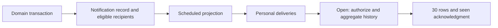
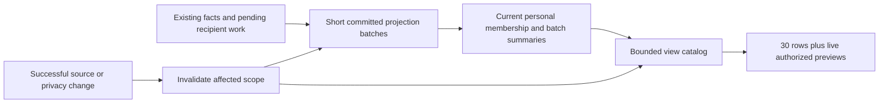

# Fast notification views with explicit snapshot and privacy contracts

Date: 2026-11-05
Status: Ready for staged local execution; Wave 0 must pass before schema implementation
Verification: standard
Review: independent senior architecture review by Astra, medium reasoning
External evidence: [first-party industry research](notification-center-industry-research-2026-11-05.md), researched 2026-11-05

## 1. Outcome and decisions

### Execution disposition

This is the authoritative implementation plan after architecture review and
first-party industry research. Start with Wave 0, then continue through the
remaining applicable waves without seeking approval between ordinary local
steps. Wave 0 is executable work: resolve its contract/algorithm questions using
repository evidence and a small correctness harness; record the decisions here.
Do not treat the gate as a reason to stop after another design-only handoff.

The default implementation is the prepared-summary/token design below. Wave 1
may justify a smaller indexed design only with measured scaling and equivalent
privacy/read/selection correctness. Record any such change and its deletion and
verification implications in this plan before continuing. An unresolved design
premise must not be hidden behind a speculative compatibility fallback.

Keep the current small SQL latency fix and unrelated workspace edits intact.
Local implementation includes canonical SQL, forward migrations, client changes,
resumable disposable-data backfill/replay tooling, focused tests and measured
results. Save actual results, commands, workload and remaining limits in
`docs/plans/notification-center-scalability-RESULT-2026-11-05.md`; do not prefill
success receipts. Production rollout, commit/push and tenant propagation are
separate from completing the local implementation.

A click should select an already prepared personal overview. Work on the normal
opening path must depend on the number of displayed summaries and authorized
scopes, rather than every delivered activity or every retained read receipt.
Delivery processing must have measured capacity and bounded delay under bursts.

Chosen direction:

1. Keep domain notification records, recipient eligibility, delivery sequences
   and personal read receipts as the canonical facts/state.
2. Incrementally maintain current personal batch membership and summaries in
   the same PostgreSQL module. Persist bounded view catalogs for the modern
   client rather than implement arbitrary historical aggregate versions.
3. Introduce a narrow token-based view contract with explicit expiration and
   quotas. Do not silently change the released arbitrary-time RPC contract.
4. Keep legacy readers at an enumerated external compatibility boundary until
   their actual consumers can be retired. Their historical queries may remain
   expensive; they are not a fallback for the new client.
5. First improve draining and fairness with short committed single-writer
   batches. Add concurrent tenant workers only if measurements justify them.
6. Current authorization/privacy checks dominate cached data. Dirty affected
   scopes can temporarily be unavailable; unrelated scopes remain usable.
7. Count SQL work, storage/write amplification, publication cost, delivery lag
   and end-to-end latency separately. The earlier 50ms target is provisional.

The external research supports asynchronous work, fairness, maintained read
metadata and authorization while serving. It does not establish one universal
notification architecture. Meta's historical Multifeed combined prepared indexes
with request-time ranking/filtering, so bounded live work remains appropriate.
Our exact-summary/token design is a Festapp decision, not a claim about Facebook
or YouTube inbox internals. [Meta Multifeed](https://engineering.fb.com/2015/03/10/production-engineering/serving-facebook-multifeed-efficiency-performance-gains-through-redesign/).

No application triggers, Redis, public sync distribution, second event queue,
implicit business backfill, or production action is part of this design work.

## 2. Current behavior and evidence

| Verified behavior | Source | Design implication |
| --- | --- | --- |
| Domain commands publish idempotent source keys and capture eligible recipient candidates. | `notification_center/core.sql`: `notification_center_publish_internal`, `notification_center_capture_recipients_internal`; `orders.sql` | Keep the explicit producer boundary; optimize recipient discovery independently. |
| Candidates are organization administrators, occasion staff and bank administrators, filtered by current eligibility. | `core.sql`: candidate UNION | Attendees are sources of activity, not automatically recipients. Candidate enumeration itself runs inside the domain transaction. |
| One global transaction advisory lock guards projection. Each call clamps work to at most 500 recipient revisions. | `core.sql`: `project_notification_center`, lines 118-144 | A recipient revision is the work unit. Single-writer throughput is not necessarily inadequate; measure it. |
| Recovery cron calls `maintain_notification_center(100)` once/minute. | `database/functions/seed/crons.sql:25` | Repository-default scheduled budget is at most 100 recipient revisions/minute. Live schedule was not inspected. |
| Maintenance performs email evaluation, form evaluation, projection and retention in one transaction. | `notification_center/maintenance.sql`: `maintain_notification_center` | Do not turn this whole maintenance call into the high-throughput drain loop. Separate delivery from evaluations/cleanup. |
| Projection updates personal state to allocate sequence; opening locks that same row before expensive aggregation. | `core.sql:134`; `daily_overview.sql:30-45` | A blocked personal row can hold worker/event locks. A row-count budget alone does not bound runtime. |
| The overview authorizes/classifies/aggregates history before bounding catalog to 100 and returning 30. | `daily_overview.sql`: `visible`, `classified`, `ranked`, `catalog` | Small response size is not small database work. |
| Snapshot fixes upper delivery sequence and anchor time, not a complete immutable database state. | `daily_overview.sql:19,35-45`; `core.sql:203-211` | Current events, read receipts and permissions are consulted again on each read. Do not promise stronger historical semantics accidentally. |
| Current cancellation/hiding and current permissions can remove facts inside an old delivery snapshot. | `center_policy.sql`; `subject_visibility.sql`; `cancelled_new_orders_test.sql` | Cached counts must be retractable/invalidateable. |
| Opening marks seen; selecting marks read and seals a batch. Another tab can read part of the captured range. | `read_state.sql`; `read_batches_test.sql` | Delivery, visibility, seen and read are separate dimensions. |
| Muting suppresses future delivery and badge eligibility; existing history is not filtered by preferences in the visible selector. Unmute does not replay skipped work. | `core.sql`: projector, `notification_center_visible_internal`, `set_notification_center_muted`; `contract_test.sql` | Do not erase historical rows or backfill muted deliveries as a cache optimization. |
| Notification event rows can change status/kind/data and attention revision; all event payloads are not immutable historical versions. | `email.sql:46`; `capacity.sql:44`; `orders.sql`: state update | Model latest-delivered revision and current source eligibility separately; replay against the actual canonical semantics. |
| Ordinary activity uses a rolling 30-day anchor; cleanup normally retains 90 days and treats active incidents separately. | `center_policy.sql`; `maintenance.sql` | Current-view expiry is derived eligibility, not deletion of business history. |
| Badge EXISTS can reject many unseen rows before finding no eligible row; occasion preferences enumerate authorized occasions at open. | `center_policy.sql:31-35`; `daily_overview.sql:107-111` | Badge and settings/context discovery need independent cost bounds, too. |
| Badge polling is 60s when closed; loaded overview refresh is 15s when open. A normal reopen retains existing rows; first open has no overview prefetch. | Flutter `notification_center_controller.dart`, `notification_center_bell.dart` | Prefetch is an optional final optimization; it cannot solve SQL scaling or worker backlog. |

Paths above are under `database/functions/` unless stated otherwise.

Current flow:

For 1000 events with five eligible recipients, projection may need 5000 recipient
revisions. The configured 100/minute budget needs at least 50 invocations for
that workload, assuming no other pending work. This is repository arithmetic,
not observed production latency or proof that all installations use that cron.

The earlier local optimization measured 1172-1222ms before and 301-369ms after on
2000 deliveries and 1000 read receipts. That fixture repeats one order and one
recipient. It does not establish distinct-customer, parallel-recipient, network,
production, or sustained-throughput capacity.

## 3. Alternatives and why the contract changes

| Approach | Benefit | Limit | Decision |
| --- | --- | --- | --- |
| Optimize existing SQL, batch permission checks and move age filtering earlier | Lowest rollout risk; useful baseline improvement | Exact aggregation still grows with eligible membership | Keep as a baseline and potential cheap interim change, not final scaling architecture. |
| Client prefetch/cache only | Can hide a warm network request | First open, background polling, privacy changes and backlog remain | Last-stage supplement. |
| Latest counters per recipient/kind only | Cheap current reads | Loses batch splits, unknown counts, historical bounds and revocation correctness | Reject. |
| Version every summary for every sequence/time/eligibility change | Potential historical query support | Arbitrary anchor plus sequence is a two-dimensional aggregate query; generic versions do not prove bounded lookup. High storage and retraction cost | Do not commit to this architecture. |
| Current summaries plus bounded token catalogs | Bounded modern reads; explicit resource ownership and lifecycle | Requires a new modern contract and deliberate legacy boundary | Recommended. |
| External broker/search/Redis | More infrastructure options | Does not settle semantics or invalidation; adds another failure/recovery surface | Not needed without measured PostgreSQL capacity evidence. |

Exact totals, immediate server-side hidden-subject removal, constant mutation
cost and uninterrupted full availability cannot all be assumed. This design
permits temporary unavailability for affected scopes while reconciling exact
summaries. It does not claim a universal no-empty-state guarantee: a person with
one affected occasion may temporarily have no readable rows.

## 4. Canonical read model

The existing notification module owns a rebuildable private projection. Domain
orders, profiles, permissions and email/bank facts remain authoritative.

Proposed private tables, finalized only after the proof in Wave 0:

- `notification_center_view_members`: one effective delivered membership per
  recipient/event with sequence, delivered revision, source references, batch
  classification, captured count/context and current eligibility. Unique
  recipient/event ownership prevents counting every attention revision twice.
  Preserve delivery history separately for the legacy contract.
- `notification_center_batch_summaries`: current summary per recipient/batch;
  activity count, known-count count, place sum, multi-place applicability,
  latest sort tuple and bounded candidate contact references. Maintain current
  read/self/legacy distinctions. Index the recipient/scope/sort tuple; use
  disjoint priority sections for current occasion, shared incidents and others.
- `notification_center_projection_scopes`: current source/privacy/read revision,
  completed revision, dirty state and durable work ownership. Progress cannot
  certify a state newer than the applied revision. Repair commits with a
  compare-and-swap against its captured source/privacy/read revision; a stale
  worker must not clear a newer dirty generation. Scope should be no broader
  than required; organization-wide invalidation is a safe bounded implementation
  only when the narrower dependency is not yet known.
- `notification_center_views` and `notification_center_view_rows`: opaque-token
  ownership/context, delivery high-water bound, anchor, source/read generations,
  up to 100 pinned catalog rows and explicit lease/expiry. Pin positions and
  membership bounds; do not duplicate every underlying order ID or store contact
  names per view. These rows do not store permission to keep displaying revoked
  private facts.

Suggested modern lifecycle: 30-minute view lease, at most four live views per
user/organization; reject a fifth live lease without evicting an active view.
Client reuses its view for paging and closes it best-effort. Expiry is handled
as an explicit reopen state. These are proposed limits of the NEW contract,
not retroactive limits on released APIs. Measure bytes/row and real tab usage
before fixing production defaults. Cleanup is bounded and crash-safe.

Required indexes include recipient/sort, recipient/batch/sequence, event/source
entity to affected memberships, scope/revision dirty work, and view/position.
Showing 100 summaries must not require sorting all recipient deliveries.
Wave 0 must prove the candidate algorithm for many singleton batches and many
revoked scopes, not just one large unread aggregate. Scope-aware indexed top-N
selection/merge can depend on the number of authorized scopes K; record that
cost explicitly. A join to allowed scopes followed by sorting all B summaries
is not a bounded top-N proof. A dirty
scope cannot silently disappear from the readiness calculation because it has
not produced a valid top-ranked summary yet.

Badge eligibility belongs to the same prepared personal projection, including
seen bounds, own activity, prospective muting, incident status and privacy
readiness. An invalidated badge cannot assert absence of activity from stale
counters; expose preparation separately from a confirmed no-unseen state.
Measure authorized occasion choices separately; move them to lazy/paged settings
loading rather than hold first content behind an unbounded occasion list.

Current summaries maintain indexed next-expiration deadlines. A fresh view must
check expiration debt against its server anchor, not merely trust that a periodic
worker probably ran. If due contributions remain unapplied, affected scopes are
preparing. An older valid view keeps its original age anchor even after current
summary expiry; its repair must not reuse a newer anchor's total. Preserve the
existing inclusive cutoff and late-old-delivery behavior.

Personal read receipts describe interval splits. A stale click can seal a prefix
while a newer unread suffix already exists. Record the authoritative read receipt
and dirty the affected range atomically, then rebuild affected summaries outside
the hot personal state lock. Do not rewrite thousands of membership rows while
holding that lock. Index group/sequence and prove repeated, partial and reverse-
order reads agree with the authoritative receipt classification.

Legacy absent count/context is resolved during backfill or affected projection
work. Preserve the rule that an unknown contribution prevents an exact complete
place total. Current ticket size never rewrites captured historical counts.
Contact candidates are references; hydrate current authorized fields for only
returned rows, with bounded replacement candidates after deletion/revocation.
A summary contact lookup must not hydrate an entire order DTO unnecessarily.

## 5. Modern interface and consistency semantics

Proposed public owner: `get_notification_center_view`, with explicit mode
`preview`, `open`, `page`, or `refresh`, opaque view/cursor token and supported
context. Exact SQL parameters/DTO are frozen in Wave 0. Separate mode-specific
validation; public callers cannot request another user's view or supply arbitrary
historical sequence/anchor values. Keep existing public serializers installed
until their consumers are enumerated and retirement is authorized.

Response states:

| State | Data and client behavior | Seen side effect |
| --- | --- | --- |
| ready preview | Complete prepared catalog available at revision; cache briefly | None |
| ready open | Authorized bounded catalog plus ready high-water bound | Advance seen through the returned bound in the successful transaction |
| preparing | Optional explicitly provisional rows from unaffected scopes; affected private data omitted; retry instruction | None; do not advance over unprepared deliveries |
| ready page/refresh | Same view positions/bounds; current access/read state applied | None |
| expired or view limit | Reopen/close-view instruction; no hidden fallback | None |
| denied | Clear private client state | None |

Every catalog row has an explicit state: ready, preparing, or revoked/removed.
Temporarily preparing rows keep a slot and retry revision while their private
payload is absent. Do not encode preparation as a missing ID: the current Flutter
refresh implementation permanently removes IDs omitted by the server. The modern
controller must restore repaired rows at their existing slots. An unchanged
catalog revision does not bypass current read/privacy revision checks.

For partial provisional data, the open intent remains unacknowledged. Retrying
while the panel is active may complete that intent only after all required scope
progress is ready at the captured revision. Do not invent a partial watermark
algorithm in the first implementation. Late arrivals beyond the ready snapshot
remain unseen. Open commits server acknowledgment with prepared data; transport
failure can still leave an uncertain client receipt, as with the current RPC.

### What is pinned and what stays live

| Dimension | Modern rule |
| --- | --- |
| Delivery membership | Upper delivery sequence and initial catalog positions are pinned. Later deliveries do not insert rows into that view. |
| Age | Eligibility uses the view's server anchor. A fresh view uses current server time. |
| Authorization and hidden subjects | Check current access at the response's coherent database read. Dirty affected scopes cannot return counts, contacts or targets. |
| Cancellation/deletion/recovered incidents | May remove an affected row/contribution inside a view. Positions of remaining rows do not reorder. |
| Read/seen | Seen belongs to explicit successful open. Explicit read updates remain live; existing scope aliases/bounds survive multi-tab partial reads. |
| Contact display | Current authorized contact data for the selected references, not a permanent PII snapshot. |
| Muting | Keep existing prospective delivery and badge policy; do not delete history or replay suppressed deliveries. |
| New source revision of an existing event | Apply the chosen effective-membership rule exactly once; prove it against current revision tests before changing semantics. |

A current effective membership row cannot reconstruct an older view after a
new attention delivery for that event replaces its sequence. For frozen-token
repair/selection, locate the latest delivered revision <= the view bound through
the retained canonical delivery history and an event/recipient/sequence index.
Keep the historical data/index needed by live views; do not pretend the latest
membership row alone serves both bounds. This is targeted affected-batch work,
not generic versioning of every historical aggregate. Its index/retention and
mixed-revision correctness are explicit Wave 0 proof obligations.

Reconciliation of a historical token is allowed to cost proportional to the
affected batch off the interactive path. Mark that scope preparing first. Do
not hide a full membership scan inside a refresh RPC to retain a latency claim.
New views use clean current summaries; legacy arbitrary anchors retain their
explicit external reader until retired.

For generation checks, data and permissions need a coherent database read, not
an initial generation read followed by unguarded payload reads. Wave 0 must pick
and prove one snapshot/locking protocol. A change committed after a read's
linearization point is not retroactively applied to that response. Already
rendered pixels cannot be revoked instantaneously during a network partition;
server response privacy and client known-invalidation behavior are the claims.

## 6. Mutation and invalidation coverage

A successful canonical mutation invalidates its dependencies in the SAME domain
transaction. It need not rebuild all dependent summaries synchronously. Projector
repair uses idempotent retraction/reapplication, never inverse arithmetic against
an unknown old contribution. Preserve the last applied source revision explicitly.

| Mutation family | Known owner or bounded discovery | Required projection effect |
| --- | --- | --- |
| New order/participant/form attention | `orders.sql`, `app_activity.sql`, `form_availability.sql` | Publish existing fact; new delivery contributes once. |
| Order state/payment/cancellation | `orders.sql`: `notification_center_order_state_internal`; callers in `eshop_orders/`, `eshop_stripe/`, `eshop_waitlist/` | Recheck eligibility without adding an unintended new delivery; retract cancelled new-order activity. |
| Hard order deletion | `eshop_orders/delete_order.sql`: `delete_order_internal_v1`, existing notification purge | Retract and invalidate dependent views before cascading source removal; source identifiers must survive long enough to find dependencies. |
| Participant leave/delete | `users/occasion_enrolment_internal.sql`; locate `remove_occasion_user_domain_internal_v1` via canonical operation manifest | Remove membership attention; invalidate counts and previews. |
| Hidden membership, role and tenant/profile changes | Locate exact stored-row writers through `automation/canonical-operation-sources.json`; direct-write policy inventory is part of Wave 0 | Coarse access check is immediate; dirty all subject/email dependencies that might change counts. Do not assume one editor RPC is the only writer. |
| Name/contact email change | `users/update_user.sql`: `update_user_internal_v1`; canonical profile/auth/contact/order writers from operation manifest | Names refresh only on bounded display; email can change hidden-subject matching and needs privacy invalidation, including old and new normalized address. |
| Email incident escalation/recovery/delete | `email.sql`, email queue/reporting owners and order deletion | Apply latest delivered attention revision once; recovery may need invalidation with no new delivery. |
| Bank or capacity incident state | `bank.sql`, `capacity.sql`, `app_activity.sql` | Retraction/reclassification must cover writes that do not increase attention revision. |
| Explicit personal read | `read_state.sql`; successful orders tab transaction | Seal exactly captured range; later arrivals remain in the next unread batch; multi-tab split repair is required. |
| Mute/unmute | `core.sql`: `set_notification_center_muted` | Update preference/badge revision; no historical erasure or replay. |
| Ordinary age expiry | Existing maintenance, new indexed due work | Retract from current summaries at due time, retain historic view anchor behavior and active incidents. |
| Projection retention cleanup | `maintenance.sql` | Avoid orphan counters/view references; do not remove business/email audit history. |

Before schema work, finish the bounded writer inventory and record every changed
owner in this matrix. A mutation family without a synchronous invalidation owner
is a correctness blocker, not an eventual-consistency exception.

## 7. Delivery, fairness and lock protocol

The scheduling design draws on Meta's documented delay tolerance and workload
isolation; its queueing accounts do not specify Festapp's inbox schema.
[Meta Async](https://engineering.fb.com/2020/08/17/production-engineering/async/),
[Meta FOQS](https://engineering.fb.com/2021/02/22/production-engineering/foqs-scaling-a-distributed-priority-queue/).

Separate `project_notification_center` invocation from maintenance evaluations.
The runner drains the existing pending recipient records and dirty scopes in
short independently committed calls. A durable queue remains even if waking
fails. Pick wake/recovery integration from existing protected backend patterns
in Wave 0; credentials stay server-side. Do not rely on a request sent before
its publishing transaction commits, or fail checkout because waking fails.

Define separately budgeted live-delivery, privacy/source-repair and historical
backfill/retention work. Each has an explicit allowable lag and protected service
share. Urgent invalidation repairs can take priority without starving ordinary
live delivery; backfills cannot consume all capacity. Deadline misses raise
observable backlog/failure states, never erase canonical organizer activity.

Retries retain attempt count, last failure, next eligible retry and fenced lease
ownership in the existing work owner. Use bounded exponential backoff/jitter for
transient failures and a visible quarantined/manual-repair state for persistent
bad work, with explicit replay. Quarantine cannot certify a recipient's failed
revision as prepared or acknowledged. A poison item must not block unrelated
recipients/tenants. Measure and test retry amplification, not only happy-path
throughput. Exact values belong to the measured worker configuration.

Keep three distinct identities/operations: logical source/recipient/revision
idempotency, aggregation of multiple genuine activities into one read batch, and
coalescing redundant worker wake-ups or future client synchronization hints.
Combining real activity is not permission to discard duplicate-looking orders.
Future transport hints are optional and not a source of durable counts. This
follows the transport distinction described by
[Firebase](https://firebase.google.com/docs/cloud-messaging/customize-messages/collapsible-message-types);
it does not add push delivery to this change.

First retain one writer with a rotating organization cursor, per-organization
quota and independent maximum transaction runtime. Count scans, recipients and
actual updates separately; a call processing already-ineligible revisions still
consumes capacity. Ordering must not always restart at the lowest organization.

Avoid waiting indefinitely for a hot personal state row while holding the
projector lease or event locks. Nonblocking acquisition/defer or bounded timeout
with whole-batch rollback/retry must leave recipient progress unchanged. Do not
mark a revision processed before its required delivery/projection commit unless
it is intentionally ineligible. Include the personal-state-before-work ordering
in the chosen lock protocol and test it against read acknowledgment/domain writes.

Prove a busy recipient cannot stall another recipient/organization. Add concurrent
per-organization leases only if the measured single writer cannot meet the
throughput target. That change also requires fairness, crash recovery and no
recipient sequence duplication; merely deleting the global lock is insufficient.

Projection work and view materialization commit coherently. A completed delivery
sequence must not become an open-acknowledgeable progress bound while its summary
contribution or semantic correction is still uncommitted.

## 8. Cost model and measurements

Record separate milestones: domain change committed with durable source work;
recipient delivery committed; relevant summary generation ready; response served;
explicit seen/read receipt committed. Historical `occurred_at` is not a queue
wait timestamp. Use pending-work age and projection progress to distinguish late
historical events, scheduling backlog and a slow interactive query.

Measure tail latency and hot state, following the concern illustrated by
[Discord's Read States account](https://discord.com/blog/why-discord-is-switching-from-go-to-rust).
Its cache/persistence implementation does not prescribe our receipt durability.

Let E be delivered records/retained history, R eligible recipients per event,
B current batches, P returned rows (30), C catalog cap (100), S live views per
recipient and D memberships affected by a correction.

| Path | Current cost concern | Target bound / explicit remaining cost |
| --- | --- | --- |
| Publish | Organization-wide candidate discovery and R authorization checks in domain transaction | Preserve exact eligibility; scope discovery and measure cost. O(R) fanout is real work. |
| Deliver | Per-recipient fact/sequence writes and 100/min scheduling | O(R) necessary writes with measured drain rate; no artificial minute-sized backlog. |
| Fresh modern view | Scan/classify/group E before LIMIT | Indexed summary candidates and C copied rows; measure permission-scope filtering and sparse/denied scope cases too. |
| Page/unchanged refresh | Reaggregate E | O(P) returned work plus bounded permission/contact checks; unchanged revision can avoid rebuilding payload. |
| Correct hidden/cancelled source | Currently read-time reevaluation | O(D) indexed background repair; affected scopes unavailable until correct. |
| Correct active views | Not persisted today | Bounded by S and C for invalidation; recompute affected old batch off-path if required. |
| View storage | None persisted | O(active recipients x S x C x measured row bytes); explicit TTL/quota and deletion budget. |
| Current membership storage | Deliveries already grow with E | O(E x recipient fanout); include indexes/WAL and retention in capacity report. |

Never describe the whole system as O(1): write fanout, invalidations, batch count,
expiry and per-scope permission checks still have costs. Distinguish elapsed time,
CPU, logical rows/buffers touched, lock waits, WAL and storage growth.

Benchmark matrix uses isolated distinct orders/customers, captured and missing
counts, current/old activity, one large unread batch and many singleton read
batches. Use 1k/10k/100k retained deliveries, 1/5/20 recipients, several tenants,
role revocation, repeated incidents and 0/1/many hidden members. Separate cold
plans/data from warm runs and client/network time from SQL. Report p50/p95/p99
with sample counts and machine description, plus publication baseline overhead.

Provisional goals, not promises or existing results:

- Ready modern open/page SQL p95 <=50ms with 100k retained deliveries; at most
  2x latency from 1k to 100k when catalog and authorized-scope counts match.
- Query-plan work demonstrates independence from E for modern opening; an
  empty/small output or excluded hydration is not valid evidence.
- Warm client content target 100ms, subject to measured freshness/network gate.
  Report cold end-to-end separately; immediate shell rendering is not content.
- Burst target: 1000 events x five recipients drains within 10s on the recorded
  benchmark machine while another tenant progresses. Confirm practical write
  throughput before treating the target as a release gate.
- Declare a sustained arrival rate and show stable backlog age with recovery
  headroom. A successful burst alone does not establish capacity.
- Record maximum temporary affected-scope unavailability during privacy repair;
  target <=2s under the benchmark workload, with backlog/failure state explicit.

## 9. Ordered execution waves

### Wave 0: contract and feasibility proof

Produce a bounded algorithm/spec before choosing final DDL. Model a small actual
sequence containing two recipients, partial reads from another tab, late old
arrivals, hidden/unhidden contact, cancelled order and escalated/recovered event.
Compare the old RPC contract and proposed modern token behavior at every step.
Inventory installed consumers and all mutation writers. Decide effective event
revision membership, coherent privacy generation read, view quota/expiry,
preparing/open acknowledgment protocol, wake integration and lock order.

This is an implementation-time correctness harness, not a full benchmark rewrite.
Do not begin the schema wave while a pinned/live dimension or invalidation owner
is unspecified. If assumptions fail, update this plan rather than disguise the
old contract as a trivial serializer. Exit: executable model and precise DTO/state
transitions demonstrate the selected simpler architecture.

### Wave 1: representative baseline and cheap query opportunities

Extend existing isolated fixtures for distinct orders and fanout, with no
production writes. Measure open plans, batch/read lookup, candidate discovery,
lock contention, worker drain and projection retention. Compare set-based current permission filtering and early indexed age/source
restrictions with the prepared-summary approach, including read work, write
amplification and invalidation cost. If the simpler indexed design meets the
measured product envelope and consistency needs, revise this plan with that
evidence before committing to extra tables; do not select infrastructure solely
because a global social service uses it. Keep baseline comparison inputs identical. Exit: measured scaling
curve and input-specific costs; no extrapolated performance promises.

### Wave 2: schema and one canonical incremental projection

Start with one complete order-created vertical slice through publication,
delivery, current summary, token open, partial read, expiry, cancellation/privacy
invalidation, refresh and order selection. Use a disposable proof harness for the
new interface before switching the real client. Require exact answers and bounded
nonempty opening work before generalizing to every event family.

Add canonical private tables/functions in `notification_center/schema.sql` and
new scoped projection SQL. Add idempotent apply/retract and explicit dirty
invalidation calls in the recorded canonical mutation owners. Complete all
family-specific invalidations before activating an organization; a successful
order slice does not authorize serving unsupported incident or participant data. Extend projector
transactions with membership/summary changes. Backfill existing delivered history
per tenant in resumable bounded chunks at a captured progress revision, recording
concurrent deltas and validating counts before ready activation. Backfill does
not republish events or deliver to newly granted users. Exit: replay equals
canonical counts/classification and failures cannot certify partial readiness.

### Wave 3: short delivery draining and fairness

Separate maintenance from the high-throughput loop. Implement committed-work
wake/recovery, rotating tenant budgets, bounded locks and independently committed
calls. Instrument throughput, oldest pending age and starvation. Keep the global
lease unless measurements require concurrent tenant claims. Exit: hot-recipient,
crash/retry, second-tenant and sustained-load tests satisfy measured budgets.

### Wave 4: modern view interface and installed-client boundary

Implement preview/open/page/refresh with bounded token catalogs and current
source/privacy/read generations. Keep order selection's membership predicates
in one canonical private owner; new token selection and legacy selection validate
their own external scope contracts before crossing it. Modern open does not call
legacy overview as a fallback. Preserve all released RPC signatures while their
consumers are supported. Exit: view contract, privacy, multi-tab read and expired
view tests pass; plans show no full recipient history scan on modern open.

### Wave 5: Flutter switch, then optional preview optimization

Update controller/bell to the modern DTO, token lifecycle and preparing/expired
states. Do not silently show provisional private counts as complete. Clear
private state on known identity/context invalidation. Closed-panel prefetch must
be one bounded optional preview after authoritative context settles, with no seen
or read side effect. Measure background cost before enabling it by default.

Deduplicate same-mode requests. Never treat preview completion as acknowledged
open or wait behind a slow preview solely to save a cheap open request. On click,
open can validate/reuse a fresh ready token in one request; a newer revision
returns a newly prepared ready catalog. Unchanged-revision refresh avoids payload
work. Respect background pause and existing controller generation fences. Exit:
real click-to-content evidence and controller races pass with the new interface.

### Wave 6: verified contraction and operations

Remove the maintained Flutter route's old overview calls and replaced active
aggregation pipeline from that route. Preserve legacy RPC bodies only with a
consumer inventory, documented performance/retirement boundary and no hidden
modern fallback. Retire them through a separately evidenced consumer cutover,
not by guessing that web/native installations are current.

Update canonical SQL source/parity, forward manifest, security ACL/definer
contracts, feature docs and benchmark receipts. Add operator diagnostics and
bounded repair. Exit: one canonical projection owner, complete invalidation
coverage, explicit external legacy retention and no duplicate modern calculation.

## 10. Failure and concurrency verification matrix

| Scenario | Required assertion |
| --- | --- |
| Duplicate work or crash after apply before progress | Retry cannot double counters or skip required delivery. |
| Old view at sequence 10, same event delivered again at 20 | At old bound 15, historical selection still finds the effective earlier delivery; current membership at 20 cannot erase it or duplicate the event. |
| Attention revision changes while worker owns older work | Final effective event membership follows the chosen revision rule; progress cannot erase the newer revision. Hide/unhide and matching-email changes during repair must also fail stale-worker generation checks. |
| Open races with delivery | View/seen bounds never include a delivery whose required summaries are uncommitted. |
| Open/read races with hot personal row | Runtime is bounded; defer does not falsely advance recipient progress. |
| Hidden/contact change races with generation check | A coherent response contains no stale private counts/contacts/selection from a dirty generation. |
| Sole occasion becomes dirty | Preparing state is explicit and seen does not leap over it; empty provisional content is allowed. |
| One of several occasions is dirty | Unaffected provisional rows remain usable and are clearly non-acknowledged. |
| Another tab partially reads batch, then later event arrives | Only captured range is read; next batch remains unread; aliases/selection stay consistent. Prove open at 100, deliver through 150, then retry reads through 100 in reverse tab order. |
| Cancel/delete removes latest contact or whole batch | Replace bounded preview safely; retract exact totals; no dangling token targets. |
| Mute then unmute | Existing history stays; skipped deliveries do not replay. |
| Thirty-day cutoff passes and old token remains live | Fresh view expires ordinary activity; old token honors its anchor with current privacy; active incidents remain eligible. |
| View expires, quota reached, or cleanup crashes | Explicit protocol state; no silent eviction of active views, unbounded retention or history-scan fallback. |
| Persistent bad work and retry storm | Bounded retry/backoff and visible quarantine preserve canonical activity; another recipient progresses and failed work is never certified ready or seen. |
| Worker offline/wake lost, then recovery | Durable work drains once; badge/preparing distinguishes old ready view from missing new data. |
| Large tenant and locked recipient beside small tenant | Demonstrated progress/fairness; no global starvation. |
| Sparse authorized scopes / many revoked summaries | Ready view selection does not disguise scanning all history behind a small LIMIT. |
| Backfill concurrent with deletion/role change | Activation requires matching revisions and never grants historical deliveries to newly eligible users. |
| Preview then click/logout/close/network failure | No preview acknowledgment, stale private resurrection, duplicate read or fabricated success receipt. |

Use the repository SQL runner against disposable local data; register tests in
normal discovery. Add deterministic concurrency tests at the actual transaction
seam. Extend controller tests and the existing full-app notification fixture for
modern protocol handling. Respect one Flutter task and `--concurrency=1`.
Run targeted normal checks; full release gates belong to the selected release.
Do not run more tests just to write this plan.

## 11. Rollout, rollback and deletion ledger

The current request prepares this plan and its execution prompt. Invoking that
prompt authorizes the local implementation waves, including disposable local
migrations/backfills and required tests. Production migration/deployment,
commit/push and tenant propagation remain separately authorized actions. No live tenant is identified from the screenshot title. Verify
canonical activation/target identity before production work; AKH can use a
separate Auth/DB and must not be inferred from current repository config.

Expansion -> resumable backfill -> revision/contract verification -> modern
server interface -> modern client -> evidenced legacy contraction. Installed old
clients continue using their explicit readers; new clients never route to them
for cache misses. Source facts and read receipts remain the recovery source.

Rollback can pause the modern interface, keep the previous deployed client
release available during the rollout, and rebuild projection from canonical
state. Do not reset seen/read, duplicate deliveries, return dirty counts, or
silently route a modern token into arbitrary-anchor legacy code. Keep cutover
readiness separate from an actual production release receipt.

| Artifact | Final disposition and proof |
| --- | --- |
| Event/source records, personal delivery history and read receipts | Retain canonical owners and historical contract; replay/idempotency tests. |
| Modern call to `get_notification_center_daily_overview` | Remove from maintained Flutter path; scoped source search plus controller request tests. |
| Old overview aggregation | Retain only at enumerated installed-client boundary; no modern fallback. Delete after consumer retirement proof. |
| New full historical summary-version proposal | Rejected; do not add generic sequence/time version tables without a new proven requirement. |
| 100/minute delivery invocation mixed with maintenance | Replace with measured delivery drain/recovery; inspect actual job/worker registration on authorized rollout. |
| Global projector advisory lock | Keep if measured single-writer capacity suffices; replace only with proven tenant lease protocol when necessary. |
| Projection/private PII tables | No direct client grants, no public sync; ACL/definer and tenant-isolation checks. |
| Client timers/prefetch/request ownership | One controller owner; same-mode coalescing, pause/invalidation and acknowledgment tests. |

## 12. Remaining risks and completion

Research boundaries remain explicit: YouTube's public webhook API is not its
internal inbox, and push suppression is not deletion of in-app history. The
first-party sources support separating those surfaces, not copying engagement
ranking into required organizer activity.
[YouTube team announcement](https://support.google.com/youtube/blog/425764939/updates-to-youtube-push-notifications-to-keep-your-audience-engaged?hl=en-JE),
[LinkedIn Concourse](https://www.linkedin.com/blog/engineering/messaging-notifications/concourse-generating-personalized-content-notifications-in-near).
No cited publication establishes the proposed 50ms target, lease TTL or view
quota; each still needs local validation.

The hard parts are dependency-complete privacy invalidation, effective event
revision semantics, multi-tab read splits and bounded current-view selection.
These are explicitly proof gates. View storage, dirty-scope repair amplification
and candidate discovery can move load to writes, so a faster read alone is not
success. All claimed latency/capacity targets remain unverified.

Complete means: the modern route performs bounded prepared reads; exact counts,
private data, seen/read and selection contracts pass; delivery has stable measured
lag under declared load; recovery/backfill/retention are bounded; installed legacy
contracts are retained or retired explicitly; source/parity/security contracts
match; production status is reported separately from local readiness.

## Local execution evidence, 2026-11-05

The complete local implementation supersedes the earlier delivery-only checkpoint.
`scalability_contract_test.sql` proves the released contract; the prepared orders,
history and lifecycle fixtures prove the modern vertical slice. The modern client
uses no daily-overview fallback. Source and measurement details are recorded in
`notification-center-scalability-RESULT-2026-11-05.md`.

Frozen implementation decisions:

- Keep the single writer lease. Delivery, personal projection and view repair are
  separate committed work classes dispatched by one protected Edge worker. pg_net
  is an after-commit hint, one-second recovery is durable scheduling, and idle
  scopes sleep until expiry. No additional queue or parallel writer is justified
  by the local measured workload.
- Maintain one effective contribution per delivered event/recipient plus indexed
  private subject dependencies and authorized scope aliases. Exact/unknown counts
  and latest three event references are derived state; PII remains in canonical
  sources. Do not backfill recipients from current role membership.
- Canonical source owners invalidate order/contact/storno, participant removal and
  rejoin, account deletion, email recovery/redaction and bank recovery. Raw hidden
  identity changes use live normalized hidden-key snapshots with indexed delta
  repair, including the union of interrupted ABA repairs. Role authority remains
  live. `writer_inventory.py` is a candidate inventory, not semantic proof by
  text matching; the feature README describes the supported owner boundary.
- The SQL payload and authorization-gated source fingerprint share one database
  snapshot. Dirty privacy/source/read epochs return explicit preparing slots
  without contacts or counters. A confirmed unchanged revision can omit payload.
- A view has at most 100 frozen row slots, four live 30-minute leases per user,
  and owner/context/timezone binding. No silent eviction. Captured rows preserve
  their batch classification and eligible sequence envelope, rather than claiming
  all previously invisible members at that snapshot. Hide/unhide within that
  range repairs the same slot; newly eligible facts outside it need a fresh view.
- Immutable read receipts use range uniqueness including after_sequence. Modern
  captured-range reads can consume inherited holes; legacy monotonic callers
  retain their published behavior. Selection validates the stored server group,
  including own `:self:read` and inherited `:legacy:read` aliases.
- Private cascade and repair foreign-key lookups require leading indexes. The
  100k cleanup/rebuild probe exposed three missing indexes; the final schema and
  catalog-level regression now cover them.
- Old issued APIs remain an explicit installed-client boundary. Their event and
  receipt authority is shared; the new client never falls back to history scans.
  Deletion requires installed-client usage evidence in a later authorized release.
- Bank alerts validate the current source episode, retaining old delivery/read
  facts without duplicate actionable read/unread alerts. The panel reserves its
  viewport/progress height and explicitly retains feed scroll across settings.

The local result is not a production release or a guarantee of the 50 ms design
objective. Empirical tail quantiles, off-path backfill/readiness, write amplification
and browser timings are reported separately, with sampling limits. Deployment,
commit, push and multi-tenant propagation remain outside this execution.
