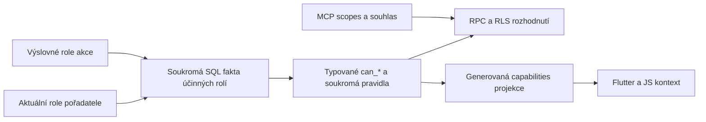

# Jedna autorita pro účinná práva pořadatele, akce a MCP

Datum: 2026-11-07
Stav: Architektura prověřena lokálním experimentem; celkový cutover není implementován ani nasazen.
Verification: standard
Výchozí main: `0a8e551ee0d862fa738492f2426aba46f595d4a8`.

## Výsledek a hranice

Změna role na pořadateli se projeví při příštím vstupu do existující akce.
Účinná práva se vždy odvodí ze současných členství. Návštěva akce nevytváří
trvalou kopii zděděných práv. Výslovně přidělená práva konkrétní akce mohou
zůstat nezávislá na roli pořadatele.

Tento plán pokrývá zdroj rolí, SQL predikáty a RLS, projekci capabilities,
obnovu kontextu, privátní synchronizaci a delegaci/error kontrakt MCP. Nemění
pravidla bank, tenantového administrátora, demo režimu ani obchodních příkazů.
Nezavádí obecný permission dispatcher, paralelní ACL engine, rozhodování práv
v klientovi, trvalé aplikační triggery ani další permission preflight RPC.

## Ověřený současný stav

| Vrstva | Kanonický vlastník | Zjištění |
|---|---|---|
| Identita a tenant | Supabase Auth, `user_info.organization`, skutečné vazby resource | Přihlášení ani existence OAuth tokenu samy nepovolují operaci. |
| Členství | `unit_users`, `occasion_users`, samostatně `organization_users` a bankovní členství | Podobně nazvané role na různých úrovních nejsou jedna univerzální hierarchie. |
| Doménové rozhodnutí | `database/functions/user_permissions/`, typované `can_*`, soukromá `operation_rules.sql` | Zde patří pravidla pro UI, MCP, RPC i RLS. Některá nyní čtou unit roli, jiná pouze uloženou occasion roli. |
| UI capabilities | `get_app_config_v218`, `context_capabilities.sql.in`, generátor SQL projekce | Jde o informativní snapshot stejných pravidel, ne autorizační důkaz pro zápis. |
| Klientský kontext | Flutter `RightsService`, JS `RightsService`, administration access | Flutter uměl ponechat dokončený snapshot stejné akce. JS už explicitní načtení opakuje. |
| Delegace MCP | `remote/config.mjs`, `remote/delegation.mjs`, `mcp-permissions.mjs` | Průnik registrace klienta, scopes tokenu, souhlasu, výběru resource a živých SQL práv. |
| Chyby | `errors.mjs`, `Operations.invoke`, MCP `toolResult` | Obecné `FORBIDDEN` neprokazuje jedinou konkrétní příčinu. Chybějící scope je jiná kategorie. |

### Reprodukce systémového problému

`automation/authorization/probe-membership-lifecycle.mjs` používá pouze
markerem ověřenou lokální databázi, skutečné SQL a fixture uvnitř rollbackované
transakce. Výstup neobsahuje identitu ani zákaznická data.
Naměřená data: [lifecycle-evidence.jsonl](permissions-2026-11-07/lifecycle-evidence.jsonl).

| Scénář | Formuláře | Novinky / objednávky | Význam |
|---|---|---|---|
| Existující běžný člen, povýšen na unit editora | povoleno | odmítnuto | Stejná unit role se vyhodnotí podle historie vstupu. |
| Existující běžný člen, povýšen na unit správce | nepovoleno bez editora | správa účastníků nepovolena | Unit správce se nepřepočítá na occasion správce. |
| První návštěva jako unit editor | povoleno | povoleno | Enrolment zapíše kopii rolí do `occasion_users`. |
| Odebrání unit editora po první návštěvě | stále povoleno | stále povoleno | Zkopírované occasion role přetrvají. |

Příčina je v `users/occasion_enrolment_internal.sql`: insert i opakované
ensure kopírují unit flags. `others/get_app_config.sql` ale tento owner volá
jen při chybějícím členství. Opakované volání ensure není řešení: současný
update by navíc přepsal i nezávisle přidělené occasion role. Obyčejný refresh
klienta tento rozdíl mezi SQL autoritami neopraví.

## Co je již připravené odděleně od celkového cutoveru

- Flutter explicitní vstup a administration re-entry znovu načítají stávající
  SQL kontext; souběžný kontextový dotaz se může sdílet. Stará capabilities se
  před načtením zneplatní. Test pokrývá povýšení i odebrání.
- MCP ponechává `FORBIDDEN` / `INSUFFICIENT_SCOPE`, přidává bezpečný postup
  řešení a permission denial neoznačuje za opakovatelný. Zpráva u form save
  uvádí ověření role, zvolené akce/formuláře a souhlasu, netvrdí nepotvrzenou
  jedinou příčinu a neparsuje text SQL chyby.
- Ověřeno moderním i legacy SDK přes HTTP/OAuth a skutečným lokálním SQL
  odmítnutím ukládání. Tato oprava nemění doménovou matici ani stará členství.

### Ověření analytického měření pořadatele

MCP tuto změnu podporuje: `festapp_units_settings_save` přijímá
`changes.settings.measurement_enabled: true`, původní `expectedVersion`
a `commandId`. Ověřeno i validací schématu běžícího produkčního serveru,
bez provedení produkční změny. Potřebné scopes jsou základní
`festapp:ticket-layouts:read`, `festapp:unit-settings:read` a
`festapp:unit-settings:write`. Skutečný účet musí být unit manager a
souhlas musí zahrnovat celý pořadatel; vybrané jednotlivé akce nestačí.
Tenantový a per-form measurement gate zůstávají samostatné.

Rozlišovat chybějící nástroj v aktuálním scope/profile, chybějící whole-unit
souhlas a odmítnutí rolí v SQL. Delegation owner nyní zná a vrací přesný
`ORGANIZER_CONSENT_REQUIRED` ještě před RPC; neodvozuje ho z SQL message.
Moderní i legacy HTTP/OAuth test pokrývá odmítnutí bez souhlasu (nula zápisů),
odmítnutí bez manager role a úspěšné předání `measurement_enabled`.
Backend pro tento wire test je simulovaný; skutečné SQL měření ověřuje
`configuration-postgres.test.mjs`. Nepřítomnost toolu v jednom připojení
není důkaz nepodporované funkce celého serveru.

Lokálně je také rozšířen stávající `context.inspect` o volitelné hledání
`query` a omezení `limit` (nejvýše 10 výsledků). `capabilitySearch` vrací
existující názvy/descriptions z téhož implementačního katalogu, požadované
scopes ze stejného registru a rozlišuje `serverSupported` od `toolEnabled`.
Popis enabled toolu respektuje aktuální datový profil. Není to nová permission
autorita ani příslib práva na konkrétní resource: výstup výslovně uvádí
`checked_when_action_runs`. Běžný dotaz bez `query` nemění dosavadní výstup.
Agent tak může odpovědět i na funkci, jejíž tool aktuální spojení neobsahuje.
Tyto pozdější změny zůstávají podle pokynu uživatele lokálně necommitnuté.

### Nezávislá chyba tlačítka Uložit

Celý `UnitSettingsScreen` byl ověřen kliknutím přes skutečný Flutter widget,
`DbUnits`, Supabase transport a zachycený HTTP request. `UnitCommands.save`
odesílal pouze Reply-To, tón a časové pásmo, takže zahazoval měřicí pole.
Nepovinný Reply-To navíc UI chybně vyžadovalo a zastavilo request ještě před
odesláním. Lokální oprava generuje povolená/nullovatelná pole ze společného
kontraktu, opravuje validaci a potvrzuje model i jeho verzi až po úspěchu.
Samostatný izolovaný root test `unit_settings_save_test.dart` pokrývá kliknutí,
prázdný Reply-To, vymazání kódu i odmítnutý zápis. HTTP backend je v tomto
widget testu simulovaný; nejde o provedený produkční zápis.

## Cílový model



1. Jediný soukromý SQL modul skládá účinné role z ověřených resource vazeb,
   explicitních práv akce a aktuálního unit členství. Veřejné typované `can_*`
   zůstávají interface doménové autorizace. Nezavádět `can(operation_string)`.
2. Projekce kontextu použije tatáž soukromá pravidla nad již načtenými řádky;
   nevolá samostatný resource dotaz pro každou capability. Výkonový baseline
   je součástí přijetí, nikoli důvod pro druhou implementaci pravidel.
3. Zděděné role se neukládají do `occasion_users`. Membership ensure spravuje
   účast/profil a existující receipts/sync, nikoli kopie autorizačního stavu.
4. Načtení UI, discovery MCP ani synchronizace samy neudělí práva. Skutečný
   příkaz a replay vždy znovu ověří aktuální role a skutečné resource vazby.
5. Povýšení ani odebrání unit role nevyžaduje změnu Supabase JWT claims.
   Existující MCP souhlas může oprávnění pouze omezit. Dříve neudělený scope
   vyžaduje nový výslovný souhlas, nikdy tiché rozšíření tokenu.

### Přesná pravidla dědění

Zachovat mapování, které nyní existuje při prvním enrolmentu, ale vyhodnocovat
je živě a bez kopie: unit editor přidává occasion editor a order editor;
unit viewer přidává occasion viewer a order viewer; unit správce přidává
occasion správce. Každý efekt se skládá OR s explicitním grantem dané akce.
Správce se tím nestává editorem, tenantový admin bankovním adminem a žádná
role neobchází výslovná bankovní pravidla. Ostatní role (approver,
receptionist, cleaning crew apod.) se bez samostatného požadavku nedědí.
Demo a tenant izolace zůstávají nad tímto skládáním.

### Historická data: nepřekročitelná migrační podmínka

Existující boolean neříká, zda ho zkopíroval enrolment, nebo ho správce akce
udělil úmyslně. Shoda s unit rolí ani datum vytvoření není důkaz původu.
Žádná plošná oprava nesmí tyto flags bez evidence přepsat či odebrat.

Nejdříve inventarizovat jednotlivé grants, jejich doložitelné receipt/audit
změny a původ. Nepodložené záznamy označit jako historicky nerozlišené;
nevymýšlet jim provenienci. Nové explicitní změny už původ zaznamenávají
v jednom writeru. U každého nerozlišeného grantu musí existovat potvrzené
ponechání jako samostatného explicitního grantu, nebo konkrétně schválené
odebrání. Do té doby zachovat existující přístup a vykazovat zbývající počet;
neprohlašovat úplné odstranění historického problému s revokací.

## Realizační vlny

### 1. Zachytit smlouvu a rozdíly

Přidat skutečné PostgreSQL regresní testy do operator/authorization testů:
existující a chybějící occasion členství, unit viewer/editor/manager odděleně,
povýšení, odebrání, explicitní occasion výjimka, cizí tenant/unit a demo.
Porovnávat účinné capability s rozhodnutím skutečného příkazu, nejen s UI.
Výchozí lifecycle probe musí před opravou ukázat dnešní nekonzistenci.

Výstup: schválená role matice výše a červené testy cílového chování.

### 2. Jedna implementace účinných role facts

Ve `database/functions/user_permissions/` zavést soukromý typovaný SQL owner
účinných rolí a čistou kompozici pro již ověřené kontextové řádky. Revidovat
gettery editor/viewer/manager a konkrétní operace v `domain_operations.sql`
a `feature_operations.sql`. Zahrnout explicitní actor variantu
`order_editor_membership_as_actor_internal`, optimalizované přímé role reads
jako `can_read_map_editor_bundle` a odpovídající RLS.

Vygenerovat `context_capabilities.sql` z `context_capabilities.sql.in`.
Nezměnit zvláštní pravidla tenant admina, bank, dema a technických service
actorů. Volající nesmí získat možnost poslat podvržená role facts.

Výstup: stejný výsledek ze SQL příkazu, RLS a UI capability, bez N+1 RPC.

### 3. Enrolment, explicitní grants a historická provenience

Odstranit kopírování pěti flags z `occasion_enrolment_internal.sql` při insertu
i update. Zachovat samostatné explicitní grants existujícího člena, profil,
účast, receipts a notification/sync vlastníky. Projít skutečné writery práv
v `users/save_occasion_user_for_edit.sql`, receipted person commands, importech
a odpovídajících released adaptérech; všechny explicitní změny musí mít
stejný writer/provenienci. Unit role writer nepřepisuje role každé akce.

Připravit forward schema/data migraci se samostatnou dry-run evidencí podle
historické podmínky výše. Neodvozovat oprávnění z migračního metadatového
štítku a nevytvářet trvalý kompatibilní copy trigger.

Výstup: nové návštěvy nemění účinná práva; explicitní změny jsou doložitelné;
historické nerozlišené grants mají vyřešený nebo přesně vykázaný stav.

### 4. Kontext a synchronizace

Ponechat aktuální opravu explicitního načítání v `RightsService` a
`RightsAdministrationAccess`. Prověřit návrat retained routy, focus/resume,
změnu identity a unit context proti stejnému generation/invalidation owneru.
`ClientSyncRuntime` výslovně vyžaduje další bootstrap pro změnu capabilities;
private profile fanout není automaticky důkaz obnovené SQL projekce.

Využít existující commit/access-change cestu z
`people/access_fanout.sql`, nikoli nový permission polling nebo cache.
Pokud má otevřená obrazovka reagovat bez navigace, předat access invalidation
stávajícímu context owneru, sdílet jeden refresh a nikdy neopakovat odmítnutý
zápis. Offline UI nemůže být autoritou pro nově získané právo.

Výstup: změna unit role se projeví při dalším vstupu; souběh/refocus nevrátí
starý kontext ani nevytvoří smyčku refreshů.

### 5. Typované důvody odmítnutí

Nynější bezpečná pomocná zpráva nesmí být prezentována jako přesná diagnostika
jediné příčiny `FORBIDDEN`. Pro přesný důvod musí být zdrojem místo skutečného
odmítnutí v SQL/delegaci. Zavést malý verzovaný transportní kontrakt pro
ověřený chybějící capability, omezení OAuth/consent a nedostupný resource.
Bez neověřeného prozrazení existence resource či rolí jiného uživatele.

SQL zachová standardní SQLSTATE; bezpečný machine-readable detail doplní
doménový owner při odmítnutí. MCP/JS/Dart ho pouze mapují, neparsují text
`message`. Nevolat druhý permission RPC po neúspěšné mutaci k hádání příčiny.
Retryable zůstává false pro permissions a true jen podle existujících
transportních/concurrency pravidel s původním command ID.

Výstup: klient odliší chybějící právo účtu od nutného nového souhlasu; starší
klient nadále obdrží platný standardní denial bez citlivých detailů.

### 6. Kontrakce a absence starých autorit

Inventarizovat přímé role reads pouze v autorizačních souborech a aktivních
callerech (`rg` je seznam kandidátů, ne důkaz symbolické shody). Nahradit
zbylé kopírování/alternativní permission výpočty. Explicitní membership data,
audience a UI editor přiřazení jsou jiné legitimní čtení; nesmí se slepě
přepsat na účinné role. Veřejné existující RPC zůstávají jen úzké adaptéry
ke kanonickému owneru, pokud je vyžadují vydaní klienti.

| Dnešní cesta | Cílový stav | Důkaz |
|---|---|---|
| Role copy při enrolmentu | odstraněno | žádný zápis zděděných flags, lifecycle test |
| Occasion-only rozhodnutí ignorující unit dědění | společná role facts | matrix SQL/RLS/capabilities |
| Již načtená práva jako autorita při re-entry | odstraněno v připravené opravě | test promotion/revocation, navigation CI |
| Generické FORBIDDEN vydávané za jedinou příčinu | jen bezpečná pomoc nebo ověřený typed reason | wire test, foreign-resource test |
| Historické grants bez jistého původu | samostatně vypořádaná evidence | nulový nerozhodnutý počet pro scope označený dokončený |

## Ověření a provoz

Používat jedinou vlastní lokální markerovanou DB a `--concurrency=1` pro
Flutter. Reprodukční příkaz (URL musí odpovídat ověřenému lokálnímu projektu):

```sh
FESTAPP_MCP_TEST_DATABASE_URL="$TASK_DATABASE_URL" \
FESTAPP_LOCAL_DB_PORT="$TASK_DATABASE_PORT" \
FESTAPP_LOCAL_DB_PROJECT_ID="$TASK_DATABASE_PROJECT" \
node automation/authorization/probe-membership-lifecycle.mjs
```

Cíleně spustit skutečné forms/role PostgreSQL testy, authorization parity a
benchmark z `automation/authorization/README.md`, moderní i legacy HTTP MCP
a real Auth/Edge pilot s explicitním consentem. Serverem odmítnutá změna
nesmí změnit stav ani zopakovat zápis. Před publikací použít dotčené kanonické
CI lanes; před produkcí všechny předepsané exact-main release gates.

Produkční schema/data aplikace a MCP/web rollout jsou samostatné kroky po
review a explicitním tenant/scope ověření. Nespouštět fixture v produkci.
Rollback nesmí znovu zapnout copy writer vedle nové autority ani obnovit stará
práva bez jejich evidence; před cutoverem připravit kompatibilní pořadí verzí
a konkrétní rollback schématu i změněných grants.

## Stav a rozhodnutí před dokončením

- **Fakt:** role lifecycle nekonzistence byla reprodukována na skutečném SQL.
- **Rozhodnutí návrhu:** živé dědění podle současného first-enrolment mapování,
  zachování explicitních práv a zvláštních doménových pravidel.
- **Materiální neznámá:** rozsah produkčních historických copy grants nebyl
  inventarizován; lokální experiment neprokazuje konkrétní příčinu selhání
  účtu reportéra `bujnovskyf`.
- **Migrační brána:** bez vyřešení nerozlišených grants nelze poctivě tvrdit
  úplnou opravu historické revokace. Žádné z nich zde nebylo změněno.
- **Publikační brána:** `main` má povinnou jednu schvalující review. Tento
  plán ani lokální testy ji nenahrazují.

Za dokončený celý cutover lze označit až jednotné živé rozhodování,
odstraněné kopírování, vypořádaná historická data, otestované klientské a MCP
cesty a samostatně doložený produkční rollout. Současná menší oprava tyto
podmínky sama nesplňuje.
