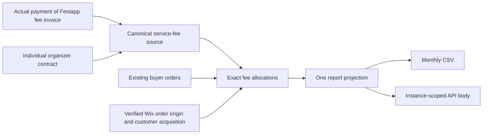

# Billing boundary

The widget has no independent subscription price. The owner's intended service
fee is a configured percentage of ticket value. Its rate and recognition policy
must come from the actual organizer agreement, never a Wix listing default.
See [the decision brief](DECISION.md) for the commercial calculation, concrete
payment evidence and persisted Custom-plan setup.

## Owners

| Data or behavior | Owner |
| --- | --- |
| Ticket prices, orders, bank/Stripe receipts, refunds | Existing Festapp SQL/payment boundaries |
| Organizer service-fee rate, invoice/settlement and recognition | Canonical `public.service_fee_*` source and service-only import RPCs; external accounting connection and real facts still required |
| Proof of Wix installation and approved attribution to a service-fee receipt | Verified checkout context and canonical order SQL; implemented locally, not deployed. Customer-acquisition evidence must additionally come from the fee source |
| Approved commercial conditions | `approval.mjs`, shared by submission and report preparation |
| One USD projection for CSV and API | `../reporting/prepare.mjs` |
| Actual external event delivery and outcome reconciliation | Server dispatcher and fenced SQL journal; implemented locally, disabled and not deployed |

`payment_financial_totals_internal()` already projects bank, Stripe and manual
ticket payment facts. Those are organizer payment facts, not proof of our service
income. The Stripe provider's rejection of application fees and transfers remains
intact. Do not modify it just to make Wix reporting possible.

The diagram is the target flow. Verified order provenance, approval validation
and report preparation are implemented and tested locally. The authoritative
settlement source/export and event dispatcher are implemented locally. They have
no real fee records and are not deployed or activated. No real service fees are created, and ticket receipts remain organizer funds.

Erel's written clarification confirms service-fee-only reporting and excludes
pre-existing non-Wix customers. The addendum is still unsigned while suitable
sole-trader wording is pending. Monthly reporting within 15 days and quarterly
settlement of sub-USD-500 balances are separate requirements.
See `../BILLING-APPROVAL.md`, [checkout provenance](CHECKOUT-ORIGIN.md), and the
commercial clarification receipt.

The platform-wide source belongs to [service fees](../../../docs/architecture/service-fees.md).
Wix delivery and recovery follow [DELIVERY.md](DELIVERY.md).
