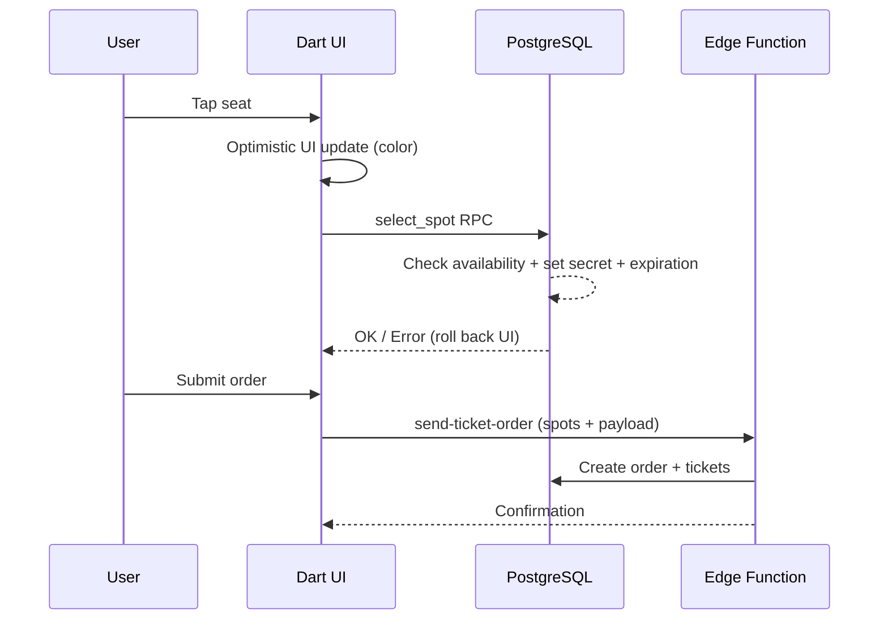

# Blueprint (Visual Seat Selection)

Visual seat selection/reservation interface for the Eshop.

The reusable viewer, customer picker and venue editor are provided by the public
[`venue_seat_picker`](https://github.com/festappnet/venue_seat_picker) package.
Festapp maps `BlueprintObjectModel` through a read-only `SeatAdapter`; SQL
reservation authority and product/order behavior remain in this feature.

## Package guides and examples

Festapp's current Flutter reservation and administration hosts consume the
`VenueSeatPicker` / `VenueSeatViewer(editorMode: true)` grid API through
`blueprintSeatAdapter`. The package also provides an object-based editor using
`VenueLayoutDocument`, `VenueLayoutController`, `VenueLayoutEditor`, `VenueLayoutViewer` and
`VenueLayoutPicker`. The package's older `VenueSeat*` grid model is a separate
contract; do not parse the two JSON formats interchangeably.

- [Object API setup](https://github.com/festappnet/venue_seat_picker/blob/main/doc/getting-started.md)
- [Editable templates and reusable furniture](https://github.com/festappnet/venue_seat_picker/blob/main/doc/templates.md)
- [Minimal editor/viewer/picker example](https://github.com/festappnet/venue_seat_picker/blob/main/example/lib/minimal.dart)
- [Full studio and portable demo](https://github.com/festappnet/venue_seat_picker/blob/main/example/README.md)

These links describe the package's main source; Festapp resolves the revision
pinned in `pubspec.yaml` (or a local development override). Updating package
guides does not advance that pin or release a production client. Template
creation allocates new seat identities; load the saved document when editing
an existing Blueprint with reservations. Products, prices, seat protection,
permissions and persistence remain Festapp responsibilities.

The prepared object package owns camera bounds in `venue_layout_core` through
`boundLayoutAxis` / `boundLayoutViewport`. Its Flutter grid/object viewers and
JavaScript kernel use that same calculation. Festapp should configure and host
these surfaces without implementing a second centering rule. See the package's
[viewer parity contract](https://github.com/festappnet/venue_seat_picker/blob/main/doc/viewer-parity.md).
This applies when consuming the prepared package revision; production activation
is a separate release.

The local development package adds a uniform 8 logical pixel completed-tap
radius, with exact targets before nearest outlines. Touch drags on empty object
editor space pan; mouse drags retain marquee selection. Grid slot handlers and
object picker handlers retain availability, pending state and rollback. This is
verified with the existing path override; publication, matching git pins for
both packages, an override-free build and deployment remain pending. See the
[local implementation plan](../../../docs/plans/blueprint-touch-plan-2026-10-24.md).

## Mobile editor navigation

The phone layout keeps its plan mounted while switching between Plan, Tools and
Groups. The canvas owns touch dragging and pinch zoom; there is no surrounding
horizontal drag recognizer. Dimension controls wrap at narrow widths, and visible
zoom/Fit controls use the viewer controller's camera and scale limits.

## Split Brain: Dart UI vs SQL Authority (CRITICAL)

Selection state is managed optimistically in Dart but authoritatively in SQL.

- Dart updates UI color immediately on tap.
- `select_spot` RPC does the real work:
  1. Validates Blueprint/Form exists
  2. Checks availability (`order_product_ticket IS NULL`)
  3. On select: sets `secret` + `secret_expiration_time` (temporary lock)
  4. On deselect: verifies secret matches before clearing

**If RPC fails (spot taken by another user), UI must roll back** -- handled by
the package `VenueSeatPicker` around Festapp's `select_spot` callback.

## Gotchas

- **SVG Coordinates**: Do not change `BlueprintModel` parsing without verifying the SVG export format. Coordinate mapping is fragile.
- **Spot -> Product linking**: `BlueprintModel.findObject` locates objects by ID; complex logic links seat coordinates to Product IDs.

## Data Flow

## SQL RPCs

- `select_spot` -- locks/unlocks seat with secret and expiration
- `create_ticket_order_client_sync_v1` -- receipted order creation via `send-ticket-order`
- `replace_blueprint_order_client_sync_v1` -- atomic seat/order replacement via the same Edge boundary

Replacement still calls `confirm_blueprint_order_change_internal_v1` inside its
transaction. The original SQL source is retained for that implementation and
historical schema reconstruction; lack of direct frontend calls does not make
the domain logic obsolete.
