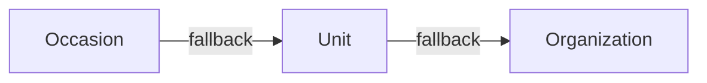

# Email Templates

## 3-Level Inheritance (CRITICAL)

Most specific wins. This applies to both template content AND banners/wrappers.

## Split Brain: Content vs Design

- **Content** (subject, body): `email_templates` table
- **Design** (banner, layout): `email_wrappers` table with `{{content}}` placeholder

Banner upload auto-regenerates wrapper HTML via `update_entity_email_banner` RPC.

## Sending Emails

`send-custom-email` validates the editor, resolves content through
`get_email_template_and_wrapper`, substitutes `{{var}}` values, encrypts the
rendered snapshot and enqueues it in `public.email_messages`. Its
`enqueueAndAwaitEmail` adapter waits for canonical provider acceptance.

Only `process-email-queue` sends through SES after the global SQL quota/rate/pause
and fenced-send gates. Diagnose rendering/authorization at the producer, queue
state and worker wakeups at the canonical queue, and delivery/bounce/complaint
receipts at `email-provider-events`. An accepted or compatibility `sent` response
does not prove mailbox delivery. See
[the SES queue guide](../../../docs/setup/aws_ses.md).

## SQL RPCs

- `get_entity_email_templates` -- fetches templates with inheritance resolution
- `update_email_template` -- persists single template changes
- `update_entity_email_banner` -- updates banner + regenerates wrapper HTML
- `get_email_template_and_wrapper` -- resolves template + wrapper for sending

## Waitlist messages

`waitlist_confirmation` and `waitlist_offer` use this same inherited resolver,
wrapper and editor. SQL creates their intents atomically with registration or
offer slots in `public.email_messages`. The producer encrypts the capability
source; the queue renderer resolves the committed order symbol and trusted
organization `DEFAULT_URL`. Raw tokens never enter order data, Client Sync,
delivery status or history. Links carry them in URL fragments, with tracking
disabled and referrer/cache protection.

Confirmation has no payment information. Offer templates explain that products
are chosen according to availability during explicit acceptance. Their renderer
uses current pending places; the existing send gate invalidates a cached snapshot
after partial acceptance and sends only after re-rendering. Expired or cancelled
offers fail the canonical intent-validity gate before any provider call.
An editor preview resolves the same template/wrapper without issuing tokens or
creating offers. Acceptance uses the ordinary order confirmation/ticket flow.

## Stable order overview link

The first confirmation includes a read-only overview link. All subsequent order
emails, including payment, update, reminder, cancellation and ticket delivery,
reuse the root order's encrypted source and token. Split orders share that root
link. Rendering does not rotate revoked/expired capabilities. Formless orders
have no public form route and omit the link.

There is no standalone `ORDER_OVERVIEW` email. Its historical rows remain for
history, but the template catalog excludes the code, its enqueue RPC is retired,
and the send-time intent gate rejects old queued messages. The access endpoint
never sends mail or rotates the link. Existing templates can position
`order_overview_button` themselves; otherwise rendering appends it once.
