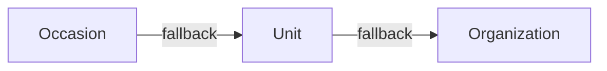

# Email Templates

## 3-Level Inheritance (CRITICAL)

Most specific wins. This applies to both template content AND banners/wrappers.

## Split Brain: Content vs Design

- **Content** (subject, body): `email_templates` table
- **Design** (banner, layout): `email_wrappers` table with `{{content}}` placeholder

Banner upload auto-regenerates wrapper HTML via `update_entity_email_banner` RPC.

## Editor visibility

`get_all_email_templates` explicitly lists editor-supported codes. Order templates
are always eligible; waitlist templates additionally require an enabled waitlist
on a capacity-limited form in the requested scope. App/account templates require
organization `IS_APP_SUPPORTED=true`. The standalone `ORDER_OVERVIEW` template,
internal team messages and unknown codes stay hidden. Adding a stored template
alone never enables it. Sender resolution and stored content are unchanged.

## Sending Emails

`send-custom-email` validates the editor, resolves content through
`get_email_template_and_wrapper`, substitutes `{{var}}` values, encrypts the
rendered snapshot and enqueues it in `public.email_messages`. Its
`enqueueAndAwaitEmail` adapter waits for canonical provider acceptance.

Only `process-email-queue` sends through SES after the global SQL quota/rate/pause
and fenced-send gates. Diagnose rendering/authorization at the producer, queue
state and worker wakeups at the canonical queue, and delivery/bounce/complaint
receipts at `email-provider-events`. An accepted or compatibility `sent` response
does not prove mailbox delivery. See
[the SES queue guide](../../../docs/setup/aws_ses.md).

## SQL RPCs

- `get_entity_email_templates` -- fetches templates with inheritance resolution
- `update_email_template` -- persists single template changes
- `update_entity_email_banner` -- updates banner + regenerates wrapper HTML
- `get_email_template_and_wrapper` -- resolves template + wrapper for sending

## Waitlist messages

`waitlist_confirmation` and `waitlist_offer` use this same inherited resolver,
wrapper and editor. SQL creates their intents atomically with registration or
offer slots in `public.email_messages`. The producer encrypts the capability
source; the queue renderer resolves the committed order symbol and trusted
organization `DEFAULT_URL`. Raw tokens never enter order data, Client Sync,
delivery status or history. Links carry them in URL fragments, with tracking
disabled and referrer/cache protection.

Confirmation has no payment information. Offer templates explain that products
are chosen according to availability during explicit acceptance. Their renderer
uses current pending places; the existing send gate invalidates a cached snapshot
after partial acceptance and sends only after re-rendering. Expired or cancelled
offers fail the canonical intent-validity gate before any provider call.
An editor preview resolves the same template/wrapper without issuing tokens or
creating offers. Acceptance uses the ordinary order confirmation/ticket flow.

## Ticket delivery block

`TICKET_ORDER_PAYMENT_DONE` supports one reserved `{{tickets}}` block in its
HTML content. The queue renderer supplies simple CID PNGs for `inline_qr` and
`both`; PDF mode and payment notices leave it empty. An older inherited template
without the block receives it at the end of its content, before the inherited
wrapper. Duplicate blocks are rejected on save and rendered only once defensively.
The ordinary template text owns all event, product and seating information.
Payment notices and ticket messages share their payment-content substitutions,
while order confirmation retains its own content. The ticket editor loads the
inherited template through the authorized preview-context RPC once, then displays
local sample substitutions through the same `HtmlView` as the template editor.
Changing sample count or delivery mode updates invalid sample QR widgets and the
PDF attachment list locally; it does not invoke an Edge Function or generate PDFs.
The samples describe the template and delivery structure, not a real order.

Inline PNG disposition and CID metadata survive the encrypted prepared snapshot
and reach SES unchanged. Legacy snapshots without metadata remain PDF attachments.
A retry reuses that snapshot; changing the event affects only later preparations
or an explicit new resend. No QR URL, additional ticket identity or send path is
introduced. Real Gmail, Outlook, Seznam and Apple Mail delivery checks remain a
separate release gate requiring approved test mailboxes.
