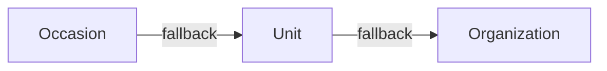

# Email Templates

## 3-Level Inheritance (CRITICAL)



Most specific wins. This applies to both template content AND banners/wrappers.

## Split Brain: Content vs Design

- **Content** (subject, body): `email_templates` table
- **Design** (banner, layout): `email_wrappers` table with `{{content}}` placeholder

Banner upload auto-regenerates wrapper HTML via `update_entity_email_banner` RPC.

## Sending Emails

`send-custom-email` validates the editor, resolves content through
`get_email_template_and_wrapper`, substitutes `{{var}}` values, encrypts the
rendered snapshot and enqueues it in `public.email_messages`. Its
`enqueueAndAwaitEmail` adapter waits for canonical provider acceptance.

Only `process-email-queue` sends through SES after the global SQL quota/rate/pause
and fenced-send gates. Diagnose rendering/authorization at the producer, queue
state and worker wakeups at the canonical queue, and delivery/bounce/complaint
receipts at `email-provider-events`. An accepted or compatibility `sent` response
does not prove mailbox delivery. See
[the SES queue guide](../../../docs/setup/aws_ses.md).

## SQL RPCs

- `get_entity_email_templates` -- fetches templates with inheritance resolution
- `update_email_template` -- persists single template changes
- `update_entity_email_banner` -- updates banner + regenerates wrapper HTML
- `get_email_template_and_wrapper` -- resolves template + wrapper for sending

## Waitlist messages

`waitlist_confirmation` and `waitlist_offer` use this same inherited resolver,
wrapper and editor. SQL creates their intents atomically with registration or
offer slots in `public.email_messages`. The producer encrypts the capability
source; the queue renderer resolves the committed order symbol and trusted
organization `DEFAULT_URL`. Raw tokens never enter order data, Client Sync,
delivery status or history. Links carry them in URL fragments, with tracking
disabled and referrer/cache protection.

Confirmation has no payment information. Offer templates explain that products
are chosen according to availability during explicit acceptance. Their renderer
uses current pending places; the existing send gate invalidates a cached snapshot
after partial acceptance and sends only after re-rendering. Expired or cancelled
offers fail the canonical intent-validity gate before any provider call.
An editor preview resolves the same template/wrapper without issuing tokens or
creating offers. Acceptance uses the ordinary order confirmation/ticket flow.

## Stable order overview link

The first confirmation includes a read-only overview link. All subsequent order
emails, including payment, update, reminder, cancellation and ticket delivery,
reuse the root order's encrypted source and token. Split orders share that root
link. Rendering does not rotate revoked/expired capabilities. Formless orders
have no public form route and omit the link.

There is no standalone `ORDER_OVERVIEW` email. Its historical rows remain for
history, but the template catalog excludes the code, its enqueue RPC is retired,
and the send-time intent gate rejects old queued messages. The access endpoint
never sends mail or rotates the link. Existing templates can position
`order_overview_button` themselves; otherwise rendering appends it once.

## Authoring and generated examples

Email authoring uses native Super Editor action-tag composition and atomic
placeholder objects. The editor serializes them only as existing `{{code}}`
substitutions. Preview data and editor metadata never enter the saved HTML.
The portable rules and preview composer live in `festapp_core/email_templates.dart`;
localized authoring labels remain in the Flutter adapter. Required overview actions
are also shown as read-only generated content inside the editor. They follow
the same wrapper/body deduplication as delivery and never enter the saved draft.

Payment-state presentation is owned by `_shared/orderEmailPresentation.ts`, used
by both actual order email producers and the preview generator. Synthetic
scenarios select payment facts, not separate wording or payment-state branches.
A zero-price scenario uses the canonical zero-order explanation. Authored fixed
text is preserved verbatim; templates that need conditional payment instructions
should use `balanceReasoning` (Stav platby). The confirmation `amount` is the full
order total even when a deposit is requested; payment-received `amount` is the
received amount.

Preview HTML is generated from production pure renderers, using synthetic inputs
in `automation/fixtures/email_preview/order.json`. Regenerate from the repository
root with:

```sh
deno run --frozen --lock=supabase/functions/deno.lock --allow-read --allow-write=assets/email_templates automation/generate_email_preview_examples.ts
```

Use the same command with `--check` and without `--allow-write` to check freshness.
`automation/test_all.sh` runs that check once with Edge Function validation.
The versioned asset records a deterministic source digest, not a generation time.
The small scenario matrix uses actual email languages (cs/en orders and cs waitlist)
and relevant producer scenarios. Order amounts, product groups and payment text
come from one fixture. No remote preview endpoint, runtime JS, live QR or customer
data is used. Payment examples include a deliberately nonpayable model IBAN,
passed through the same formatter and payment renderer as delivery.

The received-message preview loads the actual inherited wrapper and runtime
sender address through the read-only `authoringContext` action of the existing
`send-custom-email` function. The caller's JWT must first pass the existing
`get_entity_email_templates` catalog permission gate; wrapper resolution uses
only the returned hierarchy. This action cannot enqueue mail, read orders or
issue capabilities. Metadata failures keep the draft and offer retry rather
than presenting an invented sender or claiming an unwrapped body is complete.
Deploy this backward-compatible function action before the web client.

Preview composition follows delivery order: substitute authored content once,
apply the resolved wrapper once, then complete required overview links. Email
content uses its own typography rather than the application's font, and empty
fixed-height spacers retain their canonical height. The current app theme only
adapts presentation colors. The resolved wrapper's banners load through the
existing canonical image delivery path, including inherited banners. Only
exact wrapper image sources on approved canonical asset hosts opt into this;
other remote images, tracking pixels and CID attachments remain inert
placeholders. Flutter and individual mail clients may differ in unsupported
CSS or available fonts.

Production action HTML belongs to `_shared/emailActionLink.ts`; completion belongs
to `_shared/emailContentCompletion.ts`, including the current order-card slot.
TS and Dart completion use identical generated fixtures to prevent missing or
duplicate required overview links. There is no standalone ORDER_OVERVIEW template.
