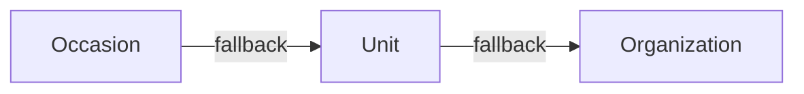

# Email Templates

## 3-Level Inheritance (CRITICAL)

Most specific wins. This applies to both template content AND banners/wrappers.

## Split Brain: Content vs Design

- **Content** (subject, body): `email_templates` table
- **Design** (banner, layout): `email_wrappers` table with `{{content}}` placeholder

Banner upload auto-regenerates wrapper HTML via `update_entity_email_banner` RPC.

## Sending Emails

`send-custom-email` validates the editor, resolves content through
`get_email_template_and_wrapper`, substitutes `{{var}}` values, encrypts the
rendered snapshot and enqueues it in `public.email_messages`. Its
`enqueueAndAwaitEmail` adapter waits for canonical provider acceptance.

Only `process-email-queue` sends through SES after the global SQL quota/rate/pause
and fenced-send gates. Diagnose rendering/authorization at the producer, queue
state and worker wakeups at the canonical queue, and delivery/bounce/complaint
receipts at `email-provider-events`. An accepted or compatibility `sent` response
does not prove mailbox delivery. See
[the SES queue guide](../../../docs/setup/aws_ses.md).

## SQL RPCs

- `get_entity_email_templates` -- fetches templates with inheritance resolution
- `update_email_template` -- persists single template changes
- `update_entity_email_banner` -- updates banner + regenerates wrapper HTML
- `get_email_template_and_wrapper` -- resolves template + wrapper for sending
