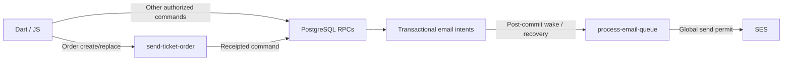

# Eshop (Orders, Tickets, Payments)

## Split Brain: Dart Reads, SQL Writes (CRITICAL)

Dart is a thin RPC wrapper. ALL write logic lives in SQL. Do NOT replicate multi-step logic in Dart -- causes race conditions.

## Atomic order creation and replacement

`send-ticket-order` routes new orders to `create_ticket_order_client_sync_v1`
and authenticated seat replacements to `replace_blueprint_order_client_sync_v1`.
Each operation carries a command ID and uses the receipted SQL boundary for
atomic validation, order/ticket changes and transactional effect intents.
`confirm_blueprint_order_change` is retained as the source of the internal
`confirm_blueprint_order_change_internal_v1` preparation logic still used by
replacement. The public facade is not this client transport. Do not use it to split
replacement into client-side cancellation and creation.

The HTTP response confirms the committed order and reports `delivery: queued`
with an optional confirmation receipt. Email acceptance and later provider
feedback are separate facts.

## Gotchas

- **Stringly Typed**: `OrderModel` fields mapped from `Tb` class strings. Renames break silently.
- **3-Layer Architecture**:

- **Storno RPC**: `update_order_and_tickets_to_storno_ws_221` -- the `_ws_221` suffix is not a typo

## SQL RPCs

- `select_spot` -- temporary spot lock with secret + expiration
- `create_ticket_order_client_sync_v1` -- receipted atomic order creation
- `replace_blueprint_order_client_sync_v1` -- receipted atomic seat replacement
- `update_order_and_tickets_to_paid_ws` -- marks order + tickets paid
- `update_order_and_tickets_to_storno_ws_221` -- cancels order + tickets
- `scan_ticket` -- validates + processes ticket scanning (enforces entrance limits)
- `get_report_ws` -- financial report for an occasion

## Occasion report snapshot

`public.get_report_ws(occasion_link text)` is the only report RPC. It checks the
caller's organization and order-view permission, then returns `{code: 200,
data: string, report: {...}}`. `report.schema_version` is 1; it contains occasion
ID/title, UTC snapshot time, spots, order/ticket state counts, money per currency,
confirmed products by ID, and warnings. IDs and numeric money are strings.
`data` is formatted from that same object for older clients. The Flutter text
view and UTF-8 TXT export share a localized formatter of `report`, using the
same translation keys as the graphical view.
The private invoker formatter has no table reads or client execution grants.

Payments are deduplicated before aggregation. Cross-occasion payment sharing or
order/payment currency mismatch returns 409 without a report. Missing access
returns 403; unexpected errors return a safe 500. No SQL details are exposed.
Anonymous execution is revoked. The old bigint helper and unused form-link
report wrappers are removed by the forward migration without CASCADE.

ReportTab keeps one snapshot per occasion/user/organization, ignores stale
responses, and refreshes only on explicit request or context change. Text and
export reuse the snapshot. Financial values describe current prices and stored
payment totals, including refunds; paid orders can have paid only a deposit.
Mobile products use a list; explanations work by tap and keyboard.

### Scheduled product prices

The Products grid reads the complete unapplied timeline from the authorized
`get_products_and_types_for_edit` bundle. `save_product_price_change` and
`cancel_product_price_change` are the only editor write boundaries. Each plan
has its own revision and absolute target price. Applied plans are excluded
from this UI; failed plans remain available for explicit repair or cancellation.

`apply_planned_changes()` keeps the existing Client Sync v1 entrypoint and cron.
It serializes workers, locks product before plan, processes due plans by time/id,
and rolls back an individual price if its sync commit fails. New checkout orders
read the actual server price; existing order/payment snapshots stay fixed.

Products refresh on tab return, application resume and each minute while a plan
is due. Shared administration grids also refresh on tab return, preserving drafts,
filters, sorting, scroll and user column widths. An in-flight refresh rechecks
drafts before replacing rows. Report refreshes on return as a read-only snapshot.

### Seat product availability in price waves

The edit bundle reports `is_used_in_blueprint` from actual spot assignments.
Price waves keep price editing available for assigned products, but do not offer
new visibility changes while seat selection cannot represent that availability.
Missing usage metadata follows the same UI restriction until the bundle reloads.
The save RPC enforces this restriction against current assignments. An existing
visibility target is preserved on a price-only save; only explicit cancellation
removes it. This guard does not change current visibility or existing schedules.

## Waitlist identity and acceptance

`state='waitlisted'` is an existing order identity with NULL price/payment_info
and no sale product or inventory allocation. Its waiting tickets have no valid
admission symbol. Offer slots refer directly to `eshop.tickets.id`; offer status
is derived from those slots. There is no person ledger. Use SQL `isActive`/`allowedActions` for
order UI; waitlisting does not authorize ordinary paid, send or cancel actions.

Full acceptance preserves order ID, symbol and sequence. Partial acceptance
moves the same ticket IDs into a new regular order linked by
`source_waitlist_order_id`; every separate partial confirmation has its own
order. Both regular creation and acceptance use the same private finalizer.
SQL owns form/product/pool locking, allocations, history, command receipts,
Client Sync changes and email intents in one transaction.

Fakturoid acceptance journals its selected tickets/slots while preparation is
pending. Complete and abort use that journal; a failed prepare restores only
that attempt, including still-valid offer slots, without overwriting the rest
of a group. Actual user cancellation never returns an valid ticket to the
waitlist. Waitlisted tickets are excluded from admissions/revenues.

## Local payment-reference reservations

Festapp owns reference issuance independently of BankSync ingestion. Activated
scopes use the private SQL registry in `eshop_payment_references/` in the existing
order transaction. Account aliases share canonical receiving identity; committed
symbols and form watermarks survive order deletion. Enrollment freezes receiving
identity and starts locked. See the [scope/import/activation runbook](../../../docs/operations/banksync/FESTAPP-PAYMENT-REFERENCES-2026-10-18.md).

## Pregenerated tickets and cash sales

[Design and verification evidence](../../../docs/plans/pregenerated-manual-ticket-sales-plan-2026-10-23.md). Production rollout is separate.

`eshop_ticket_batches/` owns the stock aggregate. A batch has one technical
`stock` order and the existing tickets/OPT/seat/resource identities. Stock
occupies form and product capacity, has no receivable/payment, and cannot be
admitted. Ordinary order mutations reject it. Active printed tickets retain
immutable products and physical allocations after sale as well as before it.

`materialize_ticket_products_internal_v1` is the shared checkout/batch product
writer. Identity allocation stays with each caller; waitlist acceptance reuses
its existing ticket IDs. A batch sale never calls that writer or inventory
allocation. It moves every selected OPT row to one new order, pairs one exact
manual CASH transaction through the existing payment authority, and commits
both histories and the Client Sync receipt together. Editor and unit-manager
rights are checked again on replay. `TicketBatchCommands` uses durable intents
and retries serialization conflicts with the same command ID.

The batch snapshot freezes commercial data, renderer inputs and catalog. The
`prepare-ticket-batch-document` Edge adapter seals one private resource manifest
before rendering bounded single/print parts. SQL leases fence completion;
immutable Storage keys and digest readback recover upload/commit interruption.
`download-ticket` and explicit email delivery use the completed individual PDF,
including after sale or catalog/layout changes. Complete-batch downloads offer
one A4 PDF with multiple ticket areas per sheet, or one ZIP containing each
original individual PDF byte for byte. Packing crops only the frozen template's
ticket area, preserves physical size where it fits, and chooses portrait or
landscape A4 by capacity (18 pt margins, 12 pt gaps). Oversized areas fit one
sheet with proportional scaling. Export is a read through the authorized,
budgeted `get_ticket_batch_export_manifest`; it neither renders from live data
nor modifies stored documents, tickets or readiness. The whole export remains
bounded by the document byte policy and the batch maximum of 200 tickets.
Rendering failure reserves
capacity until a deliberate void; retry never creates another batch.

Contact and ticket delivery are separate choices. Batch-origin orders import
no participants automatically. Fakturoid units and required personal ticket
fields are outside the first version. Public checkout and buyer hold limits
stay unchanged; Blueprint batch holds are acquired atomically by the authorized
batch command. Existing occasion deletion rejects occasions with any orders,
including batch audit, so this feature does not introduce a teardown bypass.

The UI is under Orders / Pregenerated with routed batch details. It is hidden
unless the enabled `ticket` feature explicitly sets `pregenerated_tickets: true`
(default false), including the batch action in Blueprint. This UI flag does not
replace the existing server permission checks. Stock remains
in the complete `get_orders` bundle for the common Tickets list and is excluded
only from the ordinary order-list scope. Reports distinguish stock from sales;
capacity continues using the existing relational graph.
