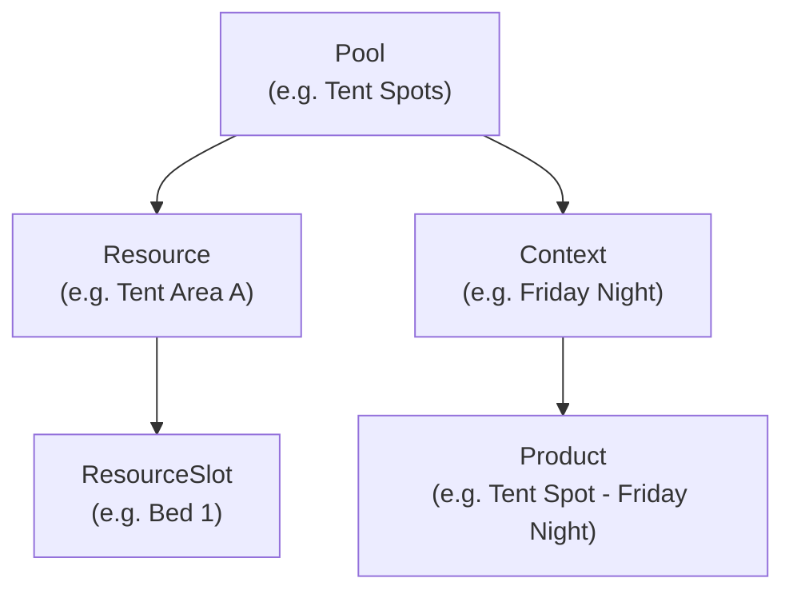

# Inventory (Capacity & Stock Management)

## Concept Hierarchy (Non-Obvious)

Products link to **Contexts**, NOT directly to Pools.

This indirection allows one pool to serve multiple products/time-slots.

## Bundle Pattern

Entire inventory state fetched AND saved in one SQL call. Do NOT add separate Dart fetches -- extend `get_inventory_pool_bundle` SQL instead.

`DbInventoryPools.updateInventoryPoolBundle` selects
`save_inventory_pool_client_sync_v1` when v1 is active. It submits the bundle
with its expected aggregate version, applies command replacements and returns
the saved authoritative bundle. The retained legacy adapter uses
`update_inventory_pool_bundle`; both own the complete save transaction.

Resource save/delete and pool deletion also use typed v1 commands when selected.
Spot assignments go through `update_spot_assignments_client_sync_v1`; the old
`update_spot_assignments` RPC is the legacy adapter. Do not implement separate
client table writes or treat a stale expected version as a successful save.

## SQL RPCs

- `get_inventory_pool_bundle` -- complete pool with resources, slots, contexts, products
- `get_inventory_pools_by_occasion_link` -- lists all pools for an occasion
- `save_inventory_pool_client_sync_v1` -- versioned pool bundle save
- `update_inventory_pool_bundle` -- retained legacy pool bundle save
- `get_spot_management_bundle` -- spots with related data for admin assignment
- `update_spot_assignments_client_sync_v1` -- receipted spot assignment batch
- `update_spot_assignments` -- retained legacy assignment batch
- `get_user_inventory` -- current user's accommodation/resource assignments
